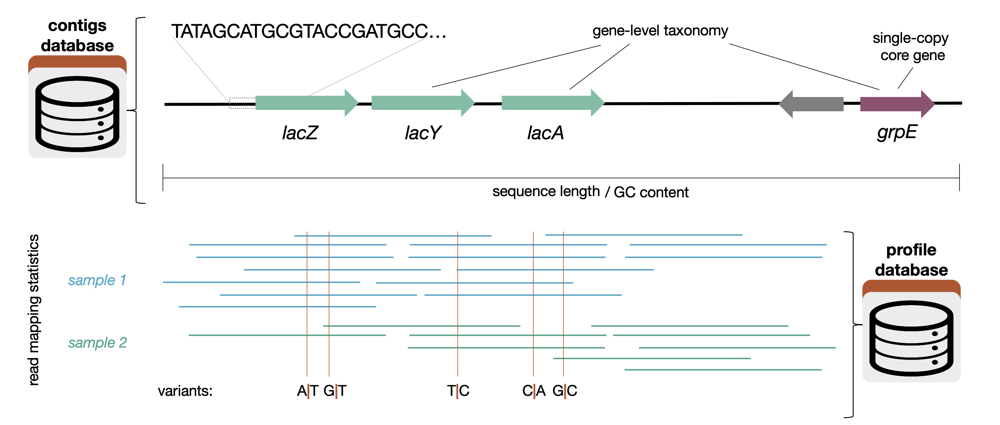



A DB-type anvi'o artifact. This artifact is typically generated, used, and/or exported **by anvi'o** (and not provided by the user)..

🔙 **[To the main page](../../)** of anvi'o programs and artifacts.

## Provided by

[anvi-merge](../../programs/anvi-merge)

## Can be provided by

[anvi-display-codon-frequencies](../../programs/anvi-display-codon-frequencies)

## Required by

[anvi-cluster-contigs](../../programs/anvi-cluster-contigs) [anvi-delete-collection](../../programs/anvi-delete-collection) [anvi-delete-misc-data](../../programs/anvi-delete-misc-data) [anvi-delete-state](../../programs/anvi-delete-state) [anvi-export-collection](../../programs/anvi-export-collection) [anvi-export-gene-coverage-and-detection](../../programs/anvi-export-gene-coverage-and-detection) [anvi-export-items-order](../../programs/anvi-export-items-order) [anvi-export-misc-data](../../programs/anvi-export-misc-data) [anvi-export-splits-and-coverages](../../programs/anvi-export-splits-and-coverages) [anvi-export-state](../../programs/anvi-export-state) [anvi-gen-fixation-index-matrix](../../programs/anvi-gen-fixation-index-matrix) [anvi-gen-gene-consensus-sequences](../../programs/anvi-gen-gene-consensus-sequences) [anvi-gen-gene-level-stats-databases](../../programs/anvi-gen-gene-level-stats-databases) [anvi-gen-variability-profile](../../programs/anvi-gen-variability-profile) [anvi-get-split-coverages](../../programs/anvi-get-split-coverages) [anvi-import-items-order](../../programs/anvi-import-items-order) [anvi-import-metabolite-profile](../../programs/anvi-import-metabolite-profile) [anvi-import-misc-data](../../programs/anvi-import-misc-data) [anvi-import-protein-profile](../../programs/anvi-import-protein-profile) [anvi-import-state](../../programs/anvi-import-state) [anvi-inspect](../../programs/anvi-inspect) [anvi-interactive](../../programs/anvi-interactive) [anvi-merge-bins](../../programs/anvi-merge-bins) [anvi-refine](../../programs/anvi-refine) [anvi-rename-bins](../../programs/anvi-rename-bins) [anvi-show-collections-and-bins](../../programs/anvi-show-collections-and-bins) [anvi-show-misc-data](../../programs/anvi-show-misc-data) [anvi-split](../../programs/anvi-split) [anvi-summarize](../../programs/anvi-summarize) [anvi-script-add-default-collection](../../programs/anvi-script-add-default-collection) [anvi-script-gen-distribution-of-genes-in-a-bin](../../programs/anvi-script-gen-distribution-of-genes-in-a-bin)

## Can be used by

[anvi-db-info](../../programs/anvi-db-info) [anvi-display-metabolism](../../programs/anvi-display-metabolism) [anvi-display-structure](../../programs/anvi-display-structure) [anvi-estimate-genome-completeness](../../programs/anvi-estimate-genome-completeness) [anvi-estimate-metabolism](../../programs/anvi-estimate-metabolism) [anvi-estimate-scg-taxonomy](../../programs/anvi-estimate-scg-taxonomy) [anvi-estimate-trna-taxonomy](../../programs/anvi-estimate-trna-taxonomy) [anvi-get-aa-counts](../../programs/anvi-get-aa-counts) [anvi-get-codon-frequencies](../../programs/anvi-get-codon-frequencies) [anvi-get-codon-usage-bias](../../programs/anvi-get-codon-usage-bias) [anvi-get-sequences-for-hmm-hits](../../programs/anvi-get-sequences-for-hmm-hits) [anvi-get-short-reads-from-bam](../../programs/anvi-get-short-reads-from-bam) [anvi-import-collection](../../programs/anvi-import-collection) [anvi-migrate](../../programs/anvi-migrate) [anvi-search-sequence-motifs](../../programs/anvi-search-sequence-motifs) [anvi-update-db-description](../../programs/anvi-update-db-description) [anvi-script-gen-genomes-file](../../programs/anvi-script-gen-genomes-file)

## Description

An anvi'o database that **contains key information about the mapping of short reads *from multiple samples* to your contigs.**

You can think of this as a extension of a [contigs-db](/help/main/artifacts/contigs-db) that contains information about how your contigs align with each of your samples. The vast majority of programs that use a profile database will also ask for the contigs database associated with it.

A profile database contains information about how short reads map to the contigs in a [contigs-db](/help/main/artifacts/contigs-db). Specifically, for each sample, a profile database contains
* the coverage and abundance per nucleotide position for each contig
* variants of various kinds (single-nucleotide, single-codon, and single-amino acid)
* structural variants (ex. insertions and deletions)
These terms are explained on the [anvi'o vocabulary page.](http://merenlab.org/vocabulary/)

This information is necessary to run anvi'o programs like [anvi-cluster-contigs](/help/main/programs/anvi-cluster-contigs), [anvi-estimate-metabolism](/help/main/programs/anvi-estimate-metabolism), and [anvi-gen-gene-level-stats-databases](/help/main/programs/anvi-gen-gene-level-stats-databases). You can also interact with a profile database using programs like [anvi-interactive](/help/main/programs/anvi-interactive).

Technically, "profile-db" refers to a profile database that contains the data from several samples -- in other words, the result of running [anvi-merge](/help/main/programs/anvi-merge) on several [single-profile-db](/help/main/artifacts/single-profile-db). However, since a [single-profile-db](/help/main/artifacts/single-profile-db) has a lot of the functionality of a profile-db, it might be easier to think of a profile database as a header referring to both single-profile-dbs and profile-dbs (which can also be called a merged-profile-dbs). For simplicity's sake, since most users are dealing with multiple samples, the name was shortened to just profile-db. The following are a list of differences in functionality between a single profile database and a merged profile database:
* You can run [anvi-cluster-contigs](/help/main/programs/anvi-cluster-contigs) on only a merged profile database (or profile-db), since they look at the alignment data in many samples
* You cannot run [anvi-merge](/help/main/programs/anvi-merge) or [anvi-import-taxonomy-for-layers](/help/main/programs/anvi-import-taxonomy-for-layers) on a merged profile database, only on a [single-profile-db](/help/main/artifacts/single-profile-db).

## How to make a profile database

### If you have multiple samples
1. Prepare your [contigs-db](/help/main/artifacts/contigs-db)
2. Run [anvi-profile](/help/main/programs/anvi-profile) with an appropriate [bam-file](/help/main/artifacts/bam-file). The output of this will give you a [single-profile-db](/help/main/artifacts/single-profile-db). You will need to do this for each of your samples, which have been converted into a [bam-file](/help/main/artifacts/bam-file) with your short reads.
3. Run [anvi-merge](/help/main/programs/anvi-merge) on your [contigs-db](/help/main/artifacts/contigs-db) (from step 1) and your [single-profile-db](/help/main/artifacts/single-profile-db)s (from step 2). The output of this is a profile-db.

### If you have a single sample
1. Prepare your [contigs-db](/help/main/artifacts/contigs-db)
2. Run [anvi-profile](/help/main/programs/anvi-profile) with an appropriate [bam-file](/help/main/artifacts/bam-file). The output of this will give you a [single-profile-db](/help/main/artifacts/single-profile-db). You can see that page for more information, but essentially you can use a single-profile-db instead of a profile database to run most anvi'o functions.

## Variants

Profile databases, like [contigs-db](/help/main/artifacts/contigs-db)s, are allowed to have different variants, though the only currently implemented variant, the [trnaseq-profile-db](/help/main/artifacts/trnaseq-profile-db), is for tRNA transcripts from tRNA-seq experiments. The default variant stored for "standard" profile databases is `unknown`. Variants should indicate that substantially different information is stored in the database. For instance, single codon variability is applicable to protein-coding genes but not tRNA transcripts, so SCV data is not recorded for the `trnaseq` variant. The $(trnaseq-workflow)s generates [trnaseq-profile-db](/help/main/artifacts/trnaseq-profile-db)s using a very different approach to [anvi-profile](/help/main/programs/anvi-profile).

## Info for Developers

This section describes some implementation details of profile databases that are relevant to anyone writing code that reads from or writes to them.

### Handling zero values

To save space, profile databases do not store rows with zero values in the view tables (e.g., `mean_coverage_splits`, `detection_contigs`, and so on). This matters a lot when reads from a metagenome are mapped to a large collection of references, since most contigs and splits will have no coverage in most samples. Instead of writing the same zero to every view table, each (item, sample) pair without coverage is listed once in one of the following tables:

* `zero_coverage_contigs`: contigs with no coverage in a given sample (columns `item` and `layer`, where `layer` is the sample name)
* `zero_coverage_splits`: splits with no coverage in a given sample (same columns)

These tables are filled by [anvi-profile](/help/main/programs/anvi-profile) in two places:

1. Before profiling, the BAM file index is used to find contigs that have no mapped reads at all. These contigs are not profiled, and they and all of their splits are added to the zero coverage tables (see `store_zero_coverage_for_skipped_splits` in `anvio/profiler.py`).
2. After profiling, the remaining contigs and splits are checked for zero mean coverage. A contig can have zero coverage despite being counted in the BAM index if none of its reads survived filtering (for instance, when all of them are removed by a `--fetch-filter` or `--min-percent-identity`, or when they lack a CIGAR string or query sequence). Such contigs and all of their splits are added to the zero coverage tables. A split within an otherwise-covered contig can also have zero coverage if the reads do not map to that split region, in which case only that split is added to `zero_coverage_splits`.

When single profiles are merged with [anvi-merge](/help/main/programs/anvi-merge), the zero value tables of all input profiles are concatenated. When a profile is split with [anvi-split](/help/main/programs/anvi-split), the rows for the contigs and splits in each bin are copied over.

When data are read from the database, the zero-values are added back into the returned data on-the-fly. `DB.get_view_data()` (in `anvio/db.py`) reads the non-zero rows from the view table, then uses `DB.get_zero_value_tables_for_view_table()` to find which zero value tables apply to it (the `_contigs` or `_splits` version, based on the suffix of the view table name), and fills in a value of 0 for every (item, sample) pair listed there. As a result, code that uses `get_view_data()` sees the complete matrix including zero values. Code that reads view tables directly (e.g., with `get_all_rows_from_table()`) will only see the non-zero rows, and therefore may need to additionally work with the zero value tables.

{:.notice}
Profile databases older than version 42 stored the explicit zero rows in the view tables. The migration to version 42 moved them into the zero coverage tables, and the migration to version 43 moved the remaining zero rows of contigs whose reads were all filtered out.

### Number of reads tables

Since version 43, profile databases store the number of reads that map to each contig and to each split in each sample, in the following tables:

* `num_reads_contigs`: the number of reads per contig
* `num_reads_splits`: the number of reads assigned to each split (see below)
* `zero_read_splits`: splits that have nonzero coverage but no reads assigned to them

The first two tables have the same structure as view tables (`entry_id`, `item`, `layer`, `value`), but they are not registered as views, so they are not shown in the interactive interface or used for clustering. They also follow the same convention for zero values: contigs and splits without coverage are not stored in these tables, since they are already listed in the zero coverage tables described above (and every contig with nonzero coverage has at least one read). A split with nonzero coverage, however, can still have zero reads assigned to it (see below), so such splits are listed in the `zero_read_splits` table, which is the counterpart to the `num_reads_splits` table.

To get the complete data including zeros, use `get_view_data()` with these table names, just like for view tables. For `num_reads_contigs`, use `expand_to_splits=False`, since copying the read count of a contig to each of its splits would not make sense.

The self table key `num_reads_stored` tells you whether these tables contain data. It is `False` (0) for blank profiles, and for databases migrated from older versions, in which case the tables exist but are empty, since the number of reads cannot be recovered without the BAM file. Code that uses these tables should check this key first, and ask the user to re-run [anvi-profile](/help/main/programs/anvi-profile) if the read counts are missing. [anvi-merge](/help/main/programs/anvi-merge) refuses to merge profiles with different values for this key (unless `--force` is used).

**Which reads are counted**

The number of reads in these tables is not necessarily the number of reads that map to a contig according to the BAM file. Only the reads that are actually used to compute coverage are counted, which means that the following are excluded:

* reads that are removed by a `--fetch-filter`
* reads with a percent identity below `--min-percent-identity`
* reads without a CIGAR string or query sequence

Note also that each alignment in the BAM file is counted, so (for paired-end data) the two reads in a pair are counted separately, and secondary or supplementary alignments are also counted unless a fetch filter removes them. In other words, the read count of a contig is the number of alignments that contribute to its coverage values. This keeps the read counts consistent with the coverage data stored in the same database, which is important for analyses that use both (such as the expected spread used in [discov-stats](/help/main/artifacts/discov-stats)).

**How reads are assigned to splits**

A read can span the boundary between two (or more) splits of a contig. To avoid counting such reads more than once, each read is assigned to exactly one split, so that the read counts of all splits of a contig add up to the read count of the contig. A read is assigned to the split that contains most of its aligned bases, that is, the bases in the aligned blocks of the read (the same ones that contribute to coverage, so soft-clipped bases, insertions, and deletions are not considered). If two splits contain the same number of aligned bases, the read is assigned to the earlier one. Reads that do not cross a split boundary (the vast majority) are simply assigned to the split in which they start. See `Coverage.get_split_index_for_read()` in `anvio/bamops.py` for the implementation.

As a result of this assignment, a split can have nonzero coverage but zero reads assigned to it, if every read that covers it has most of its aligned bases in neighboring splits. This can happen, for example, with long reads that span multiple splits. These are the splits that are listed in the `zero_read_splits` table.

{:.notice}
Edit [this file](https://github.com/merenlab/anvio/tree/master/anvio/docs/artifacts/profile-db.md) to update this information.

