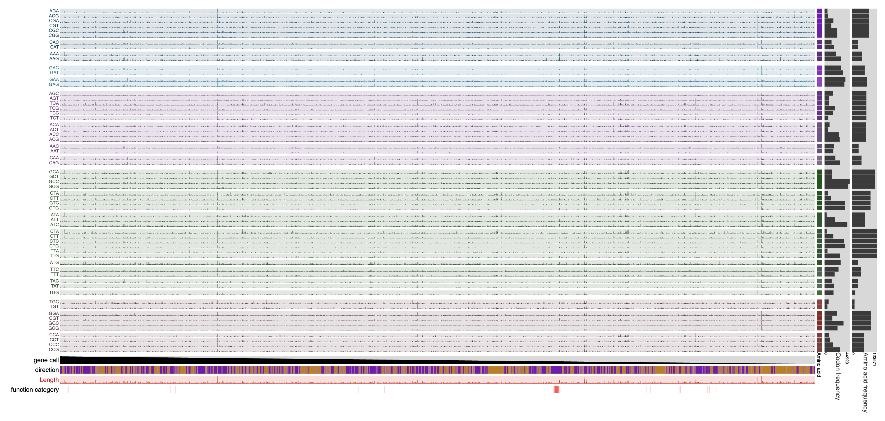
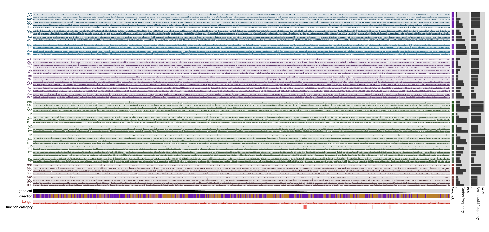
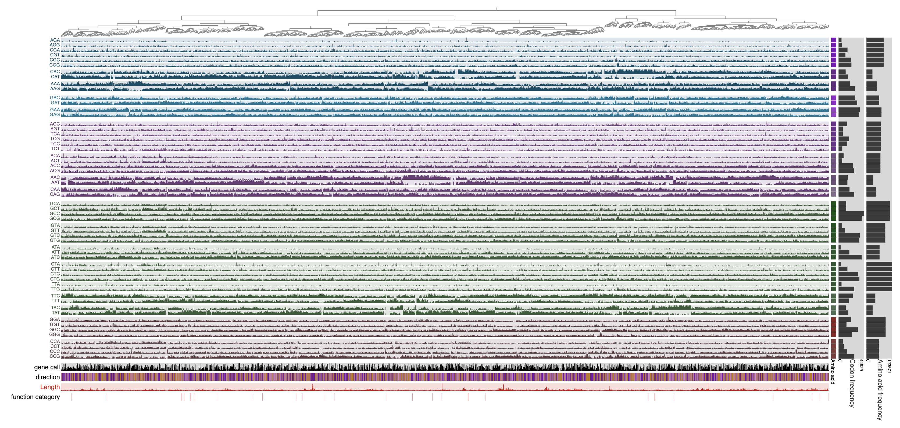
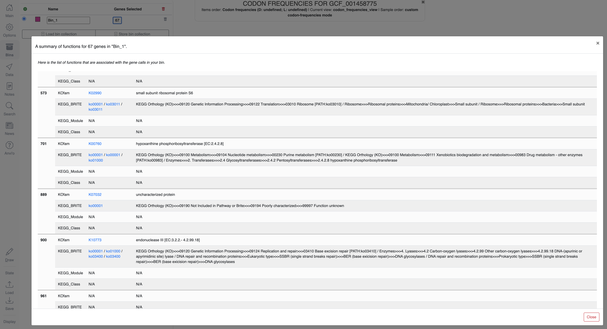

Display codon frequency statistics across genes in a given genome in the anvi&#x27;o interactive interface..

🔙 **[To the main page](../../)** of anvi'o programs and artifacts.



<div id="svg" class="subnetwork"></div>
{{ "network.json" }}
{{ 300 }}



## Authors

<div class="anvio-person"><div class="anvio-person-info"><div class="anvio-person-photo"></div><div class="anvio-person-info-box"><a href="/people/meren" target="_blank"><span class="anvio-person-name">A. Murat Eren (Meren)</span></a><div class="anvio-person-social-box"><a href="http://merenlab.org" class="person-social" target="_blank"><i class="fa fa-fw fa-home"></i>Web</a><a href="mailto:a.murat.eren@gmail.com" class="person-social" target="_blank"><i class="fa fa-fw fa-envelope-square"></i>Email</a><a href="http://twitter.com/merenbey" class="person-social" target="_blank"><i class="fa fa-fw fa-twitter-square"></i>Twitter</a><a href="http://github.com/meren" class="person-social" target="_blank"><i class="fa fa-fw fa-github"></i>Github</a></div></div></div></div>

<div class="anvio-person"><div class="anvio-person-info"><div class="anvio-person-photo"></div><div class="anvio-person-info-box"><a href="/people/semiller10" target="_blank"><span class="anvio-person-name">Samuel Miller</span></a><div class="anvio-person-social-box"><a href="https://semiller10.github.io" class="person-social" target="_blank"><i class="fa fa-fw fa-home"></i>Web</a><a href="mailto:samuelmiller10@gmail.com" class="person-social" target="_blank"><i class="fa fa-fw fa-envelope-square"></i>Email</a><a href="http://twitter.com/smiller_science" class="person-social" target="_blank"><i class="fa fa-fw fa-twitter-square"></i>Twitter</a><a href="http://github.com/semiller10" class="person-social" target="_blank"><i class="fa fa-fw fa-github"></i>Github</a></div></div></div></div>


## Requires


<p style="text-align: left" markdown="1"><span class="artifact-r">[contigs-db](../../artifacts/contigs-db) </span></p>


## Provides


<p style="text-align: left" markdown="1"><span class="artifact-p">[interactive](../../artifacts/interactive) </span></p>


## Can provide

<p style="text-align: left" markdown="1"><span class="artifact-p">[svg](../../artifacts/svg) </span> <span class="artifact-p">[profile-db](../../artifacts/profile-db) </span></p>


## Usage


This program interactively **displays gene-level codon frequency patterns across a set of contigs**.

The program calculates gene-level frequencies of individual codons and displays them in a matrix format where each row represents a codon (ordered by the amino acids they encode), each column represents a single gene, and the data points represent the counts (or frequency, depending on user-provided parameters) of occurrence of a given codon in a given gene. By default, the program orders each gene based on their synteny (the conserved order of genes across genomes) to reveal patterns in codon usage throughout the genome.

This program is most effectively applied to a <span class="artifact-n">[contigs-db](/help/main/artifacts/contigs-db)</span> that represents a single genome. Its utility for revealing synteny-based patterns of codon usage increases with decreasing numbers of contigs (i.e., a complete genome with a single contig will provide much better visualization than a metagenome-assembled genome (MAG) with 200 contigs, even though the program will visualize the latter adequately).

The calculation of different frequency statistics depends on a range of options, and the tool relies upon the same library that <span class="artifact-p">[anvi-get-codon-frequencies](/help/main/programs/anvi-get-codon-frequencies)</span> uses.

## Default output

The simplest form of this command is the following:

<div class="codeblock" markdown="1">
anvi&#45;display&#45;codon&#45;frequencies &#45;c <span class="artifact&#45;n">[contigs&#45;db](/help/main/artifacts/contigs&#45;db)</span>
</div>

When run this way, the program will generate a blank <span class="artifact-n">[profile-db](/help/main/artifacts/profile-db)</span> as a temporary file and will display the counts of each codon across each gene in the genome.

Here is an example with [GCF_001458775.1](https://www.ncbi.nlm.nih.gov/datasets/genome/GCF_001458775.1/), a reference genome for *Nitrospira nitrificans*:

```
anvi-display-codon-frequencies -c GCF_001458775.db
```

Which will display the following:

[{:.center-img .width-90}](../../images/anvi-display-codon-frequencies-01.png)

Here, every data point represents the actual count of a given codon in a given gene. As a result, very long genes that produce very large counts for each codon lead to the suppression of all other counts. It is possible to use any of the interactive interface capabilities to improve the visualization of data (such as setting up min/max values for layer data points, etc). It is also possible to run the program with additional parameters.

## Additional parameters

Additional parameters available through the help menu of the program will help filter genes and functions, as well as determine how the data are normalized. For instance, the following command will exclude genes that are shorter than 100 nucleotides long, exclude the stop codon as well as those codons for amino acids methionine, tryptophan, and cysteine, normalize data *within* synonymous codons (codons that encode the same amino acid), and replace all empty values in output with 0.0:

```
anvi-display-codon-frequencies --gene-min-codons 100 \
                               --exclude-amino-acids STP Met Trp Cys \
                               --synonymous \
                               --infinity-to-zero \
                               -c GCF_001458775.db
```

Which will display the following:

[{:.center-img .width-90}](../../images/anvi-display-codon-frequencies-02.png)

Please see the help menu for a complete list of parameters.

## Visualization features

Once the display is shown, the genes can also be ordered based on hierarchical clustering of the codon frequencies using the Settings panel, and then selecting the 'Codon frequencies' option from the 'Order' menu and clicking Draw to bring together those genes that show similar codon usage patterns regardless of their location in the genome:

[{:.center-img .width-90}](../../images/anvi-display-codon-frequencies-03.png)

Bin selection is possible in all visualizations, and clicking on the button that shows the number of genes in a given bin in the Bins panel will open a window that displays their functions:

[{:.center-img .width-90}](../../images/anvi-display-codon-frequencies-04.png)


## Working with a profile-db

By default, the program will initiate a blank <span class="artifact-n">[profile-db](/help/main/artifacts/profile-db)</span>, a temporary file stored under a directory that will be cleaned up by the operating system regularly. This means that storing states and bins, and re-running <span class="artifact-p">[anvi-display-codon-frequencies](/help/main/programs/anvi-display-codon-frequencies)</span> will not bring the stored data back.

Alternatively, the user can define a specific location for a <span class="artifact-n">[profile-db](/help/main/artifacts/profile-db)</span>, upon which the program would generate a blank profile at this precise location:

```
anvi-display-codon-frequencies -c GCF_001458775.db \
                               -p GCF_001458775-PROFILE.db
```

This <span class="artifact-n">[profile-db](/help/main/artifacts/profile-db)</span> can be used to visualize the same data repeatedly; however, future visualizations will require <span class="artifact-p">[anvi-interactive](/help/main/programs/anvi-interactive)</span> rather than <span class="artifact-p">[anvi-display-codon-frequencies](/help/main/programs/anvi-display-codon-frequencies)</span>:


```
anvi-interactive -p GCF_001458775-PROFILE.db \
                 --manual
```


{:.notice}
Edit [this file](https://github.com/merenlab/anvio/tree/master/anvio/docs/programs/anvi-display-codon-frequencies.md) to update this information.


## Command line interface

The following is the list of parameters and their descriptions in the latest version of `anvi-display-codon-frequencies`.

The code that generates this web page ensures that this information is the latest available in **9-dev (eunice)**. Which means, in some cases the information in this section (generated automatically) might be more comprehensive or up-to-date compared to the descriptions above (written by humans).

---

### Command line usage


<div class="program-parameters-usage">anvi-display-codon-frequencies [-h] [-c CONTIGS_DB] [-p PROFILE_DB] [--gene-caller-ids GENE_CALLER_IDS [GENE_CALLER_IDS ...]] [--infinity-to-zero] [--relative] [--synonymous] [--return-amino-acids] [--encodings-txt ENCODINGS_TXT] [--sum] [--average] [--gene-min-codons INTEGER] [--exclude-amino-acids AMINO ACID [AMINO ACID ...]] [--include-amino-acids AMINO ACID [AMINO ACID ...]] [--sequence-min-amino-acids INTEGER] [--pansequence-min-amino-acids PANSEQUENCE_MIN_AMINO_ACIDS PANSEQUENCE_MIN_AMINO_ACIDS] [--min-codon-filter {length,remaining,both}] [--title NAME] [--state-autoload NAME] [--collection-autoload NAME] [--export-svg FILE_PATH] [--dry-run] [--skip-news] [-I IP_ADDR] [-P INT] [--browser-path PATH] [--read-only] [--server-only] [--password-protected] [--user-server-shutdown]</div>


### Parameters and their descriptions


<div class="program-parameters">
<section class="parameter-group parameter-group-genome">
<header class="parameter-group-header"><span class="parameter-group-title">GENOME</span> <span class="parameter-group-description">Show us where to find the genome to Display codons across genes in a single genome. It could also be a bin stored in a collection.</span></header>
<dl class="parameter-list">
<dt class="parameter" id="parameter-contigs_db"><code class="parameter-flags">-c, --contigs-db</code> <code class="parameter-metavar">CONTIGS_DB</code></dt>
<dd class="parameter-details"><span class="parameter-help">Anvi&#x27;o contigs database generated by &#x27;anvi-gen-contigs-database&#x27;</span></dd>
<dt class="parameter" id="parameter-profile_db"><code class="parameter-flags">-p, --profile-db</code> <code class="parameter-metavar">PROFILE_DB</code></dt>
<dd class="parameter-details"><span class="parameter-help">Anvi&#x27;o profile database</span></dd>
<dt class="parameter" id="parameter-gene_caller_ids"><code class="parameter-flags">--gene-caller-ids</code> <code class="parameter-metavar">GENE_CALLER_IDS</code></dt>
<dd class="parameter-details"><span class="parameter-help">Select genes by ID, space-separated.</span></dd>
</dl>
</section>
<section class="parameter-group parameter-group-output-parameters">
<header class="parameter-group-header"><span class="parameter-group-title">OUTPUT PARAMETERS</span></header>
<dl class="parameter-list">
<dt class="parameter parameter-switch" id="parameter-infinity_to_zero"><code class="parameter-flags">--infinity-to-zero</code></dt>
<dd class="parameter-details"><span class="parameter-help">Replace NA (empty) values in output with 0.0. NA occurs with `--synonymous` when all codons for an amino acid are absent in a gene or function, resulting in 0/0, reported as NA. Use with caution.</span></dd>
</dl>
</section>
<section class="parameter-group parameter-group-frequency-statistics">
<header class="parameter-group-header"><span class="parameter-group-title">FREQUENCY STATISTICS</span> <span class="parameter-group-description">How should codon frequencies be computed.</span></header>
<dl class="parameter-list">
<dt class="parameter parameter-switch" id="parameter-relative"><code class="parameter-flags">--relative</code></dt>
<dd class="parameter-details"><span class="parameter-help">Return relative frequencies across codons or amino acids in each gene or function.</span></dd>
<dt class="parameter parameter-switch" id="parameter-synonymous"><code class="parameter-flags">--synonymous</code></dt>
<dd class="parameter-details"><span class="parameter-help">Return synonymous (per-amino acid) frequencies among the codons encoding each amino acid in each gene or function.</span></dd>
<dt class="parameter parameter-switch" id="parameter-return_amino_acids"><code class="parameter-flags">--return-amino-acids</code></dt>
<dd class="parameter-details"><span class="parameter-help">Return frequencies of the sets of codons encoding the same amino acid.</span></dd>
<dt class="parameter" id="parameter-encodings_txt"><code class="parameter-flags">--encodings-txt</code> <code class="parameter-metavar">ENCODINGS_TXT</code></dt>
<dd class="parameter-details"><span class="parameter-help">Changes to the standard genetic code can be provided in this tab-delimited file of two columns. Each entry in the first column is a codon and each entry in the second column is the three-letter code for the decoded amino acid. For example, to recode the stop codon, TGA, as Trp, &#x27;TGA&#x27; would be placed in the first column and &#x27;Trp&#x27; in the same row of the second. Stop/termination codons are abbreviated &#x27;STP&#x27;. This option affects per-amino acid and synonymous codon output (when using `--return-amino-acids` or `--synonymous`).</span></dd>
<dt class="parameter parameter-switch" id="parameter-sum"><code class="parameter-flags">--sum</code></dt>
<dd class="parameter-details"><span class="parameter-help">Sum frequencies across genes, returning a single row for each genome. When functions or function sources are selected, genes are subsetted to those annotated with the requested functions or annotated by the requested sources.</span></dd>
<dt class="parameter parameter-switch" id="parameter-average"><code class="parameter-flags">--average</code></dt>
<dd class="parameter-details"><span class="parameter-help">Average frequencies across genes in the genome, returning a single row for each genome. When functions or function sources are selected, genes are subsetted to those annotated with the requested functions or annotated by the requested sources.</span></dd>
</dl>
</section>
<section class="parameter-group parameter-group-filter-genes-codons">
<header class="parameter-group-header"><span class="parameter-group-title">FILTER GENES, CODONS</span> <span class="parameter-group-description">Genes can be filtered by the number of codons they contain, e.g., ignore genes shorter than 300 codons. Codons can be selected a priori, e.g., ignore Ala codons, or rarer codons can be excluded, e.g., ignore amino acids that are decoded by ≤3 codons in ≥90%% of genes. Filters can improve the statistical utility of codon relative frequency data.</span></header>
<dl class="parameter-list">
<dt class="parameter" id="parameter-gene_min_codons"><code class="parameter-flags">--gene-min-codons</code> <code class="parameter-metavar">INTEGER</code></dt>
<dd class="parameter-details"><span class="parameter-help">Set the minimum number of codons required in a gene. When functions are returned rather than genes, this filter is applied to genes before grouping them as functions.</span> <span class="parameter-default"><span class="parameter-label">Default:</span> <code class="parameter-default-value">0</code></span></dd>
<dt class="parameter" id="parameter-exclude_amino_acids"><code class="parameter-flags">--exclude-amino-acids</code> <code class="parameter-metavar">AMINO ACID</code></dt>
<dd class="parameter-details"><span class="parameter-help">Remove codons that decode the given amino acids (use three-letter codes, e.g., Ala, and STP for stop codons). If `--synonymous`, this argument defaults to &#x27;STP Met Trp&#x27;, and if other amino acids are excluded, for STP, Met, and Trp codons to still be excluded from the output table, they must also be explicitly provided in the argument.</span></dd>
<dt class="parameter" id="parameter-include_amino_acids"><code class="parameter-flags">--include-amino-acids</code> <code class="parameter-metavar">AMINO ACID</code></dt>
<dd class="parameter-details"><span class="parameter-help">This is the complement of `--exclude-amino-acids`. Only codons for the given amino acids are analyzed and reported.</span></dd>
<dt class="parameter" id="parameter-sequence_min_amino_acids"><code class="parameter-flags">--sequence-min-amino-acids</code> <code class="parameter-metavar">INTEGER</code></dt>
<dd class="parameter-details"><span class="parameter-help">Do not report codons for amino acids (and STP) that are less numerous than the given argument. For example, if the argument is 5, and a gene or function query has 4 codons encoding Asn, 2 AAT and 2 AAC, then a row for this gene in the output table will have missing values in Asn columns. This filter occurs at the end of the analysis before writing results and so does not affect prior calculations.</span> <span class="parameter-default"><span class="parameter-label">Default:</span> <code class="parameter-default-value">0</code></span></dd>
<dt class="parameter" id="parameter-pansequence_min_amino_acids"><code class="parameter-flags">--pansequence-min-amino-acids</code> <code class="parameter-metavar">PANSEQUENCE_MIN_AMINO_ACIDS</code></dt>
<dd class="parameter-details"><span class="parameter-help">The first value of the argument is a positive integer representing a minimum number of codons encoding an amino acid -- &#x27;min_amino_acids&#x27; -- and the second is a number between 0 and 1 representing a fraction of genes -- &#x27;min_gene_fraction&#x27;. Remove codons for amino acids (and STP) that are less numerous than &#x27;min_amino_acids&#x27; in a &#x27;min_gene_fraction&#x27; of genes. For example, if &#x27;min_amino_acids&#x27; is 5 and &#x27;min_gene_fraction&#x27; is 0.9, then if there are fewer than 5 codons for an amino acid/STP in ≥90% of genes, then the columns for these codons are dropped.</span> <span class="parameter-default"><span class="parameter-label">Default:</span> <code class="parameter-default-value">[0, 1.0]</code></span></dd>
<dt class="parameter" id="parameter-min_codon_filter"><code class="parameter-flags">--min-codon-filter</code> <code class="parameter-metavar">MIN_CODON_FILTER</code></dt>
<dd class="parameter-details"><span class="parameter-help">This argument arises from the ambiguity of filters that remove genes and functions by number of codons (`--gene-min-codons` and `--function-min-codons`) in relation to filters that drop codons (`--exclude/include-amino-acids` and `--pansequence-min-amino-acids`). Genes (and functions) can be filtered by their full length, e.g., genes shorter than 300 codons are ignored. They can also be filtered by the number of codons remaining after dropping codons. The codon length filter followed by dropping codons can result in genes and functions with fewer codons than the original codon threshold -- thus the option of both &#x27;length&#x27; and &#x27;remaining&#x27; filters to ensure that total codon frequencies in the output always meet the minimum codon threshold. &#x27;both&#x27; is needed as an option in addition to &#x27;remaining&#x27; so dynamic codon filtering by `--pansequence-min-amino-acids` operates on genes that passed the first length filter.</span> <span class="parameter-choices"><span class="parameter-label">Choices:</span> <code class="parameter-choice">length</code> <code class="parameter-choice">remaining</code> <code class="parameter-choice">both</code></span> <span class="parameter-default"><span class="parameter-label">Default:</span> <code class="parameter-default-value">both</code></span></dd>
</dl>
</section>
<section class="parameter-group parameter-group-visuals-related">
<header class="parameter-group-header"><span class="parameter-group-title">VISUALS RELATED</span> <span class="parameter-group-description">Parameters that give access to various adjustements regarding the interface.</span></header>
<dl class="parameter-list">
<dt class="parameter" id="parameter-title"><code class="parameter-flags">--title</code> <code class="parameter-metavar">NAME</code></dt>
<dd class="parameter-details"><span class="parameter-help">Title for the interface. If you are working with a RUNINFO dict, the title will be determined based on information stored in that file. Regardless, you can override that value using this parameter.</span></dd>
<dt class="parameter" id="parameter-state_autoload"><code class="parameter-flags">--state-autoload</code> <code class="parameter-metavar">NAME</code></dt>
<dd class="parameter-details"><span class="parameter-help">Automatically load previous saved state and draw tree. To see a list of available states, use --show-states flag.</span></dd>
<dt class="parameter" id="parameter-collection_autoload"><code class="parameter-flags">--collection-autoload</code> <code class="parameter-metavar">NAME</code></dt>
<dd class="parameter-details"><span class="parameter-help">Automatically load a collection and draw tree. To see a list of available collections, use --list-collections flag.</span></dd>
<dt class="parameter" id="parameter-export_svg"><code class="parameter-flags">--export-svg</code> <code class="parameter-metavar">FILE_PATH</code></dt>
<dd class="parameter-details"><span class="parameter-help">The SVG output file path.</span></dd>
</dl>
</section>
<section class="parameter-group parameter-group-sweet-params-of-convenience">
<header class="parameter-group-header"><span class="parameter-group-title">SWEET PARAMS OF CONVENIENCE</span> <span class="parameter-group-description">Parameters and flags that are not quite essential (but nice to have).</span></header>
<dl class="parameter-list">
<dt class="parameter parameter-switch" id="parameter-dry_run"><code class="parameter-flags">--dry-run</code></dt>
<dd class="parameter-details"><span class="parameter-help">Don&#x27;t do anything real. Test everything, and stop right before wherever the developer said &#x27;well, this is enough testing&#x27;, and decided to print out results.</span></dd>
<dt class="parameter parameter-switch" id="parameter-skip_news"><code class="parameter-flags">--skip-news</code></dt>
<dd class="parameter-details"><span class="parameter-help">Don&#x27;t try to read news content from upstream.</span></dd>
</dl>
</section>
<section class="parameter-group parameter-group-server-configuration">
<header class="parameter-group-header"><span class="parameter-group-title">SERVER CONFIGURATION</span> <span class="parameter-group-description">For power users.</span></header>
<dl class="parameter-list">
<dt class="parameter" id="parameter-ip_address"><code class="parameter-flags">-I, --ip-address</code> <code class="parameter-metavar">IP_ADDR</code></dt>
<dd class="parameter-details"><span class="parameter-help">IP address for the HTTP server. The default ip address (localhost) should work just fine for most.</span> <span class="parameter-default"><span class="parameter-label">Default:</span> <code class="parameter-default-value">localhost</code></span></dd>
<dt class="parameter" id="parameter-port_number"><code class="parameter-flags">-P, --port-number</code> <code class="parameter-metavar">INT</code></dt>
<dd class="parameter-details"><span class="parameter-help">Port number to use for anvi&#x27;o services. If nothing is declared, anvi&#x27;o will try to find a suitable port number, starting from the default port number, 8080.</span></dd>
<dt class="parameter" id="parameter-browser_path"><code class="parameter-flags">--browser-path</code> <code class="parameter-metavar">PATH</code></dt>
<dd class="parameter-details"><span class="parameter-help">By default, anvi&#x27;o will use your default browser to launch the interactive interface. If you would like to use something else than your system default, you can provide a full path for an alternative browser using this parameter, and hope for the best. For instance we are using this parameter to call Google&#x27;s experimental browser, Canary, which performs better with demanding visualizations.</span></dd>
<dt class="parameter parameter-switch" id="parameter-read_only"><code class="parameter-flags">--read-only</code></dt>
<dd class="parameter-details"><span class="parameter-help">When the interactive interface is started with this flag, all &#x27;database write&#x27; operations will be disabled.</span></dd>
<dt class="parameter parameter-switch" id="parameter-server_only"><code class="parameter-flags">--server-only</code></dt>
<dd class="parameter-details"><span class="parameter-help">The default behavior is to start the local server, and fire up a browser that connects to the server. If you have other plans, and want to start the server without calling the browser, this is the flag you need.</span></dd>
<dt class="parameter parameter-switch" id="parameter-password_protected"><code class="parameter-flags">--password-protected</code></dt>
<dd class="parameter-details"><span class="parameter-help">If this flag is set, command line tool will ask you to enter a password and interactive interface will be only accessible after entering same password. This option is recommended for shared machines like clusters or shared networks where computers are not isolated.</span></dd>
<dt class="parameter parameter-switch" id="parameter-user_server_shutdown"><code class="parameter-flags">--user-server-shutdown</code></dt>
<dd class="parameter-details"><span class="parameter-help">Allow users to shutdown an anvi&#x27;server via web interface.</span></dd>
</dl>
</section>
</div>



## Additional Resources


{:.notice}
Are you aware of resources that may help users better understand the utility of this program? Please feel free to edit [this file](https://github.com/merenlab/anvio/blob/master/anvio/cli/display_codon_frequencies.py) on GitHub. If you are not sure how to do that, find the `__resources__` tag in [this file](https://github.com/merenlab/anvio/blob/master/anvio/cli/interactive.py) to see an example.
