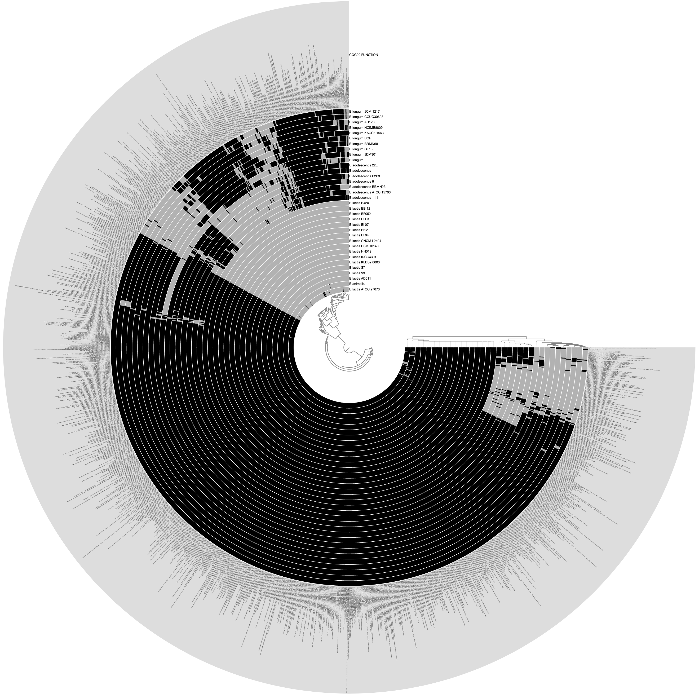
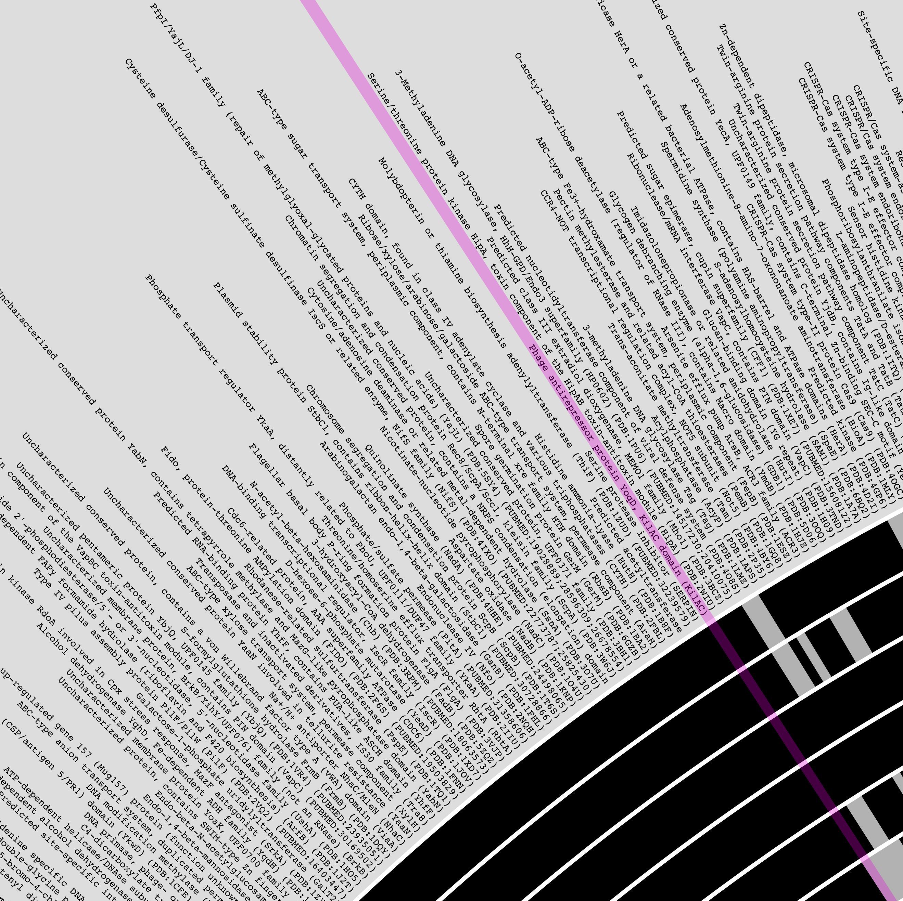
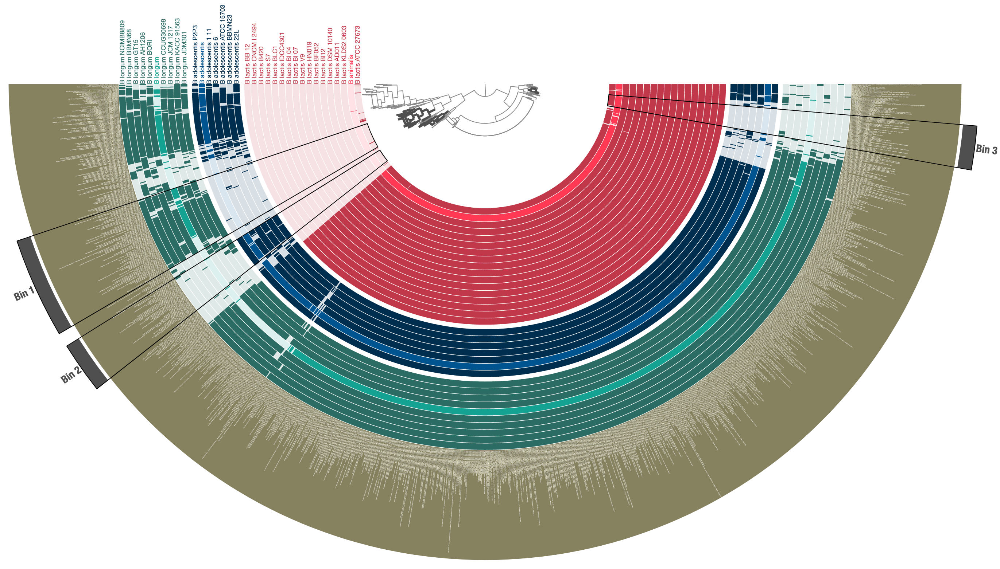

Start an anvi&#x27;o interactive display to see functions across genomes.

🔙 **[To the main page](../../)** of anvi'o programs and artifacts.



{{ "network.json" }}
{{ 300 }}


## Authors

<a href="/people/meren" target="_blank">A. Murat Eren (Meren)</a>
<a href="http://merenlab.org" class="person-social" target="_blank"><i class="fa fa-fw fa-home"></i>Web</a><a href="mailto:a.murat.eren@gmail.com" class="person-social" target="_blank"><i class="fa fa-fw fa-envelope-square"></i>Email</a><a href="http://twitter.com/merenbey" class="person-social" target="_blank"><i class="fa fa-fw fa-twitter-square"></i>Twitter</a><a href="http://github.com/meren" class="person-social" target="_blank"><i class="fa fa-fw fa-github"></i>Github</a>

## Requires

[functions](../../artifacts/functions)  [external-genomes](../../artifacts/external-genomes) 

## Can use

[internal-genomes](../../artifacts/internal-genomes)  [genomes-storage-db](../../artifacts/genomes-storage-db)  [groups-txt](../../artifacts/groups-txt) 

## Provides

[interactive](../../artifacts/interactive) 

## Can provide

[functional-enrichment-txt](../../artifacts/functional-enrichment-txt) 

## Usage

For a given annotation source for [functions](/help/main/artifacts/functions), this program will display distribution patterns of unique function names (or accession numbers) across genomes stored in anvi'o databases.

It is a powerful way to analyze differentially occurring functions for any source of annotation that is shared across all genomes.

Currently, [anvi-display-functions](/help/main/programs/anvi-display-functions) can work with any combination of genomes from [external-genomes](/help/main/artifacts/external-genomes), [internal-genomes](/help/main/artifacts/internal-genomes), and [genomes-storage-db](/help/main/artifacts/genomes-storage-db).

{:.notice}
If you are only interested in a text output, see the program [anvi-gen-function-matrix](/help/main/programs/anvi-gen-function-matrix) that can report [functions-across-genomes-txt](/help/main/artifacts/functions-across-genomes-txt) files.

### Quick & Simple Run

The simplest way to run this program is as follows:

anvi&#45;display&#45;functions &#45;e [external&#45;genomes](/help/main/artifacts/external&#45;genomes) \
                       &#45;&#45;annotation&#45;source KOfam \
                       &#45;&#45;profile&#45;db KOFAM&#45;PROFILE.db

You can replace the annotation source based on what is available across your genomes. You can use the program [anvi-db-info](/help/main/programs/anvi-db-info) to see all available function annotation sources in a given [contigs-db](/help/main/artifacts/contigs-db) or [genomes-storage-db](/help/main/artifacts/genomes-storage-db). You can also use the program [anvi-import-functions](/help/main/programs/anvi-import-functions) to import ANY kind of functional grouping of your genes and use those ad hoc functional sources to display their distribution across genomes. Please see [functions](/help/main/artifacts/functions) for more information on functions and how to obtain them.

{:.notice}
Please note that a [profile-db](/help/main/artifacts/profile-db) will be automatically generated for you. Once it is generated, the same profile database can be visualized over and over again using [anvi-interactive](/help/main/programs/anvi-interactive) in manual mode, without having to retain any other files.

### Combining genomes from multiple sources

You can run this program by combining genomes from multiple sources:

anvi&#45;display&#45;functions &#45;e [external&#45;genomes](/help/main/artifacts/external&#45;genomes) \
                       &#45;i [internal&#45;genomes](/help/main/artifacts/internal&#45;genomes) \
                       &#45;g [genomes&#45;storage&#45;db](/help/main/artifacts/genomes&#45;storage&#45;db) \
                       &#45;&#45;annotation&#45;source KOfam \
                       &#45;&#45;profile&#45;db KOFAM&#45;PROFILE.db

This way, you can bring together functions in your metagenome-assembled genomes, the isolates you have acquired from external sources, and even genomes in an anvi'o pangenome into a single framework in a disturbingly easy fashion.

### Performing functional enrichment analysis for free

This is an optional step, but may be very useful for some investigations. If your genomes are divided into meaningful groups, you can also perform a functional enrichment analysis while running this program. All you need to do for this to be included in your analysis is to provide a [groups-txt](/help/main/artifacts/groups-txt) file that describes which genome belongs to which group:

anvi&#45;display&#45;functions &#45;e [external&#45;genomes](/help/main/artifacts/external&#45;genomes) \
                       &#45;&#45;groups&#45;txt [groups&#45;txt](/help/main/artifacts/groups&#45;txt)
                       &#45;&#45;annotation&#45;source KOfam \
                       &#45;&#45;profile&#45;db KOFAM&#45;PROFILE.db

If you are using multiple sources for your genomes, you may not immediately know which genomes to list in your [groups-txt](/help/main/artifacts/groups-txt) file. In that case, you can first run the program with this additional parameter,

anvi&#45;display&#45;functions &#45;e [external&#45;genomes](/help/main/artifacts/external&#45;genomes) \
                       &#45;i [internal&#45;genomes](/help/main/artifacts/internal&#45;genomes) \
                       &#45;g [genomes&#45;storage&#45;db](/help/main/artifacts/genomes&#45;storage&#45;db) \
                       &#45;&#45;annotation&#45;source COG20_FUNCTION \
                       &#45;&#45;profile&#45;db COGS&#45;PROFILE.db \
                       &#45;&#45;print&#45;genome&#45;names&#45;and&#45;quit

In which case anvi'o would report all the functions once it recovers everything from all sources, and print them out for you to create a groups file before re-running the program with it.

This analysis will add the following additional layers in your [interactive](/help/main/artifacts/interactive) display: 'enrichment_score', 'unadjusted_p_value', 'adjusted_q_value', 'associated_groups'. See [functional-enrichment-txt](/help/main/artifacts/functional-enrichment-txt) to learn more about these columns.

### Aggregating functions using accession IDs

Once it is run, this program essentially aggregates all function names that occur in one or more genomes among the set of genomes found in input sources. The user can ask the program to use accession IDs to aggregate functions rather than function names:

anvi&#45;display&#45;functions &#45;e [external&#45;genomes](/help/main/artifacts/external&#45;genomes) \
                       &#45;&#45;annotation&#45;source KOfam \
                       &#45;&#45;profile&#45;db KOFAM&#45;PROFILE.db \
                       &#45;&#45;aggregate&#45;based&#45;on&#45;accession

While the default setting, which is to use function names, will be appropriate for most applications, using accession IDs instead of function names may be important for specific purposes. There may be an actual difference between using functions or accession to aggregate data since multiple accession IDs in various databases may correspond to the same function. This may lead to misleading enrichment analyses downstream as identical function annotations may be over-split into multiple groups. Thus, the default aggregation method uses function names.

### Aggregating functions using all function hits

This is a bit confusing, but actually it is not. In some cases a gene may be annotated with more than one function names. This is a decision often made at the function annotation tool level. For instance [anvi-run-ncbi-cogs](/help/main/programs/anvi-run-ncbi-cogs) may yield two COG annotations for a single gene because the significance score for both hits may exceed the default cutoff. While this can be useful in [anvi-summarize](/help/main/programs/anvi-summarize) output where things should be most comprehensive, having some genes annotated with multiple functions and others with one function may over-split them (since in this scenario a gene with COGXXX and COGXXX;COGYYY would end up in different bins). Thus, [anvi-display-functions](/help/main/programs/anvi-display-functions) will will use the best hit for any gene that has multiple hits. But this behavior can be turned off the following way:

anvi&#45;display&#45;functions &#45;e [external&#45;genomes](/help/main/artifacts/external&#45;genomes) \
                       &#45;&#45;annotation&#45;source KOfam \
                       &#45;&#45;profile&#45;db KOFAM&#45;PROFILE.db \
                       &#45;&#45;aggregate&#45;using&#45;all&#45;hits

### The min-occurrence limit

You can choose to limit the number of functions to be considered to those that occur in more than a minimum number of genomes:

anvi&#45;display&#45;functions &#45;e [external&#45;genomes](/help/main/artifacts/external&#45;genomes) \
                       &#45;&#45;annotation&#45;source KOfam \
                       &#45;&#45;profile&#45;db KOFAM&#45;PROFILE.db \
                       &#45;&#45;min&#45;occurrence 5

Here the `--min-occurrence 5` parameter will exclude any function that appears to occur in less than 5 genomes in your collection.

### A real-world example

Assume we have a list of [external-genomes](/help/main/artifacts/external-genomes) that include three different species of *Bifidobacterium*. Running the following command,

anvi&#45;display&#45;functions &#45;&#45;external&#45;genomes Bifidobacterium.txt \
                       &#45;&#45;annotation&#45;source COG20_FUNCTION \
                       &#45;&#45;profile&#45;db COG20&#45;PROFILE.db \
                       &#45;&#45;min&#45;occurrence 3

Would produce the following display by default, where each layer is one of the genomes described in the [external-genomes](/help/main/artifacts/external-genomes) file, and each item is a unique function name that occur in `COG20_FUNCTION` (which was obtained by running [anvi-run-ncbi-cogs](/help/main/programs/anvi-run-ncbi-cogs) on each [contigs-db](/help/main/artifacts/contigs-db) in the external genomes file) that were found in more than three genomes:

[{:.center-img .width-50}](../../images/anvi-display-functions-01.png)

The outermost layer shows the function names:

[{:.center-img .width-50}](../../images/anvi-display-functions-02.png)

After a quick prettification through the [interactive](/help/main/artifacts/interactive) interface, leads to a cleaner display of three distinct species in this group, and functions that are uniquely enriched in either of them:

[{:.center-img .width-80}](../../images/anvi-display-functions-03.png)

Now the resulting [profile-db](/help/main/artifacts/profile-db) can be used by [anvi-interactive](/help/main/programs/anvi-interactive) to re-visualize these data, or can be shared with the community without sharing the underlying contigs databases.

{:.notice}
Edit [this file](https://github.com/merenlab/anvio/tree/master/anvio/docs/programs/anvi-display-functions.md) to update this information.

## Command line interface

The following is the list of parameters and their descriptions in the latest version of `anvi-display-functions`.

The code that generates this web page ensures that this information is the latest available in **9-dev (eunice)**. Which means, in some cases the information in this section (generated automatically) might be more comprehensive or up-to-date compared to the descriptions above (written by humans).

---

### Command line usage



anvi-display-functions [-h] [-i FILE_PATH] [-e FILE_PATH] [-g GENOMES_STORAGE] [-G TEXT_FILE] [--print-genome-names-and-quit] --annotation-source FUNCTION_ANNOTATION_SOURCE [--aggregate-based-on-accession] [--aggregate-using-all-hits] [--min-occurrence NUM GENOMES] -p PROFILE_DB [--gene-caller GENE-CALLER] [--title NAME] [--state-autoload NAME] [--collection-autoload NAME] [--export-svg FILE_PATH] [--dry-run] [--skip-news] [--skip-checking-genome-hashes] [-I IP_ADDR] [-P INT] [--browser-path PATH] [--read-only] [--server-only] [--password-protected] [--user-server-shutdown]



### Parameters and their descriptions



<section class="parameter-group parameter-group-genomes">
<header class="parameter-group-header">GENOMES Tell anvi&#x27;o where your genomes are.</header>
<dl class="parameter-list">
<dt class="parameter" id="parameter-internal_genomes"><code class="parameter-flags">-i, --internal-genomes</code> <code class="parameter-metavar">FILE_PATH</code></dt>
<dd class="parameter-details">A five-column TAB-delimited flat text file. The header line must contain these columns: &#x27;name&#x27;, &#x27;bin_id&#x27;, &#x27;collection_id&#x27;, &#x27;profile_db_path&#x27;, &#x27;contigs_db_path&#x27;. Each line should list a single entry, where &#x27;name&#x27; can be any name to describe the anvi&#x27;o bin identified as &#x27;bin_id&#x27; that is stored in a collection.</dd>
<dt class="parameter" id="parameter-external_genomes"><code class="parameter-flags">-e, --external-genomes</code> <code class="parameter-metavar">FILE_PATH</code></dt>
<dd class="parameter-details">A two-column TAB-delimited flat text file that lists anvi&#x27;o contigs databases. The first item in the header line should read &#x27;name&#x27;, and the second should read &#x27;contigs_db_path&#x27;. Each line in the file should describe a single entry, where the first column is the name of the genome (or MAG), and the second column is the anvi&#x27;o contigs database generated for this genome.</dd>
<dt class="parameter" id="parameter-genomes_storage"><code class="parameter-flags">-g, --genomes-storage</code> <code class="parameter-metavar">GENOMES_STORAGE</code></dt>
<dd class="parameter-details">Anvi&#x27;o genomes storage file</dd>
</dl>
</section>
<section class="parameter-group parameter-group-groups">
<header class="parameter-group-header">GROUPS If you want, you can also tell anvi&#x27;o how to group your genomes so it can also compute functional enrichment between them.</header>
<dl class="parameter-list">
<dt class="parameter" id="parameter-groups_txt"><code class="parameter-flags">-G, --groups-txt</code> <code class="parameter-metavar">TEXT_FILE</code></dt>
<dd class="parameter-details">A tab-delimited text file specifying which group each item belongs to. Depending on the context, items here may be individual samples or genomes. The first column must contain item names matching to those that are in your input data. A different column should have the header &#x27;group&#x27; and contain the group name for each item. Each item should be associated with a single group. It is always a good idea to define groups using single words without any fancy characters. For instance, `HIGH_TEMPERATURE` or `LOW_FITNESS` are good group names. `my group #1` or `IS-THIS-OK?`, are not good group names.</dd>
<dt class="parameter parameter-switch" id="parameter-print_genome_names_and_quit"><code class="parameter-flags">--print-genome-names-and-quit</code></dt>
<dd class="parameter-details">Sometimes, especially when you are interested in creating a groups file for your genomes you gather from multiple different sources, it may be difficult to know every single genome name that will go into your analysis. If you declare this flag, after initializing everyghing, anvi&#x27;o will print out every genome name it found and quit, so you can actually put together a groups file for them.</dd>
</dl>
</section>
<section class="parameter-group parameter-group-functions">
<header class="parameter-group-header">FUNCTIONS Tell anvi&#x27;o which functional annotation source you like above all, and other important details you like about your analysis.</header>
<dl class="parameter-list">
<dt class="parameter parameter-required" id="parameter-annotation_source"><code class="parameter-flags">--annotation-source</code> <code class="parameter-metavar">FUNCTION_ANNOTATION_SOURCE</code> required</dt>
<dd class="parameter-details parameter-required">Get functional annotations for a specific annotation source. You can use the flag &#x27;--list-annotation-sources&#x27; to learn about what sources are available.</dd>
<dt class="parameter parameter-switch" id="parameter-aggregate_based_on_accession"><code class="parameter-flags">--aggregate-based-on-accession</code></dt>
<dd class="parameter-details">This is important. When anvi&#x27;o aggregates functions for functional enrichment analyses or to display them, it uses by default the &#x27;function text&#x27; as keys. This is because multiple accession IDs in various databases may correspond to the same function, and when you are doing a functional enrichment analysis, you most likely would like to avoid over-splitting of functions due to this. But then how can we know if you are doing something that requires things to be aggregated based on accession ids for functions rather than actual functions? We can&#x27;t. But we have this flag here so you can instruct anvi&#x27;o to listen to you and not to us.</dd>
<dt class="parameter parameter-switch" id="parameter-aggregate_using_all_hits"><code class="parameter-flags">--aggregate-using-all-hits</code></dt>
<dd class="parameter-details">This program will aggregate functions based on best hits only, and this flag will change that behavior. In some cases a gene may be annotated with multiple functions. This is a decision often made at the level of function annotation tool. For instance, when you run `anvi-run-ncbi-cogs`, you may end up having two COG annotations for a single gene because the gene hit both of them with significance scores that were above the default noise cutoff. While this can be useful when one visualizes functions or works with an `anvi-summarize` output where things should be most comprehensive, having some genes annotated with multiple functions and others with one function may over-split them (since in this scenario a gene with COGXXX and COGXXX;COGYYY would end up in different bins). Thus, when working on functional enrichment analyses or displaying functions anvi&#x27;o will only use the best hit for any gene that has multiple hits by default. But you can turn that behavior off explicitly and show anvi&#x27;o who is the boss by using this flag.</dd>
<dt class="parameter" id="parameter-min_occurrence"><code class="parameter-flags">--min-occurrence</code> <code class="parameter-metavar">NUM GENOMES</code></dt>
<dd class="parameter-details">The minimum number of occurrence of any given function accross genomes. If you set a value, those functions that occur in less number of genomes will be excluded. Default: <code class="parameter-default-value">1</code></dd>
</dl>
</section>
<section class="parameter-group parameter-group-profile-db">
<header class="parameter-group-header">PROFILE DB To store visuals state, collections, and such. It will be AUTOMATICALLY generated for you, and you can&#x27;t use an existing profile for this. But then once it is generated you can use that profile with `anvi-interactive`. It is actually objectively very cool.</header>
<dl class="parameter-list">
<dt class="parameter parameter-required" id="parameter-profile_db"><code class="parameter-flags">-p, --profile-db</code> <code class="parameter-metavar">PROFILE_DB</code> required</dt>
<dd class="parameter-details parameter-required">Anvi&#x27;o profile database</dd>
</dl>
</section>
<section class="parameter-group parameter-group-genes">
<header class="parameter-group-header">GENES By default, anvi&#x27;o will look for genes in contigs databases that are identified by `pyrodigal-gv`. But if you have generated your contigs databse with external gene calls, or have otherwise used another gene caller than the default, you can explicitly ask anvi&#x27;o to use that one to recover your genes.</header>
<dl class="parameter-list">
<dt class="parameter" id="parameter-gene_caller"><code class="parameter-flags">--gene-caller</code> <code class="parameter-metavar">GENE-CALLER</code></dt>
<dd class="parameter-details">The gene caller to utilize. Anvi&#x27;o supports multiple gene callers, and some operations (including this one) may require an explicit mentioning of which one to use. The default gene caller is identified automatically in most cases (based on whether the most frequent gene calls match to a known gene caller in anvi&#x27;o), but if you have a contigs-db generated with `--external-gene-callers` or something, you may have to pay extra attention here. Also, some HMM collections may add new gene calls into a given contigs-db as an ad-hoc fashion, so if you want to see all the options available to you in a given contigs database, please run the program `anvi-db-info` and take a look at the output.</dd>
</dl>
</section>
<section class="parameter-group parameter-group-visuals-related">
<header class="parameter-group-header">VISUALS RELATED Parameters that give access to various adjustements regarding the interface.</header>
<dl class="parameter-list">
<dt class="parameter" id="parameter-title"><code class="parameter-flags">--title</code> <code class="parameter-metavar">NAME</code></dt>
<dd class="parameter-details">Title for the interface. If you are working with a RUNINFO dict, the title will be determined based on information stored in that file. Regardless, you can override that value using this parameter.</dd>
<dt class="parameter" id="parameter-state_autoload"><code class="parameter-flags">--state-autoload</code> <code class="parameter-metavar">NAME</code></dt>
<dd class="parameter-details">Automatically load previous saved state and draw tree. To see a list of available states, use --show-states flag.</dd>
<dt class="parameter" id="parameter-collection_autoload"><code class="parameter-flags">--collection-autoload</code> <code class="parameter-metavar">NAME</code></dt>
<dd class="parameter-details">Automatically load a collection and draw tree. To see a list of available collections, use --list-collections flag.</dd>
<dt class="parameter" id="parameter-export_svg"><code class="parameter-flags">--export-svg</code> <code class="parameter-metavar">FILE_PATH</code></dt>
<dd class="parameter-details">The SVG output file path.</dd>
</dl>
</section>
<section class="parameter-group parameter-group-sweet-params-of-convenience">
<header class="parameter-group-header">SWEET PARAMS OF CONVENIENCE Parameters and flags that are not quite essential (but nice to have).</header>
<dl class="parameter-list">
<dt class="parameter parameter-switch" id="parameter-dry_run"><code class="parameter-flags">--dry-run</code></dt>
<dd class="parameter-details">Don&#x27;t do anything real. Test everything, and stop right before wherever the developer said &#x27;well, this is enough testing&#x27;, and decided to print out results.</dd>
<dt class="parameter parameter-switch" id="parameter-skip_news"><code class="parameter-flags">--skip-news</code></dt>
<dd class="parameter-details">Don&#x27;t try to read news content from upstream.</dd>
<dt class="parameter parameter-switch" id="parameter-skip_checking_genome_hashes"><code class="parameter-flags">--skip-checking-genome-hashes</code></dt>
<dd class="parameter-details">Use this flag if you would like anvi&#x27;o to skip checking genome hashes. This is only relevant if you may have genomes in your internal or external genomes files that have identical sequences with different names AND if you are OK with it. You may be OK with it, for instance, if you are using `anvi-dereplicate-genomes` program to dereplicate genomes desribed in multiple collections in an anvi&#x27;o profile database that may be describing the same genome multiple times (see https://github.com/merenlab/anvio/issues/1397 for a case).</dd>
</dl>
</section>
<section class="parameter-group parameter-group-server-configuration">
<header class="parameter-group-header">SERVER CONFIGURATION For power users.</header>
<dl class="parameter-list">
<dt class="parameter" id="parameter-ip_address"><code class="parameter-flags">-I, --ip-address</code> <code class="parameter-metavar">IP_ADDR</code></dt>
<dd class="parameter-details">IP address for the HTTP server. The default ip address (localhost) should work just fine for most. Default: <code class="parameter-default-value">localhost</code></dd>
<dt class="parameter" id="parameter-port_number"><code class="parameter-flags">-P, --port-number</code> <code class="parameter-metavar">INT</code></dt>
<dd class="parameter-details">Port number to use for anvi&#x27;o services. If nothing is declared, anvi&#x27;o will try to find a suitable port number, starting from the default port number, 8080.</dd>
<dt class="parameter" id="parameter-browser_path"><code class="parameter-flags">--browser-path</code> <code class="parameter-metavar">PATH</code></dt>
<dd class="parameter-details">By default, anvi&#x27;o will use your default browser to launch the interactive interface. If you would like to use something else than your system default, you can provide a full path for an alternative browser using this parameter, and hope for the best. For instance we are using this parameter to call Google&#x27;s experimental browser, Canary, which performs better with demanding visualizations.</dd>
<dt class="parameter parameter-switch" id="parameter-read_only"><code class="parameter-flags">--read-only</code></dt>
<dd class="parameter-details">When the interactive interface is started with this flag, all &#x27;database write&#x27; operations will be disabled.</dd>
<dt class="parameter parameter-switch" id="parameter-server_only"><code class="parameter-flags">--server-only</code></dt>
<dd class="parameter-details">The default behavior is to start the local server, and fire up a browser that connects to the server. If you have other plans, and want to start the server without calling the browser, this is the flag you need.</dd>
<dt class="parameter parameter-switch" id="parameter-password_protected"><code class="parameter-flags">--password-protected</code></dt>
<dd class="parameter-details">If this flag is set, command line tool will ask you to enter a password and interactive interface will be only accessible after entering same password. This option is recommended for shared machines like clusters or shared networks where computers are not isolated.</dd>
<dt class="parameter parameter-switch" id="parameter-user_server_shutdown"><code class="parameter-flags">--user-server-shutdown</code></dt>
<dd class="parameter-details">Allow users to shutdown an anvi&#x27;server via web interface.</dd>
</dl>
</section>



## Additional Resources

{:.notice}
Are you aware of resources that may help users better understand the utility of this program? Please feel free to edit [this file](https://github.com/merenlab/anvio/blob/master/anvio/cli/display_functions.py) on GitHub. If you are not sure how to do that, find the `__resources__` tag in [this file](https://github.com/merenlab/anvio/blob/master/anvio/cli/interactive.py) to see an example.
