Write KEGG pathway map files incorporating data sourced from external inputs.

🔙 **[To the main page](../../)** of anvi'o programs and artifacts.



{{ "network.json" }}
{{ 300 }}


## Authors

<a href="/people/semiller10" target="_blank">Samuel Miller</a>
<a href="https://semiller10.github.io" class="person-social" target="_blank"><i class="fa fa-fw fa-home"></i>Web</a><a href="mailto:samuelmiller10@gmail.com" class="person-social" target="_blank"><i class="fa fa-fw fa-envelope-square"></i>Email</a><a href="http://twitter.com/smiller_science" class="person-social" target="_blank"><i class="fa fa-fw fa-twitter-square"></i>Twitter</a><a href="http://github.com/semiller10" class="person-social" target="_blank"><i class="fa fa-fw fa-github"></i>Github</a>

## Requires

[kegg-data](../../artifacts/kegg-data) 

## Can use

[contigs-db](../../artifacts/contigs-db)  [external-genomes](../../artifacts/external-genomes)  [pan-db](../../artifacts/pan-db)  [genomes-storage-db](../../artifacts/genomes-storage-db)  [reaction-network-json](../../artifacts/reaction-network-json)  [kegg-reaction-txt](../../artifacts/kegg-reaction-txt)  [kegg-compound-txt](../../artifacts/kegg-compound-txt)  [kegg-membership-colors-txt](../../artifacts/kegg-membership-colors-txt)  [kegg-value-colors-txt](../../artifacts/kegg-value-colors-txt) 

## Provides

[kegg-pathway-map](../../artifacts/kegg-pathway-map)  [kegg-slice-key-txt](../../artifacts/kegg-slice-key-txt)  [kegg-label-key-txt](../../artifacts/kegg-label-key-txt) 

## Usage

[anvi-draw-kegg-pathways](/help/main/programs/anvi-draw-kegg-pathways) draws [kegg-pathway-map](/help/main/artifacts/kegg-pathway-map) files from input [kegg-reaction-txt](/help/main/artifacts/kegg-reaction-txt) and/or [kegg-compound-txt](/help/main/artifacts/kegg-compound-txt) files, one or more [contigs-db](/help/main/artifacts/contigs-db)s, a [pan-db](/help/main/artifacts/pan-db), or a metabolic model file (see [reaction-network-json](/help/main/artifacts/reaction-network-json)). The visualization of user data in the context of KEGG's curated biochemical pathways can reveal patterns in metabolism.

## Setup

There are hundreds of pathway maps, listed and categorized [here](https://www.genome.jp/kegg/pathway.html). [anvi-setup-kegg-data](/help/main/programs/anvi-setup-kegg-data) downloads, among other files, the maps with corresponding [XML files](https://www.kegg.jp/kegg/xml/) that allow elements of the map to be modified. The following command sets up the database in a default anvi'o directory.

anvi&#45;setup&#45;kegg&#45;data

Additional Python packages may be needed if you installed anvi'o before this program's package requirements were included. These can be installed with the following command.

pip install biopython reportlab rl_accel pymupdf pillow

The program can be tested with the following command.

anvi&#45;self&#45;test &#45;&#45;suite kegg&#45;mapping

### Download newest available files

Alternatively, KEGG data can be set up not from a snapshot but by downloading the newest files available from KEGG using the `-D` flag. In the following command, a higher number of download threads than the default of 1 is provided by `-T`, which significantly speeds up downloading.

anvi&#45;setup&#45;kegg&#45;data &#45;D &#45;T 5

### Install in non-default location

To preserve KEGG data that you've already set up for whatever reason, the new snapshot or download can be placed in a non-default location using the option, `--kegg-data-dir`.

anvi&#45;setup&#45;kegg&#45;data &#45;&#45;kegg&#45;data&#45;dir path/to/other/directory

`anvi-draw-kegg-pathways` requires a `--kegg-dir` argument to seek KEGG data in a non-default location.

## Pathway selection

By default, this program draws the maps that contain data of interest, e.g., KO gene sequence annotations in a [contigs-db](/help/main/artifacts/contigs-db).

To draw _all_ maps available in [kegg-data](/help/main/artifacts/kegg-data), including those that don't contain data of interest, use the flag, `--draw-bare-maps`.

The option, `--pathway-numbers`, limits the output to maps of interest. A single ID number can be provided, e.g., `00010` for `Glycolysis / Gluconeogenesis`, or multiple numbers can be listed, e.g., `00010 00020`. Regular expressions can also be provided, e.g., `011.. 01[23]..`, where `.` represents any character: here the set of numbers given by `011..` corresponds to "global" maps and `01[23]..` to "overview" maps.

The following command would draw all global maps and the glycolysis map, regardless of whether they contain any anvi'o data of interest (here, KO annotations from a contigs database).

anvi&#45;draw&#45;kegg&#45;pathways &#45;&#45;contigs&#45;dbs [contigs&#45;db](/help/main/artifacts/contigs&#45;db) \
                        &#45;&#45;pathway&#45;numbers 011.. 00010 \
                        &#45;&#45;draw&#45;bare&#45;maps \
                        &#45;o output_dir

## Labels

By default, the reaction elements of standard maps are labeled, and nothing else is. Most of these are boxes. A few standard maps, such as N-Glycan biosynthesis (`00510`), also draw reactions as lines, which are labeled too. The fill of a box hides the text of the base map, so a box without a label is blank. `--reaction-labels` and `--compound-labels` choose the kinds of map whose reaction elements and compound circles are labeled. Each takes one or more of `standard`, `overview`, and `global`, or `none` for no labels. Global maps are numbered `011XX`, overview maps are numbered `012XX` and `013XX`, and all other maps are standard (see [Single contigs database](#single-contigs-database) for an example of each).

The kinds given replace the default. The following command labels the reaction elements of standard maps, the reaction arrows of overview maps, and the compound circles of both kinds of map.

anvi&#45;draw&#45;kegg&#45;pathways &#45;&#45;contigs&#45;dbs [contigs&#45;db](/help/main/artifacts/contigs&#45;db) \
                        &#45;&#45;reaction&#45;labels standard overview \
                        &#45;&#45;compound&#45;labels standard overview \
                        &#45;o output_dir

Every element of a map of a given kind is labeled, with or without data. The exception is a reaction box with a vertical bar, or with a bar of the default style on a scale with values on both sides of 0 (see [Vertical bars](#vertical-bars) and [Bars on both sides of 0](#bars-on-both-sides-of-0)). A reaction element is labeled with KEGG's name for it. That is the first KO of the element, followed by `...` when the element stands for several KOs. The label may therefore name a KO that is not in your data. It is a KO even when a [kegg-reaction-txt](/help/main/artifacts/kegg-reaction-txt) file holds KEGG reaction IDs. A compound circle is labeled with the KEGG ID of its compound, glycan, or drug, or with the first of several IDs, followed by `...`.

A compound label is wider than its circle and sits above its center. It can cover nearby lines, arrowheads, boxes, and the compound names printed on the base map. A compound that takes part in no reaction on the map is labeled in faint gray. On maps without reactions, such as many signaling maps, that is every compound. The labels of global maps are small and crowded, and they can be read only when the map is zoomed in.

## Output

This program requires the path to a directory as an argument to `-o` or `--output-dir`. This must be a non-existent directory unless the flag, `-W` or `--overwrite-output-destinations`, is also used. Options are available to make it easier to browse through output files and anticipate their contents.

### Directory layout

Map files are sorted into up to four subdirectories, one for each kind of map:

|Subdirectory|Contents|
|:--|:--|
|`unified`|The type of map drawn from all of the data at once. With a single source — a [kegg-reaction-txt](/help/main/artifacts/kegg-reaction-txt) and/or [kegg-compound-txt](/help/main/artifacts/kegg-compound-txt) with no `sample` column, one [contigs-db](/help/main/artifacts/contigs-db), or one [reaction-network-json](/help/main/artifacts/reaction-network-json) — these maps per pathway are the only ones drawn. Not written at all with `--skip-unified-maps`.|
|`individual`|One subdirectory per data source, named after it: each sample of a text file, each contigs database, each genome of a pangenome, or, when they are grouped with a [groups-txt](/help/main/artifacts/groups-txt) file, each group instead. Drawn on request with `--draw-individual-files`.|
|`grid`|The map grids, each showing the `unified` map alongside the individual ones, or the individual ones alone with `--skip-unified-maps`. Drawn on request with `--draw-grid`.|
|`by_map`|The same individual maps arranged the other way round: one subdirectory per map, each holding one file per data source, named after it. Written on request with `--collate-files-by-map`. With `--animate-files-by-map`, a player of each map is written beside its subdirectory.|

Colorbars, which are keys to the colors of every map in the run, are written at the top of the output directory beside these subdirectories, and so are the keys to the lengths of bars and the sizes of pies. The table lists the keys of the reaction layer and the keys of the pies of the compound layer. The compound layer also has the colorbars of the reaction layer, with `compounds` in place of `reactions`.

|File|What it keys|
|:--|:--|
|`colorbar_reactions.pdf`|The fills of the `unified` map. For a file without a `sample` column, it keys the fills of every map.|
|`colorbar_reactions_samples.pdf` or `colorbar_reactions_groups.pdf`|The fills of the maps of the individual samples or groups, which share this key.|
|`colorbar_reactions_border.pdf`|The borders of the `unified` map, or of every map for a file without a `sample` column (see [Color borders by a second column](#color-borders-by-a-second-column)).|
|`colorbar_reactions_border_samples.pdf` or `colorbar_reactions_border_groups.pdf`|The borders of the maps of the individual samples or groups, which share this key.|
|`bar_key_reactions.pdf`|The lengths of the bars of the `unified` map, or of every map for a file without a `sample` column (see [Draw bars in boxes](#draw-bars-in-boxes)).|
|`bar_key_reactions_samples.pdf` or `bar_key_reactions_groups.pdf`|The lengths of the bars of the maps of the individual samples or groups, which share this key.|
|`bar_key_compounds.pdf`|The sizes of the pies in compound circles on the `unified` map, or on every map for a file without a `sample` column (see [Pies in compound circles](#pies-in-compound-circles)).|
|`bar_key_compounds_samples.pdf` or `bar_key_compounds_groups.pdf`|The sizes of the pies on the maps of the individual samples or groups, which share this key.|
|`label_key_reactions.txt`|A [kegg-label-key-txt](/help/main/artifacts/kegg-label-key-txt) that lists each box drawn without its label, since its bar is vertical or the bar scale of its map has values on both sides of 0 (see [Vertical bars](#vertical-bars) and [Bars on both sides of 0](#bars-on-both-sides-of-0)).|
|`slice_key_reactions.txt`|A [kegg-slice-key-txt](/help/main/artifacts/kegg-slice-key-txt) that lists each slice drawn with `--reaction-slice-by` (see [Draw elements in slices](#draw-elements-in-slices)), with the bar value of each slice for a layer with a bar column (see [Bars in slices](#bars-in-slices)).|
|`slice_key_reactions_border.txt`|A [kegg-slice-key-txt](/help/main/artifacts/kegg-slice-key-txt) that lists each slice of the rings drawn with `--reaction-border-slice-by` (see [Slice rings](#slice-rings)).|

A group's own maps that count the group's sources are keyed beside them instead, in `individual` and `grid` (see [Show individual group maps](#show-individual-group-maps)).

Because the names in `individual` come from your own data, they are kept in that subdirectory of their own: a sample, genome, or group may be named anything at all — including `unified`, `grid`, `by_map`, `all_maps`, or `Metabolism` — without ever colliding with a directory this program creates for itself.

The one requirement is that a name becoming a subdirectory has to work as a directory name, so a name containing a path separator, such as `Rhizobium meliloti RU11/001`, is refused. This only applies to the sources that are actually drawn individually: a source summarized on the `unified` map contributes color rather than a path, so its name is never used as one, and a source left out of a subset requested with `--draw-individual-files` or `--draw-grid` is not checked either.

### File names

By default, an output file is named after the map's KEGG accession, e.g., `ko00010.pdf` for `Glycolysis / Gluconeogenesis`. The `--name-files` flag attaches a simplified version of the pathway name to the file name, e.g., `ko00010_Glycolysis_Gluconeogenesis.pdf`.

### File categorization

The `--categorize-files` flag categorizes output map files into a subdirectory structure based on the KEGG [BRITE hierarchy of pathways](https://www.genome.jp/brite/br08901). For example, a `Glycolysis / Gluconeogenesis` map would be placed in a directory named `Metabolism/Carbohydrate_metabolism`, as would a `Citrate cycle (TCA cycle)` map, whereas an `RNA polymerase` map would be placed in a directory named `Genetic_Information_Processing/Transcription`. These category directories are built inside each of the subdirectories described above, so a categorized map of one sample would be found at, say, `individual/SAMPLE_1/Metabolism/Carbohydrate_metabolism/ko00010.pdf`. Within `unified`, `individual`, and `grid`, a subdirectory named `all_maps` is created alongside them, holding a hard link to every one of that directory's maps so that they can also be reached from a single place.

### Skipping the summary map

The `unified` map summarizes every sample, group, contigs database, or genome at once. A run draws it even when no summary was asked for. By default the sources are summarized by presence. That summary is not always wanted, and it can claim more than the data supports. Pooling values is only meaningful across commensurable samples. Presence in any one sample says little when the point is to compare the samples.

`--skip-unified-maps` leaves that map out. The `unified` subdirectory is not written. The colorbar for that map is not written either, unless the same scale also colors the individual maps, which would otherwise have no key anywhere in the output. The same rule applies to the key of the borders of that map, such as `colorbar_reactions_border.pdf`, and to the key of its bars or pies, such as `bar_key_reactions.pdf`. The maps of the individual sources are all that is left, so `--draw-individual-files` and/or `--draw-grid` are required. Each grid holds the individual maps alone, without the first 'unified' map panel labeled `all` (or `pangenome`).

Here is a simple example of the output file structure produced with `--name-files` and `--categorize-files` in the course of `anvi-self-test --suite kegg-mapping` (with the `-o` option to save the temporary directories in the test from removal).

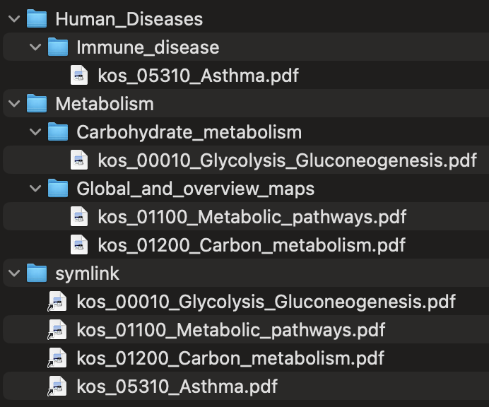{:.center-img .width-50}

### Gathering files by map

`--draw-individual-files` writes one subdirectory per data source, each holding that source's whole set of maps. That is the right arrangement for reading everything about one sample, and the wrong one for comparing a single map across samples, which means opening one file in each of those subdirectories. The `--collate-files-by-map` flag adds the transposed view: a subdirectory named after each map, holding one file per source, named after the source.

With samples `A` through `E`, `by_map/ko00010` holds `A.pdf` through `E.pdf`, `by_map/ko00020` holds another five files, and so on. Selecting everything in one of those subdirectories and stepping through it with a file browser's preview shows the colors of a single map changing from sample to sample, like an animation. Files are sorted by the name of their source, so name your samples in the order in which you would like to step through them.

This is a second arrangement of the same files rather than a replacement: the subdirectory per source stays where it is, and the gathered files are links to the maps already drawn there, so they take up no disk space of their own. `--name-files` and `--categorize-files` apply here as they do elsewhere in the output, so with both of them a gathered map would be found at, say, `by_map/Metabolism/Carbohydrate_metabolism/ko00010_Glycolysis_Gluconeogenesis/SAMPLE_1.pdf`.

### Playing maps gathered by map

The `--animate-files-by-map` flag adds a player for each map gathered by `--collate-files-by-map`. The player is an HTML file written beside the map's subdirectory, so `by_map/ko00010` gets `by_map/ko00010.html`. It opens in any current web browser, straight from the disk, with no internet connection and no anvi'o installation, so it can be passed around as a single file.

The player shows the map of each sample, contigs database, genome, or group in turn. The **Play** button or the space bar starts and pauses it. Dragging the slider moves back and forth to any frame, the arrow keys step one frame at a time, and Home and End jump to the first and last frames. The seconds per frame and looping can be changed on the page. **Actual size** shows the map at its full resolution instead of fitting it to the window.

The name of each frame's source is shown above the map. Frames follow the order of the run. Samples are sorted by name as text, so `T10` comes before `T2` unless the numbers are padded, as in `T02`. Groups follow the [groups-txt](/help/main/artifacts/groups-txt) file, contigs databases follow the order in which they were given, and genomes follow the pangenome. Names listed after `--draw-individual-files` are shown in the order listed, which is a way to choose any order.

A source with no data on a map has no file in that map's subdirectory. The player shows the bare map in its place, with the note "No data on this map", so every player of a run has the same frames in the same order. With `--draw-bare-maps`, the bare map of that source is drawn and gathered like any other map, so the player shows it without the note. Every map of the run then gets a player, even a map with no data in any source.

The colorbars and bar keys that key the individual maps are shown beside the map. The key of borders, bars, or pies is shown only in the players of maps that can show them. Where groups are colored by counts of their own sources, each group has its own colorbar, and the player shows the one that belongs to the frame.

Each frame is stored in the page as a lossless image of the map at the resolution of the KEGG image, so the colors are those of the map files. Unlike the gathered maps, the players are new files rather than links. Three frames of `00010` take about 0.2 MB, and twelve frames of the global map `01100` take about 13 MB.

## Mapping reaction and compound occurrence

Gene sequences in anvi'o databases can be annotated with KEGG Orthologs (KOs) indicating the functional capabilities of the gene product: see [anvi-run-kegg-kofams](/help/main/programs/anvi-run-kegg-kofams). KO data can be provided directly by a [kegg-reaction-txt](/help/main/artifacts/kegg-reaction-txt) file or a reaction network JSON file, instead of through anvi'o databases. KO data from one or more organisms can be mapped, enabling the comparison of metabolic capabilities.

Rather than KOs, KEGG reactions supplied by a [kegg-reaction-txt](/help/main/artifacts/kegg-reaction-txt) file can be used to draw the reaction layer; both map to reaction elements — reaction lines in global and overview maps and boxes in standard maps.

KEGG compounds provided by a [kegg-compound-txt](/help/main/artifacts/kegg-compound-txt) file can be used to draw the compound layer of circle elements on maps.

### Reaction and compound text files

Maps can be drawn directly from per-layer text files — the quickest way to visualize custom data, needing no anvi'o database. There is one file per layer, and either or both can be given:

- a [kegg-reaction-txt](/help/main/artifacts/kegg-reaction-txt) file (`--reaction-txt`) colors the **reaction layer**. Its `accession` column holds either KO IDs (`K#####`), as with the database inputs, **or** KEGG reaction IDs (`R#####`) when data are per-reaction, such as a metabolic model's fluxes — ALL accessions in the file must be of one type or the other.
- a [kegg-compound-txt](/help/main/artifacts/kegg-compound-txt) file (`--compound-txt`) colors the **compound layer**, from data such as metabolomics. Its `accession` column holds compound IDs (`C#####`).

When both files are given, the two layers are drawn together on each map, each on its own color scale, so that (for example) metabolite levels can be compared against enzyme expression. Each layer is colored independently by its own auto-detected mode (see below). Columns named by `--reaction-slice-weights`, `--reaction-border-column`, `--compound-border-column`, `--reaction-bar-column`, and `--compound-bar-column` are left out of the detection. Here is a basic command drawing just the reaction layer.

anvi&#45;draw&#45;kegg&#45;pathways &#45;&#45;reaction&#45;txt [kegg&#45;reaction&#45;txt](/help/main/artifacts/kegg&#45;reaction&#45;txt) \
                        &#45;o output_maps/

See [kegg-reaction-txt](/help/main/artifacts/kegg-reaction-txt) and [kegg-compound-txt](/help/main/artifacts/kegg-compound-txt) for the full format of each file.

Data from more than one origin, such as multiple genomes or samples, can be compared on the same maps by adding a `sample` column. Because this works just like comparing multiple contigs databases, it is described further below, under [Compare samples in an input text file](#compare-samples-in-an-input-text-file).

Instead of showing presence/absence, elements can be colored by a continuous quantitative value from a numeric column of the file, such as KO coverage, reaction flux, or compound concentration. This is described below, under [Color elements by a quantitative value](#color-elements-by-a-quantitative-value).

A second column can color the borders of reaction boxes and compound circles. It is named with `--reaction-border-column` or `--compound-border-column`, so it is never taken for the value column. This is described below, under [Color borders by a second column](#color-borders-by-a-second-column).

A column can also set the lengths of bars in reaction boxes or the sizes of pies in compound circles. It is named with `--reaction-bar-column` or `--compound-bar-column`, so it is never taken for the value column either. This is described below, under [Draw bars in boxes](#draw-bars-in-boxes).

### Reaction network JSON file

Pathway maps can be drawn from a reaction network JSON file produced by [anvi-reaction-network](/help/main/programs/anvi-reaction-network) or [anvi-get-metabolic-model-file](/help/main/programs/anvi-get-metabolic-model-file). This is especially useful with custom enzyme lists — for example, annotations from transcriptomic or proteomic data, or predicted gene content of a last common ancestor.

anvi&#45;draw&#45;kegg&#45;pathways &#45;&#45;reaction&#45;network&#45;json /path/to/network.json \
                        &#45;o output_maps/

### Single contigs database

Pathway maps can be drawn from KO data in a single [contigs-db](/help/main/artifacts/contigs-db).

anvi&#45;draw&#45;kegg&#45;pathways &#45;&#45;contigs&#45;dbs [contigs&#45;db](/help/main/artifacts/contigs&#45;db) \
                        &#45;o output_dir

Here are three maps drawn with this command from a bacterial genomic contigs database. The map in the upper left, `00010 Glycolysis / Gluconeogenesis`, is a "standard" map, in which boxes are associated with a reaction arrow and one or more KOs. The map in the upper right, `01200 Carbon metabolism`, is a metabolic "overview" map. Overview maps have numerical IDs in the range `012XX` and `013XX`. Reaction arrows in overview maps are associated with one or more KOs and are colored and widened if represented by anvi'o KO data. The bottom map, `01100 Metabolic pathways`, is a "global" metabolic map. Global maps have numerical IDs in the range `011XX`. Reaction lines in global maps are associated with one or more KOs and colored if represented by anvi'o KO data. In global and overview maps, a circle is colored where a colored reaction touches it. A reaction touches the circles at the ends of its lines: global maps draw lines into their circles, and overview maps draw arrows that stop just short of them. A compound drawn in several places is therefore colored only where a colored reaction touches it.

#### Set color

The default reaction color can be changed with the `--reaction-color` option. For text-file input, the compound layer has its own `--compound-color`.

The argument must be a six-digit color hex code, e.g., `"#FF0000"` for red. A color name, such as `red`, is refused. It is necessary to enclose a color hex code argument in quotation marks, as `#` otherwise causes the rest of the command to be ignored as a comment. For a text file with a border column and no value or bar column, these options also take `none` (see [Rings without fills](#rings-without-fills)).

anvi&#45;draw&#45;kegg&#45;pathways &#45;&#45;contigs&#45;dbs [contigs&#45;db](/help/main/artifacts/contigs&#45;db) \
                        &#45;&#45;pathway&#45;numbers 00010 \
                        &#45;&#45;reaction&#45;color "#2986cc" \
                        &#45;o output_dir

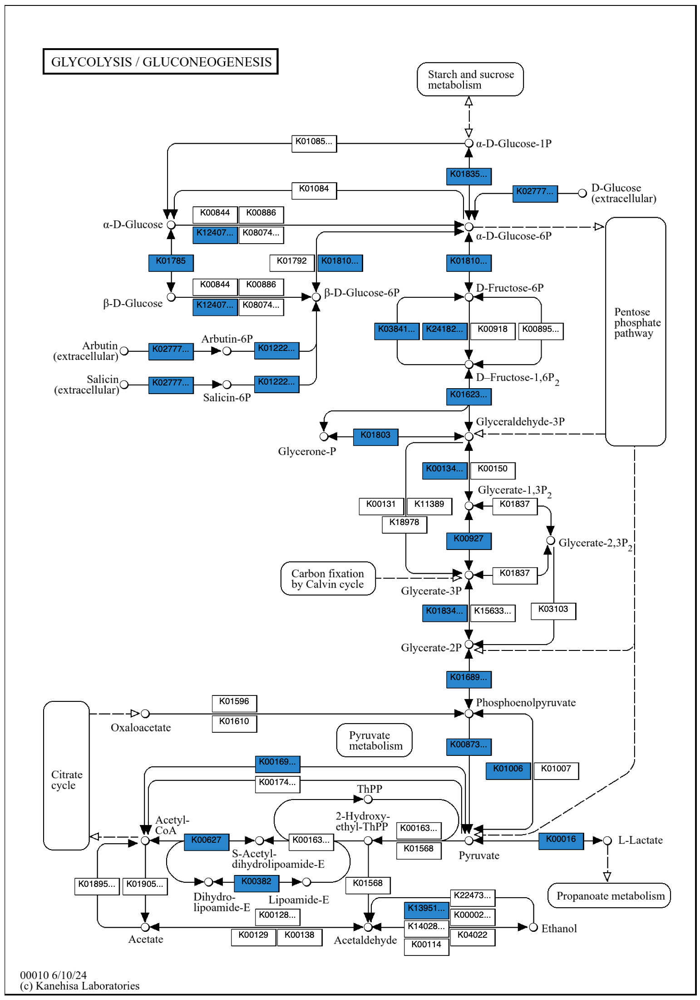{:.center-img .width-60}

The `--original-color` flag instead uses the original color scheme of the reference map. Global maps are especially colorful, with reactions varying in color across the map as a broad indication of function.

anvi&#45;draw&#45;kegg&#45;pathways &#45;&#45;contigs&#45;dbs [contigs&#45;db](/help/main/artifacts/contigs&#45;db) \
                        &#45;&#45;pathway&#45;numbers 00010 01100 01200 \
                        &#45;&#45;original&#45;color \
                        &#45;o output_dir

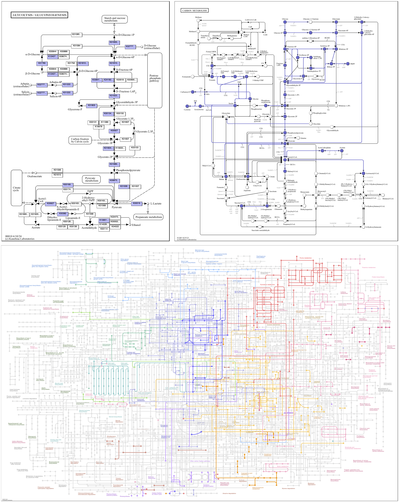

### Compare multiple contigs databases

The KO content of multiple contigs databases can be compared. Database file paths can be provided directly on the command line or in an [external-genomes](/help/main/artifacts/external-genomes) text file.

anvi&#45;draw&#45;kegg&#45;pathways &#45;&#45;contigs&#45;dbs [contigs&#45;db](/help/main/artifacts/contigs&#45;db)_1 [contigs&#45;db](/help/main/artifacts/contigs&#45;db)_2 ... [contigs&#45;db](/help/main/artifacts/contigs&#45;db)_N \
                        &#45;o output_dir

anvi&#45;draw&#45;kegg&#45;pathways &#45;&#45;external&#45;genomes [external&#45;genomes](/help/main/artifacts/external&#45;genomes) \
                        &#45;o output_dir

The images in this section show data from contigs databases of genomes from different strains of the same bacterial species.

#### Color by database

When comparing a small number of contigs databases (realistically, two or three), reactions can be colored by their occurrence across databases, with each color representing a different database or combination of databases. A colorbar key is drawn in a separate file in the output directory, `colorbar_reactions.pdf`. Each compound circle takes the color of the reaction touching it that is found in the greatest number of databases.

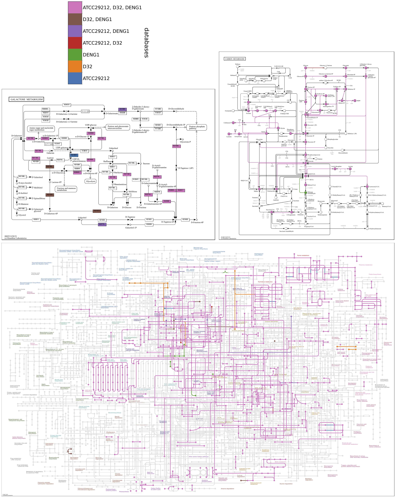

#### Color by count

When comparing a larger number of contigs databases, it makes more sense to color reactions by the number of databases in which they occur using a sequential colormap rather than by database or combination of databases using a qualitative colormap. By default, coloring explicitly by database automatically applies to three or fewer databases, whereas coloring by database count applies to four or more databases. The user can override this default with the option, `--presence-colormap-scheme`, which accepts the values `by_membership`, `by_count`, and `by_count_continuous`. For example, the user may have three databases but wish to color reactions by database count, and so would specify `--presence-colormap-scheme by_count`.

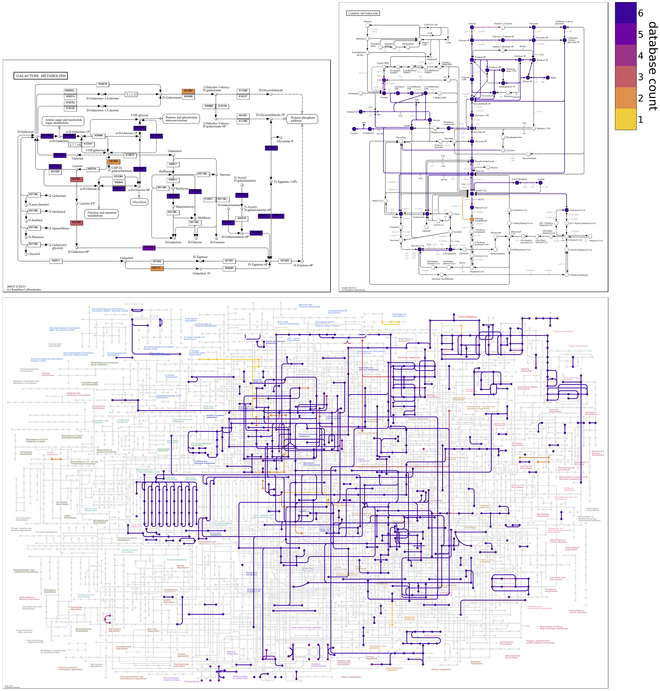

##### Counts on a continuous scale

`by_count` labels one band per count, which asks two things of the colorbar. It needs a distinguishable color for each count. It is refused when the colormap cannot supply that many. A colormap supplies a few hundred distinguishable colors at most. It also needs room to set every one of those labels: a label is sized to fit its band, so past about 40 bands they are too small to read. Asking for `by_count` above that draws the bands anyway, with a warning that the labels will be tiny.

`by_count_continuous` colors counts from the same colormap. It draws the colorbar as a gradient rather than as a discrete band per count, so it needs neither a color nor a label per count. It works with any number of samples, contigs databases, genomes, or groups. It is chosen automatically, with a warning, wherever `by_count` would be refused or its labels would be unreadable.

For a [kegg-reaction-txt](/help/main/artifacts/kegg-reaction-txt) or [kegg-compound-txt](/help/main/artifacts/kegg-compound-txt) file this is the summaries' `count_continuous` rather than `--presence-colormap-scheme`; see [Compare samples in an input text file](#compare-samples-in-an-input-text-file). The count scale of a group's own maps has the same two choices under its own option, `--group-colormap-scheme`; see [counts in bands or on a gradient](#counts-in-bands-or-on-a-gradient).

##### Where a count scale stops

A count scale runs from 1 to a maximum set by `--count-scale-max`. `observed` (the default) stops the scale at the highest count on the drawn maps. `total` runs it to the number of samples, contigs databases, genomes, or groups being counted. A number sets the maximum. Higher counts take the top color.

This matters for sparse data. With 100 samples and no compound in more than 10 of them, a scale to 100 draws every compound in nearly indistinguishable shades at the bottom of the colormap, while a scale to 10 spreads them across it. The cost of `observed` is that the scale depends on which maps were drawn, so use `total` or a number where figures have to be comparable between runs.

#### Choose the membership colors yourself

Instead of having anvi'o sample a colormap, a color can be given to each sample, contigs database, genome, or group in a [kegg-membership-colors-txt](/help/main/artifacts/kegg-membership-colors-txt) file. Pass the file with `--reaction-membership-colors`. Pass it with `--compound-membership-colors` for the compound layer of a [kegg-compound-txt](/help/main/artifacts/kegg-compound-txt) file. Use this file when each color has to mean the same thing across every figure in a paper.

|genome|color|
|:--|:--|
|E_faecalis_6240|#1f77b4|
|E_faecalis_6255|#ff7f0e|
|E_faecalis_6512|#2ca02c|

Coloring by membership colors a reaction by exactly *which* samples, contigs databases, genomes, or groups contain it, so it needs a color for each *combination* of them. Each sample, contigs database, genome, or group on its own takes its own color. A combination takes the perceptual blend of its members' colors. A row naming the combination overrides that blend. The row gives the names in the combination separated by commas. Where the file colors samples, contigs databases, or genomes, the same colors also color the map of each one. A panel of a grid then shows which sample, database, or genome it is. The panel also matches the band of that sample, database, or genome on the `unified` map. Where the file colors groups, each group's own maps count that group's sources. They do not show which of the sources an element is in, so a group's maps take the group's color only with `--group-colormap tint`. That option colors them with a ramp of tints of the group's color.

Because the colors answer the same question a colormap does, this replaces `--reaction-colormap` and cannot be combined with it. It also does not apply to coloring by *count*. A count says how many samples, contigs databases, genomes, or groups contain a reaction, not which ones, so a count has no one sample, database, genome, or group whose color it could take.

anvi&#45;draw&#45;kegg&#45;pathways &#45;&#45;external&#45;genomes [external&#45;genomes](/help/main/artifacts/external&#45;genomes) \
                        &#45;&#45;reaction&#45;membership&#45;colors [kegg&#45;membership&#45;colors&#45;txt](/help/main/artifacts/kegg&#45;membership&#45;colors&#45;txt) \
                        &#45;&#45;draw&#45;grid \
                        &#45;o output_dir

#### Reverse colormap

Changing the colormap can draw attention to different information on maps. When coloring by count, the default sequential colormap, `plasma_r`, goes from dark to light colors; reactions shared among all of the contigs databases are assigned the darkest color, and reactions unique to a single database are assigned the lightest color. The colormap can be reversed to accentuate unshared reactions in the darkest colors and shared reactions in the lightest colors. Reversing the default colormap is accomplished with the option, `--reaction-colormap plasma 0.1 0.9`. Note that Matplotlib colormap names differing by `_r` (here, `plasma` and `plasma_r`) have the same colors in reverse.

The second and third numerical `--reaction-colormap` values are not mandatory, but can be provided to trim a fraction of the colormap from each end to eliminate the lightest and darkest colors. The default coloring by database count with `plasma_r` uses limits of `0.1 0.9`. Just changing the colormap (e.g., `--reaction-colormap plasma`) removes the limits (i.e., changes them to `0.0 1.0`), so exactly reversing the default colormap requires that the same limits be specified.

The `--reaction-reverse-overlay` flag should also be used to reverse the default drawing order. This causes unshared reactions to be rendered above rather than below shared reactions, which is especially important in cluttered global maps.

anvi&#45;draw&#45;kegg&#45;pathways &#45;&#45;external&#45;genomes [external&#45;genomes](/help/main/artifacts/external&#45;genomes) \
                        &#45;&#45;reaction&#45;colormap plasma 0.1 0.9 \
                        &#45;&#45;reaction&#45;reverse&#45;overlay \
                        &#45;o output_dir

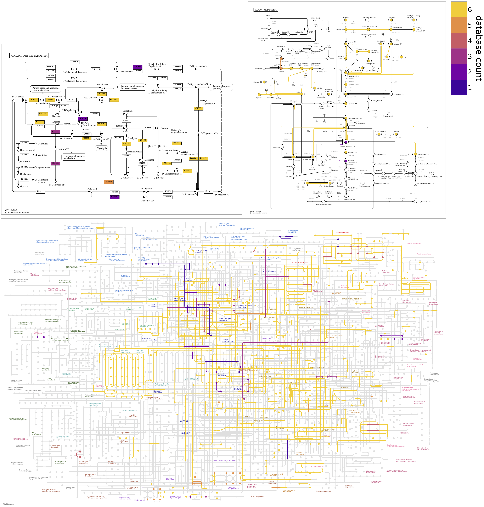

#### Show individual database maps

Coloring by count obviously masks the individual contigs databases that contain the different reactions. However, options are provided to enable investigation of the distribution of reactions across databases.

Standalone map files showing the presence/absence of reactions in all of the individual contigs databases can be drawn by using the option, `--draw-individual-files`, as a flag. Files can be drawn just for a subset of input databases by passing file arguments to the option, e.g., `--draw-individual-files contigs_db_1 contigs_db_3`. Individual map files for each database are stored in subdirectories of the output directory, with subdirectory names being the project names of databases.

To facilitate comparisons, maps for individual databases can also be drawn alongside the "unified" map containing information from all databases by using the option, `--draw-grid`, as a flag. Maps for just a subset of individual databases can be shown alongside the unified map in the grid file by passing file arguments to the option, e.g., `--draw-grid contigs_db_2 contigs_db_3`. Grid files are stored in a subdirectory of the output directory named `grid`.

The following command would draw individual map files plus grid files for all input contigs databases; a reverse colormap is used in unified maps to emphasize unshared reactions.

anvi&#45;draw&#45;kegg&#45;pathways &#45;&#45;external&#45;genomes [external&#45;genomes](/help/main/artifacts/external&#45;genomes) \
                        &#45;&#45;draw&#45;grid \
                        &#45;&#45;draw&#45;individual&#45;files \
                        &#45;&#45;reaction&#45;colormap plasma 0.1 0.9 \
                        &#45;&#45;reaction&#45;reverse&#45;overlay \
                        &#45;o output_dir

The following map grid uncovers aspects of `Galactose metabolism` among the genomes of six *Enterococcus faecalis* strains. The unified map shows that some genomes may be missing steps from `Lactose` to `D-Tagatose-6P` in the tagatose-6-phosphate pathway, an alternative to the Leloir pathway for lactose catabolism found in some lactic acid bacteria. The individual maps show that strain **ATCC29212** is missing three consecutive steps; **OG1RF** and **V583** are missing two consecutive steps. When sequential reactions catalyzed by different enzymes are missing from a pathway in a closed genomic assembly while present in related genomes, it compellingly suggests that the genes and biological capacity are not in the genome rather than absent due to technical issues of orthology annotation.

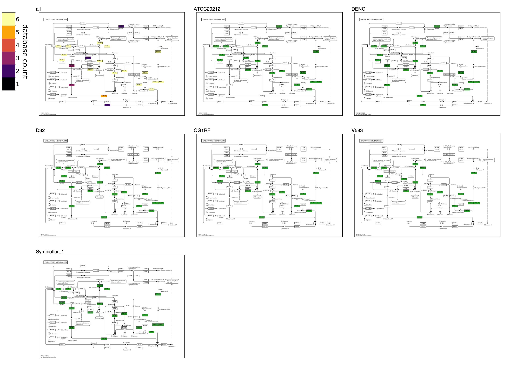

### Compare groups of contigs databases

A [groups-txt](/help/main/artifacts/groups-txt) file can be supplied to define groups of contigs databases. For example, databases representing genomes could be grouped by taxonomy, databases representing enrichment cultures under different conditions could be grouped by treatment, or databases representing marine metagenomic samples could be grouped by depth. The first column of [groups-txt](/help/main/artifacts/groups-txt) must contain the paths to the input contigs databases provided with `--contigs-dbs`. The second column headed `group` must contain group names, such as `Pacific`, `Atlantic`, and `Arctic`. Each database can only be assigned to one group.

A `--group-threshold` argument between 0 and 1 must also be provided to analyze groups. The group threshold is the proportion of databases in a group that must contain KOs defining a reaction on a map for the reaction to be associated with the group. A threshold of 0 means that ANY database in the group can contain the reaction for the reaction to be considered present in the group. A threshold of 0.75 means that at least 75% of databases in the group must contain the reaction for it to be present. A threshold of 1 means that ALL of the databases in the group must contain the reaction for it be present.

For example, set the threshold to 0.5. Reaction J on a map is defined by KO X and Reaction K is defined by KOs Y and Z. 90% of Pacific, 50% of Atlantic, and 10% of Arctic metagenomes contain KO X, so Reaction J would be colored to indicate that it is found in the Pacific and Atlantic. 0% of Pacific, 15% of Atlantic, and 40% of Arctic metagenomes contain KO Y or KO Z, so Reaction K would not be colored, being considered absent from the groups.

anvi&#45;draw&#45;kegg&#45;pathways &#45;&#45;external&#45;genomes [external&#45;genomes](/help/main/artifacts/external&#45;genomes) \
                        &#45;&#45;groups&#45;txt [groups&#45;txt](/help/main/artifacts/groups&#45;txt) \
                        &#45;&#45;group&#45;threshold 0.5 \
                        &#45;o output_dir

As with comparisons of databases rather than groups, the default setting with two or three groups is to color reactions explicitly by the group or combination of groups in which they occur. With more databases, it makes more sense to color reactions by the number of databases in which they occur using a sequential colormap. The option `--presence-colormap-scheme` can be used to override this behavior, e.g., to color reactions by group count rather than explicitly by membership using `--presence-colormap-scheme by_count`.

The following example continues with `Galactose metabolism`, now including two groups of genomic contigs databases from *Enterococcus faecalis* and *Enterococcus faecium*. The program was run three times with different values of `--group-threshold`. The top map has a threshold of 0, so a reaction is included in the *faecalis* group if it has corresponding KOs in any of the six *faecalis* genomes, and included in the *faecium* group if it has KOs in any of the five *faecium* genomes. The middle map has a threshold of 0.5, so reactions in the *faecalis* group must be in at least four of six *faecalis* genomes, and reactions in the *faecium* group must be in at least three of five genomes. The bottom map has a threshold of 1. As in the map grid of *faecalis* genomes from above, the group maps show that some *faecalis* strains may be missing steps from `Lactose` to `D-Tagatose-6P` in the tagatose-6-phosphate pathway, though at least four of the strains have each step. In comparison, a greater proportion of the *faecium* strains have these steps, with all of them having the first two, as seen in the bottom map with a threshold of 1.

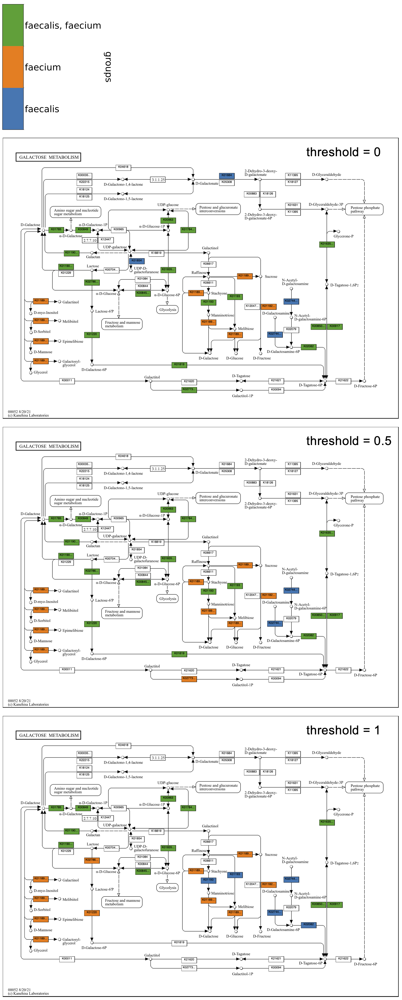

Below is the `Global metabolism` map using the same species groups with thresholds of 0 and 1. The map with a threshold of 0 shows how some metabolic pathways are present only in *faecalis* or *faecium* genomes, and the threshold of 1 shows how some of these unique pathways are conserved amongst all of the genomes of the species, such as the *faecalis* (blue) reactions in the upper right corner of the map involved in cofactor biosynthesis, and the *faecium* (orange) reactions in the upper center involved in sugar metabolism, including galactose, pentoses, and uronates.

Exploring the `Folate biosynthesis` map given the observation regarding cofactors in the global map, all *faecalis* genomes have a full set of enzymes required for folate biosynthesis, whereas all *faecium* genomes appear to be missing a big chunk of the pathway in the center of the map, from `7,8-Dihydroneopterin 3'-3P` to `7,8-Dihydropteroate`. The implication of folate auxotropy in *faecium* is confirmed by Ramsey, Hartke, and Huycke in [The Physiology and Metabolism of Enterococci](https://www.ncbi.nlm.nih.gov/books/NBK190432/): "Characteristically, *E. faecium* requires folate while *E. faecalis* does not."

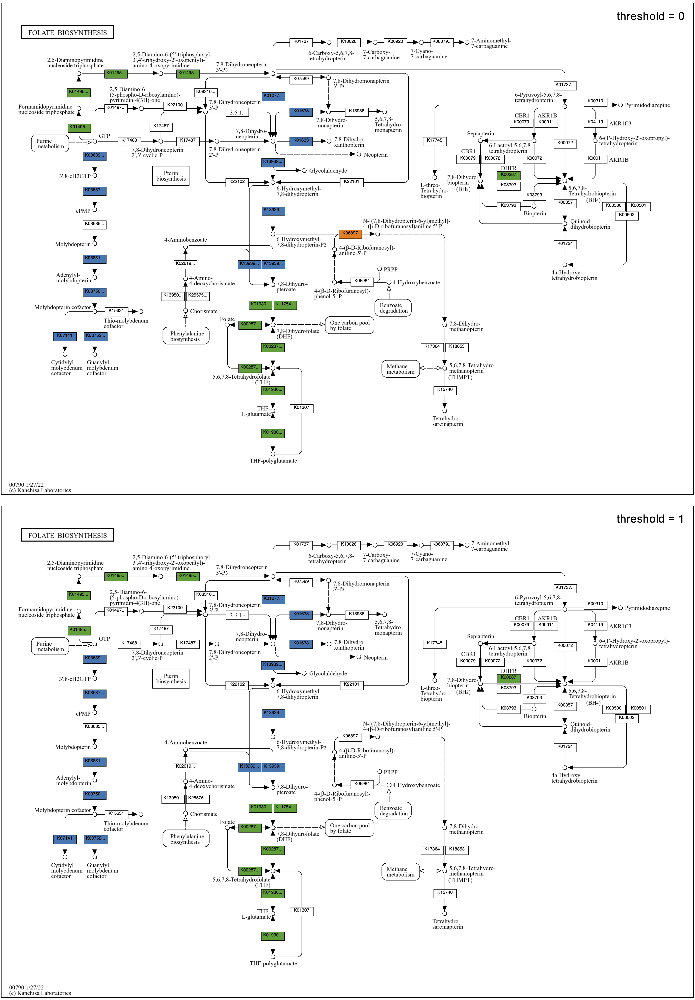

#### Show individual group maps

Maps can be drawn for individual groups as grids or separate files. These depict the occurrence of reactions across contigs databases in each group, identical to the maps that can be drawn to compare ungrouped databases.

Coloring options are available for individual group maps, `--group-colormap`, `--group-colormap-scheme` and `--group-reverse-overlay`. Unlike drawing maps for ungrouped databases, drawing maps for individual groups always colors reactions by database count regardless of the number of databases in the group in order to facilitate the comparison of individual group maps using the same colormap scheme.

With the option, `--draw-individual-files`, individual group map files and a colorbar file are written to subdirectories of the output directory named after groups. With the option, `--draw-grid`, map grid files and colorbar files are written to the `grid` subdirectory of the output directory. There are colorbar files for each individual group in the grids: using our example *Enterococcus* dataset, there are files like *colorbar_faecalis.pdf* and *colorbar_faecium.pdf*.

A subset of groups can be considered, limiting the individual files drawn or the individual maps shown in grids to the specified groups, e.g., `--draw-individual-files faecalis`, `--draw-grid faecium`.

The following command would draw individual map files plus grid files for all groups. A reverse colormap is used in individual group maps to emphasize reactions that are not shared across databases of the group. The group threshold is set to 0, meaning a reaction is classified in a group if it occurs in any database, since the individual group maps reveal the number of databases in which the reaction occurs.

anvi&#45;draw&#45;kegg&#45;pathways &#45;&#45;external&#45;genomes [external&#45;genomes](/help/main/artifacts/external&#45;genomes) \
                        &#45;&#45;groups&#45;txt [groups&#45;txt](/help/main/artifacts/groups&#45;txt) \
                        &#45;&#45;group&#45;threshold 0 \
                        &#45;&#45;draw&#45;individual&#45;files \
                        &#45;&#45;draw&#45;grid \
                        &#45;&#45;group&#45;colormap plasma 0.1 0.9 \
                        &#45;&#45;group&#45;reverse&#45;overlay \
                        &#45;o output_dir

##### Give each group's maps its own color

A group's own maps show a *magnitude* — the number of the group's databases, genomes, or samples containing a reaction — while a group's color on the `unified` map is an *identity*. The two are separate by default: `--group-colormap` names a colormap engineered for showing magnitude, and a [kegg-membership-colors-txt](/help/main/artifacts/kegg-membership-colors-txt) file does not change it.

To give each group's maps the group's own color, give `--group-colormap tint`. Each group's scale is then a ramp running from a pale tint to that group's own color, so `faecalis` panels are drawn in shades of one hue and `faecium` panels in shades of another. Every group's ramp is built the same way, so the panels of a grid stay comparable while each says which group it is.

anvi&#45;draw&#45;kegg&#45;pathways &#45;&#45;external&#45;genomes [external&#45;genomes](/help/main/artifacts/external&#45;genomes) \
                        &#45;&#45;groups&#45;txt [groups&#45;txt](/help/main/artifacts/groups&#45;txt) \
                        &#45;&#45;group&#45;threshold 0 \
                        &#45;&#45;reaction&#45;membership&#45;colors [kegg&#45;membership&#45;colors&#45;txt](/help/main/artifacts/kegg&#45;membership&#45;colors&#45;txt) \
                        &#45;&#45;group&#45;colormap tint \
                        &#45;&#45;draw&#45;individual&#45;files \
                        &#45;&#45;draw&#45;grid \
                        &#45;o output_dir

The two decimal values `--group-colormap` also accepts then say how far from white each ramp starts and stops rather than which fraction of a colormap to use, defaulting to `0.25 1.0`. The pale end stops short of white on purpose: standard and overview maps keep white for their own unhighlighted elements, so a ramp reaching it could not be drawn there. Anvi'o checks every group's ramp against those reserved colors before writing any file, and if one collides it says to start the ramp further from white — that is, to raise the first of the two values.

Since one scale styles every layer's group maps at once, a run whose reaction and compound layers give the same group different colors is refused; pointing both `--reaction-membership-colors` and `--compound-membership-colors` at a single file is the simplest way to keep them in step.

##### Counts in bands or on a gradient

A group's count scale is drawn in discrete bands, one per count the scale runs over — which is where `--count-scale-max` stops it, not how many sources the group has — or as a gradient over that same range. These are the two choices `--presence-colormap-scheme` gives the `unified` map, under `--group-colormap-scheme`:

anvi&#45;draw&#45;kegg&#45;pathways &#45;&#45;external&#45;genomes [external&#45;genomes](/help/main/artifacts/external&#45;genomes) \
                        &#45;&#45;groups&#45;txt [groups&#45;txt](/help/main/artifacts/groups&#45;txt) \
                        &#45;&#45;group&#45;threshold 0 \
                        &#45;&#45;group&#45;colormap&#45;scheme by_count_continuous \
                        &#45;&#45;draw&#45;individual&#45;files \
                        &#45;&#45;draw&#45;grid \
                        &#45;o output_dir

Which color a count takes is the same either way: it is always sampled at an even fraction of the group's colormap or ramp, so this option changes the colorbar and nothing on the maps themselves. `by_count` needs a distinguishable color for every count *and* room to label every band, both of which a group of many sources can exhaust; `by_count_continuous` needs neither, since a color on a gradient reads as a position along the range of counts rather than as an exact count, and so works for a group of any size. By default the bands are drawn while they can be told apart and read, and the gradient takes over with a warning where they cannot — see [counts on a continuous scale](#counts-on-a-continuous-scale).

Unlike `--presence-colormap-scheme`, which each layer sets for itself, one scheme covers every layer's group maps, because the reaction and compound layers of a group's map share one set of colors and one colorbar. For the same reason the choice is made once for the whole run rather than per group, so that the panels of a grid all carry the same kind of colorbar. There is no `by_membership` here: a group's own map counts that group's sources and never shows which of them contain an element.

Continuing with the comparison of *Enterococcus* species, the `Folate biosynthesis` map from above shows, on the left side, that all *faecalis* genomes have the pathway for molybdenum cofactor (MoCo) biosynthesis, unlike any *faecium* genomes. A molybdenum requirement in *faecalis* but not *faecium* is supported by the annotation of a molybdate transporter in all *faecalis* genomes and no *faecium* genomes, as seen in an `ABC transporters` map grid -- in the map of "all" groups, it is the top transporter colored blue in the first column.

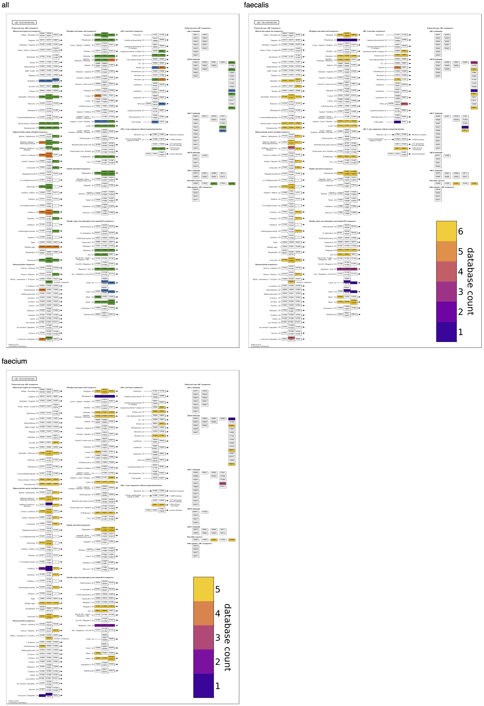

### Compare samples in an input text file

The [kegg-reaction-txt](/help/main/artifacts/kegg-reaction-txt) and [kegg-compound-txt](/help/main/artifacts/kegg-compound-txt) files introduced above can compare data across origins in the same way as multiple contigs databases, without any anvi'o database. Add a `sample` column that assigns each row to its sample of origin, where a sample can be, for example, a genome (e.g., *E. coli* versus *K. pneumoniae*), a metagenome, or a transcriptomic, proteomic, or metabolomic sample. Every row must have a sample.

When a layer's file has a `sample` column but no value column, its elements are compared across samples just as reactions are across contigs databases: they are colored by the sample or by the number of samples in which they occur, a `colorbar_reactions.pdf` (and, for the compound layer, `colorbar_compounds.pdf`) key is written, and all of the same coloring and output options apply, including `--reaction-colormap`, `--compound-colormap`, `--reaction-reverse-overlay`, `--draw-individual-files`, and `--draw-grid`. Whether elements are colored by *which* samples or by *how many* is set per layer with `--reaction-sample-summary`/`--compound-sample-summary` (`membership`, `count` or `count_continuous`; by default `membership` for 3 or fewer samples, `count` above that, and `count_continuous` where a discrete scale would run out of distinguishable colors or of room to label its bands). `count` writes a discrete colorbar with one band per count and `count_continuous` writes a gradient from the lowest count to the highest, as described under [counts on a continuous scale](#counts-on-a-continuous-scale). These per-layer options take the place of `--presence-colormap-scheme`, which applies to contigs database and pangenome inputs only and is rejected for a text run. (If a file has a value column, that value colors each sample's own map; see [Color elements by a quantitative value](#color-elements-by-a-quantitative-value).)

When elements are colored by *which* samples or groups contain them, the color of each of them can be given explicitly in a [kegg-membership-colors-txt](/help/main/artifacts/kegg-membership-colors-txt) file rather than sampled from a colormap — `--reaction-membership-colors` for the reaction layer and `--compound-membership-colors` for the compound layer, each taking the place of that layer's colormap. See [Choose the membership colors yourself](#choose-the-membership-colors-yourself). The file works the same way here as it does for contigs databases and genomes. Without a [groups-txt](/help/main/artifacts/groups-txt), the map of each sample of a layer with a value column shows that sample's values, so the file colors only the `unified` map.

anvi&#45;draw&#45;kegg&#45;pathways &#45;&#45;reaction&#45;txt [kegg&#45;reaction&#45;txt](/help/main/artifacts/kegg&#45;reaction&#45;txt) \
                        &#45;&#45;draw&#45;grid \
                        &#45;&#45;draw&#45;individual&#45;files \
                        &#45;o output_dir

Samples can be grouped with a [groups-txt](/help/main/artifacts/groups-txt) file, like contigs databases. The file has the same format, but the items in its first column must be the sample names from the `sample` column. The two files share one sample space and one [groups-txt](/help/main/artifacts/groups-txt). Whenever a layer summarizes its groups by presence — the default — `--group-threshold` must accompany `--groups-txt`, as with contigs databases: it sets the proportion of a group's samples in which an element must occur for the group to be considered to contain it.

anvi&#45;draw&#45;kegg&#45;pathways &#45;&#45;reaction&#45;txt [kegg&#45;reaction&#45;txt](/help/main/artifacts/kegg&#45;reaction&#45;txt) \
                        &#45;&#45;groups&#45;txt [groups&#45;txt](/help/main/artifacts/groups&#45;txt) \
                        &#45;&#45;group&#45;threshold 0.5 \
                        &#45;o output_dir

### Pangenomic database

Pangenomes are treated similarly to multiple contigs databases. Rather than comparing the distribution of KOs across contigs databases, KOs assigned to [pan-db](/help/main/artifacts/pan-db) gene clusters are compared across genomes. Here is the basic structure of the command.

anvi&#45;draw&#45;kegg&#45;pathways &#45;p [pan&#45;db](/help/main/artifacts/pan&#45;db) \
                        &#45;g [genomes&#45;storage&#45;db](/help/main/artifacts/genomes&#45;storage&#45;db) \
                        &#45;o output_dir

The following maps were produced with the basic command structure for a pangenome of seven *Enterococcus faecalis* and five *Enterococcus faecium* genomes. A metagenome-assembled genome (MAG) has been added to the set of *E. faecalis* genomes from above.

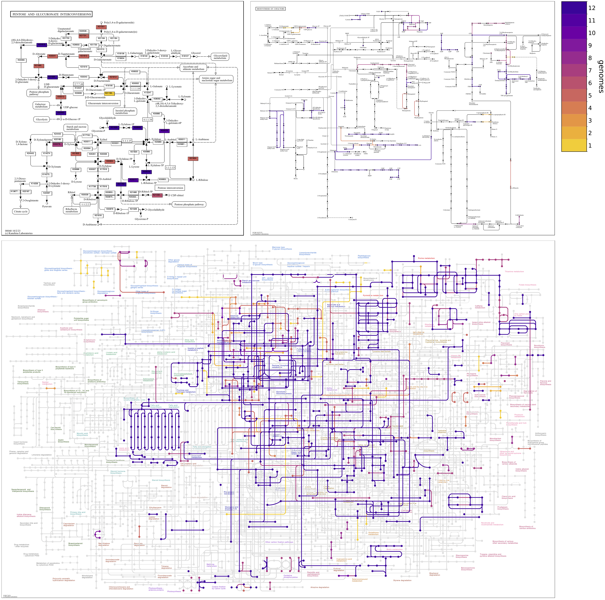

Genomes defined in the pangenomic database can be grouped like contigs databases. The [groups-txt](/help/main/artifacts/groups-txt) file has the same format, but the items in the first column must now be the names of the genomes in the pangenome rather than contigs database files. The following command colors reactions by group, assigning a reaction to a group if the reaction is in at least 50% of the group's genomes.

anvi&#45;draw&#45;kegg&#45;pathways &#45;p [pan&#45;db](/help/main/artifacts/pan&#45;db) \
                        &#45;g [genomes&#45;storage&#45;db](/help/main/artifacts/genomes&#45;storage&#45;db) \
                        &#45;&#45;groups&#45;txt [groups&#45;txt](/help/main/artifacts/groups&#45;txt) \
                        &#45;&#45;group&#45;threshold 0.5 \
                        &#45;o output_dir

All of the options demonstrated in comparing contigs databases apply to pangenomes as well, including drawing map grids and changing the colormap to emphasize reactions unshared between genomes.

anvi&#45;draw&#45;kegg&#45;pathways &#45;p [pan&#45;db](/help/main/artifacts/pan&#45;db) \
                        &#45;g [genomes&#45;storage&#45;db](/help/main/artifacts/genomes&#45;storage&#45;db) \
                        &#45;&#45;draw&#45;grid \
                        &#45;&#45;reaction&#45;colormap plasma 0.1 0.9 \
                        &#45;&#45;reaction&#45;reverse&#45;overlay \
                        &#45;o output_dir

Continuing with the *Enterococcus* pangenome, the following map grid shows differences in `Pentose and glucuronate interconversions` between *faecalis* and *faecium* and between strains of each species. *faecalis* genomes are enriched in genes for xylose metabolism (towards the bottom of the map), and *faecium* genomes are enriched in enzymes for uronate metabolism (toward the top of the map). The *faecalis* MAG, **SHARON**, has genes for the catabolism of `Xylose`, via `D-Xylulose` and `D-Xylulose-5P`. These are also annotated in three of the *faecalis* isolate genomes, **ATCC29212**, **DENG1**, and **V583**, but not the other three, **D32**, **OG1RF**, and **Symbioflor_1**. Xylose utilization is [known](https://doi.org/10.1186%2Fs12864-015-1367-x) to be variable among *faecalis* strains.

#### Consensus KOs

The functional annotations of gene clusters as a whole are imputed to the genes in the cluster. The method of assigning consensus annotations to a cluster is parameterized by the options, `--consensus-threshold` and `--discard-ties`. By default, the consensus threshold is 0 and ties are not discarded. The consensus threshold sets the proportion of genes in the cluster that must have the same functional annotation to be assigned to the cluster as a whole, so a value of 0 means that the most abundant annotation is used regardless of its abundance. To discard ties means to ignore candidate consensus annotations that are equally abundant among genes. The default behavior randomly breaks ties. The consensus KO of a gene cluster becomes the KO annotation of all the genes in the cluster for the purposes of analysis.

### Color elements by a quantitative value

The sections above color elements to show **presence/absence**. A layer can instead be colored by a continuous **quantitative value** simply by including a numeric value column in its [kegg-reaction-txt](/help/main/artifacts/kegg-reaction-txt) or [kegg-compound-txt](/help/main/artifacts/kegg-compound-txt) file. The single column that is not a key column — `accession`; `sample`; in the reaction file, `gene_id` — is auto-detected as the value column, and its header labels the colorbar. The column can have any name. A column named by `--reaction-slice-weights`, `--reaction-border-column`, `--compound-border-column`, `--reaction-bar-column`, or `--compound-bar-column` is left out of this detection. Uses can include coloring reactions by gene, transcript, or protein levels in a [kegg-reaction-txt](/help/main/artifacts/kegg-reaction-txt) file, and compound levels in a [kegg-compound-txt](/help/main/artifacts/kegg-compound-txt) file. Every row must have a numeric value.

anvi&#45;draw&#45;kegg&#45;pathways &#45;&#45;reaction&#45;txt [kegg&#45;reaction&#45;txt](/help/main/artifacts/kegg&#45;reaction&#45;txt) \
                        &#45;o output_dir

For a reaction file of KO accessions, the value of a KO is the aggregate of its optional gene rows' values, and KO accessions are aggregated to map element values. Two options set these, both defaulting to `sum`: `--reaction-gene-aggregation` combines the genes carrying one KO into that KO's value, and `--reaction-accession-aggregation` combines the KOs of one map element into that element's value. They can differ — averaging across the genes of each KO while totaling across the KOs of a reaction, for instance. The compound layer has only the second of the two, `--compound-accession-aggregation`, since a compound file names no genes and no two of its rows may name the same compound in the same sample. Accession aggregations reduce values **within a sample**.

The **reaction layer** and the **compound layer** are colored on independent scales, each through its own sequential colormap and each getting its own continuous key: `colorbar_reactions.pdf` and `colorbar_compounds.pdf`. A border column takes keys of its own, such as `colorbar_reactions_border.pdf`. The reaction colormap is set with `--reaction-colormap` and the compound colormap with `--compound-colormap` (both default `plasma_r`). The drawing order of overlapping elements can be flipped per layer with `--reaction-reverse-overlay` and `--compound-reverse-overlay`.

If a layer's file has a `sample` column, the value column colors **each sample's own magnitude**: maps for individual samples are added with `--draw-individual-files` and/or `--draw-grid`, as when comparing samples by presence/absence, and they share a single `colorbar_reactions_samples.pdf` and `colorbar_compounds_samples.pdf` so their colors are directly comparable across samples. That makes two scales per layer, the `unified` map's and the one those individual maps share. They are colored by the layer's one colormap from `--reaction-colormap`/`--compound-colormap` unless `--reaction-individual-colormap`/`--compound-individual-colormap` gives the individual maps a distinct colormap; see [Give the two scales different colormaps](#give-the-two-scales-different-colormaps). A border column adds two scales of its own, keyed in `colorbar_reactions_border.pdf` and `colorbar_reactions_border_samples.pdf` for the reaction layer.

anvi&#45;draw&#45;kegg&#45;pathways &#45;&#45;reaction&#45;txt [kegg&#45;reaction&#45;txt](/help/main/artifacts/kegg&#45;reaction&#45;txt) \
                        &#45;&#45;draw&#45;individual&#45;files \
                        &#45;&#45;draw&#45;grid \
                        &#45;o output_dir

#### Summarize samples and groups

A layer with a `sample` column involves multiple separate reductions, and each has its own option:

|Level|Option|What it reduces|
|:--|:--|:--|
|genes of an accession|`--reaction-gene-aggregation` (an aggregation; `sum` by default; or a rule for categorical values)|the genes carrying one KO or KEGG reaction accession → that accession's value. With `--reaction-slice-by gene`, each gene keeps its own value, and this option is refused.|
|accessions of an element|`--reaction-accession-aggregation`/`--compound-accession-aggregation` (an aggregation; `sum` by default; or a rule for categorical values)|the constituent accessions of a map element → that element's value. With `--reaction-slice-by accession`, each slice keeps the value of its own accession instead. With `--reaction-slice-by gene`, the rows of one gene for the accessions of an element → that gene's value, with `mean` as the default. An aggregation that changes a single value, such as `std`, is then refused.|
|across samples|`--reaction-sample-summary`/`--compound-sample-summary` (`count`, `count_continuous`, `membership`, an aggregation, or a rule for categorical values)|a set of samples → one value or one presence value per map element, or per slice with `--reaction-slice-by`|
|across groups|`--reaction-group-summary`/`--compound-group-summary` (`count`, `count_continuous`, `membership`, an aggregation, or a rule for categorical values)|the groups of a [groups-txt](/help/main/artifacts/groups-txt) → one value or one presence value per map element, or per slice with `--reaction-slice-by`|
|weights of the genes of an accession|`--reaction-slice-weight-aggregation` (`sum` by default, or `mean`)|the weights of the genes carrying one accession → that accession's weight, which sizes its slice. This applies only where `--reaction-slice-by accession` slices the elements or `--reaction-border-slice-by accession` slices the rings.|
|shares across samples and groups|`--reaction-slice-share-summary` (`share_mean` by default, or `pooled_sum`)|the shares of a slice in a set of samples, or in the groups → its share on the map of a group or the `unified` map|

A border column has its own versions of the first four options: `--reaction-border-gene-aggregation`, `--reaction-border-accession-aggregation`/`--compound-border-accession-aggregation`, `--reaction-border-sample-summary`/`--compound-border-sample-summary`, and `--reaction-border-group-summary`/`--compound-border-group-summary`. They reduce the values of the border column, and their defaults differ from those of the fill (see [Color borders by a second column](#color-borders-by-a-second-column)). The last two rows also size and pool the slices of rings that are divided on their own (see [Slice rings](#slice-rings)).

An **aggregation** is `sum` (default), `mean`, `max`, `min`, `median`, `std` — or any other unsuggested pandas aggregation that reduces a series of numbers to one number, such as `var` or `sem`. Names that transform rather than reduce (`cumsum`) or that only a grouping offers (`first`) are rejected. Where an aggregation is undefined for the values available, as `std` is for a single value, the affected elements are left uncolored. `circular_mean` averages values that repeat after a period, such as clock times, and requires `--reaction-value-period`/`--compound-value-period` (see [Color clock times with a cyclic colormap](#color-clock-times-with-a-cyclic-colormap)). `angular_deviation` measures how far such values are spread apart, on the `unified` map only.

A summary pools the values of a **map element**, not of an accession. An element's value in a sample is the aggregate of its accessions in that sample. Without `--reaction-element-normalization`/`--compound-element-normalization`, this is the value that the sample's own map draws, so the sample summary pools what the maps of the individual samples show. With groups, the group summary then pools the values of the groups.

With `--reaction-slice-by`, a summary pools the values of each **slice** instead. A slice's value in a sample is the value of its one accession or gene, so the summary pools the values of that accession or gene across the samples or groups. The last two rows of the table apply only to slices sized by `--reaction-slice-weights`, of elements or of rings. See [Draw elements in slices](#draw-elements-in-slices).

The sample summary drives the `unified` map when there are no groups, and each per-group map (produced when using `--draw-individual-files` or `--draw-grid`) when there are. The group summary colors the `unified` map when there are groups.

Note that with groups, the per-group map either shows the count of that group's sample — the default case — or, with a `--reaction-sample-summary`/`--compound-sample-summary` aggregation argument, the samples' pooled value; `--*-sample-summary` is therefore not permitted with a presence name (`count`, `count_continuous` or `membership`) when using groups. Whether that count is drawn in bands or on a gradient is set for every layer's group maps at once by `--group-colormap-scheme`, not per layer; see [counts in bands or on a gradient](#counts-in-bands-or-on-a-gradient). For categorical values, a rule given to `--reaction-sample-summary`/`--compound-sample-summary` colors each group's map by the value that it chooses among the group's samples.

Both summaries default to **presence**: in how many (`count` and `count_continuous`) or exactly which (`membership`) samples or groups an element occurs. `membership` is chosen automatically for 3 or fewer samples or groups, and `count` is chosen above that. This matches the presence/absence behavior for contigs databases and genomes. Where a discrete scale would run out of distinguishable colors or of room to label its bands, `count_continuous` is chosen instead. A warning says so. `count` draws a discrete colorbar with one band per count, while `count_continuous` draws a gradient from the lowest count to the highest — see [counts on a continuous scale](#counts-on-a-continuous-scale). Presence is the default because it is meaningful for any set of samples, whereas pooling values is only meaningful when the samples are commensurable: averaging the coverages or concentrations of replicates of one condition makes sense, while pooling them across unrelated conditions does not. Name an aggregation to pool values instead, which draws a continuous colorbar for that view; `std` across replicate samples turns the map into a picture of where they disagree. Note that `count`, `count_continuous` and `membership` always mean presence at these two levels, so pandas `count` (a row count) is not reachable through a summary option — use it with `--reaction-gene-aggregation` if you want it. The summaries of a border column, such as `--reaction-border-sample-summary`, have no default and refuse presence names, since the fill already shows presence.

The sample and group summaries in the `unified` maps both default to **presence**, even with a quantitative value column. The default is `membership` for 3 or fewer samples or groups, `count` above that, and `count_continuous` beyond what the colormap can distinguish. Presence is the default because it is meaningful across any set of samples. Pooling values is only meaningful for commensurable samples. For example, it makes sense to average transcript abundances across samples from replicate conditions, but not from unrelated conditions. Pooling values across samples is triggered by providing an aggregation argument to `--reaction-sample-summary`/`--compound-sample-summary` or `--reaction-group-summary`/`--compound-group-summary`. `std` at sample and group levels map how much samples and groups disagree. Note that `count`, `count_continuous` and `membership` always mean presence at these two levels, so pandas `count` (a row count) is not reachable through a summary option, but may be used through gene and accession aggregation options, say for drawing counts of the number of genes per reaction. The summaries of a border column, `--reaction-border-sample-summary`/`--compound-border-sample-summary` and `--reaction-border-group-summary`/`--compound-border-group-summary`, do not default to presence. Without one, the `unified` map shows no border.

A layer can show **presence in the overview and values per sample or group**. With the default presence summary, the `unified` map gets a colorbar of sample or group counts or memberships, while per-sample maps keep a continuous colorbar. The sample and group levels can be treated independently — replicate samples can be averaged within each condition (group) while the `unified` map summarizing all conditions shows in how many conditions each element occurs, with a group containing an element when at least half of its samples do:

anvi&#45;draw&#45;kegg&#45;pathways &#45;&#45;reaction&#45;txt [kegg&#45;reaction&#45;txt](/help/main/artifacts/kegg&#45;reaction&#45;txt) \
                        &#45;&#45;groups&#45;txt [groups&#45;txt](/help/main/artifacts/groups&#45;txt) \
                        &#45;&#45;group&#45;threshold 0.5 \
                        &#45;&#45;reaction&#45;sample&#45;summary mean \
                        &#45;&#45;reaction&#45;group&#45;summary count \
                        &#45;&#45;draw&#45;individual&#45;files \
                        &#45;&#45;draw&#45;grid \
                        &#45;o output_dir

#### Limit the color scale

By default a continuous scale spans exactly the values it is given, from the lowest map element to the highest. A handful of extreme elements can therefore stretch the colors over a range in which everything else is crowded into one end and cannot be told apart. The `--reaction-value-limits` and `--compound-value-limits` options bound the scale so that this cannot happen. Each option takes two values, a minimum and then a maximum. Either can be the word `none` to leave that end wherever the data puts it.

anvi&#45;draw&#45;kegg&#45;pathways &#45;&#45;reaction&#45;txt [kegg&#45;reaction&#45;txt](/help/main/artifacts/kegg&#45;reaction&#45;txt) \
                        &#45;&#45;reaction&#45;accession&#45;aggregation mean \
                        &#45;&#45;reaction&#45;value&#45;limits &#45;6 none \
                        &#45;o output_dir

A limit **sets that end of the scale**, whether or not any value reaches it. Given the limits above, the scale runs from -6 up to the highest value. Every element below -6 is drawn in the color at the bottom of the scale. Where values lie past a limit, its label is marked `≥` or `≤`: the color there stands for that value *or anything beyond it*. A scale whose values all stay above -6 still starts at -6.

Limits are read in the units of the colorbar, which are the values of **map elements** after both reductions — gene to accession (optional) and accession to map element — have been applied. With a `sample` column, the `unified` map shows a summary of these element values across the samples or groups. With the default `sum` at the accession level, an element standing for a dozen KOs may sit well past any single value in the file, so limits should be chosen against the scale that is actually drawn rather than against the input column. With `--reaction-slice-by`, the colorbar shows the values of slices instead, each the value of one accession or gene, so limits are read in those values.

A layer with a `sample` column has **two** continuous scales, and each is limited separately: `--reaction-value-limits` bounds the `unified` map's scale, while `--reaction-individual-value-limits` bounds the single scale shared by the per-sample maps (or the per-group maps given a [groups-txt](/help/main/artifacts/groups-txt)). The two are kept apart because a summary can put them on quite different footings — for example, the mean across samples clusters more tightly than the per-sample values behind it — so limits that suit one can be inappropriate for the other. Setting only one of the two is perfectly legitimate, and anvi'o warns when you do, since the scale left alone goes on spanning whatever its own values reach.

anvi&#45;draw&#45;kegg&#45;pathways &#45;&#45;reaction&#45;txt [kegg&#45;reaction&#45;txt](/help/main/artifacts/kegg&#45;reaction&#45;txt) \
                        &#45;&#45;reaction&#45;sample&#45;summary mean \
                        &#45;&#45;reaction&#45;value&#45;limits &#45;6 none \
                        &#45;&#45;reaction&#45;individual&#45;value&#45;limits &#45;7 none \
                        &#45;&#45;draw&#45;individual&#45;files \
                        &#45;&#45;draw&#45;grid \
                        &#45;o output_dir

The compound layer takes the same pair, `--compound-value-limits` and `--compound-individual-value-limits`, on its own independent scale.

Note that these options are a different thing from the two decimals `--reaction-colormap`/`--compound-colormap` accept, which choose what fraction *of the colormap* to sample and say nothing at all about the values.

#### Center the color scale

A **diverging** colormap, such as 'RdYlGn' or 'RdYlBu_r', has a neutral color at its middle and two opposed ramps either side. That middle color only means something if the scale puts it where the value it stands for actually is, and by default a scale spans exactly the values it is given: a column of log ratios running from -2 to +6 puts the neutral color at +2, and paints the negatives in the same half of the colormap as some positives.

`--reaction-value-center` and `--compound-value-center` put a value at the middle of the scale instead. Used as a bare flag, each centers the scale on **0**; give it a number to center the scale on that number instead.

anvi&#45;draw&#45;kegg&#45;pathways &#45;&#45;reaction&#45;txt [kegg&#45;reaction&#45;txt](/help/main/artifacts/kegg&#45;reaction&#45;txt) \
                        &#45;&#45;reaction&#45;accession&#45;aggregation mean \
                        &#45;&#45;reaction&#45;colormap RdYlBu_r \
                        &#45;&#45;reaction&#45;value&#45;center \
                        &#45;o output_dir

**The scale is widened, never narrowed.** It comes to run the same distance either side of the center, reaching as far as the farther of its two ends already did: values from -2 to +6 centered on 0 give a scale from -6 to +6. Nothing is clipped that was not clipped before, and the scale stays linear, so the same distance in color goes on meaning the same distance in value on both sides of the center. The colorbar is ticked at the center, wherever it falls, so a reader can see where the middle of the scale is.

The price of that is the shorter side of the colormap going partly unused — the honest picture of values that lean one way. To fill the colormap again, trim the longer side: `--reaction-value-limits none 2` along with the centering gives a scale from -2 to +2 whose top is marked `≥ 2`.

Limits and a center act on a scale in that order. The limits set their ends of the scale, and the center then widens whichever side falls short. The two can therefore conflict. Centering never moves a limit. Where it would have to, anvi'o refuses. It does not quietly undo the limit. A center lying outside its own scale's limits, or on one of them, is refused as well.

A layer with a `sample` column has **two** scales here as well, centered separately: `--reaction-value-center` centers the `unified` map's, and `--reaction-individual-value-center` the one shared by the per-sample (or per-group) maps. Centering only one of the two earns a warning, because unless `--reaction-individual-colormap` (described in the next section) gives them each a colormap, one colormap colors both, and its middle color would then mean the centered value on the one map and whatever the values happen to leave in the middle on the other.

anvi&#45;draw&#45;kegg&#45;pathways &#45;&#45;reaction&#45;txt [kegg&#45;reaction&#45;txt](/help/main/artifacts/kegg&#45;reaction&#45;txt) \
                        &#45;&#45;reaction&#45;sample&#45;summary mean \
                        &#45;&#45;reaction&#45;colormap RdYlGn \
                        &#45;&#45;reaction&#45;value&#45;center \
                        &#45;&#45;reaction&#45;individual&#45;value&#45;center \
                        &#45;&#45;draw&#45;individual&#45;files \
                        &#45;&#45;draw&#45;grid \
                        &#45;o output_dir

Centering says nothing to a reader looking at a sequential colormap, which has no middle to speak of, so anvi'o warns when a centered scale is drawn from one — the default `plasma_r` included. It also warns when a diverging colormap has been trimmed off-center by the two decimals accepted by a colormap option such as `--reaction-colormap`, since the neutral color is then no longer in the middle of what is drawn.

#### Give the two scales different colormaps

The `unified` and per-sample/per-group scales are on one colormap by default, which can work when they show the same quantity, such as the values of one sample beside the mean of them all. The different types of maps can also show quantities of different **kinds**, and then a single colormap invites mistaking one scale for the other. For example, with `--reaction-sample-summary std`, the `unified` map shows how much replicate samples *disagree*, a spread that is never negative and is not measured equivalently to the underlying values shown in the per-sample maps, which may include negative numbers.

`--reaction-individual-colormap` gives the per-sample or per-group scale a colormap of its own, leaving `--reaction-colormap` to the `unified` map. The argument structure is the same as `--reaction-colormap`, a colormap name optionally followed by two decimals limiting the fraction of it to sample.

anvi&#45;draw&#45;kegg&#45;pathways &#45;&#45;reaction&#45;txt [kegg&#45;reaction&#45;txt](/help/main/artifacts/kegg&#45;reaction&#45;txt) \
                        &#45;&#45;reaction&#45;accession&#45;aggregation mean \
                        &#45;&#45;reaction&#45;sample&#45;summary std \
                        &#45;&#45;reaction&#45;colormap cool \
                        &#45;&#45;reaction&#45;individual&#45;colormap RdYlBu \
                        &#45;&#45;draw&#45;individual&#45;files \
                        &#45;&#45;draw&#45;grid \
                        &#45;o output_dir

Here the `unified` map draws the standard deviation across samples on a sequential scale, whereas each sample's own map draws its signed values on a diverging scale. Each scale writes its own colorbar either way — `colorbar_reactions.pdf` for the `unified` map and `colorbar_reactions_samples.pdf` or `colorbar_reactions_groups.pdf` for the individual maps — so which colors mean what is never left implicit. The scales of a border column write `colorbar_reactions_border.pdf` and `colorbar_reactions_border_samples.pdf` or `colorbar_reactions_border_groups.pdf` in the same way.

The compound layer takes `--compound-individual-colormap` on its own independent scales, so a run drawing both layers across samples can have four colormaps and four colorbars. With a border column in each file, it can have eight of each. `--reaction-individual-colormap` and `--compound-individual-colormap` apply only where those individual maps are actually colored by value. The file needs a value column and a `sample` column. Under a [groups-txt](/help/main/artifacts/groups-txt), the sample summary must also pool each group's values rather than summarize their presence. Group maps that show presence are colored by `--group-colormap` instead.

#### Color clock times with a cyclic colormap

Clock times repeat every 24 hours, so a value of 23.9 h should have a color closer to 0.1 h than to 12 h. Anvi'o defines a cyclic colormap called `clocktime` for clock times in hours, with the colors at 0 h and 24 h the same purple midnight color, and a yellow color at 12 h. The morning runs through blue, teal and green. The afternoon and evening run through orange, rose and plum. Lightness rises at an even rate from midnight to noon and falls at the same rate after noon, with colors on either side of noon only differing in hue.

This colormap fills a gap that exists among named colormaps in Python packages for displaying clock time data on KEGG maps. Matplotlib's `twilight_shifted` is nearly white for times around noon, making them difficult to see on the white map background, and is nearly black for times around midnight, obscuring black box labels. In `clocktime`, black text has a contrast of at least 3:1 on every color.

Give clock times a period with `--reaction-value-period 24` (`--compound-value-period` for compounds). This says that the values repeat every 24 hours. Each color scale of values then runs from 0 to 24 h and is colored by `clocktime`, unless a colormap option names another colormap.

anvi&#45;draw&#45;kegg&#45;pathways &#45;&#45;reaction&#45;txt [kegg&#45;reaction&#45;txt](/help/main/artifacts/kegg&#45;reaction&#45;txt) \
                        &#45;&#45;reaction&#45;value&#45;period 24 \
                        &#45;&#45;draw&#45;individual&#45;files \
                        &#45;&#45;draw&#45;grid \
                        &#45;o output_dir

In this example, each sample's own map is colored by clock time, while the `unified` map keeps its default summary, showing which samples or how many samples contain each element — not clock times.

With a period, each reduction of the values takes their circular mean, `circular_mean`. For example, a map element can stand for several KOs, and the element's value in a sample is the circular mean of the KOs' times. The circular mean of 23.5 h and 0.5 h is 0 h, not 12 h. Without the period, the default `sum` adds the times — two KOs at 16 h and 19.5 h would then give 35.5 h, which is past the end of the scale, so it would be drawn as midnight.

`circular_mean` is the default of `--reaction-gene-aggregation` and `--reaction-accession-aggregation`. It is also the only aggregation that these options and the sample and group summaries accept. Times that cancel out, such as 6 h and 18 h, have no circular mean, and such an element is left uncolored. `--reaction-element-normalization` is refused with a period, since every normalization compares values on a line. Limits other than `0 24` are refused, and so are centers. On global and overview maps where no compound layer colors the fills, compound colors are averaged on a circle as well.

To show clock times on the `unified` map as well, summarize the samples with `circular_mean`. The `unified` map then shows the circular mean of each element's times in the samples:

anvi&#45;draw&#45;kegg&#45;pathways &#45;&#45;reaction&#45;txt [kegg&#45;reaction&#45;txt](/help/main/artifacts/kegg&#45;reaction&#45;txt) \
                        &#45;&#45;reaction&#45;value&#45;period 24 \
                        &#45;&#45;reaction&#45;sample&#45;summary circular_mean \
                        &#45;&#45;draw&#45;individual&#45;files \
                        &#45;o output_dir

To show instead how much the samples disagree, summarize them with `angular_deviation`. Each element on the `unified` map is then colored by how far its times in the samples are spread apart on a circle. The scale runs from 0 h, where every sample has the same time, to 5.4 h, where the times cancel out. For times close together, the angular deviation is close to their standard deviation. An element needs times in at least 3 samples, since the spread of two times is only the gap between them. Other elements are left uncolored, and a warning says how many there are.

anvi&#45;draw&#45;kegg&#45;pathways &#45;&#45;reaction&#45;txt [kegg&#45;reaction&#45;txt](/help/main/artifacts/kegg&#45;reaction&#45;txt) \
                        &#45;&#45;reaction&#45;value&#45;period 24 \
                        &#45;&#45;reaction&#45;sample&#45;summary angular_deviation \
                        &#45;&#45;draw&#45;individual&#45;files \
                        &#45;o output_dir

The `unified` map then uses the sequential `plasma_r`, unless `--reaction-colormap` names another sequential colormap. A cyclic colormap is refused there, since it would give the smallest and the largest spread the same color. The maps of the individual samples still show each sample's times in `clocktime`. With groups, give `angular_deviation` to `--reaction-group-summary` instead. It then measures how far the groups' circular means are spread apart, and needs at least 3 groups.

To show when each sample's times fall relative to the others, normalize them with `difference_from_circular_mean`. Each element on a sample's map then shows its offset from the element's circular mean across the samples. The offset is taken the shorter way around the circle, from -12 h to 12 h, and -12 h and 12 h are the same time. A sample that peaks 3 h after the others gets +3 h, and one that peaks 3 h before them gets -3 h. With a period, this is the only normalization accepted, since the others compare values on a line.

anvi&#45;draw&#45;kegg&#45;pathways &#45;&#45;reaction&#45;txt [kegg&#45;reaction&#45;txt](/help/main/artifacts/kegg&#45;reaction&#45;txt) \
                        &#45;&#45;reaction&#45;value&#45;period 24 \
                        &#45;&#45;reaction&#45;element&#45;normalization difference_from_circular_mean \
                        &#45;&#45;draw&#45;individual&#45;files \
                        &#45;o output_dir

The scale of offsets is fixed from -12 to 12, with 0 in the middle. It takes `clocktime` unless `--reaction-individual-colormap` names another colormap. Here 0 takes the light yellow middle of `clocktime`. Offsets grow darker the farther they are from 0, through the morning colors for earlier times and the afternoon colors for later ones. Both ends are the same purple. Limits other than `-12 12` are refused, and so are centers. An element found in a single sample gets an offset of 0, as with `difference_from_mean`. An element whose times cancel out, such as 6 h and 18 h, has no circular mean. It is left uncolored, and a warning says how many there are. Large offsets often come from elements whose samples do not agree at all. A `unified` map of `angular_deviation` shows where that is the case.

`clocktime` can also be given to a colormap option without a period: `--reaction-individual-colormap` for the maps of individual samples, or `--reaction-colormap` for a file without a `sample` column. The scale then needs limits of 0 and 24, such as `--reaction-individual-value-limits 0 24`. Without the limits, the scale would run from the lowest map element value to the highest, and the colors would not match the hours described above. Without a period, the values are not averaged on a circle.

Do not trim `clocktime` with the two decimals that a colormap option accepts, as different colors would appear at each end, breaking the cyclic nature of the colormap.

#### Normalize each sample against the element's own values

A per-sample map colored by a value column shows **how much** of an element there is in that sample. Often the more useful question is **how enriched** reactions and compounds are in this sample versus the others — rather than highlighting reactions and compounds that are always abundant, show which change the most.

`--reaction-element-normalization` and `--compound-element-normalization` answer that. Each map element's value in a sample is rescaled against that same element's values across all of the samples. Normalizing `relative_to_mean`, a value of +0.25 has 25% more of the element in this sample than the average across samples, and a value of -0.31 means 31% less.

anvi&#45;draw&#45;kegg&#45;pathways &#45;&#45;reaction&#45;txt [kegg&#45;reaction&#45;txt](/help/main/artifacts/kegg&#45;reaction&#45;txt) \
                        &#45;&#45;reaction&#45;element&#45;normalization relative_to_mean \
                        &#45;&#45;draw&#45;individual&#45;files \
                        &#45;&#45;draw&#45;grid \
                        &#45;o output_dir

Element normalization **cannot be handled as values in the input file**. The value being rescaled belongs to a map element, not to an accession. Each element in a map is associated with one or more accessions, so an element value is not calculated until a map is drawn, and accessions are associated with different elements in different maps.

The following normalizations encoded by anvi'o can be provided to `--*-element-normalization`:

|Name|What each sample's value becomes|
|:--|:--|
|`relative_to_mean`|`(value − mean) / mean` — the signed fraction more or less than the element's mean|
|`relative_to_median`|the same against the median, which a single extreme sample does not pull|
|`difference_from_mean`|`value − mean`, in the units of the value column|
|`difference_from_median`|`value − median`|
|`log2_ratio_to_mean`|`log2(value / mean)`, so that a doubling and a halving are equal distances|
|`log2_ratio_to_median`|`log2(value / median)`|
|`z_score`|`(value − mean) / standard deviation` across samples|
|`rank`|the element's rank among the samples, 1 being the sample with the least, ties sharing the average rank|
|`fraction_of_max`|`value / max`, running to 1 in the sample with the most|
|`fraction_of_total`|`value / total`, the sample's share of the element value summed across samples|
|`difference_from_circular_mean`|the signed offset from the element's circular mean, the shorter way around the circle; only with `--reaction-value-period`/`--compound-value-period` (see [Color clock times with a cyclic colormap](#color-clock-times-with-a-cyclic-colormap))|

Any other name given to `--*-element-normalization` is taken to be a **pandas Series method** that transforms each value into a new value, such as `abs`. Method names are checked immediately to catch errors in the form of the function, such as aggregation functions that reduce a set of values to a single number and would work with `--*-sample-summary` instead, and functions that transform values on the order of the samples (`cumsum`, `diff`, `ffill`), which are refused since sample order is an artifact of how samples happen to be named rather than inherent to the data.

**Only the individual sample and group maps are rescaled**, so this option needs `--draw-individual-files` and/or `--draw-grid`. The `unified` map summarizes samples using unnormalized values, so is unaffected by normalization. With a [groups-txt](/help/main/artifacts/groups-txt) the rescaling happens across **groups**, each group's value being whatever `--reaction-sample-summary` pooled from its samples — that summary must therefore pool values rather than falling back to the group default of counting samples containing an element, so that group maps are colored by counts not suitable for normalization rescaling.

A normalization whose neutral value is zero also **centers the rescaled scale on zero** and colors it with the diverging colormap `RdYlGn`, so that one color means "no different from usual" and the two ramps either side of it mean more and less. `--reaction-individual-value-center` and `--reaction-individual-colormap` override each of those independently.

The colorbar of the rescaled scale is relabeled to say what it now shows — e.g., `coverage relative to mean` rather than `coverage` — since it and the `unified` map's colorbar are quantities of different kinds. A second value after the normalization replaces that label with one of your own; quote it if it contains spaces.

anvi&#45;draw&#45;kegg&#45;pathways &#45;&#45;reaction&#45;txt [kegg&#45;reaction&#45;txt](/help/main/artifacts/kegg&#45;reaction&#45;txt) \
                        &#45;&#45;reaction&#45;element&#45;normalization log2_ratio_to_mean "log2 fold change" \
                        &#45;&#45;reaction&#45;individual&#45;colormap coolwarm \
                        &#45;&#45;draw&#45;individual&#45;files \
                        &#45;o output_dir

An element the normalization cannot give a value to is left uncolored, just as one with an undefined aggregation is, and where no element can be given one a warning says so rather than leaving every individual map blank unexplained. A ratio needs the value it is measured against to be **positive**: an element whose values are negative throughout has none, because +25% of a negative mean would describe a *decrease* while reading as an increase. `difference_from_mean`, `difference_from_median`, `z_score`, and `rank` measure no ratio against the reference and so are defined for signed data — a z-score divides by the spread of the values, which is positive wherever they differ at all. A z-score also needs an element found in more than one sample, and an element found in only one sample is exactly as much as it usually is, so the mean-relative normalizations put it at zero.

### Color elements by categorical values

A value column can hold **categorical values** instead of numbers: names such as `up`, `down` and `same`, or the names of clusters. Give `--reaction-value-type categorical` or `--compound-value-type categorical` to read a layer's value column this way. Values written as numbers, such as `1` and `2`, are names too, so the type is given rather than detected. A column of numbers with a typo in it is still refused.

The command below draws the map of each sample, so its file needs a `sample` column. For a file without one, leave out `--draw-individual-files` and `--draw-grid`. The `unified` map then shows the values.

anvi&#45;draw&#45;kegg&#45;pathways &#45;&#45;reaction&#45;txt [kegg&#45;reaction&#45;txt](/help/main/artifacts/kegg&#45;reaction&#45;txt) \
                        &#45;&#45;reaction&#45;value&#45;type categorical \
                        &#45;&#45;draw&#45;individual&#45;files \
                        &#45;&#45;draw&#45;grid \
                        &#45;o output_dir

Each value takes a color of its own. The legend lists the values with the first one at the top. By default, the values take colors in sorted order. Where every value is a number, such as `-1`, `0` and `1`, the values are sorted as numbers. Otherwise the digits in the values are compared as numbers, so `cluster 2` comes before `cluster 10`. Up to 9 values take the colors of Matplotlib's `tab10` without its gray. The 10th to 18th values take the light colors of `tab20` without its light gray. To choose the colors yourself, give a [kegg-value-colors-txt](/help/main/artifacts/kegg-value-colors-txt) file with `--reaction-value-colors` or `--compound-value-colors`. The order of its rows is then the order of the values. More than 18 values need such a file, except in a grouped run without a sample rule, where no map shows the values.

Each row has one value, but values can still meet. The genes of one accession, and the accessions of one map element, can have different values. A rule then chooses one, set by the same options that aggregate numbers: `--reaction-gene-aggregation`, `--reaction-accession-aggregation` and `--compound-accession-aggregation`. `plurality_order`, the default, takes the most common value and breaks a tie by the order of the values. `plurality_random` breaks a tie at random. `plurality` gives no value where there is a tie. `majority` takes the value with more than half of the votes. Without one, it gives no value. `order` takes the first value in the order of the values. `random` takes any of the values at random. An element given no value is left uncolored, and a warning says how many there are. A random choice depends on `--seed` (42 by default) and on what the value is chosen for, so a map element gets the same value on every map. The run reports how many choices each rule made. On global and overview maps where no compound layer colors the fills, each compound takes the value that the accession rule chooses among the reactions that touch it. A compound given no value keeps the color of a compound that no colored reaction touches.

With a `sample` column, the map of each sample shows that sample's values, and these maps share one legend. A value in one sample need not mean the same thing in another, so by default the `unified` map counts the samples that contain each element, however few samples there are. A run drawing only the `unified` map then colors nothing by the values. A warning says so, as it does for numbers. Coloring by which samples contain an element would use the `tab10` colors of the values. A color would then mean a sample on one map and a value on another. Where a value means the same thing in every sample, give a rule to `--reaction-sample-summary`/`--compound-sample-summary` instead. The rule then chooses one value per element across the samples for the `unified` map.

The options that shape a scale of numbers are refused for categorical values. These are the value limits and centers, the value period, the element normalization, and `--*-individual-colormap`. `--reaction-colormap` and `--compound-colormap` color only the presence on the `unified` map. With a [groups-txt](/help/main/artifacts/groups-txt), each group's map counts its samples by default, and the `unified` map counts the groups. A rule given to `--reaction-sample-summary`/`--compound-sample-summary` chooses one value per element among the samples of each group. A rule given to `--reaction-group-summary`/`--compound-group-summary` then chooses one value across the groups for the `unified` map. Each sample with a value gives one vote in its group. Each group with a value gives one vote across the groups. With two groups, every disagreement between them is a tie, so `plurality_order` settles it by the order of the values.

### Draw elements in slices

A box or line on a map often stands for several KOs or KEGG reactions. By default, their values are reduced to one value per element, and the element is drawn in one color. `--reaction-slice-by accession` draws the element in slices instead. Each slice stands for one accession of the element. It takes the color of that accession's value and a share of the element's width or length. A KO file is sliced by KO, and a file of KEGG reactions by KEGG reaction. `--reaction-slice-by gene` draws one slice for each gene of the element instead, from the file's `gene_id` column. Slicing applies to the reaction layer of a [kegg-reaction-txt](/help/main/artifacts/kegg-reaction-txt) with a value column, of numbers or of categorical values, or with a bar column (see [Bars in slices](#bars-in-slices)). Compounds are never sliced.

The sections that follow describe slices of accessions first. [Slice by gene](#slice-by-gene) then gives the rules that differ for slices of genes.

The command below draws the map of each sample, so its file needs a `sample` column. For a file without one, leave out `--draw-individual-files`. The `unified` map then shows the slices.

anvi&#45;draw&#45;kegg&#45;pathways &#45;&#45;reaction&#45;txt [kegg&#45;reaction&#45;txt](/help/main/artifacts/kegg&#45;reaction&#45;txt) \
                        &#45;&#45;reaction&#45;slice&#45;by accession \
                        &#45;&#45;draw&#45;individual&#45;files \
                        &#45;o output_dir

#### Which maps and accessions are sliced

A drawn map is sliced where it shows the values of the reaction layer. A map that shows presence is drawn whole, as it is without this option. Which maps show values depends on the file and on the summaries:

- Without a `sample` column, every map shows values.
- With a `sample` column, the map of each sample shows that sample's values. These maps are drawn with `--draw-individual-files` and/or `--draw-grid`.
- The map of a group shows values where `--reaction-sample-summary` names an aggregation or a rule.
- The `unified` map shows values where its summary names an aggregation or a rule. That summary is `--reaction-sample-summary` without groups, and `--reaction-group-summary` with them.

Both summaries default to presence. With the default summaries, a run without groups slices only the maps of the samples, and a run with groups has no map to slice. Slicing is refused where no drawn map shows values. The error names the option that would give a map of values.

On each map, an accession of an element gets a slice where it has a value on that map. An accession without data on a map takes no space there. An accession whose summary is undefined on the map takes no space either. Examples are `std` over a single sample, a rule with no winner, and the circular mean of times that cancel out. The other slices then take the whole width or length of the element, and a warning counts the accessions whose summary was undefined. An element is left uncolored on a map where none of its accessions has a value, as before. An element with one slice is drawn whole, in the color of that slice.

Slices follow the order of the accessions in the map's KGML file. With a KO file, the leftmost slice of a box is the first KO of the element, which a box label names, whenever that KO has data. Only the accessions with values are drawn, so one position can hold different accessions on different maps. The slices still keep the same order relative to each other. Slices are never ordered by value or by weight.

Each slice shows the value of one accession. Within a sample, `--reaction-gene-aggregation` reduces the values of the accession's genes to that value. The maps of groups and the `unified` map pool the values of the accession with the sample and group summaries, as they pool the values of elements without slices. `--reaction-accession-aggregation` is never applied to a slice of an accession, so it is refused for numbers sliced by accession. For categorical values, it still chooses the stand-in value of an element among the accessions of its slices (see below). The run's report of choices counts the choices of the accession rule only for these stand-in values. The color scales span the values of single accessions, not of whole elements, and their limits and centers are read in these values too. An element drawn whole adds only its stand-in value to a scale, since none of its slices is drawn.

#### Size slices by weights

Without weights, every slice drawn on a map takes the same share of its element. `--reaction-slice-weights` names a column of the reaction file that holds weights. Each slice then takes a share in proportion to its weight. The column can have any name, and it is never taken for the value column. The value column colors the slices, and the column of weights sizes them. Every row needs a weight, which is a finite number of 0 or more.

On the map of a sample, the share of a slice is its weight in that sample divided by the total weight of the slices drawn on the map. A file without a `sample` column works the same way, with the weight of each accession in the file. An accession with a weight of 0 gets no slice. An element is left uncolored where every slice with a value has a weight of 0 on the map, and a warning counts these elements.

The weights also size the slices of rings that are divided on their own (see [Slice rings](#slice-rings)).

When elements are sliced by accession and the file has a `gene_id` column, the weights of the genes of an accession in a sample are added up to give the weight of the accession. This suits amounts that add up over genes, such as counts and coverage. `--reaction-slice-weight-aggregation mean` takes their mean instead, which suits rates and scores of single genes. With `mean`, a KO with ten genes takes the same share as a KO with one gene, if all of their genes have the same weight.

The command below sizes the slices by a column headed `coverage` and colors them by the file's value column. The map of each sample draws the shares of that sample. The `unified` map shows the mean of each accession's values across the samples, and it pools the shares as described next.

anvi&#45;draw&#45;kegg&#45;pathways &#45;&#45;reaction&#45;txt [kegg&#45;reaction&#45;txt](/help/main/artifacts/kegg&#45;reaction&#45;txt) \
                        &#45;&#45;reaction&#45;slice&#45;by accession \
                        &#45;&#45;reaction&#45;slice&#45;weights coverage \
                        &#45;&#45;reaction&#45;sample&#45;summary mean \
                        &#45;&#45;draw&#45;individual&#45;files \
                        &#45;o output_dir

#### Pool the shares of samples

The map of a group and the `unified` map pool several samples. With weights, `--reaction-slice-share-summary` sets how these maps pool the shares of slices. There are two choices:

- `share_mean`, the default, finds the share of each accession in each sample and averages these shares over the samples. In each sample, the share of an accession is its weight divided by the element's total weight in that sample. An accession absent from a sample has a share of 0 there. A sample in which the element has no weight is skipped. Each sample counts once, so the weights need to be comparable only within each sample.
- `pooled_sum` adds up the weights of each accession over the samples and divides each sum by the total over the accessions of the element. A sample with more weight counts for more. Use it where the weights are in the same units in every sample, such as counts at comparable sequencing depth.

With a [groups-txt](/help/main/artifacts/groups-txt), the map of each group pools its samples, and the `unified` map pools the groups by the same rule. Under `share_mean`, the `unified` map averages the shares of the groups, so each group counts once. Under `pooled_sum`, it adds up the weights of all of the samples. After pooling, the slices without a value on the map are dropped, and the shares of the others are scaled to sum to 1.

Here is an element with two KOs, K1 and K2, in three samples. K2 has no data in S3.

|sample|weight of K1|weight of K2|shares on the sample's map|
|:--|:--|:--|:--|
|S1|90|10|0.90 / 0.10|
|S2|1|9|0.10 / 0.90|
|S3|5|none|1.00 for K1, and no slice for K2|

Without groups, `share_mean` gives K1 a share of (0.90 + 0.10 + 1.00) / 3 = 0.67 on the `unified` map, and K2 a share of (0.10 + 0.90 + 0) / 3 = 0.33. `pooled_sum` adds up the weights, 96 for K1 and 19 for K2, and gives shares of 96 / 115 = 0.83 and 19 / 115 = 0.17. S1 has ten times the total weight of S2, so it counts ten times as much under `pooled_sum`. With S1 and S2 in group G1 and S3 in group G2, `share_mean` gives 0.50 / 0.50 on the map of G1. The map of G2 draws K1 alone. The `unified` map averages the two groups, which gives 0.75 for K1 and 0.25 for K2.

Equal shares are not the same as weights of 1. Without weights, the slices are equal on every map, including the maps that pool samples. In the example, they are 0.50 / 0.50 on the `unified` map. Weights of 1 give 0.67 / 0.33 under `share_mean`, which is the mean of the equal splits on the maps of the samples. Under `pooled_sum`, they give the prevalence described below.

**Color and width are pooled separately.** The color of a slice summarizes the accession's values in the samples that have one. Its width comes from the weights. The summary of values does not use the weights. Under `pooled_sum` in the example, the width of K1 comes mostly from S1, while its color pools the values of S1, S2, and S3.

**Prevalence.** The prevalence of an accession is the number of samples that have it. To size slices by prevalence on the maps that pool samples, give the file a column of 1s. Name it with `--reaction-slice-weights`, and give `--reaction-slice-share-summary pooled_sum`. In the example, K1 is in 3 samples and K2 is in 2, so the shares on the `unified` map are 0.60 / 0.40. When slicing by accession with a `gene_id` column, also give `--reaction-slice-weight-aggregation mean`. An accession then weighs 1 in each sample, rather than the number of its genes. When slicing by gene, the column of 1s alone gives the prevalence of each gene, since a gene weighs the mean of its rows.

#### How slices are drawn

A box is cut into columns, left to right. A thin gray line separates neighboring columns, so that two neighbors of the same color can still be told apart. The box keeps one black outline, and one label where reaction elements are labeled (see [Labels](#labels)).

A line is cut into repeating dashes with no gaps. Each cycle of dashes holds one dash per slice, in order from the first point of the line in the KGML file. On global maps, compound circles cover about 10 points at each end of almost every line. The dashes fill the part of the line that the circles leave visible. That part holds a whole number of cycles, so each slice shows exactly its share of it. It holds as many cycles as it can while its shortest dash stays at least twice as long as the line is wide. A short line holds one cycle. Neighboring dashes overlap by 0.5 points, so no seams show between them. A line in several pieces shows every slice on each piece.

Where elements overlap, an element in slices is drawn in the order of its top slice. That is the slice that would be drawn on top if it were an element of its own. For numbers, it is the slice of the highest value. `--reaction-reverse-overlay` reverses this order, as it does for elements without slices.

**Too many slices.** A box is drawn whole where a slice of equal width would be narrower than 8 points. Boxes on standard maps are 92 points wide, so a box holds up to 11 slices. In a layer with a border column, the slices of a box fit inside its ring, which leaves 85 points. Every box of such a layer then holds up to 10 slices (see [Color borders by a second column](#color-borders-by-a-second-column)). A line is drawn whole where any of its pieces would give a slice of equal length shorter than the line is wide. Only the part of the piece that compound circles leave visible counts. This limit counts slices, not shares, so a slice with a small weight can still be thin.

An element drawn whole takes the color of a stand-in value. For numbers, this is the mean of the slice values, weighted by their shares. With `--reaction-value-period`, it is their circular mean, weighted the same way. A spread from `angular_deviation` is averaged as a plain number. For categorical values, the stand-in is the value chosen among the accessions of the slices, by `--reaction-accession-aggregation` and then by the sample and group rules. In both cases, only the accessions of the slices count. An element whose stand-in is undefined is left uncolored. A warning counts the elements drawn whole on each KEGG map, and the key table lists them with the reason.

**Compound colors.** On global and overview maps where no compound layer colors the fills, each compound takes a color from the reactions that touch it. An element in slices casts one vote, in the color of its stand-in value. One vote per slice would let a line with six KOs outvote a neighbor with one. An element whose stand-in is undefined casts no vote.

#### Find each slice in the key table

Slices are too narrow to label, and a box label names only the first KO of the element. The program therefore writes a key table at the top of the output directory, beside the colorbars. It is a [kegg-slice-key-txt](/help/main/artifacts/kegg-slice-key-txt) named `slice_key_reactions.txt`, with one row per slice on each drawn map. A row gives the KEGG map, the drawn map (`unified`, a sample, or a group), the KGML entry, the position and label of the element, and the slice's position, accession, gene ID, value, share, and color. The gene ID is blank for a slice of an accession. An element drawn whole has a row for each slice it would have had, with the reason it was drawn whole.

#### Slice by gene

`--reaction-slice-by gene` cuts each element into one slice per gene rather than one per accession. The genes are named in the `gene_id` column of the reaction file, so the file needs this column. A gene here is whatever carries the annotation, such as a gene, a transcript, a protein, or a gene cluster. Every row needs a gene ID, and spaces around an ID are dropped. A gene gets a slice of an element on a map where it has a row for any of the element's accessions and a value on that map. A KO with three genes then gives three slices, each in the color of one gene's value. A gene whose summary is undefined on a map takes no space there, as an accession does.

A gene can have rows for two or more accessions of one element, as when it is annotated with two KOs of the same box. It is still one slice. In each sample, the values of these rows are reduced to one value. By default, this is their mean, or their circular mean with `--reaction-value-period`. Rows of one gene usually repeat one measurement of the gene, so a sum would count it twice. A gene with one row takes the value of that row. Without a period, `--reaction-accession-aggregation` can name another aggregation that returns a single value unchanged, such as `sum` or `max`. An aggregation that changes a single value, such as `std` or `count`, is refused. Otherwise, genes with several rows would show another kind of value than genes with one row on the same color scale. For categorical values, the accession rule chooses one value among the rows, `plurality_order` by default. The same gene can have a different value in each element, since each element reduces only the gene's rows for its own accessions.

|accession|gene_id|sample|log2_ratio|
|:--|:--|:--|:--|
|K01623|gene_1|treated|1.2|
|K01624|gene_1|treated|0.8|
|K01623|gene_2|treated|-0.4|
|K01623|gene_1|control|0.3|
|K01624|gene_1|control|0.1|
|K01623|gene_2|control|0.5|

K01623 and K01624 share a box on map `00010`. On the map of `treated`, the box has two slices. `gene_1` shows 1.0, the mean of its rows for the two KOs, and `gene_2` shows -0.4. The command below also draws the `unified` map, which shows the mean of each gene's values across the samples. These means are 0.6 for `gene_1` and 0.05 for `gene_2`.

anvi&#45;draw&#45;kegg&#45;pathways &#45;&#45;reaction&#45;txt [kegg&#45;reaction&#45;txt](/help/main/artifacts/kegg&#45;reaction&#45;txt) \
                        &#45;&#45;reaction&#45;slice&#45;by gene \
                        &#45;&#45;reaction&#45;sample&#45;summary mean \
                        &#45;&#45;draw&#45;individual&#45;files \
                        &#45;o output_dir

**Genes across samples.** The maps of groups and the `unified` map pool the values of each gene across samples with the sample and group summaries. A sample in which the gene has no row for the element is skipped. This pooling takes one gene ID to name the same gene in every sample. That holds for the genes of one genome or one co-assembly with values from several samples, such as coverages or transcript levels. It does not hold for gene caller IDs from separate [contigs-db](/help/main/artifacts/contigs-db)s. These IDs start at 0 in every contigs database, so gene 0 of one assembly and gene 0 of another are different genes. Make such IDs unique before drawing, for example with a sample prefix. Otherwise, unrelated genes are pooled as one.

Two warnings check the gene IDs on the drawn maps that pool samples. A gene of one contigs database is annotated once, so it has the same accessions in every sample. It can still lack rows for some of them in a sample, so its accessions in two samples can differ. A gene ID whose rows in two samples of such a map share no accession at all likely names two genes. One warning gives the number of these IDs and names up to five of them. The other warning names the maps that pool samples where no gene ID occurs in two or more samples. Each slice of a gene there shows the value of a single sample, and nothing is pooled. This is expected where the IDs of separate assemblies were made unique.

**Weights.** With `--reaction-slice-weights`, the weight of a gene in a sample is the mean of the weights of its rows for the accessions of the element. A gene with two KOs of one box then does not take twice the space. The shares of genes follow the rules for accessions given above. On the map of a sample, the share of a gene is its weight divided by the total weight of the genes drawn. On a map that pools samples, `share_mean` averages the shares of each gene over the samples. The share of a gene in one sample is its weight divided by the total weight of all of the element's genes in that sample. `pooled_sum` adds up the weights of each gene over the samples and divides each sum by the total over the genes of the element.

**Order.** Slices of genes are ordered by the position of each gene's first accession in the KGML file. Genes with the same first accession are ordered by gene ID, with the digits in IDs compared as numbers, so `gene_2` comes before `gene_10`. Where every gene ID in the file is a number, such as the gene caller IDs of a contigs database, the IDs are sorted as numbers.

**Elements drawn whole.** An element with more slices than fit is drawn whole, as with slices of accessions. For numbers, its stand-in value is the mean of the gene values, weighted by their shares, or their circular mean with `--reaction-value-period`. For categorical values, the accession rule chooses among the values of the genes of its slices in each sample, with one vote per gene. The sample and group rules then choose across the samples and groups.

**Key table.** The `gene_id` column names the gene of each slice. The `accession` column lists the gene's accessions in the element in KGML order, joined by commas without spaces, such as `K01623,K01624`. The list covers the accessions of the element for which the gene has rows anywhere in the file, so a gene has the same label on every map. On a map where the gene has rows for only some of them, all are still listed.

#### What is refused

Slicing is refused in these cases:

- A run without `--reaction-txt`. This includes runs of contigs databases, a pangenome, or a reaction network JSON file.
- A reaction file without a value column, unless it has a bar column. Slices of presence are not supported yet, but the bars of a file whose only column of values is its bar column are sliced on their own (see [Bars in slices](#bars-in-slices)).
- `--reaction-color` or `--original-color`, which give the layer fixed colors. `--reaction-color` is accepted where only bars are sliced, since their columns take the one color of the fill.
- `--reaction-element-normalization`. Slices cannot be normalized yet.
- `--reaction-accession-aggregation` with numbers sliced by accession. Each slice shows the value of one accession, and an element drawn whole takes the weighted mean of its slice values in place of this reduction.
- `--reaction-accession-aggregation` with numbers sliced by gene, where the aggregation does not return a single value unchanged, such as `std` or `count`. Use `mean`, `sum`, `max`, `min`, or `median` instead.
- `--reaction-slice-by gene` with a reaction file that has no `gene_id` column, or a row without a gene ID.
- `--reaction-gene-aggregation` with `--reaction-slice-by gene`. This option reduces the genes of an accession to one value. Each gene is a slice of its own, so no genes are reduced to an accession.
- A run in which no drawn map shows the values of the reaction layer. A file whose only column of values is its bar column is refused instead where no drawn map shows its bars.

The options that size slices need `--reaction-slice-by`, or rings that `--reaction-border-slice-by` divides on their own. The column named by `--reaction-slice-weights` must be in the file, and it cannot be `accession`, `gene_id`, or `sample`. The file still needs a separate value column, unless a border column is sliced with `--reaction-border-slice-by`, or the file has a bar column, whose bars are then sliced on their own. `--reaction-slice-weight-aggregation` needs `--reaction-slice-weights`, a `gene_id` column, and elements or rings sliced by accession. Where everything is sliced by gene, it is refused, since a gene takes the mean weight of its rows. `--reaction-slice-share-summary` needs `--reaction-slice-weights` and a drawn map that pools samples and shows slices of elements, slices of rings divided on their own, or columns of bars sliced on their own.

Slices are drawn with private methods of Biopython's map canvas, which a Biopython release could rename. Anvi'o then stops with an error that names the installed version of Biopython, before it draws any map.

#### Read sliced maps

- A slice is one KO, one KEGG reaction, or one gene. The KOs of a box can be subunits of one enzyme, which are all needed, or alternative enzymes, any one of which is enough. KEGG does not say which for every box.
- The same KO can appear in several elements of a map. Each of them shows a slice of that KO in the same color, though its share can differ.
- With slices of genes, a gene with rows for several KOs can show a different value in each element. Each element reduces only the gene's rows for its own KOs.
- The width of a slice shows its share of one element, not an amount. A box with weights of 1000 and 1000 looks the same as a box with weights of 1 and 1. A small share draws a thin slice. Shares of 0.95 and 0.05 give a box a slice 4.6 points wide, which can look like an edge of the box.
- Color and width are pooled separately on the maps of groups and the `unified` map, as described above.
- On the `unified` map, the slices of one element can come from different samples. One sample may have data only for K1, and another only for K2.
- On the map of a group and the `unified` map, a slice of a gene pools the values of one gene ID across samples. It stands for one gene only where that ID names the same gene in every sample.
- Only the accessions or genes with values on a map are drawn on it, so the same position can hold different KOs or genes on different maps. The key table says which.
- In a view of a whole map and in the panels of a grid, slices are small. Dashes of two colors can then blend into a third color that looks like a value between them. Zoom in, or check the key table.
- Neighboring colors can look alike to readers with color-vision deficiency. For categorical values, `--reaction-value-colors` can set colors that are easier to tell apart.

### Color borders by a second column

A reaction or compound file can hold a second column of values, the border column. Its values color a ring just inside the black outline of each reaction box on standard maps, and of each compound circle on standard and overview maps. A thin black line separates the ring from the fill. The value column still colors the fill, so an element can show two values at once.

The border column is named with `--reaction-border-column` or `--compound-border-column`. In the reaction file below, `coverage` is the value column, and `status` is the border column.

|accession|gene_id|sample|coverage|status|
|:--|:--|:--|:--|:--|
|K00844|gene_1|treated|12.5|up|
|K00844|gene_1|control|3.1|down|
|K00845|gene_2|treated|8.0|same|
|K00845|gene_2|control|7.7|same|
|K01810|gene_3|treated|4.2||

anvi&#45;draw&#45;kegg&#45;pathways &#45;&#45;reaction&#45;txt [kegg&#45;reaction&#45;txt](/help/main/artifacts/kegg&#45;reaction&#45;txt) \
                        &#45;&#45;reaction&#45;border&#45;column status \
                        &#45;&#45;reaction&#45;border&#45;value&#45;type categorical \
                        &#45;&#45;reaction&#45;border&#45;sample&#45;summary plurality_order \
                        &#45;&#45;draw&#45;individual&#45;files \
                        &#45;o output_dir

The fills show coverage, and the rings show status. The map of each sample shows that sample's coverage and status. The `unified` map shows presence across the samples in its fills, as it does by default. Its rings show the status that `plurality_order` chooses across the samples. The last row leaves its status empty, so K01810 has no border value. Without `--reaction-border-column`, the file would have two candidate value columns and be refused.

#### Read the border column

The border column can have any name, but it cannot be `accession`, `gene_id`, `sample`, or the column of `--reaction-slice-weights`. It is left out of the search for the value column, as the column of weights is. A file whose only column of values is its border column therefore colors its fills by presence. `--reaction-color none` or `--compound-color none` leaves these fills uncolored instead (see [Rings without fills](#rings-without-fills)).

A row can leave its border cell empty. That row then has no border value, and its other columns are read as usual. A border column with no values at all is refused. Border values are numbers by default. Each must be a finite number, so `NA` or other text is refused. `--reaction-border-value-type categorical` or `--compound-border-value-type categorical` reads them as categorical values instead, whatever the type of the value column. A file with a border column is read as text, so `NA` is a name in every column, including `sample` and `gene_id`.

Where a file has a value column or a border column, no two rows may describe the same accession, gene, and sample. A file that colors its fills by presence therefore refuses repeated rows if it has a border column. The run reports each column with its type and the aggregations that reduce its values. It also reports the number of rows without a border value.

#### Border options

Each option that reduces, summarizes, or colors the values of the fill has a border version, which works the same way on the border column. Its name adds `border-` after the name of the layer. For example, `--reaction-border-colormap` colors border values as `--reaction-colormap` colors fill values. These are the border options of the reaction layer:

- `--reaction-border-value-type` and `--reaction-border-value-colors`
- `--reaction-border-value-period`
- `--reaction-border-gene-aggregation` and `--reaction-border-accession-aggregation`
- `--reaction-border-sample-summary` and `--reaction-border-group-summary`
- `--reaction-border-colormap` and `--reaction-border-individual-colormap`
- `--reaction-border-value-limits` and `--reaction-border-individual-value-limits`
- `--reaction-border-value-center` and `--reaction-border-individual-value-center`
- `--reaction-border-element-normalization`
- `--reaction-border-slice-by`, which divides rings among accessions or genes (see [Slice rings](#slice-rings))

The compound layer has the same options with `compound` in place of `reaction`, except the gene aggregation and the slicing. A compound file names no genes, and compound circles are never sliced. Every border option needs the border column of its layer. Runs of contigs databases, a pangenome, or a reaction network JSON file refuse every border option.

Some defaults of the border differ from those of the fill. The border takes default colors of its own, so that a color means a value of one column only. These are the defaults that differ:

- The aggregations default to `mean`, not `sum`. A border value given once per KO and repeated in the rows of its genes keeps its size under `mean`, but `sum` would multiply it. With a period, they default to `circular_mean`, and for categorical values to `plurality_order`, as for the fill.
- Numeric border values take `viridis` from 0.2 to 1, while fills take `plasma_r`. Below 0.2, `viridis` is nearly black, and a ring of that color would merge with the black lines on each side of it. With a period, borders take `clocktime`, as fills do. A spread from `angular_deviation` on the `unified` map takes `viridis` from 0.2 to 1. A normalization centered on 0 takes `RdYlGn`, as for the fill.
- Categorical border values take the colors of Matplotlib's `Dark2` without its gray, in this order: `#d95f02`, `#7570b3`, `#e6ab02`, `#a6761d`, `#1b9e77`, `#e7298a`, and `#66a61e`. The last two are close to the default presence colors of compounds and reactions, so they come last. The values take these colors in sorted order, as fill values do. More than 7 values need a [kegg-value-colors-txt](/help/main/artifacts/kegg-value-colors-txt) file, given with `--reaction-border-value-colors` or `--compound-border-value-colors`. The rows of that file set the order of the legend and how `order` and `plurality_order` break ties. They do not set the order in which elements are drawn.

For categorical border values, the options that shape a scale of numbers are refused, as they are for the fill. The border colormap is refused too, since a border shows no presence for it to color.

#### Borders of samples and groups

Without a `sample` column, one border scale colors every map. With a `sample` column, the map of each sample shows that sample's border values. The `unified` map shows a border only where `--reaction-border-sample-summary` or `--compound-border-sample-summary` gives an aggregation or a rule for categorical values. Unlike the summaries of the fill, these have no default.

With a [groups-txt](/help/main/artifacts/groups-txt), the border sample summary colors the rings of each group's map from the group's samples, and the border group summary colors the rings of the `unified` map. The group summary needs a sample summary of the same kind, as it does for the fill. Without a border sample summary, no map of a group shows a border. A border shows values only, since the fill already shows presence. The border summaries therefore refuse `count`, `count_continuous`, and `membership`. `--group-threshold`, `--group-colormap`, `--group-colormap-scheme`, and `--group-reverse-overlay` apply only to the fill. A layer of rings alone uses none of them (see [Rings without fills](#rings-without-fills)).

A run is refused before it draws anything when its options alone mean that no map shows a border. For example, the `unified` map of a file with samples shows no border without a border sample summary, so a run that draws only that map is refused. Where the data leave every ring empty, the run warns instead.

#### Where rings are drawn

A ring is drawn where a map draws an outline. These are reaction boxes on standard maps and compound circles on standard and overview maps. Global maps draw their circles without an outline, so they show no rings. Lines never show rings. Some reaction elements on standard maps are drawn as lines, and a warning counts those with border values. The scale of a border spans only the values of the rings that are drawn.

A run is refused when none of its maps can show a layer's rings. A reaction border needs a standard map, and a compound border needs a standard or overview map. Where only some maps of a run cannot show a layer's rings, the run reports how many.

The ring is 2.5 points wide on boxes, 2 points wide on circles of 24 points or less, and 3 points wide on larger circles. The 0.5-point black line between the ring and the fill keeps a ring visible where its color is close to the color of the fill. The ring lies inside the outline, so shapes keep their size. A circle with a ring hides as much of a line as before, so sliced lines meet circles as they do without rings.

An element with a fill and no border value shows no ring, so it looks as it does without a border column. An element with a border value and no fill color keeps the white fill of an element that is not highlighted, and its ring is drawn on that. A map with such an element is drawn even if nothing else on it is colored. `--reaction-color none` and `--compound-color none` give no element of a layer a fill color.

Where elements overlap, they are drawn in the order of their fills. Among the elements without a fill color, those with rings are drawn last, so an element that shows nothing never hides a ring. `--reaction-reverse-overlay` and `--compound-reverse-overlay` apply only to the fills. Ring colors are not used in this order, in the check of reserved colors, or in the colors that compounds take from reactions on global and overview maps. Black, white, and gray are valid border colors.

Rings are drawn with private methods of Biopython's map canvas, as slices are. Where a Biopython release has renamed them, anvi'o stops with an error before it draws any map.

#### Border keys

Border keys are named like the keys of the fill, with `_border` after the name of the layer. `colorbar_reactions_border.pdf` keys the reaction borders of the `unified` map, or of every map for a file without a `sample` column. `colorbar_reactions_border_samples.pdf` or `colorbar_reactions_border_groups.pdf` keys the border scale shared by the maps of the samples or groups. The compound layer writes the same files with `compounds` in place of `reactions`.

A border key is labeled as a key of the fill would be for the border column, with `(border)` added, such as `status (border)`. A label given after `--reaction-border-element-normalization` or `--compound-border-element-normalization` is used as given. A legend of categorical border values is written only where some map that it keys shows a ring. Border keys are written only at the top of the output directory, so `--collate-files-by-map` gathers none of them. `--skip-unified-maps` drops the border key of the `unified` map by the same rule as the fill key of that map. With `--reaction-border-slice-by`, the slices of rings are listed in `slice_key_reactions_border.txt` (see [Slice rings](#slice-rings)).

#### Borders of sliced boxes

With `--reaction-slice-by` and a reaction border column, the columns of a sliced box fit inside its ring. Without `--reaction-border-slice-by`, the ring stays whole. It shows the border value of the whole element, as on a box without slices. `--reaction-border-accession-aggregation` reduces the border values of the element's accessions to that value. The inside of a 92-point box is 85 points wide, so a box holds up to 10 slices in a layer with a border column, rather than 11. This holds for every box of the layer, with or without a ring on the map, so a box is sliced the same way on every map.

#### Slice rings

`--reaction-border-slice-by accession` divides the ring of each box among the KOs or KEGG reactions of the box that have border values. `--reaction-border-slice-by gene` divides it among the genes of the file's `gene_id` column instead. These units follow the rules of the slices of the fill (see [Draw elements in slices](#draw-elements-in-slices)). A unit without a border value on a map gets no slice there, and the slices follow the order of the KGML file. Only boxes on standard maps take rings, and compound circles are never sliced.

The rings of a run take one of two layouts, aligned with the fill or divided on their own.

**Aligned with the fill.** Where `--reaction-slice-by` names the same unit and slices the fill, each column of the fill takes the border value of its own accession or gene. The value is drawn as a band above and below the column. The first column also takes the left end of the ring, and the last column the right end. One thin black line encloses the fill, and the thin gray lines between columns cross the bands. A column whose unit has no border value takes no bands. A unit with a border value but no column of the fill on a map is not shown there. A warning counts such units, and a numeric border scale leaves their values out.

Where the fill of a box is drawn whole, its ring is whole too:

- A fill with one slice takes a ring in the border value of that slice.
- A fill with more slices than fit takes a ring in the color of a stand-in value. The stand-in comes from the units with both a slice of the fill and a border value, with the shares of the fill.
- A fill that is not sliced, since the map shows presence or the box has no fill value there, takes a ring in the color of a stand-in value of every unit with a border value. These units take equal shares.

The command below slices the fill and the rings by KO. The coverage of each KO sizes its column, its expression colors the column, and its status colors the bands above and below it.

anvi&#45;draw&#45;kegg&#45;pathways &#45;&#45;reaction&#45;txt [kegg&#45;reaction&#45;txt](/help/main/artifacts/kegg&#45;reaction&#45;txt) \
                        &#45;&#45;reaction&#45;slice&#45;by accession \
                        &#45;&#45;reaction&#45;slice&#45;weights coverage \
                        &#45;&#45;reaction&#45;sample&#45;summary mean \
                        &#45;&#45;reaction&#45;border&#45;column status \
                        &#45;&#45;reaction&#45;border&#45;value&#45;type categorical \
                        &#45;&#45;reaction&#45;border&#45;sample&#45;summary plurality_order \
                        &#45;&#45;reaction&#45;border&#45;slice&#45;by accession \
                        &#45;&#45;draw&#45;individual&#45;files \
                        &#45;o output_dir

**Divided on its own.** Where `--reaction-slice-by` is not given or names the other unit, each ring is divided on its own, whatever the fill of its box shows. The rings of a file whose only column of values is its bar column are divided on their own too, since its fill is not sliced (see [Bars in slices](#bars-in-slices)). Each unit with a border value takes one slice of the ring, clockwise from the top left corner. A thin gray line crosses the ring between neighboring slices. The slices are equal, unless `--reaction-slice-weights` names a column of weights. A slice then takes its share from the weights of the rows of its unit that have a border value. The weights are reduced and pooled as for the slices of the fill, by `--reaction-slice-weight-aggregation` and `--reaction-slice-share-summary`. A ring of one slice is drawn whole in its color. A ring holds up to 11 slices, and a ring with more is drawn whole in the color of a stand-in value of all of them.

In this layout, ring slices and fill slices are separate, even where they stand for the same KOs. A slice along the top of a ring can lie next to a column of the fill that stands for another KO. The two key tables say what each slice stands for.

A stand-in value is found as for a fill drawn whole. For numbers, it is the mean of the border values, weighted by their shares. With `--reaction-border-value-period`, it is their circular mean. For categorical values, it is the value that `--reaction-border-accession-aggregation` and the border summaries choose among the units. A ring whose stand-in is undefined is not drawn.

The border options follow the rules of the fill options. A numeric `--reaction-border-accession-aggregation` is refused with `--reaction-border-slice-by accession`. With `--reaction-border-slice-by gene`, it reduces the rows of a gene for the accessions of an element, by `mean` by default. A name that does not return a single value unchanged, such as `std`, is then refused. `--reaction-border-gene-aggregation` is refused with `--reaction-border-slice-by gene`, and `--reaction-border-element-normalization` with either unit. Rings sliced by gene need a `gene_id` column with an ID in every row, even in a file without a value column. A gene ID must name the same gene in every sample, and the warnings about gene IDs cover the rings too.

The slices of rings are listed in a [kegg-slice-key-txt](/help/main/artifacts/kegg-slice-key-txt) named `slice_key_reactions_border.txt`, beside `slice_key_reactions.txt`. The positions of aligned rings are those of the columns of the fill. The positions of rings divided on their own count clockwise from the top left corner. A ring drawn whole for a reason has a row for each slice it stands for, with the reason `over the cap` or `fill not sliced`.

Rings with a few slices are easy to read. Up to about 5 slices, each one can be told apart at a zoom that shows a few boxes. With more, the slices are short and take effort to read. In a view of a whole map, only whole rings stay readable.

#### Rings without fills

`--reaction-color` and `--compound-color` set the color of the fills. For a file with a border column and no value or bar column, either option also takes `none`. The fills of that layer are then left uncolored, and the layer draws only the rings of its border column. An element with a ring keeps the fill that it would have if it were not in the file. That fill is white, except where compounds take fills from reactions (see below). An element whose border cell is empty looks like an element that is not in the file. The run reports the number of rows without a border value.

Its elements count as data only through their rings, so the layer causes a map to be drawn only where one of its rings shows. Reaction boxes take rings only on standard maps, and compound circles only on standard and overview maps. A run is refused when none of its maps can show the rings, such as a run that draws only global maps.

On global and overview maps, compounds take fills from the reactions that touch them, where a reaction layer colors fills and no compound layer does. A compound layer of rings alone colors no fills, so the compounds keep the fills from the reactions. Its circles on overview maps also get rings. A circle then shows the value of its reactions in its fill and the value of its compound in its ring. Without a reaction layer that colors fills, the circles are white inside their rings. On global maps, which draw no rings, a compound layer of rings alone changes nothing.

The compound file below has a `sample` column and a border column, `concentration`, and no value column.

|accession|sample|concentration|
|:--|:--|:--|
|C00074|SAMPLE_1|12.5|
|C00074|SAMPLE_2|7.0|
|C00267|SAMPLE_1|31.0|

The command below colors the reactions of the overview map `01200` by the values of the reaction file. It rings each compound circle by the mean concentration of the compound across the samples.

anvi&#45;draw&#45;kegg&#45;pathways &#45;&#45;reaction&#45;txt [kegg&#45;reaction&#45;txt](/help/main/artifacts/kegg&#45;reaction&#45;txt) \
                        &#45;&#45;compound&#45;txt [kegg&#45;compound&#45;txt](/help/main/artifacts/kegg&#45;compound&#45;txt) \
                        &#45;&#45;compound&#45;border&#45;column concentration \
                        &#45;&#45;compound&#45;border&#45;sample&#45;summary mean \
                        &#45;&#45;compound&#45;color none \
                        &#45;&#45;pathway&#45;numbers 01200 \
                        &#45;o output_dir

The layer writes no key of its fills, such as `colorbar_compounds.pdf`. Its border keys are written as usual. The options of the rings still apply. The border summaries color the rings of the `unified` map and of the maps of groups. The `unified` map shows nothing of the layer when a run without groups gives no border sample summary, or a run with groups gives no border group summary. The run then warns. `--reaction-border-slice-by` divides the rings on their own, and `--reaction-slice-weights` sizes their slices.

`none` is refused without a border column, with a value column or a bar column, and in runs of contigs databases, a pangenome, or a reaction network JSON file. Every option of the fill of the layer is refused with it, since there is no fill to act on. These include the colormap, the membership colors, the reverse overlay, the sample and group summaries, the options that need a value column, such as `--reaction-value-limits`, and `--reaction-slice-by`. With a [groups-txt](/help/main/artifacts/groups-txt), the map of each group counts no samples for such a layer, and no `colorbar.pdf` is written for it. `--group-threshold`, `--group-colormap`, `--group-colormap-scheme`, and `--group-reverse-overlay` are refused unless another layer uses them.

#### Other options with borders

- `--reaction-color` and `--compound-color` work with a border column in a file without a value column, since the fill then shows presence. The border summaries still color the rings. Given `none` in a file without a bar column, they leave the fills uncolored (see [Rings without fills](#rings-without-fills)).
- `--original-color` is refused with `--reaction-border-column`, since the reference map sets both the colors and the drawing order of reactions.
- `--seed` also seeds the random rules of the border aggregations and summaries. The border makes its random choices independently of the fill.
- A compound file with only a border column colors its compounds by presence. On global and overview maps, these fills replace the colors that compounds would otherwise take from reactions. Global maps show no rings, so such a file shows only presence there. With `--compound-color none`, the compounds keep the colors that they take from reactions, and their circles on overview maps get rings too.

### Draw bars in boxes

A reaction file can hold a column whose values set the lengths of bars, the bar column. Each reaction box on a standard map then shows a bar in the color of its fill. The bar grows from 0 toward its value. Where the values are 0 or more, 0 is the left side of the box, and the right side stands for the top of the bar scale. Negative values are described under [Bars on both sides of 0](#bars-on-both-sides-of-0). The rest of the box shows a gray track (`#E5E5E5`), so that a bar of 0 differs from a box without data, which is white. A thin dark line (0.75 points, `#4D4D4D`) marks the end of every bar, at 0 and at the full length too. The line is what shows the end of a pale bar, whose color differs from the track by little more than its hue. The value column still sets the color of the fill, so a box shows one value by its color and another by its length.

The bar column is named with `--reaction-bar-column`. In the reaction file below, `expression` is the value column, and `coverage` is the bar column.

|accession|gene_id|sample|expression|coverage|
|:--|:--|:--|:--|:--|
|K00844|gene_1|treated|12.5|40|
|K00844|gene_1|control|3.1|35|
|K00845|gene_2|treated|8.0|12|
|K00845|gene_2|control|7.7||

anvi&#45;draw&#45;kegg&#45;pathways &#45;&#45;reaction&#45;txt [kegg&#45;reaction&#45;txt](/help/main/artifacts/kegg&#45;reaction&#45;txt) \
                        &#45;&#45;reaction&#45;bar&#45;column coverage \
                        &#45;&#45;reaction&#45;bar&#45;sample&#45;summary mean \
                        &#45;&#45;draw&#45;individual&#45;files \
                        &#45;o output_dir

The fills show expression, and the bars show coverage. The map of each sample shows that sample's expression and coverage. The `unified` map shows presence across the samples in its fills, as it does by default. Its bars show the mean coverage across the samples. The last row leaves its coverage empty, so K00845 has no bar value in the control sample, and its box is left uncolored on that sample's map.

The part of a box shown in the fill color is proportional to the bar, so a bar weights the fill by its own value. A short bar leaves only a stripe of the fill color, which is hard to match to a colormap. Bars therefore suit a value that measures support for the fill, such as coverage behind expression, or a file whose fill shows presence or a single color. A file whose only column of values is its bar column colors its fills by presence, and its bars then compare the reactions by length alone.

A compound file can have a bar column too, whose values set the sizes of pies in compound circles. Pies are described under [Pies in compound circles](#pies-in-compound-circles) and [Bar keys](#bar-keys). The other sections describe the bars of reaction boxes.

#### Draw bars as strips

`--reaction-bar-style strip` keeps both values readable where they are unrelated. The fill of each box is drawn whole, and the bar is a dark bar (`#333333`) on a white strip 5 points tall along the bottom of the box, below its label. The strip has the same end line. It reads on light and dark fills, and a skewed bar column leaves the colors of the map as they are. The white of the strip means 0 only inside a colored fill, since a box without data is white throughout. The default style is `fill`.

In the strip style, a box with a fill and no bar value keeps its whole fill and shows no strip. A missing strip cannot be read as a value, since a strip of 0 is an empty white strip, so no warning counts such boxes.

#### Read the bar column

The bar column of a reaction file can have any name, but it cannot be `accession`, `gene_id`, `sample`, the column of `--reaction-slice-weights`, or the border column. It is left out of the search for the value column, as the border column is. A row can leave its bar cell empty, and then it has no bar value. A bar column with no values at all is refused. Each bar value must be a finite number, so `NA` or other text is refused. A bar value can be negative, and its bar then grows the other way from 0. A file with a bar column is read as text, as a file with a border column is, and no two of its rows may describe the same accession, gene, and sample. The run reports the bar column, the aggregations that reduce its values, and the number of rows without a bar value.

#### Bar options

The options of bars are versions of options of the fill, with `bar-` after the name of the layer:

- `--reaction-bar-gene-aggregation` and `--reaction-bar-accession-aggregation`
- `--reaction-bar-sample-summary` and `--reaction-bar-group-summary`
- `--reaction-bar-value-limits` and `--reaction-bar-individual-value-limits`

`--reaction-bar-style` and `--reaction-bar-orientation` have no counterparts among the options of the fill (see [Draw bars as strips](#draw-bars-as-strips) and [Vertical bars](#vertical-bars)). Every bar option needs the bar column of its layer. Bars take numbers only, so they have no value type, period, colormap, center, or normalization, and their aggregations and summaries take no rules for categorical values. The aggregations default to `mean`, not `sum`, as those of a border column do. A bar value given once per KO and repeated in the rows of its genes keeps its size under `mean`, but `sum` would multiply it. The compound layer has the same options with `compound` in place of `reaction`, with three exceptions (see [Pies in compound circles](#pies-in-compound-circles)). It has no gene aggregation, since a compound file names no genes, and no style or orientation, since its bars are pies.

#### Bars of samples and groups

Without a `sample` column, one bar scale serves every map. With a `sample` column, the map of each sample shows that sample's bars. The `unified` map shows bars only where `--reaction-bar-sample-summary` gives an aggregation. Without one, it draws its fills without bars. With a [groups-txt](/help/main/artifacts/groups-txt), the bar sample summary sets the bars of each group's map from the group's samples, and the bar group summary sets the bars of the `unified` map from the groups. The group summary needs a bar sample summary. A bar shows values only, so the bar summaries refuse `count`, `count_continuous`, and `membership`. A run whose options mean that no drawn map shows bars is refused before it draws anything.

The `unified` map and the maps of the samples or groups have bar scales of their own, as they have color scales of their own. A bar of half a box can therefore stand for different values in neighboring panels of a grid, and the keys say which. Equal limits on the two scales make them one.

#### The bar scale

A bar grows from 0, so its scale always includes 0. Without limits, the scale runs from the smallest bar value on the drawn maps to the largest, widened where needed to include 0. `--reaction-bar-value-limits` and `--reaction-bar-individual-value-limits` set its ends, as the limits of a color scale do. Limits that leave 0 out, such as `10 100` or `-10 -1`, are refused, since a bar that does not start at 0 misstates its value. A bar of a value past a limit reaches that end of its box, and the key marks the end `≤` or `≥`. Where every bar value is 0, every bar has no length.

#### Bars on both sides of 0

Where the bar scale of a map has values on both sides of 0, 0 lies inside each box, and a thin gray line (0.5 points, `#808080`) marks it, under the end line. A bar of a positive value grows from that line to the right, and a bar of a negative value to the left. Limits such as `-2 2` put 0 in the middle of the box, so that bars have as much room on one side as on the other. Where every value is negative, 0 is the right side of the box, and every bar grows to the left from it. Log ratios and other changes from a reference suit such bars.

The label of a box fills its upper half, where it would hide the zero line and the ends of short bars. On a map whose bar scale has values on both sides of 0, the boxes of the `fill` style are therefore drawn without their labels. The program writes a [kegg-label-key-txt](/help/main/artifacts/kegg-label-key-txt) named `label_key_reactions.txt` beside the bar keys, with one row per box drawn without its label on each drawn map. A row gives the KEGG map, the drawn map, the KGML entry, the position and label of the box, its accessions in the file on that map, and its bar value. The `unified` map and the maps of the samples or groups have bar scales of their own, so a box can be unlabeled on one and labeled on another. Strips lie below the labels, so the boxes of the `strip` style keep them, and their strips grow both ways from a zero line of their own. A scale whose values all lie on one side of 0 has no zero line inside the boxes, and its boxes keep their labels unless their bars are vertical. `--reaction-labels` still decides which kinds of map label their other boxes.

#### Vertical bars

`--reaction-bar-orientation vertical` draws each bar up the height of its box, from the bottom, in place of along its width. A box is about a third as high as it is wide, so a vertical bar has a third of the travel: 1% of the bar scale is 0.33 points, or 0.27 points inside a ring, where a horizontal bar has 0.91 or 0.85 points. Steps of about 7-10% can then be told apart at a pixel per point. Without the option, bars are horizontal, except in sliced boxes, where each element is oriented on its own (see [Bars in slices](#bars-in-slices)).

The label of a box fills its upper half, where the top of a vertical bar would run behind it. A box with a vertical bar is therefore drawn without its label, and `label_key_reactions.txt` lists it, as it lists the boxes on a scale with values on both sides of 0. On such a scale, vertical bars grow up and down from a horizontal zero line. Where every value is negative, 0 is the top of the box. The key of vertical bars has its ruler beside the box rather than under it, so that a bar compares with the height of the key as it compares with the height of its own box. A horizontal bar and a vertical bar of the same value differ in length by about three times, so each is read only against its own box and its own ruler. In a grid of five or more panels, vertical bars are only a few pixels tall at the size of a panel. A strip lies along the bottom of its box, so `--reaction-bar-orientation vertical` is refused with `--reaction-bar-style strip`.

#### Where bars are drawn

Bars are drawn in the reaction boxes of standard maps, which are the boxes that take rings. Global and overview maps draw reactions as lines, which take no bars, and a warning counts the reaction elements with bar values that standard maps draw as lines. A run is refused when none of its maps is a standard map. The scale of bars spans only the values of boxes.

On a map that shows bars, a box with a fill and no bar value is left uncolored, and a warning counts such boxes. A whole fill there would read as a full bar, and a bare track as a bar of 0. Strips are the exception, as described above. A map that shows no bar values, such as the `unified` map without a bar sample summary, draws its fills without bars.

A box with a ring draws its bar or strip inside the black line within the ring, where a horizontal bar runs 85 points of the 92 across the box and a vertical bar 27 of the 34 up it. A box without a ring draws it inside its outline, in 91 or 33 points. A bar is read as a fraction of its own box, so the difference does not bias the reading. The label of a box lies in its upper half, so the end of a horizontal bar always shows in the lower half. A vertical bar reaches the upper half, so its box drops its label (see [Vertical bars](#vertical-bars)).

A bar of the `fill` style takes the color of the fill of its box, whatever sets that color: values, categorical values, the colors of presence across samples or groups, or a single color from `--reaction-color`. The fill alone decides the order in which overlapping elements are drawn, so `--reaction-reverse-overlay` applies as it does without bars. The check of reserved colors and the colors that compounds take from reactions see only the fills too. `--original-color` is refused with a bar column, since it draws the colors of the reference map with a renderer of its own, which draws no bars. `--reaction-color none` is refused too, since a bar of either style is drawn only in a box whose fill is colored. Runs of contigs databases, a pangenome, or a reaction network JSON file refuse every bar option.

Rings and bars combine. Rings divided on their own with `--reaction-border-slice-by` are drawn around bars as around fills, and rings aligned with the slices of the fill sit above and below its columns of bars.

#### Bars in slices

With `--reaction-slice-by`, the bars are sliced with the fill (see [Draw elements in slices](#draw-elements-in-slices)). Each column of a box shows the bar of its own accession or gene, in the color of its slice, over a gray track. In the default `fill` style, a column whose unit has a fill value but no bar value on the map is white and keeps its share, so the slicing of the fill never depends on the bars. A box none of whose columns has a bar value is left uncolored, as a whole box without a bar value is. Strips are the exception, as described below.

The bars of an element run one way on every map of a run. Where two or more of its accessions or genes have bar values in the file, its bars are vertical, so that its columns stand side by side as a small bar chart. An element with one such unit keeps a horizontal bar, which has about three times the travel. `--reaction-bar-orientation` sets the orientation of every element instead, and horizontal bars then lie across their columns. Boxes with vertical bars drop their labels (see [Vertical bars](#vertical-bars)). The columns of horizontal bars keep the label of their box, unless the bar scale has values on both sides of 0. A bar key has a ruler for each orientation that the boxes use, under its box for horizontal bars and beside it for vertical bars.

An element drawn whole, with one slice on a map or more slices than fit, shows one bar in the orientation of the element. It shows the bar value of its one slice, or the mean of the bar values of its slices, weighted by their shares. On a map whose fill shows presence, such as the `unified` map without a sample summary, the fill is not sliced, and the bar of a box shows the mean of the bar values of its units.

The aggregations of bars follow the rules of the fill. `--reaction-bar-accession-aggregation` is refused for numbers sliced by accession, since each column shows the bar value of one accession. With slices of genes, it reduces the rows of a gene for the accessions of an element, and it must return a single value unchanged. `--reaction-bar-gene-aggregation` is refused with slices of genes.

In the strip style, each column takes a strip of its own along its bottom, under the label of the box. A column without a bar value keeps its color and shows no strip, and a box none of whose columns has a bar value keeps the columns of its fill without strips.

`--reaction-slice-weights` sizes the columns of bars as it sizes the slices of the fill, and `--reaction-slice-weight-aggregation` and `--reaction-slice-share-summary` apply to them as well. Each bar is read as a fraction of its own column. Vertical bars in columns of unequal width form a bar chart of variable width, in which the eye compares area, width times height, though the width of a column shows its share, not an amount. Horizontal bars and strips in columns of unequal width do not compare directly with their neighbors, just as those of boxes with different numbers of columns do not.

A file whose only column of values is its bar column colors its fills by presence. With `--reaction-slice-by`, its bars are sliced on their own, among the accessions or genes with bar values on the map, in the one color of the fill. A box is then a bar chart of its KOs or genes. `--reaction-slice-weights` can size these columns, and `--reaction-color` can give them their color. Rings sliced with `--reaction-border-slice-by` are divided on their own in such a file, since the fill is not sliced.

The key table, `slice_key_reactions.txt`, gains one more column, `bar`, for a layer with a bar column. It gives the bar value of each slice on the drawn map. It is blank where the slice has none, for the slices of lines, which take no bars, and on a map that shows no bars. The table of a file whose only column of values is its bar column lists the columns of bars, with no fill values. The tables of layers without bars, and the tables of rings, keep their columns.

#### Pies in compound circles

`--compound-bar-column` names the bar column of a compound file. Its values set the sizes of pies in compound circles. A pie is a sector in the color of the fill of its circle, over a gray track (`#E5E5E5`). It grows clockwise from 12 o'clock, which stands for 0, and a full circle stands for the top of the bar scale. A thin dark line (0.75 points, `#4D4D4D`) runs from the center along the free edge of the pie. It marks the end of every pie, at 12 o'clock for a pie of 0 and for a full pie too. It also shows the edge of a pale pie, as the end line of a bar shows the end of a pale bar.

The compound file below has a `sample` column and a bar column, `concentration`, and no value column.

|accession|sample|concentration|
|:--|:--|:--|
|C00031|SAMPLE_1|55|
|C00031|SAMPLE_2|31|
|C00668|SAMPLE_1|12|
|C00074|SAMPLE_2|30.5|
|C00074|SAMPLE_3|8|
|C00267|SAMPLE_3|14|

anvi&#45;draw&#45;kegg&#45;pathways &#45;&#45;compound&#45;txt [kegg&#45;compound&#45;txt](/help/main/artifacts/kegg&#45;compound&#45;txt) \
                        &#45;&#45;compound&#45;bar&#45;column concentration \
                        &#45;&#45;compound&#45;bar&#45;sample&#45;summary mean \
                        &#45;&#45;draw&#45;individual&#45;files \
                        &#45;o output_dir

The file has no value column, so its fills show presence. The map of each sample draws the compounds of that sample in one color, and each pie shows the concentration of its compound in that sample. The `unified` map colors each compound by the samples that contain it, as it does by default, and its pies show the mean concentration across those samples. The pie of C00031 there shows 43, the mean of 55 and 31. That is the largest mean, so the pie fills its circle.

As with bars, the part of a circle shown in the fill color is proportional to the pie, so a small pie leaves only a sliver of the fill color. Pies therefore suit a value that measures support for the fill, or a file whose fill shows presence or a single color.

Pies are drawn in the compound circles of standard and overview maps, which are the circles that take rings. Global maps keep whole fills and show no pies. A run is refused when none of its maps is a standard or overview map. Where only some of its maps cannot show pies, the run reports how many. The scale of pies spans only the values of the circles that show them.

A pie lies inside the outline of its circle. In a circle with a ring, it lies inside the black line within the ring, so the ring sits outside the pie. Compound circles are 16 points wide on standard maps and on most overview maps, and such a circle shows a pie 15 points across. Inside a ring, the pie is 10 points across, and it can be read only when the map is zoomed in. The larger circles of the overview maps `01200` and `01212` are 40 points wide, and they show pies 39 points across, or 32 points across inside their 3-point rings. A compound label, where `--compound-labels` draws one, lies over the upper half of its circle and can hide the start and the end of a pie. Circles with pies keep their labels, unlike some boxes with bars, so no key table of unlabeled circles is written.

On a map that shows pies, a circle with a fill and no bar value is left uncolored, and a warning counts such circles. A whole fill there would read as a full pie, and a bare track as a pie of 0. A map that shows no bar values, such as the `unified` map without a bar sample summary, draws its fills without pies.

A pie has no zero line from which to grow the other way, so its scale runs from 0 up. A negative bar value is refused, and so are aggregations and summaries, such as `skew`, that reduce bar values below 0 on a scale in use. The `unified` map has a scale of its own, which serves every map of a file without a `sample` column. Where the maps of the samples or groups are drawn, the scale that they share is in use too, and it spans every sample or group, including any left out of a subset given to `--draw-individual-files` or `--draw-grid`. Without limits, each scale runs from 0 to the largest of its bar values, which come only from circles that show pies. The lower limit of pies must be 0 or `none`, and the upper limit a number above 0 or `none`. Limits such as `1 10`, `-5 10`, and `none 0` are refused. A pie of a value past the upper limit fills its circle, and the key marks the top `≥`.

The options of pies follow those of the bars of reactions, with `compound` in place of `reaction`:

- `--compound-bar-accession-aggregation`, which defaults to `mean`, not `sum`
- `--compound-bar-sample-summary` and `--compound-bar-group-summary`, which have no default and refuse `count`, `count_continuous`, and `membership`
- `--compound-bar-value-limits` and `--compound-bar-individual-value-limits`

Pies have no options for a style or an orientation, since a pie is drawn only one way. `--reaction-bar-style`, `--reaction-bar-orientation`, and `--reaction-bar-gene-aggregation` apply only to the bars of reactions. The summaries set the pies of the `unified` map and of the maps of groups by the rules of bars (see [Bars of samples and groups](#bars-of-samples-and-groups)). The bar column of a compound file is read as that of a reaction file, except that its values must be 0 or more. It cannot be `accession`, `sample`, or the border column. The run reports the bar column, its accession aggregation, and the number of rows without a bar value.

A pie takes the color of the fill of its circle, whatever sets that color: values, categorical values, the colors of presence across samples or groups, or a single color from `--compound-color`. A compound layer with a bar column therefore colors fills, by values or by presence. On global and overview maps, these fills replace the colors that compounds would otherwise take from reactions. A compound border column colors a ring outside the pie, so a circle can show three columns at once: the value column in the color of its pie, the bar column in the size of its pie, and the border column in its ring.

`--compound-color none` is refused with a bar column, since the pies would have no color. `--original-color` takes no compound file, so it draws no pies. Runs of contigs databases, a pangenome, or a reaction network JSON file refuse every option of pies. A run is also refused when its options mean that no drawn map shows bar values, such as a run of a file with samples that draws only the `unified` map and gives no `--compound-bar-sample-summary`.

#### Bar keys

Bars are keyed by length, in files of their own. `bar_key_reactions.pdf` keys the bars of the `unified` map, or of every map for a file without a `sample` column. `bar_key_reactions_samples.pdf` or `bar_key_reactions_groups.pdf` keys the bar scale shared by the maps of the samples or groups. A key is a gray box with a ruler under it, whose width stands for the scale. The key of vertical bars has its ruler beside the box instead, and the height of the box stands for the scale. The key of a scale whose boxes have bars of both orientations, as sliced boxes can, has both rulers. The key of strips is a white box, as the track of a strip is white. A key of a scale with values on both sides of 0 marks 0 with a gray line across the box. 0 is labeled, and so are both ends of the scale, which stand for full bars. Where an end of a scale with values on both sides of 0 lies so close to 0 that their labels would collide, the gray line alone marks 0. The key is labeled with the bar column and `(bar)`, such as `coverage (bar)`. Bar keys are written only at the top of the output directory, and `--skip-unified-maps` drops the key of the `unified` map by the rule for colorbars. A player shows a bar key only beside the maps that can show bars.

Pies have bar keys of their own, which are written and dropped as the keys of bars are. `bar_key_compounds.pdf` keys the pies of the `unified` map, or of every map for a file without a `sample` column. `bar_key_compounds_samples.pdf` or `bar_key_compounds_groups.pdf` keys the scale of pies shared by the maps of the samples or groups. A key of pies is a gray circle with a black outline, as a compound circle has. Ticks outside it mark the quarters of the scale, clockwise from 12 o'clock, and each tick is labeled with its value. A full pie ends where it starts, so the tick at 12 o'clock stands for both ends of the scale. 0 is labeled to its right, where pies start, and the top of the scale to its left, where full pies end. The tick runs up between the two labels, so that they do not read as one. A top that values lie past is marked `≥`. A scale whose one value is 0 is a circle labeled 0 alone. The key is labeled with the bar column and `(bar)`, as a key of bars is. A player shows the key of pies only beside the maps that can show pies, which are standard and overview maps.

### Mixed coloring across reaction and compound layers

Because each file is colored independently by its own mode, one map can mix a value-colored layer with a presence- or membership-colored layer. For example, the presence/absence of KOs in a genome (a [kegg-reaction-txt](/help/main/artifacts/kegg-reaction-txt) file with no value column) can be displayed alongside quantitative metabolomics of compounds (a [kegg-compound-txt](/help/main/artifacts/kegg-compound-txt) file with a value column), each layer getting its own colorbar. When only one layer carries a `sample` column, that layer drives the per-sample (or per-group) maps and the other layer is drawn identically on every one of them, as would apply in the example with metabolomes measured from different treatments of an organism.

Text-file presence layers use their own default colors (reaction green, compound pink), which can be changed independently with `--reaction-color` and `--compound-color` (each takes a six-digit color hex code, or is used as a flag for the default). Either one is a *static* color, so with a `sample` column it overrides comparison across samples the same way it does for multiple contigs databases: the `unified` map shows presence in any sample in that one color, with no colorbar, while the individual maps still show one sample each (or, with a [groups-txt](/help/main/artifacts/groups-txt), their group's sample counts). Because it overrides the comparison, it cannot be combined with that layer's sample or group summary. The summaries of a border column and of a bar column are still allowed, since they color rings or size bars and pies, while a static color sets only the color of the fills. For a file with a border column and no value or bar column, either option can also take `none`, which leaves the fills uncolored (see [Rings without fills](#rings-without-fills)).

A reaction presence layer can instead be highlighted in the reference map's colors with `--original-color`, which also works with a `sample` column: the `unified` map shows the union of the samples and `--draw-individual-files`/`--draw-grid` add a reference-colored map per sample, just as they do for multiple contigs databases. Because the reference map dictates both the colors and their drawing order, that flag, like a fixed color, cannot be combined with a value column, with the sample or group summaries, with `--reaction-reverse-overlay`, or with `--group-threshold`. Unlike a fixed color, it also cannot be combined with `--reaction-border-column`. With a [groups-txt](/help/main/artifacts/groups-txt) the `unified` map is still the union, while each group's map falls back to counting the group's samples — one color cannot distinguish them — styled by `--group-colormap`/`--group-reverse-overlay`.

Avoid purely grayscale colormaps or colormaps whose ends are pure white or black, as these can collide with the reserved colors that anvi'o uses for un-highlighted reactions and compounds; if that happens, the error names which layer's colormap (`--reaction-colormap` or `--compound-colormap`) to change. The same check covers the colors given per categorical value in a [kegg-value-colors-txt](/help/main/artifacts/kegg-value-colors-txt) file. It covers the colors given in a [kegg-membership-colors-txt](/help/main/artifacts/kegg-membership-colors-txt) file. It also covers the scale of each group's own maps. That includes the ramp of tints of a group's color that `--group-colormap tint` builds. This ramp runs towards white by construction, so it is the most likely of these colors to collide. The check also covers the compounds of global and overview maps drawn without a compound layer that colors fills — compounds take their colors from the average colors of touching reactions, so a compound can come out in a reserved color even where no reaction has that color. The colors of borders are not checked, so black, white, and gray can color rings.

{:.notice}
Edit [this file](https://github.com/merenlab/anvio/tree/master/anvio/docs/programs/anvi-draw-kegg-pathways.md) to update this information.

## Command line interface

The following is the list of parameters and their descriptions in the latest version of `anvi-draw-kegg-pathways`.

The code that generates this web page ensures that this information is the latest available in **9-dev (eunice)**. Which means, in some cases the information in this section (generated automatically) might be more comprehensive or up-to-date compared to the descriptions above (written by humans).

---

### Command line usage



anvi-draw-kegg-pathways [-h] [--reaction-txt FILE] [--compound-txt FILE] [--reaction-gene-aggregation NAME] [--reaction-accession-aggregation NAME] [--compound-accession-aggregation NAME] [--reaction-value-period PERIOD] [--compound-value-period PERIOD] [--reaction-value-type {numeric,categorical}] [--compound-value-type {numeric,categorical}] [--seed INT] [--reaction-slice-by {accession,gene}] [--reaction-slice-weights COLUMN] [--reaction-slice-weight-aggregation {sum,mean}] [--reaction-slice-share-summary {share_mean,pooled_sum}] [--reaction-border-column COLUMN] [--compound-border-column COLUMN] [--reaction-border-value-type {numeric,categorical}] [--compound-border-value-type {numeric,categorical}] [--reaction-border-value-colors FILE] [--compound-border-value-colors FILE] [--reaction-border-value-period PERIOD] [--compound-border-value-period PERIOD] [--reaction-border-gene-aggregation NAME] [--reaction-border-accession-aggregation NAME] [--compound-border-accession-aggregation NAME] [--reaction-border-sample-summary NAME] [--compound-border-sample-summary NAME] [--reaction-border-group-summary NAME] [--compound-border-group-summary NAME] [--reaction-border-colormap REACTION_BORDER_COLORMAP [REACTION_BORDER_COLORMAP ...]] [--compound-border-colormap COMPOUND_BORDER_COLORMAP [COMPOUND_BORDER_COLORMAP ...]] [--reaction-border-individual-colormap REACTION_BORDER_INDIVIDUAL_COLORMAP [REACTION_BORDER_INDIVIDUAL_COLORMAP ...]] [--compound-border-individual-colormap COMPOUND_BORDER_INDIVIDUAL_COLORMAP [COMPOUND_BORDER_INDIVIDUAL_COLORMAP ...]] [--reaction-border-value-limits LIMIT LIMIT] [--compound-border-value-limits LIMIT LIMIT] [--reaction-border-individual-value-limits LIMIT LIMIT] [--compound-border-individual-value-limits LIMIT LIMIT] [--reaction-border-value-center [VALUE]] [--compound-border-value-center [VALUE]] [--reaction-border-individual-value-center [VALUE]] [--compound-border-individual-value-center [VALUE]] [--reaction-border-element-normalization NAME [NAME ...]] [--compound-border-element-normalization NAME [NAME ...]] [--reaction-border-slice-by {accession,gene}] [--reaction-bar-column COLUMN] [--compound-bar-column COLUMN] [--reaction-bar-style {fill,strip}] [--reaction-bar-orientation {horizontal,vertical}] [--reaction-bar-gene-aggregation NAME] [--reaction-bar-accession-aggregation NAME] [--compound-bar-accession-aggregation NAME] [--reaction-bar-sample-summary NAME] [--compound-bar-sample-summary NAME] [--reaction-bar-group-summary NAME] [--compound-bar-group-summary NAME] [--reaction-bar-value-limits LIMIT LIMIT] [--compound-bar-value-limits LIMIT LIMIT] [--reaction-bar-individual-value-limits LIMIT LIMIT] [--compound-bar-individual-value-limits LIMIT LIMIT] [--reaction-network-json FILE] [--contigs-dbs CONTIGS_DBS [CONTIGS_DBS ...]] [--external-genomes EXTERNAL_GENOMES] [-p PAN_DB] [-g GENOMES_STORAGE] [--consensus-threshold FLOAT] [--discard-ties] [-G TEXT_FILE] [--group-threshold FLOAT] [--reaction-sample-summary NAME] [--compound-sample-summary NAME] [--reaction-group-summary NAME] [--compound-group-summary NAME] [-o DIR_PATH] [-W] [--name-files] [--categorize-files] [--draw-individual-files [DRAW_INDIVIDUAL_FILES ...]] [--draw-grid [DRAW_GRID ...]] [--skip-unified-maps] [--collate-files-by-map] [--animate-files-by-map] [--draw-bare-maps] [--pathway-numbers PATHWAY_NUMBERS [PATHWAY_NUMBERS ...]] [--kegg-dir PATH] [--reaction-labels MAP_KIND [MAP_KIND ...]] [--compound-labels MAP_KIND [MAP_KIND ...]] [--reaction-color [HEX]] [--compound-color [HEX]] [--original-color] [--reaction-colormap REACTION_COLORMAP [REACTION_COLORMAP ...]] [--reaction-individual-colormap REACTION_INDIVIDUAL_COLORMAP [REACTION_INDIVIDUAL_COLORMAP ...]] [--compound-individual-colormap COMPOUND_INDIVIDUAL_COLORMAP [COMPOUND_INDIVIDUAL_COLORMAP ...]] [--reaction-membership-colors PATH] [--compound-membership-colors PATH] [--reaction-value-colors PATH] [--compound-value-colors PATH] [--presence-colormap-scheme {by_count,by_count_continuous,by_membership}] [--count-scale-max NAME_OR_NUMBER] [--reaction-reverse-overlay] [--compound-colormap COMPOUND_COLORMAP [COMPOUND_COLORMAP ...]] [--compound-reverse-overlay] [--reaction-value-limits LIMIT LIMIT] [--reaction-individual-value-limits LIMIT LIMIT] [--compound-value-limits LIMIT LIMIT] [--compound-individual-value-limits LIMIT LIMIT] [--reaction-value-center [VALUE]] [--reaction-individual-value-center [VALUE]] [--compound-value-center [VALUE]] [--compound-individual-value-center [VALUE]] [--reaction-element-normalization NAME [NAME ...]] [--compound-element-normalization NAME [NAME ...]] [--group-colormap GROUP_COLORMAP [GROUP_COLORMAP ...]] [--group-colormap-scheme {by_count,by_count_continuous}] [--group-reverse-overlay]



### Parameters and their descriptions



<section class="parameter-group parameter-group-input-text-files">
<header class="parameter-group-header">INPUT TEXT FILES Draw pathway maps directly from tab-delimited text files, coloring reaction and/or compound map elements. Provide a reaction-layer file, a compound-layer file, or both of these draw-kegg-pathway text files; each layer is colored independently by its own auto-detected mode.</header>
<dl class="parameter-list">
<dt class="parameter" id="parameter-reaction_txt"><code class="parameter-flags">--reaction-txt</code> <code class="parameter-metavar">FILE</code></dt>
<dd class="parameter-details">Path to a tab-delimited kegg-reaction-txt file coloring the reaction elements of maps. It must have an &#x27;accession&#x27; column whose values are ALL KO IDs (&#x27;K&#x27; followed by digits) or ALL KEGG reaction IDs (&#x27;R&#x27; followed by digits): the two cannot be mixed in one file. An optional &#x27;gene_id&#x27; column names the gene that a row comes from. Gene IDs affect coloring only with &#x27;--reaction-slice-by gene&#x27; or &#x27;--reaction-border-slice-by gene&#x27;, which draw each gene as a slice. Otherwise, the values of the genes of an accession are reduced to one value (&#x27;--reaction-gene-aggregation&#x27;). An optional &#x27;sample&#x27; column assigns each row to a sample of origin, enabling comparison across samples (and, with &#x27;--groups-txt&#x27;, groups of samples) as when using multiple contigs databases. The single column that is not &#x27;accession&#x27;, &#x27;gene_id&#x27;, &#x27;sample&#x27;, a column of weights (&#x27;--reaction-slice-weights&#x27;), a border column (&#x27;--reaction-border-column&#x27;), or a bar column (&#x27;--reaction-bar-column&#x27;) is auto-detected as the value column. With it, reactions are colored by value, and without it, by presence. Its values are numbers, or categorical values with &#x27;--reaction-value-type categorical&#x27;.</dd>
<dt class="parameter" id="parameter-compound_txt"><code class="parameter-flags">--compound-txt</code> <code class="parameter-metavar">FILE</code></dt>
<dd class="parameter-details">Path to a tab-delimited kegg-compound-txt file coloring the compound elements of maps. It must have an &#x27;accession&#x27; column whose values are all KEGG compound IDs (&#x27;C&#x27; followed by digits). It must NOT have a &#x27;gene_id&#x27; column, since compounds are not gene products. An optional &#x27;sample&#x27; column works as for &#x27;--reaction-txt&#x27;. The single column that is not &#x27;accession&#x27;, &#x27;sample&#x27;, a border column (&#x27;--compound-border-column&#x27;), or a bar column (&#x27;--compound-bar-column&#x27;) is auto-detected as the value column: with it, compounds are colored by value; without it, by presence. Its values are numbers, or categorical values with &#x27;--compound-value-type categorical&#x27;.</dd>
<dt class="parameter" id="parameter-reaction_gene_aggregation"><code class="parameter-flags">--reaction-gene-aggregation</code> <code class="parameter-metavar">NAME</code></dt>
<dd class="parameter-details">How to reduce the values of the GENES annotated with one accession to that accession&#x27;s own value, when the reaction layer is colored by a value column and its file names genes in a &#x27;gene_id&#x27; column. Verified names are &#x27;sum&#x27;, &#x27;mean&#x27;, &#x27;max&#x27;, &#x27;min&#x27;, &#x27;median&#x27;, &#x27;std&#x27;, and the default is &#x27;sum&#x27;: the genes carrying a KO contribute to that KO&#x27;s total. Any other pandas aggregation that reduces a series of numbers to a single number works too, such as &#x27;var&#x27; or &#x27;sem&#x27;; a name that transforms rather than reduces, like &#x27;cumsum&#x27;, or that only a grouping offers, like &#x27;first&#x27;, is rejected. Note that two rows describing the same gene and accession are refused rather than combined, so this reduces genuinely different genes. Where an aggregation is undefined for the values available, as &#x27;std&#x27; is for a single value, the element is left uncolored and a warning reports how many accessions were affected. With &#x27;--reaction-value-period&#x27;, the default is &#x27;circular_mean&#x27;, and no other name is accepted. With &#x27;--reaction-value-type categorical&#x27;, this takes a rule that chooses one value among the genes instead: &#x27;plurality_order&#x27;, &#x27;plurality_random&#x27;, &#x27;plurality&#x27;, &#x27;majority&#x27;, &#x27;order&#x27;, &#x27;random&#x27;. The default is &#x27;plurality_order&#x27; (see &#x27;--reaction-value-type&#x27;). With &#x27;--reaction-slice-by gene&#x27;, each gene is a slice of its own, so this option is refused.</dd>
<dt class="parameter" id="parameter-reaction_accession_aggregation"><code class="parameter-flags">--reaction-accession-aggregation</code> <code class="parameter-metavar">NAME</code></dt>
<dd class="parameter-details">How to reduce the values of the several accessions that ONE MAP ELEMENT stands for to that element&#x27;s color, when the reaction layer is colored by a value column. Nearly a quarter of the reaction elements in KEGG&#x27;s maps stand for more than one KO, so this is a common case. The default is &#x27;sum&#x27;: the KOs of a reaction contribute to that reaction&#x27;s total. It takes the same names as &#x27;--reaction-gene-aggregation&#x27;, and the two can differ: averaging across the genes of each KO while totaling across the KOs of a reaction, say. With &#x27;--reaction-value-period&#x27;, the default is &#x27;circular_mean&#x27;, and no other name is accepted. With &#x27;--reaction-value-type categorical&#x27;, this takes a rule that chooses one value among the accessions of a map element instead, with the same names and default as &#x27;--reaction-gene-aggregation&#x27;. With &#x27;--reaction-slice-by gene&#x27;, this reduces the rows of one gene for the accessions of an element, and its default for numbers is &#x27;mean&#x27; rather than &#x27;sum&#x27;. A gene with one such row shows the value of that row, so a name that does not return a single value unchanged, such as &#x27;std&#x27; or &#x27;count&#x27;, is refused. With &#x27;--reaction-slice-by accession&#x27;, it is refused for numbers, since each slice shows the value of one accession.</dd>
<dt class="parameter" id="parameter-compound_accession_aggregation"><code class="parameter-flags">--compound-accession-aggregation</code> <code class="parameter-metavar">NAME</code></dt>
<dd class="parameter-details">Like &#x27;--reaction-accession-aggregation&#x27;, but for the compound layer, and with the same default of &#x27;sum&#x27;: a single circle on a map occasionally stands for more than one KEGG compound, such as the circle covering four forms of cobalamin, and this reduces the values of whichever of them the file lists to that circle&#x27;s color. It applies to about one compound circle in fifty, so it rarely has anything to do. There is no reduction below it: a compound file names no genes, and rows repeating a compound are refused rather than combined, so each compound has one value per sample. With &#x27;--compound-value-period&#x27;, the default is &#x27;circular_mean&#x27;, and no other name is accepted. With &#x27;--compound-value-type categorical&#x27;, this takes a rule that chooses one value among the compounds of a circle instead, with the same names and default as &#x27;--reaction-gene-aggregation&#x27;.</dd>
<dt class="parameter" id="parameter-reaction_value_period"><code class="parameter-flags">--reaction-value-period</code> <code class="parameter-metavar">PERIOD</code></dt>
<dd class="parameter-details">The period after which the values of the reaction layer repeat, in the units of its value column. For clock times in hours, give 24. Values just below the period and just above 0 are then close together — with a period of 24, the circular mean of 23.5 and 0.5 is 0, not 12. Every reduction of the values averages them on a circle with &#x27;circular_mean&#x27;. It is the default of &#x27;--reaction-gene-aggregation&#x27; and &#x27;--reaction-accession-aggregation&#x27;. It is also the only name that these options accept, and the only average that the sample and group summaries accept. Values that cancel out have no mean, such as 6 and 18; elements with undefined means are left uncolored. A period does not affect presence summaries. With this argument, &#x27;--reaction-element-normalization&#x27; takes only &#x27;difference_from_circular_mean&#x27;, since the other normalizations compare values on a line. Each color scale of the values themselves runs from 0 to the period, so a color always means the same point in the period. Limits other than 0 and the period are refused, and so is a center. Without a colormap, the scales use the cyclic &#x27;clocktime&#x27;. On global and overview maps drawn from reactions alone, compound colors are also averaged on a circle. The summary that colors the &#x27;unified&#x27; map (&#x27;--reaction-sample-summary&#x27; without groups and &#x27;--reaction-group-summary&#x27; with groups) can instead be &#x27;angular_deviation&#x27;, with each element colored by how far its values in the samples or groups are spread apart. With a period of 24, the scale ranges from 0 to 5.4. This summary requires values from at least 3 samples or groups, and its scale takes a sequential colormap (&#x27;plasma_r&#x27; unless &#x27;--reaction-colormap&#x27; names another).</dd>
<dt class="parameter" id="parameter-compound_value_period"><code class="parameter-flags">--compound-value-period</code> <code class="parameter-metavar">PERIOD</code></dt>
<dd class="parameter-details">Like &#x27;--reaction-value-period&#x27;, but for the compound layer.</dd>
<dt class="parameter" id="parameter-reaction_value_type"><code class="parameter-flags">--reaction-value-type</code> <code class="parameter-metavar">REACTION_VALUE_TYPE</code></dt>
<dd class="parameter-details">What the value column of the reaction file holds. &#x27;numeric&#x27;, the default, means numbers. They are colored along a scale. &#x27;categorical&#x27; means named values, such as &#x27;up&#x27;, &#x27;down&#x27; and &#x27;same&#x27;. Each value takes a color of its own. Values written as numbers, such as 1 and 2, are names too. A value is read as text, so &#x27;NA&#x27; is a value like any other. Every row needs a value. Each accession can have one value per sample, or one per gene and sample. The values take 18 default colors in sorted order. Up to 9 values take the colors of Matplotlib&#x27;s &#x27;tab10&#x27; without its gray. The 10th to 18th values take the light colors of &#x27;tab20&#x27; without its light gray. &#x27;--reaction-value-colors&#x27; gives colors of your choosing instead. Where several values meet, a rule chooses one of them. &#x27;--reaction-gene-aggregation&#x27; chooses among the genes of an accession, and &#x27;--reaction-accession-aggregation&#x27; among the KOs or reactions of a map element. The rules are &#x27;plurality_order&#x27;, &#x27;plurality_random&#x27;, &#x27;plurality&#x27;, &#x27;majority&#x27;, &#x27;order&#x27;, &#x27;random&#x27;. &#x27;plurality_order&#x27;, the default, takes the most common value, even with less than half of the votes. It breaks a tie by the order of the values. &#x27;plurality_random&#x27; breaks a tie at random. &#x27;plurality&#x27; gives no value where there is a tie. &#x27;majority&#x27; takes the value with more than half of the votes. Without one, it gives no value. &#x27;order&#x27; takes the value that comes first in the order of the values. &#x27;random&#x27; takes one of the values at random. An accession given no value does not vote in its map elements. An element given no value is left uncolored. It does not vote across the samples or groups. A warning says how many elements have no value. The order is the row order of &#x27;--reaction-value-colors&#x27;, or else sorted order. Where every value is a number, the values are sorted as numbers. Otherwise the digits in the values are compared as numbers, so &#x27;cluster 2&#x27; comes before &#x27;cluster 10&#x27;. A random choice depends on &#x27;--seed&#x27;. The map of each sample shows that sample&#x27;s values. A value in one sample need not mean the same thing in another sample, so by default the &#x27;unified&#x27; map counts the samples that contain each element. A rule given to &#x27;--reaction-sample-summary&#x27; instead chooses one value across the samples. On global and overview maps where no compound layer colors the fills, each compound takes the value that the accession rule chooses among the reactions that touch it. A compound given no value keeps the color of a compound that no colored reaction touches. These options for a scale of numbers are refused: &#x27;--reaction-value-limits&#x27;, &#x27;--reaction-individual-value-limits&#x27;, &#x27;--reaction-value-center&#x27;, &#x27;--reaction-individual-value-center&#x27;, &#x27;--reaction-value-period&#x27;, &#x27;--reaction-element-normalization&#x27;, and &#x27;--reaction-individual-colormap&#x27;. With &#x27;--groups-txt&#x27;, each group&#x27;s map counts its samples, and the &#x27;unified&#x27; map counts the groups. A rule in &#x27;--reaction-sample-summary&#x27; colors each group&#x27;s map instead. &#x27;--reaction-group-summary&#x27; can then give a rule for the &#x27;unified&#x27; map. A group given no value does not vote for the &#x27;unified&#x27; map. Choices: <code class="parameter-choice">numeric</code> <code class="parameter-choice">categorical</code></dd>
<dt class="parameter" id="parameter-compound_value_type"><code class="parameter-flags">--compound-value-type</code> <code class="parameter-metavar">COMPOUND_VALUE_TYPE</code></dt>
<dd class="parameter-details">Like &#x27;--reaction-value-type&#x27;, but for the value column of the compound file. A compound file has no genes, so &#x27;--compound-accession-aggregation&#x27; is the only rule below the samples. Choices: <code class="parameter-choice">numeric</code> <code class="parameter-choice">categorical</code></dd>
<dt class="parameter" id="parameter-seed"><code class="parameter-flags">--seed</code> <code class="parameter-metavar">INT</code></dt>
<dd class="parameter-details">The seed of random choices among categorical values. The rules &#x27;plurality_random&#x27; and &#x27;random&#x27; make these choices (see &#x27;--reaction-value-type&#x27;). The default is 42. Each choice comes from the seed and from what the value is chosen for, such as the KOs of a map element in one sample. A map element therefore gets the same value on every map, and in every run with the same seed. The rules of borders (&#x27;--reaction-border-sample-summary&#x27;, for example) use the same seed, but they choose apart from the rules of the fills. This option is refused where no rule chooses at random.</dd>
<dt class="parameter" id="parameter-reaction_slice_by"><code class="parameter-flags">--reaction-slice-by</code> <code class="parameter-metavar">REACTION_SLICE_BY</code></dt>
<dd class="parameter-details">Draw each reaction element in slices, one for each of its accessions or genes with a value on the map. Each slice takes the color of its own value. This needs a &#x27;--reaction-txt&#x27; file with a value column or a bar column. Maps that show values are sliced, but maps that show presence are drawn whole. A bar column (&#x27;--reaction-bar-column&#x27;) is sliced with the fill, and a file whose only column of values is its bar column has its bars sliced on their own, in the one color of its fill. With &#x27;accession&#x27;, a KO file is sliced by KO, and a reaction file by KEGG reaction. Slices follow the order of the accessions in the map&#x27;s KGML file. With &#x27;gene&#x27;, an element is sliced by the genes of a &#x27;gene_id&#x27; column, and every row needs a gene ID. A gene with rows for two or more accessions of an element is one slice. In each sample, the values of these rows are reduced to their mean, or to their circular mean with &#x27;--reaction-value-period&#x27;. Without a period, &#x27;--reaction-accession-aggregation&#x27; can name another aggregation that returns a single value unchanged, such as &#x27;sum&#x27; or &#x27;max&#x27;. For categorical values, its rule chooses among the rows. Slices of genes are ordered by the first of their accessions in the KGML file, and then by gene ID, with digits compared as numbers. A gene ID must name the same gene in every sample, since the maps of groups and the &#x27;unified&#x27; map pool the values of each gene across samples. Gene caller IDs start at 0 in every contigs database, so IDs from separate assemblies must be made unique, for example with a sample prefix. A warning names the gene IDs that have no accession in common between their rows in two samples of a map that pools samples. Such an ID likely names two genes. Another warning names the maps that pool samples where no gene ID occurs in two or more samples. Each gene is a slice of its own, so &#x27;--reaction-gene-aggregation&#x27; is refused. &#x27;--reaction-slice-weight-aggregation&#x27; is refused too, unless the rings of a border are sliced by accession (&#x27;--reaction-border-slice-by&#x27;). A box is cut into columns from left to right, and a line into repeating dashes. The dashes fill the part of the line that compound circles leave visible. The slices of an element are equal unless &#x27;--reaction-slice-weights&#x27; names a column of weights. A box is drawn whole where an equal slice would be narrower than 8 points, and a line where an equal slice of its visible part would be shorter than the line is wide. An element drawn whole takes the mean of its slice values, weighted by their shares. With &#x27;--reaction-value-period&#x27;, this is a circular mean. With &#x27;--reaction-value-type categorical&#x27;, the element takes the value that &#x27;--reaction-accession-aggregation&#x27; chooses among the accessions or genes of its slices. Each slice shows the value of one accession or gene, so the color scales span the values of single accessions or genes. When numbers are sliced by accession, the weighted mean takes the place of &#x27;--reaction-accession-aggregation&#x27;, which is refused. A sliced element keeps one label on a map whose reaction elements are labeled (&#x27;--reaction-labels&#x27;), and its slices are not labeled. The file &#x27;slice_key_reactions.txt&#x27; in the output directory lists each slice on each map, and each element drawn whole. Choices: <code class="parameter-choice">accession</code> <code class="parameter-choice">gene</code></dd>
<dt class="parameter" id="parameter-reaction_slice_weights"><code class="parameter-flags">--reaction-slice-weights</code> <code class="parameter-metavar">COLUMN</code></dt>
<dd class="parameter-details">The column of the reaction file that holds the weights of slices (&#x27;--reaction-slice-by&#x27;). The weights also size the slices of rings that are divided on their own (&#x27;--reaction-border-slice-by&#x27;), and the columns of bars of a file whose only other column of values is its bar column (&#x27;--reaction-bar-column&#x27;). In columns of unequal width, a bar is read as a fraction of its own column. Vertical bars compare by height, but the eye also compares their areas, and the width of a column shows its share, not an amount. This option needs &#x27;--reaction-slice-by&#x27; or &#x27;--reaction-border-slice-by&#x27;. Without this option, the slices of an element are equal. This column is never taken for the value column. Every row needs a weight, which is a number of 0 or more. Where a map shows one sample, or the file has no &#x27;sample&#x27; column, the share of a slice is its weight divided by the total weight of the slices drawn. An accession or gene with a weight of 0 gets no slice. When slicing by accession with a &#x27;gene_id&#x27; column, the weights of the genes of an accession are added up (&#x27;--reaction-slice-weight-aggregation&#x27;). When slicing by gene, a gene takes the mean weight of its rows for the accessions of an element, so a gene with two KOs does not take twice the space. Group maps and the &#x27;unified&#x27; map pool the shares of their samples (&#x27;--reaction-slice-share-summary&#x27;). The width of a slice in a box, or its length on a line, shows its share of the element, not its weight. The weights do not change the colors of slices.</dd>
<dt class="parameter" id="parameter-reaction_slice_weight_aggregation"><code class="parameter-flags">--reaction-slice-weight-aggregation</code> <code class="parameter-metavar">REACTION_SLICE_WEIGHT_AGGREGATION</code></dt>
<dd class="parameter-details">How to reduce the weights of the genes annotated with one accession to the weight of that accession. This needs &#x27;--reaction-slice-weights&#x27;, a &#x27;gene_id&#x27; column, and &#x27;--reaction-slice-by accession&#x27; or &#x27;--reaction-border-slice-by accession&#x27;. &#x27;sum&#x27;, the default, suits amounts that add up over genes, such as counts and coverage. &#x27;mean&#x27; suits rates and scores of single genes. With &#x27;mean&#x27;, a KO with ten genes takes the same share as a KO with one gene, if all of their genes have the same weight. Choices: <code class="parameter-choice">sum</code> <code class="parameter-choice">mean</code></dd>
<dt class="parameter" id="parameter-reaction_slice_share_summary"><code class="parameter-flags">--reaction-slice-share-summary</code> <code class="parameter-metavar">REACTION_SLICE_SHARE_SUMMARY</code></dt>
<dd class="parameter-details">How group maps and the &#x27;unified&#x27; map pool the shares of weighted slices across samples (&#x27;--reaction-slice-weights&#x27;). The map of a single sample takes its shares from the weights of that sample. &#x27;share_mean&#x27;, the default, finds the share of each accession in each sample and averages these shares over the samples in which the element has weight. An accession absent from a sample has a share of 0 there. Each sample counts once, so the weights need to be comparable only within a sample. &#x27;pooled_sum&#x27; adds up the weights of each accession over the samples and divides each sum by the total over the accessions of the element. A sample with more weight counts for more, so use it where the weights are in the same units in every sample, such as counts at comparable sequencing depth. Slices of genes are pooled by the same rules, with genes in place of accessions, and so are the slices of rings that are divided on their own (&#x27;--reaction-border-slice-by&#x27;) and the columns of bars sliced on their own in a file without a value column. With &#x27;--groups-txt&#x27;, the map of each group pools its samples, and the &#x27;unified&#x27; map pools the groups by the same rule. Under &#x27;share_mean&#x27;, each group counts once. This option needs &#x27;--reaction-slice-weights&#x27;, since slices without weights are equal on every map. Choices: <code class="parameter-choice">share_mean</code> <code class="parameter-choice">pooled_sum</code></dd>
</dl>
</section>
<section class="parameter-group parameter-group-border-values">
<header class="parameter-group-header">BORDER VALUES Color the borders of map elements by a second column of a draw-kegg-pathways text file. A border is a ring just inside the black outline of a reaction box on standard maps, or of a compound circle on standard and overview maps. A thin black line separates the ring from the fill. The value column still colors the fills. Global maps draw no rings, and neither do reaction lines. Each border option is like the option of the fill whose name lacks &#x27;border-&#x27;, but applies to the border column. A ring is whole unless &#x27;--reaction-border-slice-by&#x27; divides it among the accessions or genes of its box.</header>
<dl class="parameter-list">
<dt class="parameter" id="parameter-reaction_border_column"><code class="parameter-flags">--reaction-border-column</code> <code class="parameter-metavar">COLUMN</code></dt>
<dd class="parameter-details">The column of the reaction file whose values color the borders of reaction boxes on standard maps. The column is left out of the search for the value column, so a file whose only other column is this one colors its fills by presence. It cannot be &#x27;accession&#x27;, &#x27;gene_id&#x27;, &#x27;sample&#x27;, or the column of &#x27;--reaction-slice-weights&#x27;. A row can leave its cell empty, and then it has no border value. A file with a border column is read as text, so &#x27;NA&#x27; in any column is a name. Every other &#x27;--reaction-border-*&#x27; option needs this one. The borders take keys of their own, such as &#x27;colorbar_reactions_border.pdf&#x27;, whose labels end in &#x27; (border)&#x27;. With &#x27;--reaction-border-slice-by&#x27;, the file &#x27;slice_key_reactions_border.txt&#x27; lists the slices of rings. Reaction lines show no border, and a warning counts the elements with border values that standard maps draw as lines.</dd>
<dt class="parameter" id="parameter-compound_border_column"><code class="parameter-flags">--compound-border-column</code> <code class="parameter-metavar">COLUMN</code></dt>
<dd class="parameter-details">Like &#x27;--reaction-border-column&#x27;, but for the compound file. Its values color the borders of compound circles on standard and overview maps. Global maps draw compound circles without an outline, so they show no borders. A compound file with only a border column colors its fills by presence. On global and overview maps, these fills replace the compound colors that are otherwise derived from reactions.</dd>
<dt class="parameter" id="parameter-reaction_border_value_type"><code class="parameter-flags">--reaction-border-value-type</code> <code class="parameter-metavar">REACTION_BORDER_VALUE_TYPE</code></dt>
<dd class="parameter-details">Like &#x27;--reaction-value-type&#x27;, but for the border column. Categorical border values take 7 default colors in sorted order, those of Matplotlib&#x27;s &#x27;Dark2&#x27; without its gray. &#x27;--reaction-border-value-colors&#x27; gives colors of your choosing instead. Choices: <code class="parameter-choice">numeric</code> <code class="parameter-choice">categorical</code></dd>
<dt class="parameter" id="parameter-compound_border_value_type"><code class="parameter-flags">--compound-border-value-type</code> <code class="parameter-metavar">COMPOUND_BORDER_VALUE_TYPE</code></dt>
<dd class="parameter-details">Like &#x27;--compound-value-type&#x27;, but for the border column. The default colors are those of &#x27;--reaction-border-value-type&#x27;. Choices: <code class="parameter-choice">numeric</code> <code class="parameter-choice">categorical</code></dd>
<dt class="parameter" id="parameter-reaction_border_value_colors"><code class="parameter-flags">--reaction-border-value-colors</code> <code class="parameter-metavar">FILE</code></dt>
<dd class="parameter-details">Like &#x27;--reaction-value-colors&#x27;, but for the categorical values of the border column. The order of the rows sets the order of the values in the legend and how &#x27;order&#x27; and &#x27;plurality_order&#x27; break ties. It does not change which element is drawn on top.</dd>
<dt class="parameter" id="parameter-compound_border_value_colors"><code class="parameter-flags">--compound-border-value-colors</code> <code class="parameter-metavar">FILE</code></dt>
<dd class="parameter-details">Like &#x27;--reaction-border-value-colors&#x27;, but for the compound layer.</dd>
<dt class="parameter" id="parameter-reaction_border_value_period"><code class="parameter-flags">--reaction-border-value-period</code> <code class="parameter-metavar">PERIOD</code></dt>
<dd class="parameter-details">Like &#x27;--reaction-value-period&#x27;, but for the border column.</dd>
<dt class="parameter" id="parameter-compound_border_value_period"><code class="parameter-flags">--compound-border-value-period</code> <code class="parameter-metavar">PERIOD</code></dt>
<dd class="parameter-details">Like &#x27;--compound-value-period&#x27;, but for the border column.</dd>
<dt class="parameter" id="parameter-reaction_border_gene_aggregation"><code class="parameter-flags">--reaction-border-gene-aggregation</code> <code class="parameter-metavar">NAME</code></dt>
<dd class="parameter-details">Like &#x27;--reaction-gene-aggregation&#x27;, but for the border column. The default is &#x27;mean&#x27;, not &#x27;sum&#x27;. A border value given once per KO and repeated in the rows of its genes keeps its size under &#x27;mean&#x27;. It applies whether or not the fill is sliced. With &#x27;--reaction-border-slice-by gene&#x27;, each gene is a slice of its own, so this option is refused.</dd>
<dt class="parameter" id="parameter-reaction_border_accession_aggregation"><code class="parameter-flags">--reaction-border-accession-aggregation</code> <code class="parameter-metavar">NAME</code></dt>
<dd class="parameter-details">Like &#x27;--reaction-accession-aggregation&#x27;, but for the border column. The default is &#x27;mean&#x27;, not &#x27;sum&#x27;. It applies whether or not the fill is sliced. With &#x27;--reaction-border-slice-by&#x27;, it acts on the slices of rings as &#x27;--reaction-accession-aggregation&#x27; acts on the slices of fills. It is refused for numbers sliced by accession. With &#x27;gene&#x27;, it reduces the rows of a gene for the accessions of an element, and a name that does not return a single value unchanged is refused.</dd>
<dt class="parameter" id="parameter-compound_border_accession_aggregation"><code class="parameter-flags">--compound-border-accession-aggregation</code> <code class="parameter-metavar">NAME</code></dt>
<dd class="parameter-details">Like &#x27;--compound-accession-aggregation&#x27;, but for the border column. The default is &#x27;mean&#x27;, not &#x27;sum&#x27;.</dd>
<dt class="parameter" id="parameter-reaction_border_sample_summary"><code class="parameter-flags">--reaction-border-sample-summary</code> <code class="parameter-metavar">NAME</code></dt>
<dd class="parameter-details">Like &#x27;--reaction-sample-summary&#x27;, but for the border column. There is no default. Without it, the &#x27;unified&#x27; map shows no border, and with &#x27;--groups-txt&#x27;, no map of a group shows one either. A border shows values only, so the presence names &#x27;count&#x27;, &#x27;count_continuous&#x27; and &#x27;membership&#x27; are refused.</dd>
<dt class="parameter" id="parameter-compound_border_sample_summary"><code class="parameter-flags">--compound-border-sample-summary</code> <code class="parameter-metavar">NAME</code></dt>
<dd class="parameter-details">Like &#x27;--compound-sample-summary&#x27;, but for the border column. As for &#x27;--reaction-border-sample-summary&#x27;, there is no default, and presence names are refused.</dd>
<dt class="parameter" id="parameter-reaction_border_group_summary"><code class="parameter-flags">--reaction-border-group-summary</code> <code class="parameter-metavar">NAME</code></dt>
<dd class="parameter-details">Like &#x27;--reaction-group-summary&#x27;, but for the border column. There is no default. Without it, the &#x27;unified&#x27; map of a grouped run shows no border. It needs &#x27;--reaction-border-sample-summary&#x27; of the same kind, and it takes no presence names.</dd>
<dt class="parameter" id="parameter-compound_border_group_summary"><code class="parameter-flags">--compound-border-group-summary</code> <code class="parameter-metavar">NAME</code></dt>
<dd class="parameter-details">Like &#x27;--compound-group-summary&#x27;, but for the border column. As for &#x27;--reaction-border-group-summary&#x27;, there is no default, and presence names are refused.</dd>
<dt class="parameter" id="parameter-reaction_border_colormap"><code class="parameter-flags">--reaction-border-colormap</code> <code class="parameter-metavar">REACTION_BORDER_COLORMAP</code></dt>
<dd class="parameter-details">Like &#x27;--reaction-colormap&#x27;, but for numeric border values. The default is &#x27;viridis&#x27; from 0.2 to 1. Below 0.2, &#x27;viridis&#x27; is nearly black, and a ring of that color would merge with the black lines on each side of it. With &#x27;--reaction-border-value-period&#x27;, the default is &#x27;clocktime&#x27;. Categorical border values take colors of their own, so this option is refused for them.</dd>
<dt class="parameter" id="parameter-compound_border_colormap"><code class="parameter-flags">--compound-border-colormap</code> <code class="parameter-metavar">COMPOUND_BORDER_COLORMAP</code></dt>
<dd class="parameter-details">Like &#x27;--reaction-border-colormap&#x27;, but for the compound layer.</dd>
<dt class="parameter" id="parameter-reaction_border_individual_colormap"><code class="parameter-flags">--reaction-border-individual-colormap</code> <code class="parameter-metavar">REACTION_BORDER_INDIVIDUAL_COLORMAP</code></dt>
<dd class="parameter-details">Like &#x27;--reaction-individual-colormap&#x27;, but for the border column.</dd>
<dt class="parameter" id="parameter-compound_border_individual_colormap"><code class="parameter-flags">--compound-border-individual-colormap</code> <code class="parameter-metavar">COMPOUND_BORDER_INDIVIDUAL_COLORMAP</code></dt>
<dd class="parameter-details">Like &#x27;--compound-individual-colormap&#x27;, but for the border column.</dd>
<dt class="parameter" id="parameter-reaction_border_value_limits"><code class="parameter-flags">--reaction-border-value-limits</code> <code class="parameter-metavar">LIMIT</code></dt>
<dd class="parameter-details">Like &#x27;--reaction-value-limits&#x27;, but for the border column.</dd>
<dt class="parameter" id="parameter-compound_border_value_limits"><code class="parameter-flags">--compound-border-value-limits</code> <code class="parameter-metavar">LIMIT</code></dt>
<dd class="parameter-details">Like &#x27;--compound-value-limits&#x27;, but for the border column.</dd>
<dt class="parameter" id="parameter-reaction_border_individual_value_limits"><code class="parameter-flags">--reaction-border-individual-value-limits</code> <code class="parameter-metavar">LIMIT</code></dt>
<dd class="parameter-details">Like &#x27;--reaction-individual-value-limits&#x27;, but for the border column.</dd>
<dt class="parameter" id="parameter-compound_border_individual_value_limits"><code class="parameter-flags">--compound-border-individual-value-limits</code> <code class="parameter-metavar">LIMIT</code></dt>
<dd class="parameter-details">Like &#x27;--compound-individual-value-limits&#x27;, but for the border column.</dd>
<dt class="parameter" id="parameter-reaction_border_value_center"><code class="parameter-flags">--reaction-border-value-center</code> <code class="parameter-metavar">VALUE</code></dt>
<dd class="parameter-details">Like &#x27;--reaction-value-center&#x27;, but for the border column.</dd>
<dt class="parameter" id="parameter-compound_border_value_center"><code class="parameter-flags">--compound-border-value-center</code> <code class="parameter-metavar">VALUE</code></dt>
<dd class="parameter-details">Like &#x27;--compound-value-center&#x27;, but for the border column.</dd>
<dt class="parameter" id="parameter-reaction_border_individual_value_center"><code class="parameter-flags">--reaction-border-individual-value-center</code> <code class="parameter-metavar">VALUE</code></dt>
<dd class="parameter-details">Like &#x27;--reaction-individual-value-center&#x27;, but for the border column.</dd>
<dt class="parameter" id="parameter-compound_border_individual_value_center"><code class="parameter-flags">--compound-border-individual-value-center</code> <code class="parameter-metavar">VALUE</code></dt>
<dd class="parameter-details">Like &#x27;--compound-individual-value-center&#x27;, but for the border column.</dd>
<dt class="parameter" id="parameter-reaction_border_element_normalization"><code class="parameter-flags">--reaction-border-element-normalization</code> <code class="parameter-metavar">NAME</code></dt>
<dd class="parameter-details">Like &#x27;--reaction-element-normalization&#x27;, but for the border column. A normalization centered on zero colors the border scale of the individual maps with &#x27;RdYlGn&#x27;, as it does for the fill. A label given after the normalization is used as given, without &#x27; (border)&#x27;. Slices of rings cannot be normalized yet, so this option is refused with &#x27;--reaction-border-slice-by&#x27;.</dd>
<dt class="parameter" id="parameter-compound_border_element_normalization"><code class="parameter-flags">--compound-border-element-normalization</code> <code class="parameter-metavar">NAME</code></dt>
<dd class="parameter-details">Like &#x27;--reaction-border-element-normalization&#x27;, but for the compound layer.</dd>
<dt class="parameter" id="parameter-reaction_border_slice_by"><code class="parameter-flags">--reaction-border-slice-by</code> <code class="parameter-metavar">REACTION_BORDER_SLICE_BY</code></dt>
<dd class="parameter-details">Divide the ring of each box among the accessions or genes of the box that have border values, as &#x27;--reaction-slice-by&#x27; divides the fill. Where &#x27;--reaction-slice-by&#x27; names the same unit, the rings are aligned with the slices of the fill. Each column of the fill then takes the border value of its own accession or gene, as bands above and below it. The first and last columns also take the left and right ends of the ring. A column without a border value takes no bands. A box whose fill is drawn whole takes a whole ring, in the border value of its one slice or in the color of a stand-in value. Where &#x27;--reaction-slice-by&#x27; is not given or names the other unit, each ring is divided on its own, whatever its fill shows, into one slice for each accession or gene, clockwise from the top left corner. Thin gray lines separate the slices. The slices are equal, or sized by &#x27;--reaction-slice-weights&#x27; from the rows that have a border value. Ring slices and fill slices are then separate, even where a slice of the ring lies next to a column of the fill. A ring holds at most 11 slices. A ring with more is drawn whole in the color of a stand-in value. A stand-in value is the mean of the slice values, weighted by their shares, as for a fill drawn whole. With &#x27;--reaction-border-value-period&#x27;, it is a circular mean, and for categorical border values, &#x27;--reaction-border-accession-aggregation&#x27; chooses it. With &#x27;gene&#x27;, the file needs a &#x27;gene_id&#x27; column with an ID in every row, even where it has no value column. Only boxes on standard maps take rings, and compound circles are never sliced. Rings with many slices are hard to read, so this suits boxes with a few accessions or genes. The file &#x27;slice_key_reactions_border.txt&#x27; in the output directory lists each slice of each ring on each map, and each ring drawn whole. Choices: <code class="parameter-choice">accession</code> <code class="parameter-choice">gene</code></dd>
</dl>
</section>
<section class="parameter-group parameter-group-bar-values">
<header class="parameter-group-header">BAR VALUES Draw bars in the reaction boxes of standard maps, or pies in the compound circles of standard and overview maps, from a column of a draw-kegg-pathways text file. A bar fills part of the length of its box in the color of the fill, over a gray track, or it runs along a white strip under the whole fill (&#x27;--reaction-bar-style&#x27;). A pie fills part of a turn of its circle in the color of the fill, clockwise from 12 o&#x27;clock over a gray track. A thin dark line marks the end of a bar or pie. The value column still sets the color of the fill. Each bar option is like the option of the fill whose name lacks &#x27;bar-&#x27;, but applies to the bar column. Bars take numbers only, so they have no value type, period, colormap, center, or normalization.</header>
<dl class="parameter-list">
<dt class="parameter" id="parameter-reaction_bar_column"><code class="parameter-flags">--reaction-bar-column</code> <code class="parameter-metavar">COLUMN</code></dt>
<dd class="parameter-details">The column of the reaction file whose values set the lengths of bars in reaction boxes on standard maps. A bar runs from 0 toward its value. Where the values are 0 or more, 0 is the left side of the box, and the right side is the top of the bar scale, or the bottom and the top for vertical bars (&#x27;--reaction-bar-orientation&#x27;). In the default style, the bar is drawn in the color of the fill of the box, and the rest of the box shows a gray track, so that a bar of 0 differs from a box without data. The column is left out of the search for the value column, so a file whose only other column is this one colors its fills by presence, and the bars take the colors of presence. It cannot be &#x27;accession&#x27;, &#x27;gene_id&#x27;, &#x27;sample&#x27;, the column of &#x27;--reaction-slice-weights&#x27;, or the border column. A row can leave its cell empty, and then it has no bar value. A bar value can be negative. Where every value is negative, 0 is the right side of the box, or its top for vertical bars. Where the bar scale of a map has values on both sides of 0, bars grow both ways from a gray zero line, and the boxes of the &#x27;fill&#x27; style drop their labels, which &#x27;label_key_reactions.txt&#x27; lists. On a map that shows bars, a box with a fill and no bar value is left uncolored, and a warning counts such boxes. Strips are the exception (&#x27;--reaction-bar-style&#x27;). Reaction lines take no bars. The bars take keys of their own, &#x27;bar_key_reactions.pdf&#x27; and &#x27;bar_key_reactions_samples.pdf&#x27; or &#x27;bar_key_reactions_groups.pdf&#x27;, labeled with the column and &#x27; (bar)&#x27;. Every other &#x27;--reaction-bar-*&#x27; option needs this one. With &#x27;--reaction-slice-by&#x27;, each column of a box shows the bar value of its own accession or gene. A column whose unit has no bar value keeps its share, white in the default style, and in its color without a strip in the strip style. A file whose only other column is this one slices its bars on their own, in the color of the fill. &#x27;slice_key_reactions.txt&#x27; gives the bar value of each slice.</dd>
<dt class="parameter" id="parameter-compound_bar_column"><code class="parameter-flags">--compound-bar-column</code> <code class="parameter-metavar">COLUMN</code></dt>
<dd class="parameter-details">The column of the compound file whose values set the sizes of pies in the compound circles of standard and overview maps. A pie is a sector in the color of the fill of its circle, clockwise from 12 o&#x27;clock over a gray track. 12 o&#x27;clock stands for 0, and a full circle for the top of the bar scale. A pie has no zero line, so bar values below 0 are refused, and so are aggregations and summaries that reduce them below 0. Global maps do not show pies. A circle with a ring shows its pie inside the ring, which leaves 10 points across a circle 16 points wide, so its pie reads only when zoomed in. The column is left out of the search for the value column, so a file whose only other column is this one colors its fills by presence. On global and overview maps, the fills of a compound file with a bar column replace the colors that compounds otherwise take from a reaction layer. The bar column cannot be &#x27;accession&#x27;, &#x27;sample&#x27;, or the border column. A row can leave its cell empty, and then it has no bar value. On a map that shows pies, a circle with a fill and no bar value is left uncolored, and a warning counts such circles. The pies have keys of their own, &#x27;bar_key_compounds.pdf&#x27; and &#x27;bar_key_compounds_samples.pdf&#x27; or &#x27;bar_key_compounds_groups.pdf&#x27;. Each is a circle ticked in quarters of the scale and labeled with the column and &#x27;(bar)&#x27;. Every other &#x27;--compound-bar-*&#x27; option needs this one. Pies take no style or orientation, and &#x27;--reaction-bar-style&#x27; and &#x27;--reaction-bar-orientation&#x27; apply only to the bars of reactions.</dd>
<dt class="parameter" id="parameter-reaction_bar_style"><code class="parameter-flags">--reaction-bar-style</code> <code class="parameter-metavar">REACTION_BAR_STYLE</code></dt>
<dd class="parameter-details">How a bar is drawn in its box. With &#x27;fill&#x27;, the default, the bar is drawn in the color of the fill over a gray track, so the fill shows only as far as the bar reaches. A short bar then leaves a stripe of the fill&#x27;s color that is hard to match to a colormap, so this style suits a bar that measures support for the fill, such as coverage behind expression. With &#x27;strip&#x27;, the fill is drawn whole, and the bar is a dark bar on a white strip 5 points tall along the bottom of the box, below its label. Both values then stay readable. A box with a fill and no bar value keeps its whole fill without a strip, which cannot be read as a value, since a strip of 0 is white. With &#x27;--reaction-slice-by&#x27;, each column of a box takes a strip of its own, which is read as a fraction of the width of its column. A column without a bar value keeps its color without a strip, and a box none of whose columns has one keeps its fill in columns. The bar keys of strips are white boxes rather than gray ones. Choices: <code class="parameter-choice">fill</code> <code class="parameter-choice">strip</code></dd>
<dt class="parameter" id="parameter-reaction_bar_orientation"><code class="parameter-flags">--reaction-bar-orientation</code> <code class="parameter-metavar">REACTION_BAR_ORIENTATION</code></dt>
<dd class="parameter-details">Which way bars run in their boxes. With &#x27;horizontal&#x27;, a bar runs across its box. With &#x27;vertical&#x27;, it runs up its box from the bottom, or down from the top where every bar value is negative. Without this option, bars are horizontal, except with &#x27;--reaction-slice-by&#x27;. The bars of an element are then vertical where two or more of its accessions or genes have bar values in the file, so that its columns of bars stand side by side, and horizontal otherwise. An element drawn whole, with one slice or more than fit, takes one bar of its orientation. A box is about a third as high as it is wide, so 1% of the bar scale is 0.33 points up a box, or 0.27 points inside a ring, where a horizontal bar has 0.91 or 0.85 points. The top of a vertical bar would run behind the label of its box, so a box with a vertical bar is drawn without its label, and &#x27;label_key_reactions.txt&#x27; lists such boxes. A bar key has a ruler under its box for horizontal bars, beside it for vertical bars, and both where the bars run both ways. A strip lies along the bottom of its box, so &#x27;vertical&#x27; is refused with &#x27;--reaction-bar-style strip&#x27;. Choices: <code class="parameter-choice">horizontal</code> <code class="parameter-choice">vertical</code></dd>
<dt class="parameter" id="parameter-reaction_bar_gene_aggregation"><code class="parameter-flags">--reaction-bar-gene-aggregation</code> <code class="parameter-metavar">NAME</code></dt>
<dd class="parameter-details">Like &#x27;--reaction-gene-aggregation&#x27;, but for the bar column. The default is &#x27;mean&#x27;, not &#x27;sum&#x27;. A bar value given once per KO and repeated in the rows of its genes keeps its size under &#x27;mean&#x27;. It is refused with &#x27;--reaction-slice-by gene&#x27;, where each gene is a column of its own.</dd>
<dt class="parameter" id="parameter-reaction_bar_accession_aggregation"><code class="parameter-flags">--reaction-bar-accession-aggregation</code> <code class="parameter-metavar">NAME</code></dt>
<dd class="parameter-details">Like &#x27;--reaction-accession-aggregation&#x27;, but for the bar column. The default is &#x27;mean&#x27;, not &#x27;sum&#x27;. As for the fill, it is refused with &#x27;--reaction-slice-by accession&#x27;, since each column shows the bar value of one accession, and a box drawn whole takes the mean of the bar values of its columns, weighted by their shares. With &#x27;--reaction-slice-by gene&#x27;, it reduces the rows of a gene for the accessions of an element, and it must return a single value unchanged.</dd>
<dt class="parameter" id="parameter-compound_bar_accession_aggregation"><code class="parameter-flags">--compound-bar-accession-aggregation</code> <code class="parameter-metavar">NAME</code></dt>
<dd class="parameter-details">Like &#x27;--compound-accession-aggregation&#x27;, but for the bar column. The default is &#x27;mean&#x27;, not &#x27;sum&#x27;.</dd>
<dt class="parameter" id="parameter-reaction_bar_sample_summary"><code class="parameter-flags">--reaction-bar-sample-summary</code> <code class="parameter-metavar">NAME</code></dt>
<dd class="parameter-details">Like &#x27;--reaction-sample-summary&#x27;, but for the bar column. There is no default. Without it, the &#x27;unified&#x27; map shows no bars and draws its fills without them, and with &#x27;--groups-txt&#x27;, no map of a group shows bars either. A bar shows values only, so the presence names &#x27;count&#x27;, &#x27;count_continuous&#x27; and &#x27;membership&#x27; are refused.</dd>
<dt class="parameter" id="parameter-compound_bar_sample_summary"><code class="parameter-flags">--compound-bar-sample-summary</code> <code class="parameter-metavar">NAME</code></dt>
<dd class="parameter-details">Like &#x27;--compound-sample-summary&#x27;, but for the bar column. As for &#x27;--reaction-bar-sample-summary&#x27;, there is no default, and presence names are refused.</dd>
<dt class="parameter" id="parameter-reaction_bar_group_summary"><code class="parameter-flags">--reaction-bar-group-summary</code> <code class="parameter-metavar">NAME</code></dt>
<dd class="parameter-details">Like &#x27;--reaction-group-summary&#x27;, but for the bar column. There is no default. Without it, the &#x27;unified&#x27; map of a grouped run shows no bars. It needs &#x27;--reaction-bar-sample-summary&#x27;, and it takes no presence names.</dd>
<dt class="parameter" id="parameter-compound_bar_group_summary"><code class="parameter-flags">--compound-bar-group-summary</code> <code class="parameter-metavar">NAME</code></dt>
<dd class="parameter-details">Like &#x27;--compound-group-summary&#x27;, but for the bar column. As for &#x27;--reaction-bar-group-summary&#x27;, there is no default, and presence names are refused.</dd>
<dt class="parameter" id="parameter-reaction_bar_value_limits"><code class="parameter-flags">--reaction-bar-value-limits</code> <code class="parameter-metavar">LIMIT</code></dt>
<dd class="parameter-details">Like &#x27;--reaction-value-limits&#x27;, but for the bar scale of the &#x27;unified&#x27; map, or of every map of a file without a &#x27;sample&#x27; column. A bar grows from 0, so the scale always includes 0, and limits that leave 0 out are refused. A bar of a value past a limit reaches that end of its box, and the key marks that end &#x27;≤&#x27; or &#x27;≥&#x27;.</dd>
<dt class="parameter" id="parameter-compound_bar_value_limits"><code class="parameter-flags">--compound-bar-value-limits</code> <code class="parameter-metavar">LIMIT</code></dt>
<dd class="parameter-details">Like &#x27;--reaction-bar-value-limits&#x27;, but for the pies of the compound layer. A pie has no zero line, so its scale runs from 0 up. The lower limit must be 0 and the upper limit above 0, or either can be left open. A pie of a value past the upper limit fills its circle, and the key marks the top &#x27;≥&#x27;.</dd>
<dt class="parameter" id="parameter-reaction_bar_individual_value_limits"><code class="parameter-flags">--reaction-bar-individual-value-limits</code> <code class="parameter-metavar">LIMIT</code></dt>
<dd class="parameter-details">Like &#x27;--reaction-individual-value-limits&#x27;, but for the bar scale shared by the maps of the individual samples or groups. It too must include 0.</dd>
<dt class="parameter" id="parameter-compound_bar_individual_value_limits"><code class="parameter-flags">--compound-bar-individual-value-limits</code> <code class="parameter-metavar">LIMIT</code></dt>
<dd class="parameter-details">Like &#x27;--compound-bar-value-limits&#x27;, but for the scale of pies shared by the maps of the individual samples or groups.</dd>
</dl>
</section>
<section class="parameter-group parameter-group-reaction-network-json">
<header class="parameter-group-header">REACTION NETWORK JSON Display KO data from a metabolic model JSON file produced by &#x27;anvi-reaction-network --enzymes-txt&#x27; or &#x27;anvi-get-metabolic-model-file&#x27;.</header>
<dl class="parameter-list">
<dt class="parameter" id="parameter-reaction_network_json"><code class="parameter-flags">--reaction-network-json</code> <code class="parameter-metavar">FILE</code></dt>
<dd class="parameter-details">Path to a metabolic model JSON file (produced by &#x27;anvi-reaction-network --enzymes-txt&#x27; or &#x27;anvi-get-metabolic-model-file&#x27;). KO IDs are extracted from the gene annotations in the JSON and used to highlight reactions in pathway maps.</dd>
</dl>
</section>
<section class="parameter-group parameter-group-contigs-database">
<header class="parameter-group-header">CONTIGS DATABASE Display KO data from one or more contigs databases, e.g., for genomes and metagenomes.</header>
<dl class="parameter-list">
<dt class="parameter" id="parameter-contigs_dbs"><code class="parameter-flags">--contigs-dbs</code> <code class="parameter-metavar">CONTIGS_DBS</code></dt>
<dd class="parameter-details">One or more anvi&#x27;o contigs databases generated by &#x27;anvi-gen-contigs-database&#x27;. Contigs databases can alternatively be provided by &#x27;--external-genomes&#x27;.</dd>
<dt class="parameter" id="parameter-external_genomes"><code class="parameter-flags">--external-genomes</code> <code class="parameter-metavar">EXTERNAL_GENOMES</code></dt>
<dd class="parameter-details">A two-column tab-delimited text file that lists anvi&#x27;o contigs databases generated by &#x27;anvi-gen-contigs-database&#x27;. Contigs databases can alternatively be provided by &#x27;--contigs-dbs&#x27;. The header row must be &#x27;name&#x27; and &#x27;contigs_db_path&#x27; in that order. Each line in the file should describe a single entry, where the first column contains a database name, and the second contains the path to the database.</dd>
</dl>
</section>
<section class="parameter-group parameter-group-pangenomic-database">
<header class="parameter-group-header">PANGENOMIC DATABASE Display KO data from a pangenome.</header>
<dl class="parameter-list">
<dt class="parameter" id="parameter-pan_db"><code class="parameter-flags">-p, --pan-db</code> <code class="parameter-metavar">PAN_DB</code></dt>
<dd class="parameter-details">Anvi&#x27;o pan database</dd>
<dt class="parameter" id="parameter-genomes_storage"><code class="parameter-flags">-g, --genomes-storage</code> <code class="parameter-metavar">GENOMES_STORAGE</code></dt>
<dd class="parameter-details">Anvi&#x27;o genomes storage file</dd>
<dt class="parameter" id="parameter-consensus_threshold"><code class="parameter-flags">--consensus-threshold</code> <code class="parameter-metavar">FLOAT</code></dt>
<dd class="parameter-details">If this argument is provided, then a KO annotation must be assigned to this minimum proportion of genes in a cluster to be imputed to the cluster as a whole. By default, without this argument, the annotation assigned to the most genes becomes the annotation of the cluster (see &#x27;--discard-ties&#x27;). The consensus threshold must be on [0, 1].</dd>
<dt class="parameter parameter-switch" id="parameter-discard_ties"><code class="parameter-flags">--discard-ties</code></dt>
<dd class="parameter-details">By default, a gene cluster is assigned a KO annotation by finding the KO that occurs in the greatest number of genes in the cluster (see &#x27;--consensus-threshold&#x27;) and arbitrarily choosing one KO in case of a tie. With this flag, a tie instead results in a KO annotation not being assigned to the cluster.</dd>
</dl>
</section>
<section class="parameter-group parameter-group-groups">
<header class="parameter-group-header">GROUPS Display data from groups of contigs databases, genomes in a pangenome, or samples in a draw-kegg-pathways text file.</header>
<dl class="parameter-list">
<dt class="parameter" id="parameter-groups_txt"><code class="parameter-flags">-G, --groups-txt</code> <code class="parameter-metavar">TEXT_FILE</code></dt>
<dd class="parameter-details">Path to a tab-delimited text file specifying which group each item belongs to. Items may be: contigs database files if provided with &#x27;--contigs-dbs&#x27;, the names of genomes in a pangenomic database if provided with &#x27;--pan-db&#x27;, or the names of samples in the &#x27;sample&#x27; column of a draw-kegg-pathways text file if provided with &#x27;--reaction-txt&#x27;/&#x27;--compound-txt&#x27;. The first column can have any header, e.g., &#x27;contigs_db&#x27;, &#x27;pangenome&#x27;, &#x27;sample&#x27;, or &#x27;source&#x27;. The second column, headed &#x27;group&#x27;, must contain the group name for each item. Each item can only be associated with a single group. It is recommended that group names be single words without fancy characters, such as &#x27;HIGH_TEMPERATURE&#x27; or &#x27;LOW_FITNESS&#x27; rather than &#x27;my group #1&#x27; or &#x27;IS-THIS-OK?&#x27;. With groups, maps are drawn for individual groups rather than individual items (&#x27;--draw-individual-files&#x27;, &#x27;--draw-grid&#x27;), and the &#x27;unified&#x27; map summarizes the groups rather than the items. For a draw-kegg-pathways text file, how each group&#x27;s samples and how the groups themselves are summarized are set by &#x27;--reaction-sample-summary&#x27;/&#x27;--compound-sample-summary&#x27; and &#x27;--reaction-group-summary&#x27;/&#x27;--compound-group-summary&#x27;. Whenever the groups are summarized by presence, which is the default, &#x27;--group-threshold&#x27; must also be given to define when a group contains a map element, unless &#x27;--skip-unified-maps&#x27; is also used, in which case &#x27;--group-threshold&#x27; is invalid, as it only applies to the &#x27;unified&#x27; map.</dd>
<dt class="parameter" id="parameter-group_threshold"><code class="parameter-flags">--group-threshold</code> <code class="parameter-metavar">FLOAT</code></dt>
<dd class="parameter-details">The proportion of items in a group containing data of interest for it to be represented in terms of presence/absence in a map feature. Here is a concrete example. Say the &#x27;groups-txt&#x27; file defines three groups of genome items in a pangenome representing different species, &#x27;A&#x27;, &#x27;B&#x27;, and &#x27;C&#x27;. You wish to understand the distribution of metabolic capabilities across the 3 species using KO annotations of genes. Reaction colors are assigned based on the groups rather than individual genomes containing the reaction. Thresholds on [0, 1] can be set to define group membership: a threshold of &#x27;0&#x27; would mean that ANY genome in the group can contain the reaction via KOs for the reaction to be considered present in the group; a threshold of &#x27;0.75&#x27; means at least 75% of the genomes in the group must contain the reaction for it to be present; a threshold of &#x27;1&#x27; means that ALL genomes in the group must contain the reaction for it to be present. In our example, set the threshold to &#x27;0.5&#x27;. Reaction J on a map corresponds to KO X, and Reaction K on a map corresponds to KOs Y and Z. 90% of species A genomes, 50% of species B genomes, and 10% of species C genomes contain KO X, so Reaction J would be colored to indicate that it is represented in species A and B. 0% of species A genomes, 15% of species B genomes, and 40% of species C genomes contain KO Y or KO Z, so Reaction K would not be colored. This threshold defines group presence, so it applies whenever groups are summarized by presence: always for contigs databases and pangenomes, and for a draw-kegg-pathways text layer whose &#x27;--reaction-group-summary&#x27;/&#x27;--compound-group-summary&#x27; summarizes presence (&#x27;count&#x27;, &#x27;count_continuous&#x27;, or &#x27;membership&#x27;), which is the default. It does not apply when every text layer&#x27;s groups are summarized by pooling values, or by choosing a categorical value with a rule, instead. It also does not apply with &#x27;--skip-unified-maps&#x27;, since only the &#x27;unified&#x27; map uses the threshold, while a group&#x27;s own map counts the group&#x27;s own sources whatever the threshold is.</dd>
<dt class="parameter" id="parameter-group_colormap"><code class="parameter-flags">--group-colormap</code> <code class="parameter-metavar">GROUP_COLORMAP</code></dt>
<dd class="parameter-details">This option is like &#x27;--reaction-colormap&#x27;, but only applies to drawing files for individual groups (&#x27;--draw-individual-files&#x27;) and panels for individual groups in map grids (&#x27;--draw-grid&#x27;). These maps for individual groups show data from group sources — samples, contigs databases, or pan genomes. Presence may only be colored by count — e.g., the number of samples in the group containing the data — not membership. Like &#x27;--reaction-colormap&#x27;, this parameter takes the name of a colormap, and optionally, two decimal values between 0.0 and 1.0 to limit the fraction of the colormap used. The default configuration is the same, with the colormap being &#x27;plasma_r&#x27; and the limits being 0.1 and 0.9. Note that per-group maps show counts in discrete bands by default, one per count in the group&#x27;s scale, so a group whose scale spans more counts than this colormap has distinguishable colors or over more than 40 of them has its count drawn on a continuous scale instead, along with a warning saying so (&#x27;--group-colormap-scheme&#x27;). This option colors group maps that show counts. Where a layer&#x27;s samples are pooled into a value instead — &#x27;--reaction-sample-summary&#x27;/&#x27;--compound-sample-summary&#x27; given an aggregation — its group maps show that value, and are colored by &#x27;--reaction-individual-colormap&#x27;/&#x27;--compound-individual-colormap&#x27;, or by the layer&#x27;s own &#x27;--reaction-colormap&#x27;/&#x27;--compound-colormap&#x27; if that is not given. In place of a colormap name, give the value &#x27;tint&#x27;. It colors the maps of each group with a ramp of tints of the group&#x27;s color. The ramp runs from a pale tint to the group&#x27;s color. &#x27;--reaction-membership-colors&#x27;/&#x27;--compound-membership-colors&#x27; gives the color of each group. Every group&#x27;s ramp is built the same way, so the panels of a grid stay comparable, while each panel shows which group it is. The two decimal values then say how far from white the ramp starts and stops rather than which fraction of a colormap to use, defaulting to 0.25 and 1.0: the pale end stops short of white because standard and overview maps keep white for their own unhighlighted elements. A named colormap remains the default, since one built for showing magnitude usually reads better as a count than a color chosen to identify a group does.</dd>
<dt class="parameter" id="parameter-group_colormap_scheme"><code class="parameter-flags">--group-colormap-scheme</code> <code class="parameter-metavar">GROUP_COLORMAP_SCHEME</code></dt>
<dd class="parameter-details">How the count scale of individual group maps is drawn: &#x27;by_count&#x27; gives each count a band of a discrete colorbar, one per source in the group, while &#x27;by_count_continuous&#x27; draws a gradient from the lowest count to the highest. Which color a count takes is the same either way — it is always sampled at an even fraction of &#x27;--group-colormap&#x27; — so this option changes the colorbar and nothing on the maps themselves. Discrete bands need one distinguishable color per count and room to label every band, both of which a group of many sources can exhaust (the labels above about 40 counts); a gradient needs neither, since a color on it reads as a position along the range of counts rather than as an exact count, and so works for a group of any size. By default the bands are drawn while they can be told apart and read, and the gradient takes over with a warning where they cannot. Unlike &#x27;--presence-colormap-scheme&#x27;, which each layer sets for itself, one scheme covers every layer&#x27;s group maps, because the reaction and compound layers of a group&#x27;s map share one set of colors and one colorbar; for the same reason the choice is made once for the whole run rather than per group, so that the panels of a grid all carry the same kind of colorbar. There is no &#x27;by_membership&#x27; here: a group&#x27;s own map counts that group&#x27;s sources and never shows which of them contain an element. Like &#x27;--group-colormap&#x27;, this applies only to individual group maps that show source counts. Choices: <code class="parameter-choice">by_count</code> <code class="parameter-choice">by_count_continuous</code></dd>
<dt class="parameter parameter-switch" id="parameter-group_reverse_overlay"><code class="parameter-flags">--group-reverse-overlay</code></dt>
<dd class="parameter-details">This flag is like &#x27;--reaction-reverse-overlay&#x27;, but only applies to drawing files for individual groups (&#x27;--draw-individual-files&#x27;) and panels for individual groups in map grids (&#x27;--draw-grid&#x27;). With this flag, these maps for individual groups draw reactions with a lesser numerical value (e.g., in fewer group sources like contigs databases, pan genomes, or samples) on top of reactions with a greater numerical value, the opposite of the default drawing order. Like &#x27;--group-colormap&#x27;, this applies only to individual group maps that show source counts; when a text layer&#x27;s samples are summarized by pooling values, its individual group maps reuse &#x27;--reaction-reverse-overlay&#x27;/&#x27;--compound-reverse-overlay&#x27; instead.</dd>
</dl>
</section>
<section class="parameter-group parameter-group-sample-and-group-summaries">
<header class="parameter-group-header">SAMPLE AND GROUP SUMMARIES How a draw-kegg-pathways text layer with a &#x27;sample&#x27; column is summarized across its samples, and across groups of samples defined by &#x27;--groups-txt&#x27;. These are the two reductions above the within-sample gene and accession aggregations. Each can independently summarize presence (in how many, or exactly which, samples or groups an element occurs) or pool the values of a value column. For categorical values, each can choose one value with a rule instead.</header>
<dl class="parameter-list">
<dt class="parameter" id="parameter-reaction_sample_summary"><code class="parameter-flags">--reaction-sample-summary</code> <code class="parameter-metavar">NAME</code></dt>
<dd class="parameter-details">How to summarize a SET OF SAMPLES for the reaction layer. &#x27;count&#x27;, &#x27;count_continuous&#x27; and &#x27;membership&#x27; summarize presence, coloring an element by how many (&#x27;count&#x27; and &#x27;count_continuous&#x27;) or exactly which (&#x27;membership&#x27;) samples contain it. &#x27;count&#x27; gives each count its own band of a discrete colorbar, which needs a distinguishable color per sample and a legible label per band, and so is refused when there are more samples than the colormap can supply and warns when there are more bands than a bar can label; &#x27;count_continuous&#x27; colors counts from the same colormap — assigning the very same colors, with the sequential colormap a count scale calls for — but draws the scale as a gradient from the lowest count to the highest, which any number of samples can share, at the cost of a color reading as a position along the range rather than as an exact count. Any other name is an aggregation that pools the samples&#x27; values from the layer&#x27;s value column, which the file must have: the validated ones are &#x27;sum&#x27;, &#x27;mean&#x27;, &#x27;max&#x27;, &#x27;min&#x27;, &#x27;median&#x27;, &#x27;std&#x27;, and any other pandas aggregation reducing numbers to a single number works too (see &#x27;--reaction-gene-aggregation&#x27;). An aggregation pools the values of each map element. These are the values that the maps of the individual samples draw. &#x27;std&#x27; is an example here, mapping how much replicate samples disagree. This summary colors the &#x27;unified&#x27; map when the samples are not grouped, and each group&#x27;s map when they are grouped with &#x27;--groups-txt&#x27; — though only an aggregation, or a rule for categorical values, affects a group&#x27;s map, since presence there is always the count of the group&#x27;s own samples, so the presence names are rejected in a grouped run as having nothing to choose between. Maps for individual samples are never summarized, always showing that one sample alone: its own values with a value column, its presence without one. Without this option, samples are summarized by presence, by membership with 3 or fewer samples, by count above that, and by a continuous count scale where a discrete one would run out of distinguishable colors or of room to label its bands (above 40 of them). Presence is the default because it is meaningful for any set of samples, whereas pooling values is only meaningful when the samples are commensurable, such as replicates of one condition. If no summary of the samples is meaningful or desired, use &#x27;--skip-unified-maps&#x27; to leave the map out. Without groups, &#x27;--reaction-sample-summary&#x27; colors the &#x27;unified&#x27; map alone; an ungrouped run with &#x27;--skip-unified-maps&#x27; therefore refuses this option. With &#x27;--reaction-value-period&#x27;, its aggregations are &#x27;circular_mean&#x27; and, without groups, &#x27;angular_deviation&#x27;. With &#x27;--reaction-value-type categorical&#x27;, aggregations are refused. Presence stays the default. It counts the samples, however few there are. Coloring by which samples contain an element would use the &#x27;tab10&#x27; colors of the values. A color would then mean a sample on one map and a value on another. Without groups, a rule (&#x27;plurality_order&#x27;, &#x27;plurality_random&#x27;, &#x27;plurality&#x27;, &#x27;majority&#x27;, &#x27;order&#x27;, &#x27;random&#x27;) instead chooses one value across the samples for the &#x27;unified&#x27; map (see &#x27;--reaction-value-type&#x27;). With &#x27;--groups-txt&#x27;, the rule chooses one value among the samples of each group for that group&#x27;s map. The &#x27;unified&#x27; map then counts the groups, unless &#x27;--reaction-group-summary&#x27; gives a rule. Use a rule only where a value means the same thing in every sample.</dd>
<dt class="parameter" id="parameter-compound_sample_summary"><code class="parameter-flags">--compound-sample-summary</code> <code class="parameter-metavar">NAME</code></dt>
<dd class="parameter-details">Like &#x27;--reaction-sample-summary&#x27;, but for the compound layer. The two layers can be summarized differently.</dd>
<dt class="parameter" id="parameter-reaction_group_summary"><code class="parameter-flags">--reaction-group-summary</code> <code class="parameter-metavar">NAME</code></dt>
<dd class="parameter-details">How to summarize THE SAMPLE GROUPS of &#x27;--groups-txt&#x27; for the reaction layer, which colors the &#x27;unified&#x27; map of a grouped run. &#x27;count&#x27;, &#x27;count_continuous&#x27; and &#x27;membership&#x27; summarize presence, coloring an element by how many or exactly which groups contain it, a group containing it subject to the &#x27;--group-threshold&#x27;; &#x27;count&#x27; and &#x27;count_continuous&#x27; differ only in whether the scale is drawn in discrete bands or as a gradient, as described for &#x27;--reaction-sample-summary&#x27;. Any other name is an aggregation pooling the groups&#x27; values, each group&#x27;s value being its own samples summarized by &#x27;--reaction-sample-summary&#x27; (which must therefore also pool values). Without this option, groups are summarized by presence, by membership with 3 or fewer groups, by count above that, and by a continuous count scale where a discrete one would run out of distinguishable colors or of room to label its bands. A useful combination for replicates is &#x27;--reaction-sample-summary mean --reaction-group-summary count&#x27;: each group&#x27;s map shows the mean of its replicate samples, while the &#x27;unified&#x27; map shows the number of groups in which each element occurs. If no summary of the groups is meaningful or desired, use &#x27;--skip-unified-maps&#x27; to leave the map out, and without a map to color, &#x27;--reaction-group-summary&#x27; is refused. With &#x27;--reaction-value-period&#x27;, its aggregations are &#x27;circular_mean&#x27; and &#x27;angular_deviation&#x27;. With &#x27;--reaction-value-type categorical&#x27;, presence stays the default. It counts the groups, however few there are. A rule chooses one value across the groups instead (see &#x27;--reaction-value-type&#x27;). It needs &#x27;--reaction-sample-summary&#x27; to give a rule as well, to choose each group&#x27;s value among its samples. Each group with a value gives one vote, whatever its size. With few groups, ties are common. With two groups, every disagreement is a tie, so &#x27;plurality_order&#x27; settles it by the order of the values.</dd>
<dt class="parameter" id="parameter-compound_group_summary"><code class="parameter-flags">--compound-group-summary</code> <code class="parameter-metavar">NAME</code></dt>
<dd class="parameter-details">Like &#x27;--reaction-group-summary&#x27;, but for the compound layer. The two layers can be summarized differently.</dd>
</dl>
</section>
<section class="parameter-group parameter-group-output">
<header class="parameter-group-header">OUTPUT Output files.</header>
<dl class="parameter-list">
<dt class="parameter" id="parameter-output_dir"><code class="parameter-flags">-o, --output-dir</code> <code class="parameter-metavar">DIR_PATH</code></dt>
<dd class="parameter-details">Directory path for output files</dd>
<dt class="parameter parameter-switch" id="parameter-overwrite_output_destinations"><code class="parameter-flags">-W, --overwrite-output-destinations</code></dt>
<dd class="parameter-details">Overwrite if the output files and/or directories exist.</dd>
<dt class="parameter parameter-switch" id="parameter-name_files"><code class="parameter-flags">--name-files</code></dt>
<dd class="parameter-details">Include the pathway name along with the number in output map file names. For example, in drawing KO presence/absence data, by default, the &#x27;Glycolysis / Gluconeogenesis&#x27; map would be saved to a file named &#x27;ko00010.pdf&#x27;, but, with this flag, the map would be saved to a file named &#x27;ko00010_Glycolysis_Gluconeogenesis.pdf&#x27;. To further illustrate how special characters in pathway names are translated to characters in file paths, the file name for &#x27;Glycosylphosphatidylinositol (GPI)-anchor biosynthesis&#x27; would be &#x27;ko00563_Glycosylphosphatidylinositol_(GPI)_anchor_biosynthesis.pdf&#x27;, and the file name for &#x27;Biosynthesis of 12-, 14- and 16-membered macrolides&#x27; would be &#x27;ko00522_Biosynthesis_of_12_14_and_16_membered_macrolides.pdf&#x27; with this flag.</dd>
<dt class="parameter parameter-switch" id="parameter-categorize_files"><code class="parameter-flags">--categorize-files</code></dt>
<dd class="parameter-details">Categorize output files by pathway map within subdirectories corresponding to the BRITE hierarchy of maps (see https://www.genome.jp/brite/br08901). Links to these files are also gathered in one directory for easier browsing. For example, if drawing a map file for &#x27;Glycolysis / Gluconeogenesis&#x27;, &#x27;00010&#x27;, then the file will be written to subdirectory &#x27;Metabolism/Carbohydrate_metabolism&#x27; of the output directory, and a link with the same basename as the file will be created in subdirectory &#x27;all_maps&#x27; of the output directory. If drawing a map grid for &#x27;Quorum sensing&#x27;, &#x27;02024&#x27;, then the file will be written to a subdirectory named &#x27;grid/Cellular_Processes/Cellular_community_prokaryotes&#x27;, and a hard link will be created in a subdirectory named &#x27;grid/all_maps&#x27;.</dd>
<dt class="parameter" id="parameter-draw_individual_files"><code class="parameter-flags">--draw-individual-files</code> <code class="parameter-metavar">DRAW_INDIVIDUAL_FILES</code></dt>
<dd class="parameter-details">Draw pathway maps for individual contigs databases if multiple ungrouped databases are provided, for individual genomes of an ungrouped pangenome, or for the individual samples of a draw-kegg-pathways text file with a &#x27;sample&#x27; column. If used as a flag (without values), save files for all of the individual databases, genomes, or samples. Alternatively, the project names of a subset of contigs databases, or the names of a subset of genomes or samples, can be provided. If groups are defined by &#x27;--groups-txt&#x27;, then maps are drawn for individual database, pan genome, or sample groups instead. A subset of group names can be provided to draw maps for select groups.</dd>
<dt class="parameter" id="parameter-draw_grid"><code class="parameter-flags">--draw-grid</code> <code class="parameter-metavar">DRAW_GRID</code></dt>
<dd class="parameter-details">Draw a grid for each pathway map. If using multiple ungrouped contigs databases, the grid shows the &#x27;unified&#x27; map of data from all databases and maps for individual databases. If using an ungrouped pangenomic database, the grid shows the pangenomic map and maps for individual genomes. If using a draw-kegg-pathways text file with a &#x27;sample&#x27; column, the grid shows the &#x27;unified&#x27; map summarizing all of the samples and maps for individual samples. The grid view facilitates identification of the contigs databases, genomes, or samples containing reactions highlighted in the integrative map. If used as a flag (without values), all of the contigs databases, genomes, or samples are included in the grid. Alternatively, the project names of a subset of contigs databases, or the names of a subset of genomes or samples, can be provided. If groups are defined by &#x27;--groups-txt&#x27;, then the grid instead shows the &#x27;unified&#x27; map alongside maps for individual contigs database, pan genome, or sample groups. A subset of group names can be provided to select maps in the grid. With &#x27;--skip-unified-maps&#x27; each grid only shows the individual maps, leaving out the first &#x27;unified&#x27; map panel.</dd>
<dt class="parameter parameter-switch" id="parameter-skip_unified_maps"><code class="parameter-flags">--skip-unified-maps</code></dt>
<dd class="parameter-details">Skip the &#x27;unified&#x27; map. That map summarizes every sample, group, contigs database, or genome at once. Skipping it drops the files written under &#x27;unified&#x27; and the first panel of each map grid. The summary is not always wanted. Pooling values is only meaningful across commensurable samples. The default &#x27;unified&#x27; map display of the presence of sample or group sources says little when the point is to compare the samples or groups. A run normally draws the map even when no summary was asked for. This option does not affect the maps of individual samples or groups and the color scale they share. The colorbar for the summary (&#x27;colorbar_reactions.pdf&#x27; or &#x27;colorbar_compounds.pdf&#x27;) is kept only where the same scale also colors the individual maps. The same rule applies to the keys of borders, such as &#x27;colorbar_reactions_border.pdf&#x27;. &#x27;--draw-individual-files&#x27; and/or &#x27;--draw-grid&#x27; are therefore required with &#x27;--skip-unified-maps&#x27;. Options that only shape the summary are refused: the sample and group summaries, &#x27;--presence-colormap-scheme&#x27;, and the limits and center of the summary&#x27;s own value scale. &#x27;--group-threshold&#x27; is also refused, though a grouped run otherwise requires it.</dd>
<dt class="parameter parameter-switch" id="parameter-collate_files_by_map"><code class="parameter-flags">--collate-files-by-map</code></dt>
<dd class="parameter-details">Gather the map files drawn by &#x27;--draw-individual-files&#x27; into a directory per map, each holding one file per sample, group, contigs database, or pan genome named after it. This is a second arrangement of the same files, standing beside the directory per source that &#x27;--draw-individual-files&#x27; writes rather than replacing it, and it lets a single map be compared across sources by stepping through one directory, as a file browser&#x27;s preview moves from one file to the next. For example, with samples &#x27;A&#x27; through &#x27;E&#x27;, the &#x27;Glycolysis / Gluconeogenesis&#x27; map would be gathered into a directory named &#x27;by_map/ko00010&#x27; holding files named &#x27;A.pdf&#x27; through &#x27;E.pdf&#x27;, or &#x27;by_map/ko00010_Glycolysis_Gluconeogenesis&#x27; with &#x27;--name-files&#x27;. With &#x27;--categorize-files&#x27;, the BRITE subdirectories precede each map&#x27;s directory, just as they precede each map file elsewhere in the output. The gathered files are links to the maps already drawn, so they take up no disk space of their own.</dd>
<dt class="parameter parameter-switch" id="parameter-animate_files_by_map"><code class="parameter-flags">--animate-files-by-map</code></dt>
<dd class="parameter-details">Write a player beside each directory of maps that &#x27;--collate-files-by-map&#x27; gathers. The player is an HTML file that shows the map of each sample, group, contigs database, or genome in turn. It can be paused, stepped frame by frame with the arrow keys, and moved to any frame with a slider. It opens in a web browser from the disk, with no internet connection. For example, the directory &#x27;by_map/ko00010&#x27; gets the player &#x27;by_map/ko00010.html&#x27;. The frames follow the order of the run. Samples are sorted by name, groups follow the groups file, contigs databases follow the order given, and genomes follow the pangenome. Names listed after &#x27;--draw-individual-files&#x27; set the order instead. A sample, group, contigs database, or genome with no data on a map is shown as the bare map. The colorbars that key the individual maps are shown beside the map. Unlike the gathered maps, the players are new files rather than links.</dd>
<dt class="parameter parameter-switch" id="parameter-draw_bare_maps"><code class="parameter-flags">--draw-bare-maps</code></dt>
<dd class="parameter-details">By default, without this flag, only draw maps containing select input data. Even if pathway maps are given explicitly with &#x27;--pathway-numbers&#x27; (e.g., &quot;00010 01100&quot;), if they do not contain input data, they are not drawn unless this flag is used.</dd>
</dl>
</section>
<section class="parameter-group parameter-group-map">
<header class="parameter-group-header">MAP Pathway maps to draw.</header>
<dl class="parameter-list">
<dt class="parameter" id="parameter-pathway_numbers"><code class="parameter-flags">--pathway-numbers</code> <code class="parameter-metavar">PATHWAY_NUMBERS</code></dt>
<dd class="parameter-details">Five-digit numbers identify pathway maps to draw. By default, all maps are drawn. Numbers are five-digits long. This argument accepts regular expression patterns. For example, the values, 01100 03... , will draw the global &#x27;Metabolic pathways&#x27; map &#x27;01100&#x27; and all of the &#x27;Genetic Information Processing&#x27; maps with numbers starting &#x27;03&#x27;. See the following website for a classification of the maps: https://www.genome.jp/kegg/pathway.html</dd>
<dt class="parameter" id="parameter-kegg_dir"><code class="parameter-flags">--kegg-dir</code> <code class="parameter-metavar">PATH</code></dt>
<dd class="parameter-details">Path to KEGG database directory containing map files. If this option is not used, the program expects a database set up in the default location used by &#x27;anvi-setup-kegg-data&#x27;.</dd>
</dl>
</section>
<section class="parameter-group parameter-group-labels">
<header class="parameter-group-header">LABELS Labels on map elements.</header>
<dl class="parameter-list">
<dt class="parameter" id="parameter-reaction_labels"><code class="parameter-flags">--reaction-labels</code> <code class="parameter-metavar">MAP_KIND</code></dt>
<dd class="parameter-details">Label the reaction elements of the given kinds of map, among &#x27;standard&#x27;, &#x27;overview&#x27;, and &#x27;global&#x27;. &#x27;none&#x27; labels no map. The default is &#x27;standard&#x27;. Global maps are numbered 011XX, overview maps are numbered 012XX and 013XX, and all other maps are standard. The kinds given replace the default, so list &#x27;standard&#x27; among them to keep the labels of boxes on standard maps. Without a label, a box is blank, since its fill hides the text of the base map. Every reaction element of a map of a given kind is labeled, with or without data, except a box with a vertical bar, or with a bar of the default style on a scale with values on both sides of 0 (&#x27;--reaction-bar-column&#x27;). A label is KEGG&#x27;s name for the element. That is the first KO of the element, followed by &#x27;...&#x27; if the element stands for several KOs. The label is a KO even when &#x27;--reaction-txt&#x27; holds KEGG reaction IDs, and it may name a KO that is not in the data. On global maps, the labels are small and crowded, and they can be read only when the map is zoomed in. Choices: <code class="parameter-choice">standard</code> <code class="parameter-choice">overview</code> <code class="parameter-choice">global</code> <code class="parameter-choice">none</code></dd>
<dt class="parameter" id="parameter-compound_labels"><code class="parameter-flags">--compound-labels</code> <code class="parameter-metavar">MAP_KIND</code></dt>
<dd class="parameter-details">Like &#x27;--reaction-labels&#x27;, but for compound circles, which are not labeled by default. A label is the KEGG ID of the compound, glycan, or drug that a circle stands for. If the circle stands for several, the label is the first ID, followed by &#x27;...&#x27;. A label is wider than its circle and sits above its center. It can cover nearby lines, arrowheads, boxes, and the names printed on the base map. A compound that takes part in no reaction on the map is labeled in faint gray. On maps without reactions, such as many signaling maps, that is every compound. Compound circles can be labeled with any input, not only with &#x27;--compound-txt&#x27;. Choices: <code class="parameter-choice">standard</code> <code class="parameter-choice">overview</code> <code class="parameter-choice">global</code> <code class="parameter-choice">none</code></dd>
</dl>
</section>
<section class="parameter-group parameter-group-color">
<header class="parameter-group-header">COLOR Everything to do with coloring.</header>
<dl class="parameter-list">
<dt class="parameter" id="parameter-reaction_color"><code class="parameter-flags">--reaction-color</code> <code class="parameter-metavar">HEX</code></dt>
<dd class="parameter-details">Color the fills of reaction elements a single static color for presence/absence, rather than dynamically (across databases, genomes, samples, or groups) or by a value column. Used as a flag (without a value), the fills take the default color (green). Alternatively, give a six-digit color hex code, such as &#x27;#FFA500&#x27; for orange. A COLOR HEX CODE MUST BE ENCLOSED IN QUOTES, SINCE AN UNQUOTED &#x27;#&#x27; MAKES THE SHELL IGNORE THE REST OF THE COMMAND. This applies to the reaction layer of any input; for multiple databases, genomes, samples, or groups it overrides dynamic coloring to show simple presence/absence. For a reaction file with a border column (&#x27;--reaction-border-column&#x27;) and no fill value column or bar column, the option also takes &#x27;none&#x27;, which leaves the fills uncolored so that only the rings of the border column are drawn. It cannot be combined with &#x27;--reaction-colormap&#x27; (dynamic reaction coloring) or &#x27;--original-color&#x27;.</dd>
<dt class="parameter" id="parameter-compound_color"><code class="parameter-flags">--compound-color</code> <code class="parameter-metavar">HEX</code></dt>
<dd class="parameter-details">Like &#x27;--reaction-color&#x27;, but for the fills of the compound layer of a &#x27;--compound-txt&#x27; file colored by presence/absence. Used as a flag, the fills take the default color (pink); or give a quoted color hex code. For a compound file with a border column (&#x27;--compound-border-column&#x27;) and no fill value column or bar column, the option also takes &#x27;none&#x27;, which leaves the fills uncolored so that only rings are drawn. Compounds on global and overview maps then keep the fills that they take from a reaction layer. Database, pangenome, and reaction-network-JSON inputs have no compound layer, so this applies only to a compound text file. It cannot be combined with &#x27;--compound-colormap&#x27; or &#x27;--original-color&#x27;.</dd>
<dt class="parameter parameter-switch" id="parameter-original_color"><code class="parameter-flags">--original-color</code></dt>
<dd class="parameter-details">Color reaction elements using the original colors of the reference map, rather than a single color, dynamic coloring, or a value column. On global and overview maps, the compounds that those reactions touch are colored to match, just as they appear in the reference maps. This draws only from the reaction layer, through a dedicated renderer, so it cannot also take an explicit compound file (&#x27;--compound-txt&#x27;), and it cannot be combined with &#x27;--reaction-color&#x27;, &#x27;--compound-color&#x27;, or the colormaps. It works across multiple sources: with several contigs databases, the genomes of a pangenome, or a &#x27;--reaction-txt&#x27; file with a &#x27;sample&#x27; column, the &#x27;unified&#x27; map highlights the union of them all and &#x27;--draw-individual-files&#x27;/&#x27;--draw-grid&#x27; add a reference-colored map per database, genome, or sample. Because the reference map fixes both the colors and their drawing order, there is no color scale left to give away: a value column, the sample and group summary options, &#x27;--reaction-reverse-overlay&#x27; and &#x27;--group-threshold&#x27; therefore cannot be combined with it. With &#x27;--groups-txt&#x27;, the &#x27;unified&#x27; map is still the union, while each group&#x27;s own map counts the group&#x27;s sources instead, since one color cannot distinguish them.</dd>
<dt class="parameter" id="parameter-reaction_colormap"><code class="parameter-flags">--reaction-colormap</code> <code class="parameter-metavar">REACTION_COLORMAP</code></dt>
<dd class="parameter-details">This option takes the name of a colormap which is sampled in coloring data. This can be a Matplotlib colormap or &#x27;clocktime&#x27;, a colormap defined in anvi&#x27;o to show clock times. In addition to the colormap name, two decimal values between 0.0 and 1.0, with the first value smaller than the second, can be provided to limit the fraction of the colormap used. For example, the values, plasma 0.2 0.9 , would extract 70% of the &#x27;plasma&#x27; colormap, ignoring the darkest 20% and lightest 10%. Here is how a colormap is applied to KO occurrence data. KO reactions can be dynamically colored by occurrence in multiple contigs databases, the genomes of a pangenome, the samples of a draw-kegg-pathways text file, or groups of any of these. Pangenomes by default use the sequential colormap, &#x27;plasma_r&#x27; (&#x27;_r&#x27; can be added to colormap names to reverse the order of colors), trimming the top and bottom 10%. &#x27;plasma_r&#x27; spans yellow (fewer genomes) to blue-violet (more genomes), which accentuates in darker colors reactions that are shared rather than unshared across genomes. In contrast, a colormap spanning dark to light, such as &#x27;plasma&#x27;, can be better for drawing attention to unshared reactions. Multiple contigs databases and groups can use three &#x27;schemes&#x27; for dynamic coloring: &#x27;by_count&#x27;, &#x27;by_count_continuous&#x27;, or &#x27;by_membership&#x27; (see &#x27;--presence-colormap-scheme&#x27;). As with pangenomes, the two count schemes use by default the &#x27;plasma_r&#x27; colormap, trimming the top and bottom 10%. &#x27;by_membership&#x27; uses by default the qualitative colormap, &#x27;tab10&#x27;, without trimming. This colormap contains distinct colors suitable for clearly differentiating the databases or groups containing reactions. All of the above concerns occurrence coloring. When coloring a reaction layer by a value column instead (a &#x27;--reaction-txt&#x27; file with a value column of numbers), this same option selects the sequential colormap that is sampled continuously to map reaction values (default &#x27;plasma_r&#x27;), and &#x27;--presence-colormap-scheme&#x27; does not apply. That one colormap then colors the &#x27;unified&#x27; map and the maps of the individual samples or groups alike, unless &#x27;--reaction-individual-colormap&#x27; gives the latter a colormap of their own. With &#x27;--reaction-value-type categorical&#x27;, each value takes a color of its own. This option then colors only presence across the samples or groups on the &#x27;unified&#x27; map. It is refused where the &#x27;unified&#x27; map shows the values, or where no &#x27;unified&#x27; map is drawn. See the following webpage for named Matplotlib colormaps: https://matplotlib.org/stable/users/explain/colors/colormaps.html#classes-of-colormaps</dd>
<dt class="parameter" id="parameter-reaction_individual_colormap"><code class="parameter-flags">--reaction-individual-colormap</code> <code class="parameter-metavar">REACTION_INDIVIDUAL_COLORMAP</code></dt>
<dd class="parameter-details">Like &#x27;--reaction-colormap&#x27;, but for the single color scale shared by the individual maps (&#x27;--draw-individual-files&#x27;/&#x27;--draw-grid&#x27;). These are the maps of the samples, or of the groups when the samples are grouped with &#x27;--groups-txt&#x27;. It takes the same values: a colormap name on its own, or a name followed by two decimals limiting the fraction of the colormap to sample. Without this option, one colormap colors both of those maps and the &#x27;unified&#x27; map, which is what you want when the two show the same quantity — the values of one sample beside the mean of them all, for example. Give it when they do not. With &#x27;--reaction-sample-summary std&#x27;, for instance, the &#x27;unified&#x27; map shows how much replicate samples disagree, a spread that is never negative and will not conform to the scale of the underlying values, so drawing it in the colors that show magnitude on the per-sample maps invites mistaking one scale for the other. A diverging colormap could make sense for per-sample values running either side of zero, and a sequential colormap given here for &#x27;unified&#x27; map values like standard deviation that only grow. &#x27;Unified&#x27; and per-sample/group maps have their own colorbars regardless (&#x27;colorbar_reactions.pdf&#x27; for the &#x27;unified&#x27; map and &#x27;colorbar_reactions_samples.pdf&#x27;/&#x27;colorbar_reactions_groups.pdf&#x27;), so nothing about which colors mean what is left implicit. This option only applies where those maps are colored by value: the reaction file needs a value column and a &#x27;sample&#x27; column, and, with &#x27;--groups-txt&#x27;, &#x27;--reaction-sample-summary&#x27; must pool the values of each group&#x27;s samples rather than summarize their presence, which &#x27;--group-colormap&#x27; colors instead. It is refused for categorical values (&#x27;--reaction-value-type categorical&#x27;), which take colors of their own. A border column has a colormap of its own for these maps (&#x27;--reaction-border-individual-colormap&#x27;), with its own colorbar.</dd>
<dt class="parameter" id="parameter-compound_individual_colormap"><code class="parameter-flags">--compound-individual-colormap</code> <code class="parameter-metavar">COMPOUND_INDIVIDUAL_COLORMAP</code></dt>
<dd class="parameter-details">Like &#x27;--reaction-individual-colormap&#x27;, but for the compound layer of a &#x27;--compound-txt&#x27; file colored by a value column. The two layers are colored on independent scales, each with its own colorbar, so each takes its own colormaps.</dd>
<dt class="parameter" id="parameter-reaction_membership_colors"><code class="parameter-flags">--reaction-membership-colors</code> <code class="parameter-metavar">PATH</code></dt>
<dd class="parameter-details">Path to a tab-delimited kegg-membership-colors-txt file. It gives a color hex code to each sample of a &#x27;--reaction-txt&#x27; file, each contigs database, each genome of a pangenome, or each group of any of these when &#x27;--groups-txt&#x27; is used. The file colors the reaction layer by membership, in colors you choose. It replaces &#x27;--reaction-colormap&#x27;, so the two cannot be combined. The first column of the file holds the name of each sample, database, genome, or group. It can be headed anything. Its &#x27;color&#x27; column holds the hex codes. Coloring by membership colors an element by exactly WHICH samples, databases, genomes, or groups contain it, so a color is needed for every combination of them. Each of them on its own takes its own color. A combination takes the blend of the colors of its members. A row naming the combination overrides the blend. The row gives the names of the members separated by commas, exactly as the colorbar labels the combination. Without groups, the same colors also color the individual map of each sample, database, or genome (&#x27;--draw-individual-files&#x27;/&#x27;--draw-grid&#x27;). The color of a panel of a grid then says which sample, database, or genome it is. That color matches the band of the same sample, database, or genome on the &#x27;unified&#x27; map. For a layer with a value column, the map of each sample shows that sample&#x27;s values instead. With groups, the individual maps of each group count the group&#x27;s samples, databases, or genomes. Only &#x27;--group-colormap tint&#x27; puts the group&#x27;s color on those maps. It colors them with a ramp of tints of the group&#x27;s color. Where &#x27;--reaction-sample-summary&#x27; gives an aggregation or a rule, a group&#x27;s maps show values, not counts. Every sample, database, genome, or group of the run needs a color. Names in the file that are not in the run are reported and ignored, so one file can serve runs that draw different subsets. Note that giving this file colors the layer by membership however many samples, databases, genomes, or groups there are. Without the file, a layer with more than three of them is colored by count. A layer of categorical values (&#x27;--reaction-value-type categorical&#x27;) is colored by count even with two or three samples or groups. With the file, six of them take a 63-band scale of every combination, rather than a six-band scale of counts. No color scale can distinguish the combinations of more than a handful of them, so anvi&#x27;o refuses rather than draw a scale whose bands cannot be told apart.</dd>
<dt class="parameter" id="parameter-compound_membership_colors"><code class="parameter-flags">--compound-membership-colors</code> <code class="parameter-metavar">PATH</code></dt>
<dd class="parameter-details">Like &#x27;--reaction-membership-colors&#x27;, but for the compound layer of a &#x27;--compound-txt&#x27; file colored by sample or group presence. The two layers are colored independently, so each takes its own file. Pointing both options at a single file gives the two layers the same color for each sample or group, and so one legend. It cannot be combined with &#x27;--compound-colormap&#x27;.</dd>
<dt class="parameter" id="parameter-reaction_value_colors"><code class="parameter-flags">--reaction-value-colors</code> <code class="parameter-metavar">PATH</code></dt>
<dd class="parameter-details">Path to a tab-delimited kegg-value-colors-txt file giving a color hex code to each categorical value of the reaction layer (&#x27;--reaction-value-type categorical&#x27;). Its first column holds the values and can be headed anything. Its &#x27;color&#x27; column holds the hex codes. The order of the rows is the order of the values. That order sets the legend, the drawing order of overlapping elements, and the choices of the rules &#x27;order&#x27; and &#x27;plurality_order&#x27;. Every value of the reaction file needs a color. Values that the reaction file does not have are reported and ignored, so one colors file can serve several runs. Two values cannot share a color. With &#x27;--groups-txt&#x27; and a &#x27;sample&#x27; column in the reaction file, the colors file needs a rule in &#x27;--reaction-sample-summary&#x27;. Without one, each group&#x27;s map counts its samples, and no map shows the values.</dd>
<dt class="parameter" id="parameter-compound_value_colors"><code class="parameter-flags">--compound-value-colors</code> <code class="parameter-metavar">PATH</code></dt>
<dd class="parameter-details">Like &#x27;--reaction-value-colors&#x27;, but for the categorical values of the compound layer.</dd>
<dt class="parameter" id="parameter-presence_colormap_scheme"><code class="parameter-flags">--presence-colormap-scheme</code> <code class="parameter-metavar">PRESENCE_COLORMAP_SCHEME</code></dt>
<dd class="parameter-details">There are three ways of dynamically coloring elements by occurrence in multiple contigs databases (&#x27;--contigs-dbs&#x27;), the genomes of a pangenome, or groups (&#x27;--groups-txt&#x27;) of either: by count in discrete bands, by count on a continuous scale, or by membership. For a draw-kegg-pathways text file this choice is part of the sample and group summaries instead (&#x27;--reaction-sample-summary&#x27; and the related options), so this option is rejected for a text run. It is also rejected with &#x27;--skip-unified-maps&#x27;, which leaves no map for it to color. A group&#x27;s own map is drawn by &#x27;--group-colormap-scheme&#x27;. A database&#x27;s or genome&#x27;s own map draws its reactions in a single color. By default, with 4 or more databases or groups, reactions are colored by count of database or group; with 2 or 3, reactions are colored explicitly by database or group membership. In coloring by count, the colormap should be sequential, such that the color of a reaction changes &#x27;smoothly&#x27; with the count. Because its colorbar labels one band per count, &#x27;by_count&#x27; additionally needs a distinguishable color for every count, and is refused when there are more databases or groups than the colormap can supply — with a few hundred of them no color scale could tell them apart anyway — and it needs room to set every one of those labels, so above about 40 counts it warns that they will be too small to read. &#x27;by_count_continuous&#x27; colors counts from the same colormap in the same way but draws its colorbar as a gradient from the lowest count to the highest, which needs neither a distinguishable color nor a label per count, so a color there reads as a position along the range rather than as an exact count; it is chosen automatically, with a warning, wherever &#x27;by_count&#x27; would be refused or its labels would be unreadable. In contrast, coloring by membership means that the color of a reaction is set by its membership in a database or group, or in a combination of databases or groups, so a qualitative colormap can be used instead of a sequential colormap, to give a distinct color to each combination. This is the default with 2 or 3 databases or groups. Choices: <code class="parameter-choice">by_count</code> <code class="parameter-choice">by_count_continuous</code> <code class="parameter-choice">by_membership</code></dd>
<dt class="parameter" id="parameter-count_scale_max"><code class="parameter-flags">--count-scale-max</code> <code class="parameter-metavar">NAME_OR_NUMBER</code></dt>
<dd class="parameter-details">Where a color scale of counts stops, which decides how the colors are spread over the counts. By default, &#x27;observed&#x27; stops at the highest count anything on the drawn maps actually has, so that the colors span the counts that occur. &#x27;total&#x27; runs the scale to the number of samples, contigs databases, genomes, or groups being counted. That number is the highest the count could be. A number stops the scale there instead, and counts above it take the top color, which is how separate figures are given the same scale. The default matters most for sparse data: with 100 samples and no element in more than 10 of them, a scale running to 100 draws every element in indistinguishable shades at the bottom of the colormap, while one running to 10 spreads them across it. Use &#x27;total&#x27; or a number if a fixed scale matters more, since an &#x27;observed&#x27; scale depends on which maps were drawn and so is not comparable between runs that draw different maps. This applies to every count scale: the &#x27;unified&#x27; map&#x27;s, per layer, and the within-group source counts of individual group maps. Coloring by membership is unaffected, needing a color per combination; so is coloring by a value column, which always spans the input values. Default: <code class="parameter-default-value">observed</code></dd>
<dt class="parameter parameter-switch" id="parameter-reaction_reverse_overlay"><code class="parameter-flags">--reaction-reverse-overlay</code></dt>
<dd class="parameter-details">By default, without this flag, reactions with a greater numerical value (e.g., in more contigs databases, pan genomes, samples, or groups, or with a higher reaction value column) are drawn on top of those with a lesser value. With this flag, the opposite applies. This drawing order matters most in global and overview maps, where reaction arrows frequently cross and overlap, so which reaction is drawn on top is actually visible; especially with a non-default colormap spanning dark to light, reversing the order there accentuates unshared rather than shared parts of a pathway. (In standard maps, reactions rarely overlap, so the order seldom matters.) This applies to the reaction layer across every source: contigs databases, pan genomes, and the reaction layer of draw-kegg-pathways text files (&#x27;--reaction-txt&#x27;). The compound layer has its own &#x27;--compound-reverse-overlay&#x27;. For categorical values (&#x27;--reaction-value-type categorical&#x27;), the value that comes first in their order is drawn on top, and this flag puts the last value on top instead. It does not change which value a rule chooses.</dd>
<dt class="parameter" id="parameter-compound_colormap"><code class="parameter-flags">--compound-colormap</code> <code class="parameter-metavar">COMPOUND_COLORMAP</code></dt>
<dd class="parameter-details">Like &#x27;--reaction-colormap&#x27;, but for the compound layer when drawing compounds from a &#x27;--compound-txt&#x27; file colored by a value column. The reaction and compound layers are colored on independent scales, each with its own colorbar (both default &#x27;plasma_r&#x27;). As with &#x27;--reaction-colormap&#x27;, this takes a colormap name, optionally followed by two decimal limits. With &#x27;--compound-value-type categorical&#x27;, it colors only presence across the samples or groups on the &#x27;unified&#x27; map.</dd>
<dt class="parameter parameter-switch" id="parameter-compound_reverse_overlay"><code class="parameter-flags">--compound-reverse-overlay</code></dt>
<dd class="parameter-details">Like &#x27;--reaction-reverse-overlay&#x27;, but for the compound layer of a &#x27;--compound-txt&#x27; file. By default, compounds with a greater value are drawn on top of those with a lesser value; with this flag, the opposite applies. Note that compound circles rarely overlap on a map, unlike the crossing reaction arrows of global and overview maps, so the compound drawing order is usually of little visual consequence. For categorical values (&#x27;--compound-value-type categorical&#x27;), it puts the last value on top, as &#x27;--reaction-reverse-overlay&#x27; does.</dd>
<dt class="parameter" id="parameter-reaction_value_limits"><code class="parameter-flags">--reaction-value-limits</code> <code class="parameter-metavar">LIMIT</code></dt>
<dd class="parameter-details">Limits on the values that the reaction layer&#x27;s color scale spans on the &#x27;unified&#x27; map, given as a minimum and then a maximum, either of which can be the word &#x27;none&#x27; to leave that end where the data puts it. For instance, &#x27;--reaction-value-limits -6 none&#x27; starts the scale at -6 and lets it run up to whatever the values reach. A limit sets its end of the scale whether or not any value reaches it. Every element past a limit takes the color of that end of the scale. The colorbar labels each limit. Where values lie past a limit, the label at the limit is marked &#x27;&lt;=&#x27; or &#x27;&gt;=&#x27;. This tells a reader that the color stands for that value or anything beyond it, rather than for the value alone. The limits are read in the units of the colorbar, which are the values of map elements once both reductions have been applied (&#x27;--reaction-gene-aggregation&#x27; and then &#x27;--reaction-accession-aggregation&#x27;), so with the default of &#x27;sum&#x27; at the accession level, a single element standing for a dozen KOs may sit well past any one value in the file. With a &#x27;sample&#x27; column, the &#x27;unified&#x27; map shows a summary of these element values across the samples or groups. With &#x27;--reaction-slice-by&#x27;, the limits are read in the values of slices instead. Each slice shows the value of one accession or gene.</dd>
<dt class="parameter" id="parameter-reaction_individual_value_limits"><code class="parameter-flags">--reaction-individual-value-limits</code> <code class="parameter-metavar">LIMIT</code></dt>
<dd class="parameter-details">Like &#x27;--reaction-value-limits&#x27;, but for the single color scale shared by the individual maps (&#x27;--draw-individual-files&#x27;/&#x27;--draw-grid&#x27;). These are the maps of the samples, or of the groups when the samples are grouped with &#x27;--groups-txt&#x27;. The two scales are limited separately because they can span quite different things: where &#x27;--reaction-sample-summary mean&#x27; colors the &#x27;unified&#x27; map, that map shows means across samples, which cluster far more tightly than the per-sample values underlying them, so limits that suit one can be badly wrong for the other. Giving one of the two options without the other is perfectly legitimate, and anvi&#x27;o warns when you do, since the scale left alone goes on spanning whatever its own values happen to reach.</dd>
<dt class="parameter" id="parameter-compound_value_limits"><code class="parameter-flags">--compound-value-limits</code> <code class="parameter-metavar">LIMIT</code></dt>
<dd class="parameter-details">Like &#x27;--reaction-value-limits&#x27;, but for the compound layer of a &#x27;--compound-txt&#x27; file colored by a value column. The two layers are colored on independent scales, each with its own colorbar, so each takes its own limits.</dd>
<dt class="parameter" id="parameter-compound_individual_value_limits"><code class="parameter-flags">--compound-individual-value-limits</code> <code class="parameter-metavar">LIMIT</code></dt>
<dd class="parameter-details">Like &#x27;--reaction-individual-value-limits&#x27;, but for the compound layer: the scale shared by the compound colors of the individual sample or group maps.</dd>
<dt class="parameter" id="parameter-reaction_value_center"><code class="parameter-flags">--reaction-value-center</code> <code class="parameter-metavar">VALUE</code></dt>
<dd class="parameter-details">Put a value at the middle of the reaction layer&#x27;s color scale on the &#x27;unified&#x27; map. Given as a bare flag without an argument, it centers the scale on 0, which is what a signed quantity is read against. Give a number instead to center the scale on that. Centering is important in making use of a diverging colormap, e.g., &#x27;--reaction-colormap RdBu_r&#x27;. Such a colormap has a neutral color in the middle and two opposed ramps either side — only a centered scale puts the correct value at the neutral color. Without it, a scale spans exactly the values it is given, so values running from -4 to +6 put the neutral color at +1. The scale is widened, never narrowed: it is adjusted to run the same distance on either side of the center, reaching as far as the farther of its two ends did — nothing is clipped that was not clipped before with &#x27;--*-value-limits&#x27; arguments. The price is that the shorter side of the colormap goes partly unused. Centering never moves an end set by &#x27;--reaction-value-limits&#x27;. A center that would move one is refused. With both limits given, the center has to be their midpoint.</dd>
<dt class="parameter" id="parameter-reaction_individual_value_center"><code class="parameter-flags">--reaction-individual-value-center</code> <code class="parameter-metavar">VALUE</code></dt>
<dd class="parameter-details">Like &#x27;--reaction-value-center&#x27;, but for the single color scale shared by the individual maps (&#x27;--draw-individual-files&#x27;/&#x27;--draw-grid&#x27;). These are the maps of the samples, or of the groups when the samples are grouped with &#x27;--groups-txt&#x27;. The two scales are centered separately, for the same reason they are limited separately: a summary can put them on quite different footings. Giving one of the two without the other is legitimate, and anvi&#x27;o warns when you do, since one colormap colors both scales unless &#x27;--reaction-individual-colormap&#x27; gives them one each, and the middle color would then mean the centered value on the one map and whatever the values leave in the middle on the other.</dd>
<dt class="parameter" id="parameter-compound_value_center"><code class="parameter-flags">--compound-value-center</code> <code class="parameter-metavar">VALUE</code></dt>
<dd class="parameter-details">Like &#x27;--reaction-value-center&#x27;, but for the compound layer of a &#x27;--compound-txt&#x27; file colored by a value column. The two layers are colored on independent scales, each with its own colorbar, so each takes its own center.</dd>
<dt class="parameter" id="parameter-compound_individual_value_center"><code class="parameter-flags">--compound-individual-value-center</code> <code class="parameter-metavar">VALUE</code></dt>
<dd class="parameter-details">Like &#x27;--reaction-individual-value-center&#x27;, but for the compound layer: the scale shared by the compound colors of the individual sample or group maps.</dd>
<dt class="parameter" id="parameter-reaction_element_normalization"><code class="parameter-flags">--reaction-element-normalization</code> <code class="parameter-metavar">NAME</code></dt>
<dd class="parameter-details">Color the reaction elements of sample or group maps after a transformation comparing their levels to the other maps: each element&#x27;s quantitative value is rescaled against that same element&#x27;s values across all of the samples or groups. Given a value of &#x27;relative_to_mean&#x27;, a reaction element value of -0.26 means that the is 26% less abundant than the average value across samples. Certain normalizations including &#x27;relative_to_mean&#x27; are defined: &#x27;relative_to_mean&#x27;, &#x27;relative_to_median&#x27;, &#x27;difference_from_mean&#x27;, &#x27;difference_from_median&#x27;, &#x27;log2_ratio_to_mean&#x27;, &#x27;log2_ratio_to_median&#x27;, &#x27;z_score&#x27;, &#x27;rank&#x27;, &#x27;fraction_of_max&#x27;, &#x27;fraction_of_total&#x27;, &#x27;difference_from_circular_mean&#x27;. A pandas Series method that transforms each value to a new value, such as &#x27;abs&#x27;, can be used instead. A second value after the normalization can be given to label the colorbar of the rescaled scale: this replaces the default label composed from the normalization and the header of the &#x27;--reaction-txt&#x27; file value column. Remember to quote the argument value if it has spaces, e.g., &#x27;relative_to_mean &quot;change vs. mean&quot;&#x27;. &#x27;--draw-individual-files&#x27; and/or &#x27;--draw-grid&#x27; are required with this argument; only the maps of individual samples or groups are rescaled, while the &#x27;unified&#x27; map summarizes unnormalized values. With &#x27;--groups-txt&#x27;, rescaling happens across groups, so &#x27;--reaction-sample-summary&#x27; has to pool each group&#x27;s samples into a value: left at its default, it counts by occurrence among the group&#x27;s samples, which isn&#x27;t something that should be rescaled. A normalization whose neutral value is zero, such as &#x27;relative_to_mean&#x27;, centers the rescaled scale on zero and colors it with the diverging colormap, &#x27;RdYlGn&#x27;; override with &#x27;--reaction-individual-value-center&#x27; and &#x27;--reaction-individual-colormap&#x27;. An element the normalization cannot value is left uncolored — a ratio needs a positive value to measure against, and a z-score needs an element found in more than one sample. With &#x27;--reaction-value-period&#x27;, the only normalization is &#x27;difference_from_circular_mean&#x27;. Each value becomes its offset from the element&#x27;s circular mean across the samples or groups, the shorter way around the circle. With a period of 24, the offsets run from -12 to 12, and -12 and 12 are the same point. Their scale is fixed, with 0 in the middle. It takes the cyclic &#x27;clocktime&#x27; unless &#x27;--reaction-individual-colormap&#x27; names another colormap. An element found in one sample has an offset of 0. An element whose values cancel out has no circular mean, so it is left uncolored, and a warning says so.</dd>
<dt class="parameter" id="parameter-compound_element_normalization"><code class="parameter-flags">--compound-element-normalization</code> <code class="parameter-metavar">NAME</code></dt>
<dd class="parameter-details">Like &#x27;--reaction-element-normalization&#x27;, but for the compound layer of a &#x27;--compound-txt&#x27; file colored by a value column. The two layers are rescaled independently, each on its own scale and with its own colorbar, so each takes its own normalization and its own label.</dd>
</dl>
</section>



## Additional Resources

{:.notice}
Are you aware of resources that may help users better understand the utility of this program? Please feel free to edit [this file](https://github.com/merenlab/anvio/blob/master/anvio/cli/draw_kegg_pathways.py) on GitHub. If you are not sure how to do that, find the `__resources__` tag in [this file](https://github.com/merenlab/anvio/blob/master/anvio/cli/interactive.py) to see an example.
