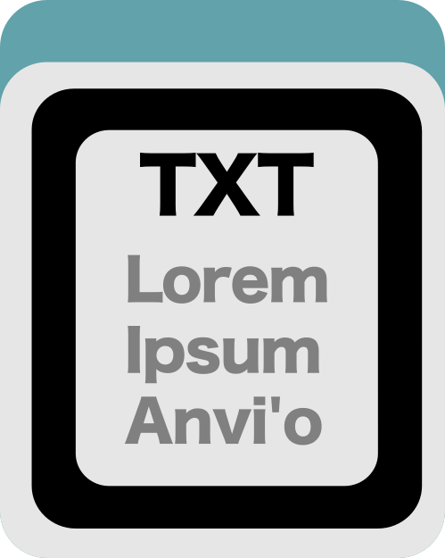

Export an item order from an anvi&#x27;o database.

🔙 **[To the main page](../../)** of anvi'o programs and artifacts.



{{ "network.json" }}
{{ 300 }}


## Authors

<a href="/people/meren" target="_blank">A. Murat Eren (Meren)</a>
<a href="http://merenlab.org" class="person-social" target="_blank"><i class="fa fa-fw fa-home"></i>Web</a><a href="mailto:a.murat.eren@gmail.com" class="person-social" target="_blank"><i class="fa fa-fw fa-envelope-square"></i>Email</a><a href="http://twitter.com/merenbey" class="person-social" target="_blank"><i class="fa fa-fw fa-twitter-square"></i>Twitter</a><a href="http://github.com/meren" class="person-social" target="_blank"><i class="fa fa-fw fa-github"></i>Github</a>

## Requires

[profile-db](../../artifacts/profile-db) 

## Can use

[pan-db](../../artifacts/pan-db) 

## Provides

[misc-data-items-order-txt](../../artifacts/misc-data-items-order-txt)  [dendrogram](../../artifacts/dendrogram)  [phylogeny](../../artifacts/phylogeny) 

## Usage

This program, as one might think, allows you to export a [misc-data-items-order](/help/main/artifacts/misc-data-items-order), outputing a [misc-data-items-order-txt](/help/main/artifacts/misc-data-items-order-txt).

You can export one of the item orders in a [profile-db](/help/main/artifacts/profile-db) or [pan-db](/help/main/artifacts/pan-db) as follows:

anvi&#45;export&#45;items&#45;order &#45;p [profile&#45;db](/help/main/artifacts/profile&#45;db) \
                        &#45;&#45;name cov

The `cov` here refers to the tree that is generated using only differential coverage. Almost all anvi'o profile databases will also have available an items-order based on the tetranucleotide frequency called `tnf`, and one based on both called `tnf-cov`.

However, to list the item orders available in this database, just don't include the name flag.

anvi&#45;export&#45;items&#45;order &#45;p [pan&#45;db](/help/main/artifacts/pan&#45;db)

You'll get a `Config Error` that will tell you what item orders are available.

{:.notice}
Edit [this file](https://github.com/merenlab/anvio/tree/master/anvio/docs/programs/anvi-export-items-order.md) to update this information.

## Command line interface

The following is the list of parameters and their descriptions in the latest version of `anvi-export-items-order`.

The code that generates this web page ensures that this information is the latest available in **9-dev (eunice)**. Which means, in some cases the information in this section (generated automatically) might be more comprehensive or up-to-date compared to the descriptions above (written by humans).

---

### Command line usage



anvi-export-items-order [-h] [-p DB PATH] [--name ORDER NAME] [-o FILE_PATH]



### Parameters and their descriptions



<section class="parameter-group parameter-group-input">
<header class="parameter-group-header">INPUT The database and the items order of interest</header>
<dl class="parameter-list">
<dt class="parameter" id="parameter-db_path"><code class="parameter-flags">-p, --db-path</code> <code class="parameter-metavar">DB PATH</code></dt>
<dd class="parameter-details">An appropriate anvi&#x27;o database.</dd>
<dt class="parameter" id="parameter-name"><code class="parameter-flags">--name</code> <code class="parameter-metavar">ORDER NAME</code></dt>
<dd class="parameter-details">The name of the order you want to export. If you don&#x27;t provide an order name, anvi&#x27;o will show you the names of all available orders in the database.</dd>
</dl>
</section>
<section class="parameter-group parameter-group-ouput">
<header class="parameter-group-header">OUPUT Output file name and stuff</header>
<dl class="parameter-list">
<dt class="parameter" id="parameter-output_file"><code class="parameter-flags">-o, --output-file</code> <code class="parameter-metavar">FILE_PATH</code></dt>
<dd class="parameter-details">File path to store results.</dd>
</dl>
</section>



## Additional Resources

{:.notice}
Are you aware of resources that may help users better understand the utility of this program? Please feel free to edit [this file](https://github.com/merenlab/anvio/blob/master/anvio/cli/export_items_order.py) on GitHub. If you are not sure how to do that, find the `__resources__` tag in [this file](https://github.com/merenlab/anvio/blob/master/anvio/cli/interactive.py) to see an example.
