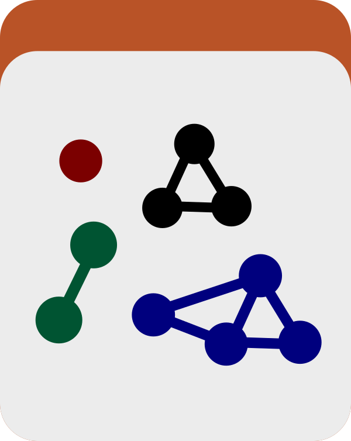
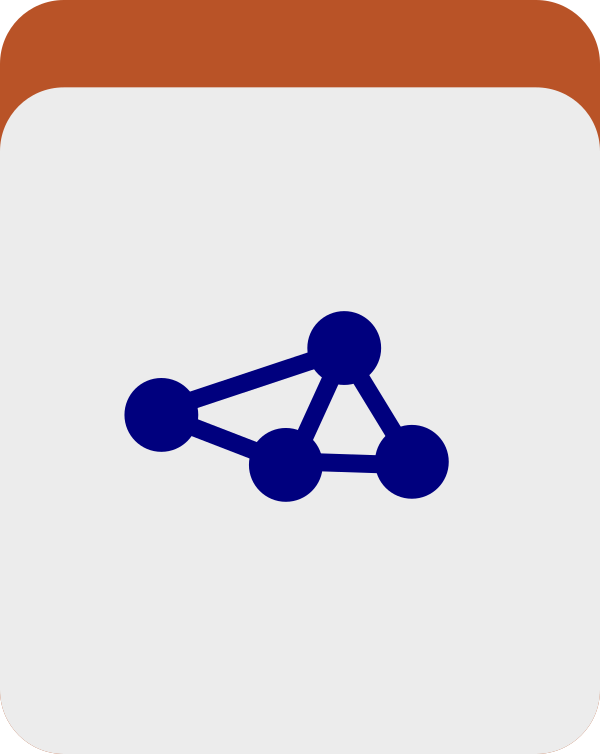

A program to compute genes databases for a ginen set of bins stored in an anvi&#x27;o collection. Genes databases store gene-level coverage and detection statistics, and they are usually computed and generated automatically when they are required (such as running anvi-interactive with `--gene-mode` flag). This program allows you to pre-compute them if you don&#x27;t want them to be done all at once.

🔙 **[To the main page](../../)** of anvi'o programs and artifacts.



{{ "network.json" }}
{{ 300 }}


## Authors

<a href="/people/meren" target="_blank">A. Murat Eren (Meren)</a>
<a href="http://merenlab.org" class="person-social" target="_blank"><i class="fa fa-fw fa-home"></i>Web</a><a href="mailto:a.murat.eren@gmail.com" class="person-social" target="_blank"><i class="fa fa-fw fa-envelope-square"></i>Email</a><a href="http://twitter.com/merenbey" class="person-social" target="_blank"><i class="fa fa-fw fa-twitter-square"></i>Twitter</a><a href="http://github.com/meren" class="person-social" target="_blank"><i class="fa fa-fw fa-github"></i>Github</a>

## Requires

[profile-db](../../artifacts/profile-db)  [contigs-db](../../artifacts/contigs-db) 

## Can use

[collection](../../artifacts/collection)  [bin](../../artifacts/bin) 

## Provides

[genes-db](../../artifacts/genes-db) 

## Usage

This program **generates a [genes-db](/help/main/artifacts/genes-db), which stores the coverage and detection values for all of the genes in your [contigs-db](/help/main/artifacts/contigs-db).**

This information is usually calculated when it's needed (for example when running [anvi-interactive](/help/main/programs/anvi-interactive) in genes mode), but this program lets you break this process into two steps. This way, you can easily change the parameters of [anvi-interactive](/help/main/programs/anvi-interactive) without having to recalculate the gene-level statistics.

Given a [contigs-db](/help/main/artifacts/contigs-db) and [profile-db](/help/main/artifacts/profile-db) pair, as well as a [collection](/help/main/artifacts/collection), this program will calculate the stats for the genes in each of your [bin](/help/main/artifacts/bin)s and give each bin its own [profile-db](/help/main/artifacts/profile-db) that includes this information.

For example, if a [collection](/help/main/artifacts/collection) called `GENE_COLLECTION` contained the bins `bin_0001`, `bin_0002`, and `bin_0003` and you ran:

anvi&#45;gen&#45;gene&#45;level&#45;stats&#45;databases &#45;c [contigs&#45;db](/help/main/artifacts/contigs&#45;db) \
                                    &#45;p [profile&#45;db](/help/main/artifacts/profile&#45;db) \
                                    &#45;C [collection](/help/main/artifacts/collection)

Then it will create a directory called `GENES` that contains three [profile-db](/help/main/artifacts/profile-db) called `GENE_COLLECTION-bin_0001.db`, `GENE_COLLECTION-bin_0002.db`, and `GENE_COLLECTION-bin_0003.db`. In terms of output, this program is similar to [anvi-split](/help/main/programs/anvi-split): each of these databases can now be treated as self-contained anvi'o projects but they also contain the gene-level information. Thus, you then could run [anvi-interactive](/help/main/programs/anvi-interactive) in genes mode on one of these profile databases.

You also have the option to provide a list of [bin](/help/main/artifacts/bin) (either as a file or as a string) to anlyze instead of a single [collection](/help/main/artifacts/collection).

### Other Parameters

You can also change the definition of an outlier nucleotide position or switch calculations to use the [INSeq/Tn-Seq](https://www.illumina.com/science/sequencing-method-explorer/kits-and-arrays/in-seq-tn-seq.html) statistical methods.

{:.notice}
Edit [this file](https://github.com/merenlab/anvio/tree/master/anvio/docs/programs/anvi-gen-gene-level-stats-databases.md) to update this information.

## Command line interface

The following is the list of parameters and their descriptions in the latest version of `anvi-gen-gene-level-stats-databases`.

The code that generates this web page ensures that this information is the latest available in **9-dev (eunice)**. Which means, in some cases the information in this section (generated automatically) might be more comprehensive or up-to-date compared to the descriptions above (written by humans).

---

### Command line usage



anvi-gen-gene-level-stats-databases [-h] -c CONTIGS_DB -p PROFILE_DB [-C COLLECTION_NAME] [-b BIN_NAME] [-B FILE_PATH] [--zeros-are-outliers] [--outliers-threshold NUM] [--just-do-it] [--inseq-stats]



### Parameters and their descriptions



<section class="parameter-group parameter-group-input-databases">
<header class="parameter-group-header">INPUT DATABASES Which anvi&#x27;o databases do you wish to work today?</header>
<dl class="parameter-list">
<dt class="parameter parameter-required" id="parameter-contigs_db"><code class="parameter-flags">-c, --contigs-db</code> <code class="parameter-metavar">CONTIGS_DB</code> required</dt>
<dd class="parameter-details parameter-required">Anvi&#x27;o contigs database generated by &#x27;anvi-gen-contigs-database&#x27;</dd>
<dt class="parameter parameter-required" id="parameter-profile_db"><code class="parameter-flags">-p, --profile-db</code> <code class="parameter-metavar">PROFILE_DB</code> required</dt>
<dd class="parameter-details parameter-required">Anvi&#x27;o profile database</dd>
</dl>
</section>
<section class="parameter-group parameter-group-bins-and-collection">
<header class="parameter-group-header">BIN(S) AND COLLECTION You can select a bin, multiple bins, or you can simply focus on every bin in a collection by providing only a collection name. Once you are done with your selection, anvi&#x27;o will generate an individual genes database for each of the bin it finds.</header>
<dl class="parameter-list">
<dt class="parameter" id="parameter-collection_name"><code class="parameter-flags">-C, --collection-name</code> <code class="parameter-metavar">COLLECTION_NAME</code></dt>
<dd class="parameter-details">Collection name.</dd>
<dt class="parameter" id="parameter-bin_id"><code class="parameter-flags">-b, --bin-id</code> <code class="parameter-metavar">BIN_NAME</code></dt>
<dd class="parameter-details">Bin name you are interested in.</dd>
<dt class="parameter" id="parameter-bin_ids_file"><code class="parameter-flags">-B, --bin-ids-file</code> <code class="parameter-metavar">FILE_PATH</code></dt>
<dd class="parameter-details">Text file for bins (each line should be a unique bin id).</dd>
</dl>
</section>
<section class="parameter-group parameter-group-additional-parameters">
<header class="parameter-group-header">ADDITIONAL PARAMETERS These parameters are those that are critical to identify outlier nucleotide positions and how to define what should be included in those calculations. In most cases you can leave them as is, and things are going to be alright.</header>
<dl class="parameter-list">
<dt class="parameter parameter-switch" id="parameter-zeros_are_outliers"><code class="parameter-flags">--zeros-are-outliers</code></dt>
<dd class="parameter-details">If you want all zero coverage positions to be treated like outliers then use this flag. The reason to treat zero coverage as outliers is because when mapping reads to a reference we could get many zero positions due to accessory genes. These positions then skew the average values that we compute.</dd>
<dt class="parameter" id="parameter-outliers_threshold"><code class="parameter-flags">--outliers-threshold</code> <code class="parameter-metavar">NUM</code></dt>
<dd class="parameter-details">Threshold to use for the outlier detection. The default value is &#x27;1.5&#x27;. Absolute deviation around the median is used. To read more about the method please refer to: &#x27;How to Detect and Handle Outliers&#x27; by Boris Iglewicz and David Hoaglin (doi:10.1016/j.jesp.2013.03.013). Default: <code class="parameter-default-value">1.5</code></dd>
</dl>
</section>
<section class="parameter-group parameter-group-parameters-of-convenience">
<header class="parameter-group-header">PARAMETERS OF CONVENIENCE They say they save lives.</header>
<dl class="parameter-list">
<dt class="parameter parameter-switch" id="parameter-just_do_it"><code class="parameter-flags">--just-do-it</code></dt>
<dd class="parameter-details">Don&#x27;t bother me with questions or warnings, just do it.</dd>
</dl>
</section>
<section class="parameter-group parameter-group-inseq-data">
<header class="parameter-group-header">INSEQ DATA When analyzing INSeq/Tn-Seq data</header>
<dl class="parameter-list">
<dt class="parameter parameter-switch" id="parameter-inseq_stats"><code class="parameter-flags">--inseq-stats</code></dt>
<dd class="parameter-details">Provide if working with INSeq/Tn-Seq genomic data. With this, all gene level coverage stats will be calculated using INSeq/Tn-Seq statistical methods.</dd>
</dl>
</section>



## Additional Resources

{:.notice}
Are you aware of resources that may help users better understand the utility of this program? Please feel free to edit [this file](https://github.com/merenlab/anvio/blob/master/anvio/cli/gen_gene_level_stats_databases.py) on GitHub. If you are not sure how to do that, find the `__resources__` tag in [this file](https://github.com/merenlab/anvio/blob/master/anvio/cli/interactive.py) to see an example.
