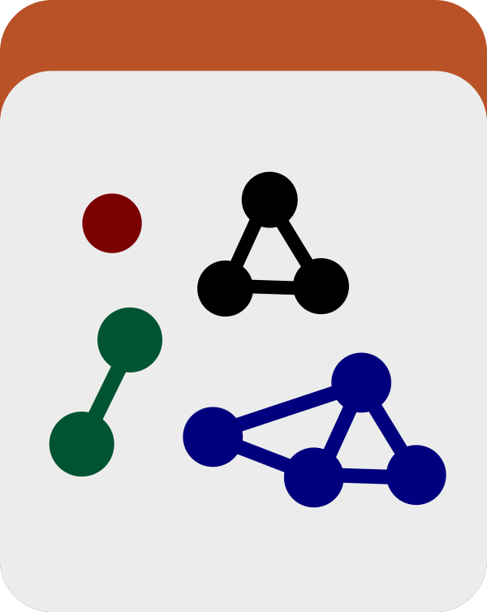
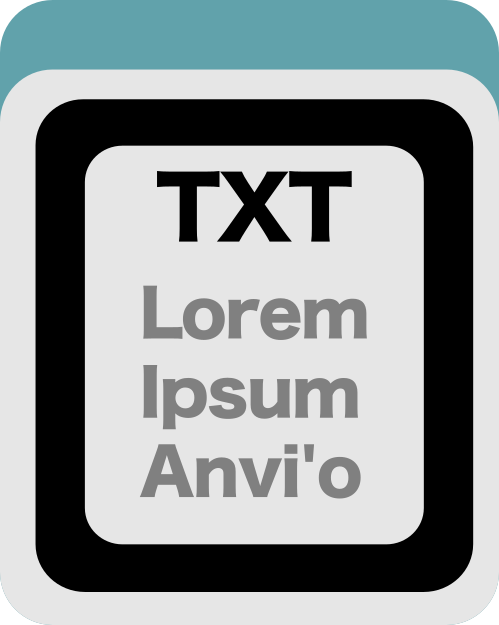

Get sequences for genes with hits in a single functional annotation source, optionally only for those that match to specific accession ids, from one or more contigs-dbs, bins, or genomes. Similar to anvi-get-sequences-for-hmm-hits, but without any gene concatenation / phylogenomics functionality..

🔙 **[To the main page](../../)** of anvi'o programs and artifacts.



<div id="svg" class="subnetwork"></div>
{{ "network.json" }}
{{ 300 }}



## Authors

<div class="anvio-person"><div class="anvio-person-info"><div class="anvio-person-photo"></div><div class="anvio-person-info-box"><a href="/people/meren" target="_blank"><span class="anvio-person-name">A. Murat Eren (Meren)</span></a><div class="anvio-person-social-box"><a href="http://merenlab.org" class="person-social" target="_blank"><i class="fa fa-fw fa-home"></i>Web</a><a href="mailto:a.murat.eren@gmail.com" class="person-social" target="_blank"><i class="fa fa-fw fa-envelope-square"></i>Email</a><a href="http://twitter.com/merenbey" class="person-social" target="_blank"><i class="fa fa-fw fa-twitter-square"></i>Twitter</a><a href="http://github.com/meren" class="person-social" target="_blank"><i class="fa fa-fw fa-github"></i>Github</a></div></div></div></div>


## Requires


<p style="text-align: left" markdown="1"><span class="artifact-r">[contigs-db](../../artifacts/contigs-db) </span> <span class="artifact-r">[functions](../../artifacts/functions) </span></p>


## Can use

<p style="text-align: left" markdown="1"><span class="artifact-r">[profile-db](../../artifacts/profile-db) </span> <span class="artifact-r">[collection](../../artifacts/collection) </span> <span class="artifact-r">[bin](../../artifacts/bin) </span> <span class="artifact-r">[external-genomes](../../artifacts/external-genomes) </span> <span class="artifact-r">[internal-genomes](../../artifacts/internal-genomes) </span></p>


## Provides


<p style="text-align: left" markdown="1"><span class="artifact-p">[genes-fasta](../../artifacts/genes-fasta) </span></p>


## Usage


This program writes a <span class="artifact-n">[genes-fasta](/help/main/artifacts/genes-fasta)</span> with one entry per gene that has at least one hit in a single <span class="artifact-n">[functions](/help/main/artifacts/functions)</span> source. You can limit the output to genes with hits to specific accession ids in that source.

It works with a <span class="artifact-n">[contigs-db](/help/main/artifacts/contigs-db)</span>, bins in a <span class="artifact-n">[collection](/help/main/artifacts/collection)</span>, or many genomes described in <span class="artifact-n">[external-genomes](/help/main/artifacts/external-genomes)</span> and/or <span class="artifact-n">[internal-genomes](/help/main/artifacts/internal-genomes)</span> files.

<span class="artifact-p">[anvi-get-sequences-for-function-hits](/help/main/programs/anvi-get-sequences-for-function-hits)</span> is very similar to <span class="artifact-p">[anvi-get-sequences-for-hmm-hits](/help/main/programs/anvi-get-sequences-for-hmm-hits)</span>, but unlike the latter, this program does not have any functionality to concatenate genes for downstream phylogenetic or phylogenomic analyses. While this was not difficult to implement, it was a mindful omission on our part. This is primarily due to the fact that genes that share a functional annotation can have extremely low sequence identity depending on the breadth of their representation in databases, so their sequences may not a reliable basis for phylogenetic or phylogenomic inferences even though it may not be immediately obvious for all functions. HMMs can also return not-so-ideal hits, but since they are built from aligned sequences by design, they are generally more appropriate to work with for such goals.

The primary purpose of this program is to give you all matching sequences annotated with a particular function, or all functions listed in a particular source.

### Learn available annotation sources

<div class="codeblock" markdown="1">
anvi&#45;get&#45;sequences&#45;for&#45;function&#45;hits &#45;c <span class="artifact&#45;n">[contigs&#45;db](/help/main/artifacts/contigs&#45;db)</span> \
                                     &#45;&#45;list&#45;annotation&#45;sources
</div>

### Get sequences for all genes with hits in a source

<div class="codeblock" markdown="1">
anvi&#45;get&#45;sequences&#45;for&#45;function&#45;hits &#45;c <span class="artifact&#45;n">[contigs&#45;db](/help/main/artifacts/contigs&#45;db)</span> \
                                     &#45;&#45;annotation&#45;source Pfam \
                                     &#45;o <span class="artifact&#45;n">[genes&#45;fasta](/help/main/artifacts/genes&#45;fasta)</span>
</div>

### Get sequences only for genes with hits to specific accession ids

<div class="codeblock" markdown="1">
anvi&#45;get&#45;sequences&#45;for&#45;function&#45;hits &#45;c <span class="artifact&#45;n">[contigs&#45;db](/help/main/artifacts/contigs&#45;db)</span> \
                                     &#45;&#45;annotation&#45;source Pfam \
                                     &#45;&#45;accession&#45;ids PF00117,PF02786 \
                                     &#45;o <span class="artifact&#45;n">[genes&#45;fasta](/help/main/artifacts/genes&#45;fasta)</span>
</div>

Instead of a comma-separated list, `--accession-ids` also accepts a file with one accession id per line. A gene is reported if any of its hits in the source matches any of the accession ids. If an accession id matches nothing in any of your inputs, anvi'o will stop with an error rather than ignore it.

### Get sequences from bins or genomes

For every bin in a collection (use `--bin-id` or `--bin-ids-file` to focus on specific bins):

<div class="codeblock" markdown="1">
anvi&#45;get&#45;sequences&#45;for&#45;function&#45;hits &#45;c <span class="artifact&#45;n">[contigs&#45;db](/help/main/artifacts/contigs&#45;db)</span> \
                                     &#45;p <span class="artifact&#45;n">[profile&#45;db](/help/main/artifacts/profile&#45;db)</span> \
                                     &#45;C <span class="artifact&#45;n">[collection](/help/main/artifacts/collection)</span> \
                                     &#45;&#45;annotation&#45;source COG20_FUNCTION \
                                     &#45;o <span class="artifact&#45;n">[genes&#45;fasta](/help/main/artifacts/genes&#45;fasta)</span>
</div>

For many genomes:

<div class="codeblock" markdown="1">
anvi&#45;get&#45;sequences&#45;for&#45;function&#45;hits &#45;e <span class="artifact&#45;n">[external&#45;genomes](/help/main/artifacts/external&#45;genomes)</span> \
                                     &#45;i <span class="artifact&#45;n">[internal&#45;genomes](/help/main/artifacts/internal&#45;genomes)</span> \
                                     &#45;&#45;annotation&#45;source KOfam \
                                     &#45;&#45;accession&#45;ids K00001 \
                                     &#45;o <span class="artifact&#45;n">[genes&#45;fasta](/help/main/artifacts/genes&#45;fasta)</span>
</div>

The annotation source must be present in every input <span class="artifact-n">[contigs-db](/help/main/artifacts/contigs-db)</span>.

### Amino acid sequences

Sequences are reported in DNA alphabet by default. Add `--get-aa-sequences` to get amino acid sequences instead.

### Deflines

The default defline looks like this:

```
{genome_name}_{gene_callers_id} source:{source}|accession:{accession}|function:{function}
```

Here `{genome_name}` is the genome name, the bin name, or the project name of the <span class="artifact-n">[contigs-db](/help/main/artifacts/contigs-db)</span> depending on the input. If a gene has multiple hits in the source, its accessions and functions are joined with `!!!`.

You can define your own defline with `--defline-format`, and see all available variables with `--list-defline-variables`. Your format must produce a unique defline for each sequence (e.g., by including `{genome_name}` and `{gene_callers_id}`), otherwise anvi'o will complain.

<div class="codeblock" markdown="1">
anvi&#45;get&#45;sequences&#45;for&#45;function&#45;hits &#45;c <span class="artifact&#45;n">[contigs&#45;db](/help/main/artifacts/contigs&#45;db)</span> \
                                     &#45;&#45;annotation&#45;source Pfam \
                                     &#45;&#45;defline&#45;format "{gene_callers_id}_{accession}" \
                                     &#45;o <span class="artifact&#45;n">[genes&#45;fasta](/help/main/artifacts/genes&#45;fasta)</span>
</div>


{:.notice}
Edit [this file](https://github.com/merenlab/anvio/tree/master/anvio/docs/programs/anvi-get-sequences-for-function-hits.md) to update this information.


## Command line interface

The following is the list of parameters and their descriptions in the latest version of `anvi-get-sequences-for-function-hits`.

The code that generates this web page ensures that this information is the latest available in **9-dev (eunice)**. Which means, in some cases the information in this section (generated automatically) might be more comprehensive or up-to-date compared to the descriptions above (written by humans).

---

### Command line usage


<div class="program-parameters-usage">anvi-get-sequences-for-function-hits [-h] [-c CONTIGS_DB] [-p PROFILE_DB] [-C COLLECTION_NAME] [-b BIN_NAME] [-B FILE_PATH] [-e FILE_PATH] [-i FILE_PATH] [--annotation-source FUNCTION_ANNOTATION_SOURCE] [--accession-ids ACCESSION_IDS] [-l] [-o FILE_PATH] [--get-aa-sequences] [--defline-format F-STRING] [--list-defline-variables] [--no-wrap]</div>


### Parameters and their descriptions


<div class="program-parameters">
<section class="parameter-group parameter-group-input-option-1-contigs-db">
<header class="parameter-group-header"><span class="parameter-group-title">INPUT OPTION #1: CONTIGS DB</span> <span class="parameter-group-description">Get sequences for all genes with hits in a single contigs-db.</span></header>
<dl class="parameter-list">
<dt class="parameter" id="parameter-contigs_db"><code class="parameter-flags">-c, --contigs-db</code> <code class="parameter-metavar">CONTIGS_DB</code></dt>
<dd class="parameter-details"><span class="parameter-help">Anvi&#x27;o contigs database generated by &#x27;anvi-gen-contigs-database&#x27;</span></dd>
</dl>
</section>
<section class="parameter-group parameter-group-input-option-2-contigs-db-profile-db">
<header class="parameter-group-header"><span class="parameter-group-title">INPUT OPTION #2: CONTIGS DB + PROFILE DB</span> <span class="parameter-group-description">Get sequences for genes in bins of a collection. Without a bin id or a bin ids file, every bin in the collection will be used.</span></header>
<dl class="parameter-list">
<dt class="parameter" id="parameter-profile_db"><code class="parameter-flags">-p, --profile-db</code> <code class="parameter-metavar">PROFILE_DB</code></dt>
<dd class="parameter-details"><span class="parameter-help">Anvi&#x27;o profile database</span></dd>
<dt class="parameter" id="parameter-collection_name"><code class="parameter-flags">-C, --collection-name</code> <code class="parameter-metavar">COLLECTION_NAME</code></dt>
<dd class="parameter-details"><span class="parameter-help">Collection name.</span></dd>
<dt class="parameter" id="parameter-bin_id"><code class="parameter-flags">-b, --bin-id</code> <code class="parameter-metavar">BIN_NAME</code></dt>
<dd class="parameter-details"><span class="parameter-help">Bin name you are interested in.</span></dd>
<dt class="parameter" id="parameter-bin_ids_file"><code class="parameter-flags">-B, --bin-ids-file</code> <code class="parameter-metavar">FILE_PATH</code></dt>
<dd class="parameter-details"><span class="parameter-help">Text file for bins (each line should be a unique bin id).</span></dd>
</dl>
</section>
<section class="parameter-group parameter-group-input-option-3-external-internal-genomes">
<header class="parameter-group-header"><span class="parameter-group-title">INPUT OPTION #3: EXTERNAL / INTERNAL GENOMES</span> <span class="parameter-group-description">Get sequences for genes in many genomes. You can use an external genomes file, an internal genomes file, or both.</span></header>
<dl class="parameter-list">
<dt class="parameter" id="parameter-external_genomes"><code class="parameter-flags">-e, --external-genomes</code> <code class="parameter-metavar">FILE_PATH</code></dt>
<dd class="parameter-details"><span class="parameter-help">A two-column TAB-delimited flat text file that lists anvi&#x27;o contigs databases. The first item in the header line should read &#x27;name&#x27;, and the second should read &#x27;contigs_db_path&#x27;. Each line in the file should describe a single entry, where the first column is the name of the genome (or MAG), and the second column is the anvi&#x27;o contigs database generated for this genome.</span></dd>
<dt class="parameter" id="parameter-internal_genomes"><code class="parameter-flags">-i, --internal-genomes</code> <code class="parameter-metavar">FILE_PATH</code></dt>
<dd class="parameter-details"><span class="parameter-help">A five-column TAB-delimited flat text file. The header line must contain these columns: &#x27;name&#x27;, &#x27;bin_id&#x27;, &#x27;collection_id&#x27;, &#x27;profile_db_path&#x27;, &#x27;contigs_db_path&#x27;. Each line should list a single entry, where &#x27;name&#x27; can be any name to describe the anvi&#x27;o bin identified as &#x27;bin_id&#x27; that is stored in a collection.</span></dd>
</dl>
</section>
<section class="parameter-group parameter-group-functions">
<header class="parameter-group-header"><span class="parameter-group-title">FUNCTIONS</span> <span class="parameter-group-description">Declare exactly one annotation source, and optionally limit the output to genes with hits to specific accession ids in it. If you are recovering sequences from multiple genomes you better have the same annotation source in all of them.</span></header>
<dl class="parameter-list">
<dt class="parameter" id="parameter-annotation_source"><code class="parameter-flags">--annotation-source</code> <code class="parameter-metavar">FUNCTION_ANNOTATION_SOURCE</code></dt>
<dd class="parameter-details"><span class="parameter-help">Get functional annotations for a specific annotation source. You can use the flag &#x27;--list-annotation-sources&#x27; to learn about what sources are available.</span></dd>
<dt class="parameter" id="parameter-accession_ids"><code class="parameter-flags">--accession-ids</code> <code class="parameter-metavar">ACCESSION_IDS</code></dt>
<dd class="parameter-details"><span class="parameter-help">One or more accession ids from a functional annotation source to focus on. You can provide them as a comma-separated list (e.g., &#x27;PF00117,PF02786&#x27;), or as a path to a file with one accession id per line. Accession ids are matched exactly and they are case-sensitive for science.</span></dd>
<dt class="parameter parameter-switch" id="parameter-list_annotation_sources"><code class="parameter-flags">-l, --list-annotation-sources</code></dt>
<dd class="parameter-details"><span class="parameter-help">List available functional annotation sources.</span></dd>
</dl>
</section>
<section class="parameter-group parameter-group-output">
<header class="parameter-group-header"><span class="parameter-group-title">OUTPUT</span> <span class="parameter-group-description">A FASTA file with one entry per gene.</span></header>
<dl class="parameter-list">
<dt class="parameter" id="parameter-output_file"><code class="parameter-flags">-o, --output-file</code> <code class="parameter-metavar">FILE_PATH</code></dt>
<dd class="parameter-details"><span class="parameter-help">File path to store results.</span></dd>
<dt class="parameter parameter-switch" id="parameter-get_aa_sequences"><code class="parameter-flags">--get-aa-sequences</code></dt>
<dd class="parameter-details"><span class="parameter-help">Store amino acid sequences instead.</span></dd>
<dt class="parameter" id="parameter-defline_format"><code class="parameter-flags">--defline-format</code> <code class="parameter-metavar">F-STRING</code></dt>
<dd class="parameter-details"><span class="parameter-help">Proivide a defline template for anvi&#x27;o to use when generating the FASTA output. The way this works is actually quite simple: first you learn about all the options that exist using the `--list-defline-variables`, and then use them to create your template. Available variables should be listed within curly brackets, which will be evaluated in contex. Anything outside of curly brackets will be kept as is. For instance, if you would like your defline to have the gene caller ID after the contig name in which it occurs, you can use this template: &#x27;{contig_name}_{gene_callers_id}&#x27;, and your defline will look like &#x27;&gt;XXX_182&#x27;. In most cases &#x27;{gene_callers_id}&#x27; will serve as the default defline format if this parameters is not used. See more examples in online help.</span></dd>
<dt class="parameter parameter-switch" id="parameter-list_defline_variables"><code class="parameter-flags">--list-defline-variables</code></dt>
<dd class="parameter-details"><span class="parameter-help">When declared, anvi&#x27;o will list the variable names that can be used to construct deflines in FASTA outputs from the user-defined `--defline-format` strings.</span></dd>
<dt class="parameter parameter-switch" id="parameter-no_wrap"><code class="parameter-flags">--no-wrap</code></dt>
<dd class="parameter-details"><span class="parameter-help">Do not be wrap sequences nicely in the output file.</span></dd>
</dl>
</section>
</div>



## Additional Resources


{:.notice}
Are you aware of resources that may help users better understand the utility of this program? Please feel free to edit [this file](https://github.com/merenlab/anvio/blob/master/anvio/cli/get_sequences_for_function_hits.py) on GitHub. If you are not sure how to do that, find the `__resources__` tag in [this file](https://github.com/merenlab/anvio/blob/master/anvio/cli/interactive.py) to see an example.
