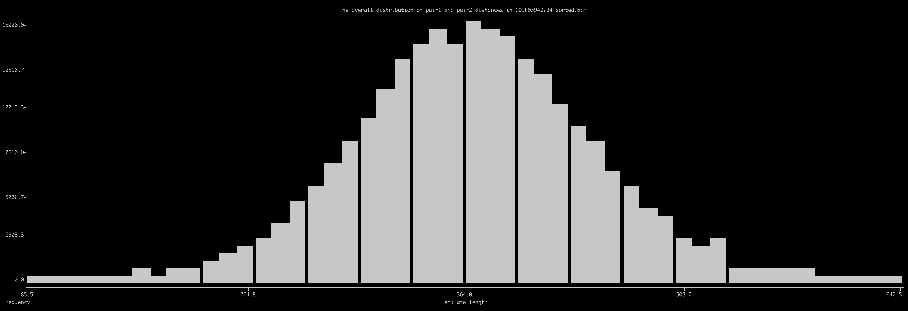

Report the distribution of template lengths from a BAM file. The purpose of this is to get an idea about the insert size distribution in a BAM file rapidly by summarizing distances between each paired-end read in a given read recruitment experiment..

🔙 **[To the main page](../../)** of anvi'o programs and artifacts.



<div id="svg" class="subnetwork"></div>
{{ "network.json" }}
{{ 300 }}



## Authors

<div class="anvio-person"><div class="anvio-person-info"><div class="anvio-person-photo"></div><div class="anvio-person-info-box"><a href="/people/meren" target="_blank"><span class="anvio-person-name">A. Murat Eren (Meren)</span></a><div class="anvio-person-social-box"><a href="http://merenlab.org" class="person-social" target="_blank"><i class="fa fa-fw fa-home"></i>Web</a><a href="mailto:a.murat.eren@gmail.com" class="person-social" target="_blank"><i class="fa fa-fw fa-envelope-square"></i>Email</a><a href="http://twitter.com/merenbey" class="person-social" target="_blank"><i class="fa fa-fw fa-twitter-square"></i>Twitter</a><a href="http://github.com/meren" class="person-social" target="_blank"><i class="fa fa-fw fa-github"></i>Github</a></div></div></div></div>


## Requires


<p style="text-align: left" markdown="1"><span class="artifact-r">[bam-file](../../artifacts/bam-file) </span></p>


## Provides


This program does not seem to provide any artifacts. Such programs usually print out some information for you to see or alter some anvi'o artifacts without producing any immediate outputs.


## Usage


This program may be useful if you are interested in learning the insert size distribution in a given <span class="artifact-n">[bam-file](/help/main/artifacts/bam-file)</span>.

## Example run

The most straightforward way to run the program is the following:

<div class="codeblock" markdown="1">
anvi&#45;get&#45;tlen&#45;dist&#45;from&#45;bam <span class="artifact&#45;n">[bam&#45;file](/help/main/artifacts/bam&#45;file)</span>
</div>

Here is an example output in the terminal:

```
BAM file .....................................: ./INVERSION-TEST/CP_R03_CDI_C_07_POST.bam
Number of contigs ............................: 8
Number of reads ..............................: 2,331,062
Minimum template length frequency ............: 10
Maximum template length to consider ..........: 500,000


WARNING
===============================================
Some of your contigs, 2 of 8 to be precise, did not seem to have any template
lenght data. There are many reasons this could happen, including a very high
`--min-tlen-frequency` parameter for BAM files with small number of reads. But
since there are some contigs that seem to have proper paired-end reads with
template lengths, anvi'o will continue reporting and put zeros for contigs that
have no data in output files.

Output file ..................................: TEMPLATE-LENGTH-STATS.txt


✓ anvi-get-tlen-dist-from-bam took 0:00:05.483682
```

## Output file

The program will report a TAB-delimited output file with the following format:

|contig|length|num_reads_considered|mean|mean_Q2Q3|median|min|max|std|
|:--|:--:|:--:|:--:|:--:|:--:|:--:|:--:|:--:|
|B_fragilis_ARW016_000000000001|5526948|2213634|367.6|392.5|393.0|32|71613|663.1|
|B_fragilis_ARW016_000000000002|3905|634|398.6|398.7|399.0|382|415|7.926|
|B_fragilis_ARW016_000000000003|4039|588|397.5|397.8|398.0|380|411|7.206|
|B_fragilis_ARW016_000000000004|3950|524|397.4|397.2|397.0|382|414|7.492|
|B_fragilis_ARW016_000000000005|911|0|||||||
|B_fragilis_ARW016_000000000006|647|0|||||||
|B_fragilis_ARW016_000000000007|12247|1860|394.9|396.7|397.0|99|419|23.61|
|B_fragilis_ARW016_000000000008|4861|528|396.7|396.7|397.0|384|410|6.746|

## Histogram

If you run the program with the flag `--plot-data`, it will attempt to plot a histogram for all contigs in the BAM file.

{:.warning}
The plotting function requires an additional Python library, [plotext](https://github.com/piccolomo/plotext), to be installed. While it is not a part of the default anvi'o distirbution, you can install it in your environment by running `pip install plotext`.

Here is an example run:

```
anvi-get-tlen-dist-from-bam C09F039427B4.bam \
                            --plot-data
```

And the result in the terminal:

[{:.center-img}](../../images/anvi-get-tlen-dist-from-bam.png)

The histogram may require additional filters to avoid skewed displays due to outliers. The parameters `--max-template-length-to-consider` and/or `--min-template-length-frequency` may be useful for such adjustments. Please see the help menu for their details.


{:.notice}
Edit [this file](https://github.com/merenlab/anvio/tree/master/anvio/docs/programs/anvi-get-tlen-dist-from-bam.md) to update this information.


## Command line interface

The following is the list of parameters and their descriptions in the latest version of `anvi-get-tlen-dist-from-bam`.

The code that generates this web page ensures that this information is the latest available in **9-dev (eunice)**. Which means, in some cases the information in this section (generated automatically) might be more comprehensive or up-to-date compared to the descriptions above (written by humans).

---

### Command line usage


<div class="program-parameters-usage">anvi-get-tlen-dist-from-bam [-h] [--min-template-length-frequency MIN_TEMPLATE_LENGTH_FREQUENCY] [--max-template-length-to-consider MAX_TEMPLATE_LENGTH_TO_CONSIDER] [-o FILE_PATH] [--plot-data] BAM_FILE</div>


### Parameters and their descriptions


<div class="program-parameters">
<section class="parameter-group parameter-group-positional-arguments">
<header class="parameter-group-header"><span class="parameter-group-title">positional arguments</span></header>
<dl class="parameter-list">
<dt class="parameter parameter-required parameter-positional" id="parameter-bam_file"><code class="parameter-flags">BAM_FILE</code> <span class="parameter-required-label">required</span></dt>
<dd class="parameter-details parameter-required"><span class="parameter-help">An indexed BAM file</span></dd>
</dl>
</section>
<section class="parameter-group parameter-group-input-options">
<header class="parameter-group-header"><span class="parameter-group-title">INPUT OPTIONS</span> <span class="parameter-group-description">Things you don&#x27;t care but should.</span></header>
<dl class="parameter-list">
<dt class="parameter" id="parameter-min_template_length_frequency"><code class="parameter-flags">--min-template-length-frequency</code> <code class="parameter-metavar">MIN_TEMPLATE_LENGTH_FREQUENCY</code></dt>
<dd class="parameter-details"><span class="parameter-help">How many times a template lenght should be observed to be considered as a viable template lenght? If this number is zero, you will have an extremely large number template lengths that will likely be due to noise. This number can be best set as a function of the total number of mapped reads in a bam file. The default value is set with the assumption that you have millions of reads in the BAM file.</span> <span class="parameter-default"><span class="parameter-label">Default:</span> <code class="parameter-default-value">10</code></span></dd>
<dt class="parameter" id="parameter-max_template_length_to_consider"><code class="parameter-flags">--max-template-length-to-consider</code> <code class="parameter-metavar">MAX_TEMPLATE_LENGTH_TO_CONSIDER</code></dt>
<dd class="parameter-details"><span class="parameter-help">Some paired end reads will map incredibly distant locations given the linear sequences you have used for read recruitment if the DNA templates were circular in the sample used for sequencing. Which is a beautiful thing, but can ruin your histogram. Using this parameter, you can discard paired end reads that are extremely distant from one another.</span> <span class="parameter-default"><span class="parameter-label">Default:</span> <code class="parameter-default-value">500000</code></span></dd>
</dl>
</section>
<section class="parameter-group parameter-group-output-options">
<header class="parameter-group-header"><span class="parameter-group-title">OUTPUT OPTIONS</span> <span class="parameter-group-description">Output options.</span></header>
<dl class="parameter-list">
<dt class="parameter" id="parameter-output_file"><code class="parameter-flags">-o, --output-file</code> <code class="parameter-metavar">FILE_PATH</code></dt>
<dd class="parameter-details"><span class="parameter-help">File path to store results.</span></dd>
<dt class="parameter parameter-switch" id="parameter-plot_data"><code class="parameter-flags">--plot-data</code></dt>
<dd class="parameter-details"><span class="parameter-help">In addition to providing you with a TAB-delimited output file, anvi&#x27;o can also try to plot a summary histogram for the template length distribution across ALL contigs in a given BAM file</span></dd>
</dl>
</section>
</div>



## Additional Resources


{:.notice}
Are you aware of resources that may help users better understand the utility of this program? Please feel free to edit [this file](https://github.com/merenlab/anvio/blob/master/anvio/cli/get_tlen_dist_from_bam.py) on GitHub. If you are not sure how to do that, find the `__resources__` tag in [this file](https://github.com/merenlab/anvio/blob/master/anvio/cli/interactive.py) to see an example.
