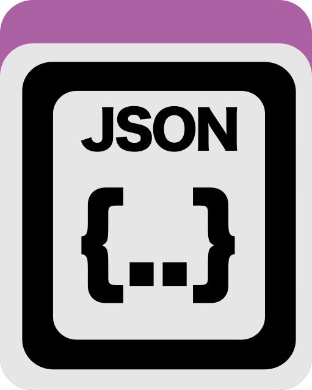

Import an anvi&#x27;o state into a profile database.

🔙 **[To the main page](../../)** of anvi'o programs and artifacts.



{{ "network.json" }}
{{ 300 }}


## Authors

<a href="/people/meren" target="_blank">A. Murat Eren (Meren)</a>
<a href="http://merenlab.org" class="person-social" target="_blank"><i class="fa fa-fw fa-home"></i>Web</a><a href="mailto:a.murat.eren@gmail.com" class="person-social" target="_blank"><i class="fa fa-fw fa-envelope-square"></i>Email</a><a href="http://twitter.com/merenbey" class="person-social" target="_blank"><i class="fa fa-fw fa-twitter-square"></i>Twitter</a><a href="http://github.com/meren" class="person-social" target="_blank"><i class="fa fa-fw fa-github"></i>Github</a>

## Requires

[state-json](../../artifacts/state-json)  [profile-db](../../artifacts/profile-db) 

## Can use

[pan-db](../../artifacts/pan-db) 

## Provides

[state](../../artifacts/state) 

## Usage

This program allows you to import a [state](/help/main/artifacts/state) from a [state-json](/help/main/artifacts/state-json).

You can run this program on a [profile-db](/help/main/artifacts/profile-db) or [pan-db](/help/main/artifacts/pan-db) like so:

anvi&#45;import&#45;state &#45;p [profile&#45;db](/help/main/artifacts/profile&#45;db) \
                  &#45;s [state&#45;json](/help/main/artifacts/state&#45;json) \
                  &#45;n MY_STATE

This will import the state described in your [state-json](/help/main/artifacts/state-json) into your [profile-db](/help/main/artifacts/profile-db) with the name `MY_STATE`.

{:.notice}
Edit [this file](https://github.com/merenlab/anvio/tree/master/anvio/docs/programs/anvi-import-state.md) to update this information.

## Command line interface

The following is the list of parameters and their descriptions in the latest version of `anvi-import-state`.

The code that generates this web page ensures that this information is the latest available in **9-dev (eunice)**. Which means, in some cases the information in this section (generated automatically) might be more comprehensive or up-to-date compared to the descriptions above (written by humans).

---

### Command line usage



anvi-import-state [-h] -p PAN_OR_PROFILE_DB -s STATE_FILE -n STATE_NAME



### Parameters and their descriptions



<section class="parameter-group parameter-group-options">
<header class="parameter-group-header">options</header>
<dl class="parameter-list">
<dt class="parameter parameter-required" id="parameter-pan_or_profile_db"><code class="parameter-flags">-p, --pan-or-profile-db</code> <code class="parameter-metavar">PAN_OR_PROFILE_DB</code> required</dt>
<dd class="parameter-details parameter-required">An anvi&#x27;o pan-db or profile-db (and even genes-db or pan-graph-db in appropriate contexts).</dd>
<dt class="parameter parameter-required" id="parameter-state"><code class="parameter-flags">-s, --state</code> <code class="parameter-metavar">STATE_FILE</code> required</dt>
<dd class="parameter-details parameter-required">JSON serializable anvi&#x27;o state file.</dd>
<dt class="parameter parameter-required" id="parameter-name"><code class="parameter-flags">-n, --name</code> <code class="parameter-metavar">STATE_NAME</code> required</dt>
<dd class="parameter-details parameter-required">State name.</dd>
</dl>
</section>



## Additional Resources

{:.notice}
Are you aware of resources that may help users better understand the utility of this program? Please feel free to edit [this file](https://github.com/merenlab/anvio/blob/master/anvio/cli/import_state.py) on GitHub. If you are not sure how to do that, find the `__resources__` tag in [this file](https://github.com/merenlab/anvio/blob/master/anvio/cli/interactive.py) to see an example.
