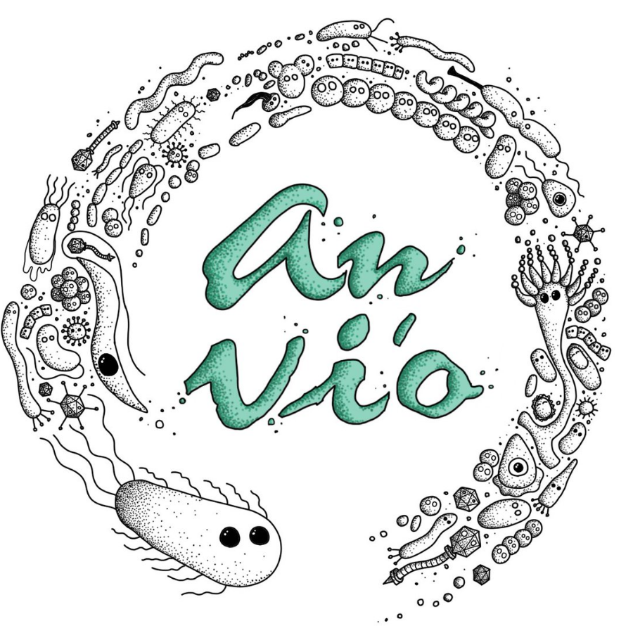
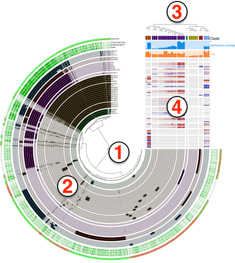

Start an anvi&#x27;o server for the interactive interface.

🔙 **[To the main page](../../)** of anvi'o programs and artifacts.



{{ "network.json" }}
{{ 300 }}


## Authors

<a href="/people/meren" target="_blank">A. Murat Eren (Meren)</a>
<a href="http://merenlab.org" class="person-social" target="_blank"><i class="fa fa-fw fa-home"></i>Web</a><a href="mailto:a.murat.eren@gmail.com" class="person-social" target="_blank"><i class="fa fa-fw fa-envelope-square"></i>Email</a><a href="http://twitter.com/merenbey" class="person-social" target="_blank"><i class="fa fa-fw fa-twitter-square"></i>Twitter</a><a href="http://github.com/meren" class="person-social" target="_blank"><i class="fa fa-fw fa-github"></i>Github</a>

<a href="/people/ozcan" target="_blank">Özcan C. Esen</a>
<a href="http://blog.ozcanesen.com/" class="person-social" target="_blank"><i class="fa fa-fw fa-home"></i>Web</a><a href="mailto:ozcanesen@gmail.com" class="person-social" target="_blank"><i class="fa fa-fw fa-envelope-square"></i>Email</a><a href="http://twitter.com/ozcanesen" class="person-social" target="_blank"><i class="fa fa-fw fa-twitter-square"></i>Twitter</a><a href="http://github.com/ozcan" class="person-social" target="_blank"><i class="fa fa-fw fa-github"></i>Github</a>

<a href="/people/matthewlawrenceklein" target="_blank">Matthew Lawrence Klein</a>
<a href="http://matthewlawrencekle.in" class="person-social" target="_blank"><i class="fa fa-fw fa-home"></i>Web</a><a href="mailto:mtt.l.kln@gmail.com" class="person-social" target="_blank"><i class="fa fa-fw fa-envelope-square"></i>Email</a><a href="http://github.com/matthewlawrenceklein" class="person-social" target="_blank"><i class="fa fa-fw fa-github"></i>Github</a>

<a href="/people/isaacfink21" target="_blank">Isaac Fink</a>
<a href="mailto:iafink@uchicago.edu" class="person-social" target="_blank"><i class="fa fa-fw fa-envelope-square"></i>Email</a><a href="http://github.com/isaacfink21" class="person-social" target="_blank"><i class="fa fa-fw fa-github"></i>Github</a>

<a href="/people/blankenberg" target="_blank">Daniel Blankenberg</a>
<a href="mailto:blanked2@ccf.org" class="person-social" target="_blank"><i class="fa fa-fw fa-envelope-square"></i>Email</a><a href="http://github.com/blankenberg" class="person-social" target="_blank"><i class="fa fa-fw fa-github"></i>Github</a>

## Requires

[profile-db](../../artifacts/profile-db) 

## Can use

[single-profile-db](../../artifacts/single-profile-db)  [contigs-db](../../artifacts/contigs-db)  [genes-db](../../artifacts/genes-db)  [bin](../../artifacts/bin)  [view-data](../../artifacts/view-data)  [dendrogram](../../artifacts/dendrogram)  [phylogeny](../../artifacts/phylogeny) 

## Provides

[interactive](../../artifacts/interactive) 

## Can provide

[svg](../../artifacts/svg)  [collection](../../artifacts/collection)  [bin](../../artifacts/bin)  [contig-inspection](../../artifacts/contig-inspection)  [dendrogram](../../artifacts/dendrogram)  [phylogeny](../../artifacts/phylogeny) 

## Usage

Initiates an interactive environment in your default browser.

Although it is generally associated with the typical concentric circles of 'oimcs data, the anvi'o interactive interface has many forms and offers Anvi'oers a vast amount of functionality, from manual reconstruction of genomes from metagenomes to refinement of metagenome-assembled genomes, displaying nucleotide-level coverage patterns, single-nucleotide variants, pangenomes, phylogenomic trees, and more. While the circular display is the default method for data presentation, you can also display your data in a rectangular from (as seen [here](http://merenlab.org/tutorials/interactive-interface/#lets-go-all-corners)).

In fact, the interface has many of its own blog posts, including a pretty comprehensive introductory tutorial [here](http://merenlab.org/tutorials/interactive-interface/) and a breakdown of its data types [here](http://merenlab.org/2016/02/27/the-anvio-interactive-interface/).

Here, we'll go through *some* things that the anvi'o interactive interface is capable of through this program. More information about most of this can be found by calling `anvi-interactive -h` or by checking out the additional resources at the bottom of this page.

Please makes sure you are familiar with the terminology that describes various parts of a given display, which are **explained in the [interactive](/help/main/artifacts/interactive) artifact**:

{:.center-img}

## Running anvi-interactive on a profile database

One of the simplest ways to run the interactive interface (especially useful for manual binning) is just providing an anvi'o profile database and an anvi'o contigs database:

anvi&#45;interactive &#45;p [profile&#45;db](/help/main/artifacts/profile&#45;db) \
                 &#45;c [contigs&#45;db](/help/main/artifacts/contigs&#45;db)

For the central tree to display correctly, you'll need to have run hierarchical clustering at some point while making your profile database (either during [anvi-merge](/help/main/programs/anvi-merge), or, if this is a [single-profile-db](/help/main/artifacts/single-profile-db), while running [anvi-profile](/help/main/programs/anvi-profile)). It is also possible to provide a phylogenetic tree or a clustering dendrogram from the command line using the `--tree` parameter.

If you do not have a [state](/help/main/artifacts/state) stored in your profile database named `default`, you will need to click the "Draw" button for anvi'o to provide you with an [interactive](/help/main/artifacts/interactive) display of your data.

### How to visualize things when you don't have a hierarchical clustering of your contigs?

Typically the [interactive](/help/main/artifacts/interactive) displays that will be initiated with `anvi-interactive` will require an items order to display all your contigs. There are multiple ways for anvi'o to generate dendrograms.

{:.notice}
Some advanced information you should feel free to skip: anvi'o uses a set of [clustering-configuration](/help/main/artifacts/clustering-configuration) files to decide which sources of data to use to cluster items. These recipes are essentially a set of configuration files for anvi'o to learn which information to use from [contigs-db](/help/main/artifacts/contigs-db), [profile-db](/help/main/artifacts/profile-db), or [pan-db](/help/main/artifacts/pan-db) type databases.

Some of the programs that generate dendrograms include [anvi-merge](/help/main/programs/anvi-merge), [anvi-profile](/help/main/programs/anvi-profile), and [anvi-experimental-organization](/help/main/programs/anvi-experimental-organization). But since hierarchical clustering is an extremely demanding process, anvi'o will skip this step during [anvi-merge](/help/main/programs/anvi-merge) if there are more than 20,000 splits n the database. This is because the computational complexity of this process will get less and less feasible with increasing number of splits. You can force anvi'o to try to cluster your splits regardless of how many of them there are by using the flag `--enforce-hierarchical-clustering`. However, we strongly advice against it especially if you have more than 30,000 splits since your process will likely be killed by the operating system, or take a very very long time to finish (plus, if you have that many splits the performance of the interactive interface will be very low).

What happens if you don't have a hierarchical clustering dendrogram, but you still wish to have an overall understanding of your data, or visualize the coverages of some contigs of interest or any contig at all? There are multiple ways you can do that:

* You can use [anvi-inspect](/help/main/programs/anvi-inspect) to visualize nucleotide- and gene-level coverages and single-nucleotide variants on individual contigs,
* You can use [anvi-cluster-contigs](/help/main/programs/anvi-cluster-contigs) to create a collection for your contigs and initiate `anvi-interactive` in collection mode (see the subsection "[visualizing bins instead of contigs](#visualizing-bins-instead-of-contigs)" below.
* You can import external binning results using [anvi-import-collection](/help/main/programs/anvi-import-collection), or manually identify contigs of interest, and use [anvi-import-collection](/help/main/programs/anvi-import-collection) to create a collection of a smaller number of contigs. You can then use [anvi-refine](/help/main/programs/anvi-refine) to visualize contigs in a single bin, or use [anvi-split](/help/main/programs/anvi-split) to first generate a split profile for your contigs to visualize your smaller dataset using [anvi-interactive](/help/main/programs/anvi-interactive).

### Collection mode: Visualizing *bins* instead of contigs

By default, when run on a profile database that resulted from a metagenomic workflow, [anvi-interactive](/help/main/programs/anvi-interactive) will initiate each contig as a separate item and organize them based on the clustering dendrograms provided (either automatically or by the user). But if there is a [collection](/help/main/artifacts/collection) stored in the profile database, it is also possible to run [anvi-interactive](/help/main/programs/anvi-interactive) on a specific collection, during which anvi'o will use the underlying contig data to calculate summary statistics for each bin before displaying them. In collection mode, each item of your central plot will not represent a contig, but a bin within your collection. This is how the collection mode can be initialized in comparison to the default mode:

anvi&#45;interactive &#45;p [profile&#45;db](/help/main/artifacts/profile&#45;db) \
                 &#45;c [contigs&#45;db](/help/main/artifacts/contigs&#45;db) \
                 &#45;C [collection](/help/main/artifacts/collection)

The clustering of [bin](/help/main/artifacts/bin)s in this case based on their distribution across samples will be done automatically on-the-fly. See the note on this mode in [the metagenomic workflow](http://merenlab.org/2016/06/22/anvio-tutorial-v2/#anvi-interactive) for more information.

### Genes mode: Visualizing *genes* instead of contigs

You can also start the interactive interface in "gene mode", in which each item of the central tree is a gene instead of a split or contig (or

bin like in "collection mode").

To initiate the visualization in gene mode you need the following:

anvi&#45;interactive &#45;p [profile&#45;db](/help/main/artifacts/profile&#45;db) \
                 &#45;c [contigs&#45;db](/help/main/artifacts/contigs&#45;db) \
                 &#45;C [collection](/help/main/artifacts/collection) \
                 &#45;b [bin](/help/main/artifacts/bin) \
                 &#45;&#45;gene&#45;mode

If there isn't one already, this command will automatically generate an anvi'o [genes-db](/help/main/artifacts/genes-db) under the `GENES` directory at the same level of the profile database. When the same command is run again, [anvi-interactive](/help/main/programs/anvi-interactive) will use the existing genes database.

In this view you can order genes based on their distributions patterns across metagenomes (*without paying attention to their synteny*) or by ordering them based on their synteny in a given genome (*without paying attention to their differential distribution*). [Figure 2 in this paper](https://peerj.com/articles/4320/) examples the latter, and [Figure 5 in this paper](https://stm.sciencemag.org/content/11/507/eaau9356) examples the former case, which is also shown below:

You can also visit [this page](http://merenlab.org/tutorials/infant-gut/#the-gene-mode-studying-distribution-patterns-at-the-gene-level) to see another practical example from the Infant Gut tutorial.

## Manual mode: visualize anything

You can also run the anvi'o interactive interface on *ad hoc* data that has nothing to do with anvi'o databases (here is [a tutorial on this](http://merenlab.org/tutorials/interactive-interface/)). To do that, you simply provide *any* of the following types of files individually or together, without a [contigs-db](/help/main/artifacts/contigs-db):

- a TAB-delimited tabular data (`--view-data`),
- a NEWICK formatted tree (`--tree`),

For instance:

anvi&#45;interactive &#45;d view_data.txt \
                 &#45;t tree.txt \
                 &#45;p my&#45;display&#45;PROFILE.db

When doing this kind of run, anvi'o does not expect you to have a profile database, but it still needs you to provide a name for it. Anvi'o will simply create an empty one for you so you can store your state or collections in it for reproducibility. When you run the same command again, anvi'o will find the same profile database and will remember everything you have stored in it.

{:.notice}
Anvi'o recognizes this kind of run automatically, and starts the interface in what we call the 'manual mode'. In older versions of anvi'o you had to use the flag `--manual-mode` (or `--manual`) to ask for it explicitly. This is no longer necessary, but anvi'o will continue to accept these flags so your older commands will work.

There is one case where you will need the `--manual-mode` flag: if you provide a tree or a data file without `-p` or `-c` in a directory where anvi'o can find a [profile-db](/help/main/artifacts/profile-db) and a [contigs-db](/help/main/artifacts/contigs-db), anvi'o can't tell whether you want to see your files alone, or on top of those databases. In that case it will ask you to be precise, either by using `--manual-mode` with a profile database path of your choice, or by providing the databases you want to use explicitly with `-p` and `-c`.

## Extending anvi'o displays

You can extend any [interactive](/help/main/artifacts/interactive) display in anvi'o with additional data related to your project through the program [anvi-import-misc-data](/help/main/programs/anvi-import-misc-data). [This article](https://merenlab.org/2017/12/11/additional-data-tables/) describes a detailed use of this program.

While the use of [anvi-import-misc-data](/help/main/programs/anvi-import-misc-data) is the most effective way to improve anvi'o displays, you can also use the parameter `--additional-layers` to provide a TAB-delimited file ([misc-data-items-txt](/help/main/artifacts/misc-data-items-txt)) that contains additional layers of information over your items.

If you want to add an entirely new view to the interface, you can do that too, as long as you provide a file containing all split names and their associated values. For more information, see the parameter `--additional-view`.

You can also provide the manual inputs even if you're using an anvi'o database. For example, if you provide your own NEWICK formatted tree, you will have the option to display it instead of the one in your database.

## Visualization Settings

In anvi'o, the visualization settings at a given time are called a [state](/help/main/artifacts/state).

To open the interface in a specific state, you can use the `--state-autoload` flag or by importing a state using [anvi-import-state](/help/main/programs/anvi-import-state).

You can also customize various aspects of the interactive interface. For example, you can change the preselected view, title, and taxonomic level displayed (for example, showing the class name instead of the genus name). You can also hide outlier single nucleotide variations or open only a specific collection.

## Password protection

Use `--password-protected` flag to limit access to your interactive instances, which by default will be accessible to anyone on your network.

## Quick solutions for network problems

In a typical run, [anvi-interactive](/help/main/programs/anvi-interactive) initiates a local server to which you connect through your browser to visualize data. Which can yield unexpected problems if you are running anvi'o in virtual environments such as Windows Subsystem for Linux. If your browser does not show up, or you get cryptic errors such as "*tcgetpgrp failed: Not a tty*", you can always simplify things by manually setting network properties such as `--ip-address` and `--port-number`.

For instance you can start an interactive interface the following way:

anvi&#45;interactive &#45;p [profile&#45;db](/help/main/artifacts/profile&#45;db) \
                 &#45;c [contigs&#45;db](/help/main/artifacts/contigs&#45;db) \
                 &#45;&#45;ip&#45;address 127.0.0.1 \
                 &#45;&#45;port&#45;number 8901 \
                 &#45;&#45;server&#45;only

Which would not initiate your browser, but then you can open your browser and go to this address to work with the anvi'o interactive interface:

* [http://127.0.0.1:8901](http://127.0.0.1:8901)

## Other things

### Viewing your data

You can use this program to look at the available information in your databases, which is very convenient. For example, you can view all of the available

- views (using `--show-views`)
- states (using `--show-states`)
- collections (using `--list-collections`)

{:.notice}
Edit [this file](https://github.com/merenlab/anvio/tree/master/anvio/docs/programs/anvi-interactive.md) to update this information.

## Command line interface

The following is the list of parameters and their descriptions in the latest version of `anvi-interactive`.

The code that generates this web page ensures that this information is the latest available in **9-dev (eunice)**. Which means, in some cases the information in this section (generated automatically) might be more comprehensive or up-to-date compared to the descriptions above (written by humans).

---

### Command line usage



anvi-interactive [-h] [-p PROFILE_DB] [-c CONTIGS_DB] [-C COLLECTION_NAME] [--manual-mode] [-f FASTA file] [-d VIEW_DATA] [-t NEWICK] [--items-order FLAT_FILE] [-V ADDITIONAL_VIEW] [-A ADDITIONAL_LAYERS] [-F FUNCTION ANNOTATION SOURCE] [--gene-mode] [--inseq-stats] [-b BIN_NAME] [--view NAME] [--title NAME] [--taxonomic-level {t_domain,t_phylum,t_class,t_order,t_family,t_genus,t_species}] [--show-all-layers] [--split-hmm-layers] [--hide-outlier-SNVs] [--state-autoload NAME] [--collection-autoload NAME] [--export-svg FILE_PATH] [--show-views] [--skip-check-names] [-o DIR_PATH] [--dry-run] [--show-states] [--list-collections] [--skip-init-functions] [--skip-auto-ordering] [--skip-news] [--distance DISTANCE_METRIC] [--linkage LINKAGE_METHOD] [-I IP_ADDR] [-P INT] [--browser-path PATH] [--read-only] [--server-only] [--password-protected] [--user-server-shutdown]



### Parameters and their descriptions



<section class="parameter-group parameter-group-default-inputs">
<header class="parameter-group-header">DEFAULT INPUTS The interactive interface can be started with and without anvi&#x27;o databases. The default use assumes you have your profile and contigs database, however, it is also possible to start the interface using ad hoc input files. See &#x27;MANUAL INPUTS&#x27; section for those parameters.</header>
<dl class="parameter-list">
<dt class="parameter" id="parameter-profile_db"><code class="parameter-flags">-p, --profile-db</code> <code class="parameter-metavar">PROFILE_DB</code></dt>
<dd class="parameter-details">Anvi&#x27;o profile database</dd>
<dt class="parameter" id="parameter-contigs_db"><code class="parameter-flags">-c, --contigs-db</code> <code class="parameter-metavar">CONTIGS_DB</code></dt>
<dd class="parameter-details">Anvi&#x27;o contigs database generated by &#x27;anvi-gen-contigs-database&#x27;</dd>
<dt class="parameter" id="parameter-collection_name"><code class="parameter-flags">-C, --collection-name</code> <code class="parameter-metavar">COLLECTION_NAME</code></dt>
<dd class="parameter-details">If you have a collection in your profile database, you can use this flag to start the interactive interface with a tree showing your bins in your collection, instead of each split. This is very useful when you have imported your external binning results into anvi&#x27;o, and want to see the distribution of your bins across samples. In these cases anvi&#x27;o will cluster your bins and based on multiple metrics. Because this particular clustering will be done on the fly within anvi&#x27;o interactive class, you get to define a distance metric and a linkage method using --linkage and --distance parameters if you want!</dd>
</dl>
</section>
<section class="parameter-group parameter-group-manual-inputs">
<header class="parameter-group-header">MANUAL INPUTS Input parameters to start the interactive interface without anvi&#x27;o databases. When you provide these without a contigs database, anvi&#x27;o will start the interface in manual mode automatically. You still need to provide a profile database path, which does not need to exist: anvi&#x27;o will create an empty one for you to store your states and collections.</header>
<dl class="parameter-list">
<dt class="parameter parameter-switch" id="parameter-manual_mode"><code class="parameter-flags">--manual-mode, --manual</code></dt>
<dd class="parameter-details">You will rarely need this flag, since anvi&#x27;o starts the interactive interface in manual mode automatically when it is given ad hoc input files (such as a tree or a view data file) without a contigs database. But if there are anvi&#x27;o databases in your work directory, anvi&#x27;o may not be sure whether you want to visualize your files alone or on top of those databases, and ask you to use this flag to be precise. In the manual mode the profile database is only used to store the &#x27;state&#x27; of the interface and collections, and if it does not exist, anvi&#x27;o will create an empty one for you.</dd>
<dt class="parameter" id="parameter-fasta_file"><code class="parameter-flags">-f, --fasta-file</code> <code class="parameter-metavar">FASTA FILE</code></dt>
<dd class="parameter-details">A FASTA-formatted input file.</dd>
<dt class="parameter" id="parameter-view_data"><code class="parameter-flags">-d, --view-data</code> <code class="parameter-metavar">VIEW_DATA</code></dt>
<dd class="parameter-details">A TAB-delimited file for view data</dd>
<dt class="parameter" id="parameter-tree"><code class="parameter-flags">-t, --tree</code> <code class="parameter-metavar">NEWICK</code></dt>
<dd class="parameter-details">NEWICK formatted tree structure</dd>
<dt class="parameter" id="parameter-items_order"><code class="parameter-flags">--items-order</code> <code class="parameter-metavar">FLAT_FILE</code></dt>
<dd class="parameter-details">A flat file that contains the order of items you wish the display using the interactive interface. You may want to use this if you have a specific order of items in your mind, and do not want to display a tree in the middle (or simply you don&#x27;t have one). The file format is simple: each line should have an item name, and there should be no header.</dd>
</dl>
</section>
<section class="parameter-group parameter-group-additional-stuff">
<header class="parameter-group-header">ADDITIONAL STUFF Parameters to provide additional layers, views, or layer data.</header>
<dl class="parameter-list">
<dt class="parameter" id="parameter-additional_view"><code class="parameter-flags">-V, --additional-view</code> <code class="parameter-metavar">ADDITIONAL_VIEW</code></dt>
<dd class="parameter-details">A TAB-delimited file for an additional view to be used in the interface. This file should contain all split names, and values for each of them in all samples. Each column in this file must correspond to a sample name. Content of this file will be called &#x27;user_view&#x27;, which will be available as a new item in the &#x27;views&#x27; combo box in the interface</dd>
<dt class="parameter" id="parameter-additional_layers"><code class="parameter-flags">-A, --additional-layers</code> <code class="parameter-metavar">ADDITIONAL_LAYERS</code></dt>
<dd class="parameter-details">A TAB-delimited file for additional layers for splits. The first column of this file must be split names, and the remaining columns should be unique attributes. The file does not need to contain all split names, or values for each split in every column. Anvi&#x27;o will try to deal with missing data nicely. Each column in this file will be visualized as a new layer in the tree.</dd>
<dt class="parameter" id="parameter-annotation_source_for_per_split_summary"><code class="parameter-flags">-F, --annotation-source-for-per-split-summary</code> <code class="parameter-metavar">FUNCTION ANNOTATION SOURCE</code></dt>
<dd class="parameter-details">Using this parameter with a functional annotation source that (1) is in the contigs database and (2) has a maximum of 10 different function names, will dynamically add a new layer to the intearctive interface where proportions of functions in that source will be shown per split as stacked bar charts.</dd>
</dl>
</section>
<section class="parameter-group parameter-group-gene-mode">
<header class="parameter-group-header">GENE MODE Gene mode related parameters.</header>
<dl class="parameter-list">
<dt class="parameter parameter-switch" id="parameter-gene_mode"><code class="parameter-flags">--gene-mode</code></dt>
<dd class="parameter-details">Initiate the interactive interface in &#x27;gene mode&#x27;. In this mode, the items are genes (instead of splits of contigs). The following views are available: detection (the detection value of each gene in each sample). The mean_coverage (the mean coverage of genes). The non_outlier_mean_coverage (the mean coverage of the non-outlier nucleotide positions of each gene in each sample (median absolute deviation is used to remove outliers per gene per sample)). The non_outlier_coverage_std view (standard deviation of the coverage of non-outlier positions of genes in samples). You can also choose to order items and layers according to each one of the aforementioned views. In addition, all layer ordering that are available in the regular mode (i.e. the full mode where you have contigs/splits) are also available in &#x27;gene mode&#x27;, so that, for example, you can choose to order the layers according to &#x27;detection&#x27;, and that would be the order according to the detection values of splits, whereas if you choose &#x27;genes_detections&#x27; then the order of layers would be according to the detection values of genes. Inspection and sequence functionality are available (through the right-click menu), except now sequences are of the specific gene. Inspection has now two options available: &#x27;Inspect Context&#x27;, which brings you to the inspection page of the split to which the gene belongs where the inspected gene will be highlighted in yellow in the bottom, and &#x27;Inspect Gene&#x27;, which opens the inspection page only for the gene and 100 nts around each side of it (the purpose of this option is to make the inspection page load faster if you only want to look at the nucleotide coverage of a specific gene). NOTICE: You can&#x27;t store states or collections in &#x27;gene mode&#x27;. However, you still can make fake selections, and create fake bins for your viewing convenience only (smiley). Search options are available, and you can even search for functions if you have them in your contigs database. ANOTHER NOTICE: loading this mode might take a while if your bin has many genes, and your profile database has many samples, this is because the gene coverages stats are computed in an ad-hoc manner when you load this mode, we know this is not ideal and we plan to improve that (along with other things). If you have suggestions/complaints regarding this mode please comment on this github issue: https://goo.gl/yHhRei. Please refer to the online tutorial for more information.</dd>
<dt class="parameter parameter-switch" id="parameter-inseq_stats"><code class="parameter-flags">--inseq-stats</code></dt>
<dd class="parameter-details">Provide if working with INSeq/Tn-Seq genomic data. With this, all gene level coverage stats will be calculated using INSeq/Tn-Seq statistical methods.</dd>
<dt class="parameter" id="parameter-bin_id"><code class="parameter-flags">-b, --bin-id</code> <code class="parameter-metavar">BIN_NAME</code></dt>
<dd class="parameter-details">Bin name you are interested in.</dd>
</dl>
</section>
<section class="parameter-group parameter-group-visuals-related">
<header class="parameter-group-header">VISUALS RELATED Parameters that give access to various adjustements regarding the interface.</header>
<dl class="parameter-list">
<dt class="parameter" id="parameter-view"><code class="parameter-flags">--view</code> <code class="parameter-metavar">NAME</code></dt>
<dd class="parameter-details">Start the interface with a pre-selected view. To see a list of available views, use --show-views flag.</dd>
<dt class="parameter" id="parameter-title"><code class="parameter-flags">--title</code> <code class="parameter-metavar">NAME</code></dt>
<dd class="parameter-details">Title for the interface. If you are working with a RUNINFO dict, the title will be determined based on information stored in that file. Regardless, you can override that value using this parameter.</dd>
<dt class="parameter" id="parameter-taxonomic_level"><code class="parameter-flags">--taxonomic-level</code> <code class="parameter-metavar">TAXONOMIC_LEVEL</code></dt>
<dd class="parameter-details">The taxonomic level to use whenever relevant and/or available. The default taxonomic level is t_genus, but if you choose something specific, anvi&#x27;o will focus on that whenever possible. Choices: <code class="parameter-choice">t_domain</code> <code class="parameter-choice">t_phylum</code> <code class="parameter-choice">t_class</code> <code class="parameter-choice">t_order</code> <code class="parameter-choice">t_family</code> <code class="parameter-choice">t_genus</code> <code class="parameter-choice">t_species</code> Default: <code class="parameter-default-value">t_genus</code></dd>
<dt class="parameter parameter-switch" id="parameter-show_all_layers"><code class="parameter-flags">--show-all-layers</code></dt>
<dd class="parameter-details">When declared, this flag tells the interface to show every additional layer even if there are no hits. By default, anvi&#x27;o doesn&#x27;t show layers if there are no hits for any of your items.</dd>
<dt class="parameter parameter-switch" id="parameter-split_hmm_layers"><code class="parameter-flags">--split-hmm-layers</code></dt>
<dd class="parameter-details">When declared, this flag tells the interface to split every gene found in HMM searches that were performed against non-singlecopy gene HMM profiles into their own layer. Please see the documentation for details.</dd>
<dt class="parameter parameter-switch" id="parameter-hide_outlier_snvs"><code class="parameter-flags">--hide-outlier-SNVs</code></dt>
<dd class="parameter-details">During profiling, anvi&#x27;o marks positions of single-nucleotide variations (SNVs) that originate from places in contigs where coverage values are a bit &#x27;sketchy&#x27;. If you would like to avoid SNVs in those positions of splits in applicable projects you can use this flag, and the interface would hide SNVs that are marked as &#x27;outlier&#x27; (although it is clearly the best to see everything, no one will judge you if you end up using this flag) (plus, there may or may not be some historical data on this here: https://github.com/meren/anvio/issues/309).</dd>
<dt class="parameter" id="parameter-state_autoload"><code class="parameter-flags">--state-autoload</code> <code class="parameter-metavar">NAME</code></dt>
<dd class="parameter-details">Automatically load previous saved state and draw tree. To see a list of available states, use --show-states flag.</dd>
<dt class="parameter" id="parameter-collection_autoload"><code class="parameter-flags">--collection-autoload</code> <code class="parameter-metavar">NAME</code></dt>
<dd class="parameter-details">Automatically load a collection and draw tree. To see a list of available collections, use --list-collections flag.</dd>
<dt class="parameter" id="parameter-export_svg"><code class="parameter-flags">--export-svg</code> <code class="parameter-metavar">FILE_PATH</code></dt>
<dd class="parameter-details">The SVG output file path.</dd>
</dl>
</section>
<section class="parameter-group parameter-group-sweet-params-of-convenience">
<header class="parameter-group-header">SWEET PARAMS OF CONVENIENCE Parameters and flags that are not quite essential (but nice to have).</header>
<dl class="parameter-list">
<dt class="parameter parameter-switch" id="parameter-show_views"><code class="parameter-flags">--show-views</code></dt>
<dd class="parameter-details">When declared, the program will show a list of available views, and exit.</dd>
<dt class="parameter parameter-switch" id="parameter-skip_check_names"><code class="parameter-flags">--skip-check-names</code></dt>
<dd class="parameter-details">For debugging purposes. You should never really need it.</dd>
<dt class="parameter" id="parameter-output_dir"><code class="parameter-flags">-o, --output-dir</code> <code class="parameter-metavar">DIR_PATH</code></dt>
<dd class="parameter-details">Directory path for output files</dd>
<dt class="parameter parameter-switch" id="parameter-dry_run"><code class="parameter-flags">--dry-run</code></dt>
<dd class="parameter-details">Don&#x27;t do anything real. Test everything, and stop right before wherever the developer said &#x27;well, this is enough testing&#x27;, and decided to print out results.</dd>
<dt class="parameter parameter-switch" id="parameter-show_states"><code class="parameter-flags">--show-states</code></dt>
<dd class="parameter-details">When declared the program will print all available states and exit.</dd>
<dt class="parameter parameter-switch" id="parameter-list_collections"><code class="parameter-flags">--list-collections</code></dt>
<dd class="parameter-details">Show available collections and exit.</dd>
<dt class="parameter parameter-switch" id="parameter-skip_init_functions"><code class="parameter-flags">--skip-init-functions</code></dt>
<dd class="parameter-details">When declared, function calls for genes will not be initialized (therefore will be missing from all relevant interfaces or output files). The use of this flag may reduce the memory fingerprint and processing time for large datasets.</dd>
<dt class="parameter parameter-switch" id="parameter-skip_auto_ordering"><code class="parameter-flags">--skip-auto-ordering</code></dt>
<dd class="parameter-details">When declared, the attempt to include automatically generated orders of items based on additional data is skipped. In case those buggers cause issues with your data, and you still want to see your stuff and deal with the other issue maybe later.</dd>
<dt class="parameter parameter-switch" id="parameter-skip_news"><code class="parameter-flags">--skip-news</code></dt>
<dd class="parameter-details">Don&#x27;t try to read news content from upstream.</dd>
<dt class="parameter" id="parameter-distance"><code class="parameter-flags">--distance</code> <code class="parameter-metavar">DISTANCE_METRIC</code></dt>
<dd class="parameter-details">The distance metric for the hierarchical clustering. Only relevant if you are running the interactive interface in &quot;collection&quot; mode. The default is &quot;euclidean&quot;. Default: <code class="parameter-default-value">euclidean</code></dd>
<dt class="parameter" id="parameter-linkage"><code class="parameter-flags">--linkage</code> <code class="parameter-metavar">LINKAGE_METHOD</code></dt>
<dd class="parameter-details">The linkage method for the hierarchical clustering. Only relevant if you are running the interactive interface in &quot;collection&quot; mode. The default is &quot;ward&quot;. Default: <code class="parameter-default-value">ward</code></dd>
</dl>
</section>
<section class="parameter-group parameter-group-server-configuration">
<header class="parameter-group-header">SERVER CONFIGURATION For power users.</header>
<dl class="parameter-list">
<dt class="parameter" id="parameter-ip_address"><code class="parameter-flags">-I, --ip-address</code> <code class="parameter-metavar">IP_ADDR</code></dt>
<dd class="parameter-details">IP address for the HTTP server. The default ip address (localhost) should work just fine for most. Default: <code class="parameter-default-value">localhost</code></dd>
<dt class="parameter" id="parameter-port_number"><code class="parameter-flags">-P, --port-number</code> <code class="parameter-metavar">INT</code></dt>
<dd class="parameter-details">Port number to use for anvi&#x27;o services. If nothing is declared, anvi&#x27;o will try to find a suitable port number, starting from the default port number, 8080.</dd>
<dt class="parameter" id="parameter-browser_path"><code class="parameter-flags">--browser-path</code> <code class="parameter-metavar">PATH</code></dt>
<dd class="parameter-details">By default, anvi&#x27;o will use your default browser to launch the interactive interface. If you would like to use something else than your system default, you can provide a full path for an alternative browser using this parameter, and hope for the best. For instance we are using this parameter to call Google&#x27;s experimental browser, Canary, which performs better with demanding visualizations.</dd>
<dt class="parameter parameter-switch" id="parameter-read_only"><code class="parameter-flags">--read-only</code></dt>
<dd class="parameter-details">When the interactive interface is started with this flag, all &#x27;database write&#x27; operations will be disabled.</dd>
<dt class="parameter parameter-switch" id="parameter-server_only"><code class="parameter-flags">--server-only</code></dt>
<dd class="parameter-details">The default behavior is to start the local server, and fire up a browser that connects to the server. If you have other plans, and want to start the server without calling the browser, this is the flag you need.</dd>
<dt class="parameter parameter-switch" id="parameter-password_protected"><code class="parameter-flags">--password-protected</code></dt>
<dd class="parameter-details">If this flag is set, command line tool will ask you to enter a password and interactive interface will be only accessible after entering same password. This option is recommended for shared machines like clusters or shared networks where computers are not isolated.</dd>
<dt class="parameter parameter-switch" id="parameter-user_server_shutdown"><code class="parameter-flags">--user-server-shutdown</code></dt>
<dd class="parameter-details">Allow users to shutdown an anvi&#x27;server via web interface.</dd>
</dl>
</section>



## Additional Resources

* [A beginners tutorial on anvi&#x27;o interactive interface](http://merenlab.org/tutorials/interactive-interface/)

* [How to add more data to a display for layers and items](http://merenlab.org/2017/12/11/additional-data-tables/)

* [An overview of interactive data types](http://merenlab.org/2016/02/27/the-anvio-interactive-interface/)

* [Anvi&#x27;o &#x27;views&#x27; demystified](http://merenlab.org/2017/05/08/anvio-views/)

* [Working with SVG files from the interactive interface](http://merenlab.org/2016/10/27/high-resolution-figures/)

* [Running remote anvi&#x27;o interactive interfaces on your local computer](http://merenlab.org/2018/03/07/working-with-remote-interative/)

{:.notice}
Are you aware of resources that may help users better understand the utility of this program? Please feel free to edit [this file](https://github.com/merenlab/anvio/blob/master/anvio/cli/interactive.py) on GitHub. If you are not sure how to do that, find the `__resources__` tag in [this file](https://github.com/merenlab/anvio/blob/master/anvio/cli/interactive.py) to see an example.
