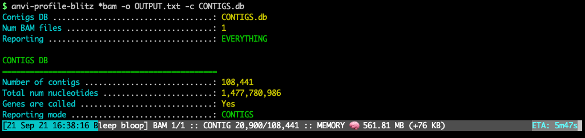

FAST profiling of BAM files to get gene-, contig-, or genome-level coverage and detection stats. Unlike `anvi-profile`, which is another anvi&#x27;o program that can profile BAM files, this program is designed to be very quick and only report long-format files for various read recruitment statistics per item. Plase also see the program `anvi-script-get-coverage-from-bam` for recovery of data from BAM files without an anvi&#x27;o contigs database.

🔙 **[To the main page](../../)** of anvi'o programs and artifacts.



{{ "network.json" }}
{{ 300 }}


## Authors

<a href="/people/meren" target="_blank">A. Murat Eren (Meren)</a>
<a href="http://merenlab.org" class="person-social" target="_blank"><i class="fa fa-fw fa-home"></i>Web</a><a href="mailto:a.murat.eren@gmail.com" class="person-social" target="_blank"><i class="fa fa-fw fa-envelope-square"></i>Email</a><a href="http://twitter.com/merenbey" class="person-social" target="_blank"><i class="fa fa-fw fa-twitter-square"></i>Twitter</a><a href="http://github.com/meren" class="person-social" target="_blank"><i class="fa fa-fw fa-github"></i>Github</a>

<a href="/people/ivagljiva" target="_blank">Iva Veseli</a>
<a href="mailto:iva.veseli@gmail.com" class="person-social" target="_blank"><i class="fa fa-fw fa-envelope-square"></i>Email</a><a href="http://twitter.com/ivaglj1va" class="person-social" target="_blank"><i class="fa fa-fw fa-twitter-square"></i>Twitter</a><a href="http://github.com/ivagljiva" class="person-social" target="_blank"><i class="fa fa-fw fa-github"></i>Github</a>

## Requires

[bam-file](../../artifacts/bam-file)  [contigs-db](../../artifacts/contigs-db) 

## Can use

[collection-txt](../../artifacts/collection-txt)  [genes-of-interest-txt](../../artifacts/genes-of-interest-txt) 

## Provides

[bam-stats-txt](../../artifacts/bam-stats-txt)  [discov-stats](../../artifacts/discov-stats) 

## Usage

This program **produces a [bam-stats-txt](/help/main/artifacts/bam-stats-txt) from one or more [bam-file](/help/main/artifacts/bam-file) given a [contigs-db](/help/main/artifacts/contigs-db)**. It is designed to serve people who only need to process read recruitment data stored in a [bam-file](/help/main/artifacts/bam-file) to recover coverage and detection statistics as well as the number of mapped reads (along with other statistics) for their genes, contigs, and/or genomes. It will report what's going on nicely with memory usage information and estimated time of completion:

[{:.center-img}](../../images/anvi-profile-blitz.png)

There are other programs in anvi'o software ecosystem that are similar to this one:

* [anvi-profile](/help/main/programs/anvi-profile) also takes a [bam-file](/help/main/artifacts/bam-file) and profiles it. **They both require a [contigs-db](/help/main/artifacts/contigs-db)**. But while [anvi-profile](/help/main/programs/anvi-profile) produces a [single-profile-db](/help/main/artifacts/single-profile-db) for downstream analyses in anvi'o, [anvi-profile-blitz](/help/main/programs/anvi-profile-blitz) produces text files for downstream analyses by the user (via R, Python, or other solutions). In contrast to [anvi-profile](/help/main/programs/anvi-profile), [anvi-profile-blitz](/help/main/programs/anvi-profile-blitz) is orders of magnitude faster with similar memory usage.

* [anvi-script-get-coverage-from-bam](/help/main/programs/anvi-script-get-coverage-from-bam) also takes a [bam-file](/help/main/artifacts/bam-file) and profiles it. **They both produce text output files.** But while [anvi-script-get-coverage-from-bam](/help/main/programs/anvi-script-get-coverage-from-bam) does not require a [contigs-db](/help/main/artifacts/contigs-db), [anvi-profile-blitz](/help/main/programs/anvi-profile-blitz) requires one to work. They will both run very rapidly, [anvi-script-get-coverage-from-bam](/help/main/programs/anvi-script-get-coverage-from-bam) will work with a much smaller amount of memory.

## Output files

For output file formats, please see [bam-stats-txt](/help/main/artifacts/bam-stats-txt).

## Running

You can use this program with one or more BAM files to recover minimal or extended statistics for contigs or genes in a [contigs-db](/help/main/artifacts/contigs-db).

{:.warning}
Since the program will not be able to ensure the [contigs-db](/help/main/artifacts/contigs-db) was generated from the same [contigs-fasta](/help/main/artifacts/contigs-fasta) that was used for read recruitment that resulted in [bam-file](/help/main/artifacts/bam-file)s for analysis, you can make serious mistakes if you mix up your workflow and start profiling BAM files that have nothing to do with a [contigs-db](/help/main/artifacts/contigs-db). If you make a mistake like that, in the best case scenario you will get an empty output file because the program will skip all contigs with non-matching name. In the worst case scenario you will get a file if some names in [contigs-db](/help/main/artifacts/contigs-db) incorrectly matches to some names in the [bam-file](/help/main/artifacts/bam-file). While this warning may be confusing, you can avoid all these if you use the SAME FASTA FILE both as reference for read recruitment and as input for [anvi-gen-contigs-database](/help/main/programs/anvi-gen-contigs-database).

### Contigs mode, default output

Profile contigs, produce a default output:

anvi&#45;profile&#45;blitz [bam&#45;file](/help/main/artifacts/bam&#45;file) \
                   &#45;c [contigs&#45;db](/help/main/artifacts/contigs&#45;db) \
                   &#45;o OUTPUT.txt

This example is with a single BAM file, but you can also have multiple BAM files as a parameter by using wildcards,

anvi&#45;profile&#45;blitz &#42;.bam \
                   &#45;c [contigs&#45;db](/help/main/artifacts/contigs&#45;db) \
                   &#45;o OUTPUT.txt

or by providing multiple paths:

anvi&#45;profile&#45;blitz /path/to/SAMPLE&#45;01.bam \
                   /path/to/SAMPLE&#45;02.bam \
                   /another/path/to/SAMPLE&#45;03.bam
                   &#45;c [contigs&#45;db](/help/main/artifacts/contigs&#45;db) \
                   &#45;o OUTPUT.txt

### Contigs mode, minimal output

Profile contigs, produce a minimal output. This is the fastest option:

anvi&#45;profile&#45;blitz [bam&#45;file](/help/main/artifacts/bam&#45;file) \
                   &#45;c [contigs&#45;db](/help/main/artifacts/contigs&#45;db) \
                   &#45;&#45;report&#45;minimal \
                   &#45;o OUTPUT.txt

### Genome/bin mode via collections

If you have a [collection-txt](/help/main/artifacts/collection-txt), you can summarize coverage/detection statistics per bin/genome instead of per contig.

anvi&#45;profile&#45;blitz [bam&#45;file](/help/main/artifacts/bam&#45;file) \
                   &#45;c [contigs&#45;db](/help/main/artifacts/contigs&#45;db) \
                   &#45;C [collection&#45;txt](/help/main/artifacts/collection&#45;txt) \
                   &#45;o OUTPUT.txt

{:.note}
Bin-level detection and coverage are computed by treating all contigs in a bin as a single genome (nucleotide arrays are concatenated under the hood, in alphabetical order of contig names). With `--report-minimal`, these statistics are streamed to keep memory usage close to contig mode even for large bins.

### Genes mode, default output

Instead of contigs, profile genes, produce a default output:

anvi&#45;profile&#45;blitz [bam&#45;file](/help/main/artifacts/bam&#45;file) \
                   &#45;c [contigs&#45;db](/help/main/artifacts/contigs&#45;db) \
                   &#45;&#45;gene&#45;mode \
                   &#45;o OUTPUT.txt

`--report-minimal` will behave the same, and produce minimal output.

### Genes mode, on a subset of genes

You don't want to profile all genes in your [contigs-db](/help/main/artifacts/contigs-db)? Then you should tell anvi'o which specific genes you are interested in by either providing a comma-separated list of gene-caller IDs:

anvi&#45;profile&#45;blitz [bam&#45;file](/help/main/artifacts/bam&#45;file) \
                   &#45;c [contigs&#45;db](/help/main/artifacts/contigs&#45;db) \
                   &#45;&#45;gene&#45;mode \
                   &#45;o OUTPUT.txt \
                   &#45;&#45;gene&#45;caller&#45;ids 5,13,74,203

_Or_ by providing a [genes-of-interest-txt](/help/main/artifacts/genes-of-interest-txt) file:

anvi&#45;profile&#45;blitz [bam&#45;file](/help/main/artifacts/bam&#45;file) \
                   &#45;c [contigs&#45;db](/help/main/artifacts/contigs&#45;db) \
                   &#45;&#45;gene&#45;mode \
                   &#45;o OUTPUT.txt \
                   &#45;&#45;genes&#45;of&#45;interest [genes&#45;of&#45;interest&#45;txt](/help/main/artifacts/genes&#45;of&#45;interest&#45;txt)

## Modifying discov parameters

For genomes or contigs, [anvi-profile-blitz](/help/main/programs/anvi-profile-blitz) computes the distribution of coverage (discov) score alongside other coverage statistics. Discov combines a spread score _S_ (proportion of windows with coverage, normalized by the proportion expected given the number of mapped reads), an evenness score _E_ (based on the coefficient of variation of mean coverage depth across covered windows), and detection _D_. See [discov-stats](/help/main/artifacts/discov-stats) for a full description of the metric and parameters.

The default parameters are designed to work well across typical metagenomics data, but you can adjust them:

**Window sizing**

_S_ and _E_ are computed by dividing the input sequence into non-overlapping windows. By default, contig-level stats use a window length equal to 1% of the contig length (minimum 300 bp). Genome/bin-level stats (when using `--collection-txt`) use a fixed 10,000 bp window. You can override these defaults with the following parameters:

* `--window-length INT` — use a fixed window size in bp for all sequences
* `--window-length-as-percentage INT` — set window length as a percentage of each sequence's length
* `--min-window-length INT` — set a minimum window length floor when using percentage mode

**Combining _S_ and _E_**

You can adjust how _S_ and _E_ are combined into the spread-evenness score _C_ by changing either their weights or the formula:

* `--alpha FLOAT` — weight of _S_ relative to _E_, in [0, 1] (default: 0.5)
* `--discov-formula STRING` — `geometric` (_C_ = _S_^_α_ × _E_^(1-_α_)) or `linear` (_C_ = _αS_ + (1-_α_)_E_) (default: `geometric`)

The final score is discov = min(1, _C_ + _D_^2).

**Window-level output**

To inspect the per-window values used to compute _S_ and _E_ (useful for debugging or visualization), add the `--gen-window-level-output` flag:

anvi&#45;profile&#45;blitz [bam&#45;file](/help/main/artifacts/bam&#45;file) \
                   &#45;c [contigs&#45;db](/help/main/artifacts/contigs&#45;db) \
                   &#45;o OUTPUT.txt \
                   &#45;&#45;gen&#45;window&#45;level&#45;output

This produces an additional file named `OUTPUT-WINDOWS.txt` with one row per window, including its start/stop positions (relative to the contig it is in, also in genome mode), its length, whether it has any coverage, its mean coverage, and the number of bases with nonzero coverage.

In genome mode, the contigs of a bin are concatenated before being divided into windows, so a window can span the boundary between two contigs. Such a window is reported under the contig in which it starts, and its stop position can therefore be larger than the length of that contig.

Note that computing discov is not compatible with `--gene-mode` or `--report-minimal`.

## Performance

The memory use will be correlated linaerly with the size of the [contigs-db](/help/main/artifacts/contigs-db), but once everything is loaded, the memory usage will not increase substantially over time.

With the flag `--report-minimal`, [anvi-profile-blitz](/help/main/programs/anvi-profile-blitz) profiled on a laptop computer 100,000 contigs that contained 1 billion nts in 6 minutes and used  ~300 Mb memory. This contigs database had 1.5 million genes, and memory usage increased to 1.7 Gb when [anvi-profile-blitz](/help/main/programs/anvi-profile-blitz) run in `--gene-mode`. The flag `--gene-mode` does not change time complexity dramatically.

Anvi'o has this program because [Emile Faure](https://twitter.com/faureemile) presented us with a challenge: Emile had a ~140 Gb anvi'o [contigs-db](/help/main/artifacts/contigs-db) that contained nearly 70 million contig sequences from over 200 single-assembled metagenomes, and wanted to learn the coverages of each gene in the contigs database in 200 metagenomes individually. Yet the combination of [anvi-profile](/help/main/programs/anvi-profile) and [anvi-summarize](/help/main/programs/anvi-summarize) jobs would take **more than 40 days** to complete. Since all Emile needed was to learn the coverages from BAM files, we implemented [anvi-profile-blitz](/help/main/programs/anvi-profile-blitz) to skip the profiling step. The run took **8 hours to compute and report coverage values for 175 million genes in 70 million contigs**, and the memory use remained below 200 Gb.

{:.notice}
Edit [this file](https://github.com/merenlab/anvio/tree/master/anvio/docs/programs/anvi-profile-blitz.md) to update this information.

## Command line interface

The following is the list of parameters and their descriptions in the latest version of `anvi-profile-blitz`.

The code that generates this web page ensures that this information is the latest available in **9-dev (eunice)**. Which means, in some cases the information in this section (generated automatically) might be more comprehensive or up-to-date compared to the descriptions above (written by humans).

---

### Command line usage



anvi-profile-blitz [-h] -c CONTIGS_DB [--gene-mode] [--gene-caller GENE-CALLER] [--gene-caller-ids GENE_CALLER_IDS] [--genes-of-interest FILE] [-C COLLECTION_TXT] -o FILE_PATH [--report-minimal] [--gen-window-level-output] [--window-length INTEGER] [--window-length-as-percentage INTEGER] [--min-window-length INTEGER] [--alpha FLOAT] [--discov-formula STRING] BAM_FILE(S) [BAM_FILE(S) ...]



### Parameters and their descriptions



<section class="parameter-group parameter-group-positional-arguments">
<header class="parameter-group-header">positional arguments</header>
<dl class="parameter-list">
<dt class="parameter parameter-required parameter-positional" id="parameter-bam_files"><code class="parameter-flags">BAM_FILE(S)</code> required</dt>
<dd class="parameter-details parameter-required">One or more indexed BAM files</dd>
</dl>
</section>
<section class="parameter-group parameter-group-input-db">
<header class="parameter-group-header">INPUT DB You will need to give this program an anvi&#x27;o contigs database.</header>
<dl class="parameter-list">
<dt class="parameter parameter-required" id="parameter-contigs_db"><code class="parameter-flags">-c, --contigs-db</code> <code class="parameter-metavar">CONTIGS_DB</code> required</dt>
<dd class="parameter-details parameter-required">Anvi&#x27;o contigs database generated by &#x27;anvi-gen-contigs-database&#x27;</dd>
</dl>
</section>
<section class="parameter-group parameter-group-genes">
<header class="parameter-group-header">GENES? You can work with genes instead of contigs</header>
<dl class="parameter-list">
<dt class="parameter parameter-switch" id="parameter-gene_mode"><code class="parameter-flags">--gene-mode</code></dt>
<dd class="parameter-details">This program by default will summarize coverage and detection stats for contigs found in your contigs database. Declaring this flag will change that behavior and report coverage and detection stats for each gene. Brace yourself for a huge file for large contigs databases lol :(</dd>
<dt class="parameter" id="parameter-gene_caller"><code class="parameter-flags">--gene-caller</code> <code class="parameter-metavar">GENE-CALLER</code></dt>
<dd class="parameter-details">The gene caller to utilize. Anvi&#x27;o supports multiple gene callers, and some operations (including this one) may require an explicit mentioning of which one to use. The default gene caller is identified automatically in most cases (based on whether the most frequent gene calls match to a known gene caller in anvi&#x27;o), but if you have a contigs-db generated with `--external-gene-callers` or something, you may have to pay extra attention here. Also, some HMM collections may add new gene calls into a given contigs-db as an ad-hoc fashion, so if you want to see all the options available to you in a given contigs database, please run the program `anvi-db-info` and take a look at the output.</dd>
<dt class="parameter" id="parameter-gene_caller_ids"><code class="parameter-flags">--gene-caller-ids</code> <code class="parameter-metavar">GENE_CALLER_IDS</code></dt>
<dd class="parameter-details">Gene caller ids to focus on. Multiple of them can be declared separated by a delimiter (the default is a comma, and if there is no option to change the delimiter, you must use a comma).In anvi-gen-variability-profile, if you declare nothing you will get all genes matching your other filtering criteria. In other programs, you may get everything, nothing, or an error. It really depends on the situation. Fortunately, mistakes are cheap, so it&#x27;s worth a try.</dd>
<dt class="parameter" id="parameter-genes_of_interest"><code class="parameter-flags">--genes-of-interest</code> <code class="parameter-metavar">FILE</code></dt>
<dd class="parameter-details">A file with anvi&#x27;o gene caller IDs. There should be only one column in the file, and each line should correspond to a unique gene caller id (without a column header).</dd>
</dl>
</section>
<section class="parameter-group parameter-group-collection">
<header class="parameter-group-header">COLLECTION Report genome/bin-level stats instead of per-contig stats</header>
<dl class="parameter-list">
<dt class="parameter" id="parameter-collection_txt"><code class="parameter-flags">-C, --collection-txt</code> <code class="parameter-metavar">COLLECTION_TXT</code></dt>
<dd class="parameter-details">Provide an anvi&#x27;o collection-txt artifact that associates each contig with a bin/genome. When a collection-txt is provided, anvi&#x27;o will report coverage and detection metrics per bin/genome rather than per contig.</dd>
</dl>
</section>
<section class="parameter-group parameter-group-output">
<header class="parameter-group-header">OUTPUT How do you want to store your output data.</header>
<dl class="parameter-list">
<dt class="parameter parameter-required" id="parameter-output_file"><code class="parameter-flags">-o, --output-file</code> <code class="parameter-metavar">FILE_PATH</code> required</dt>
<dd class="parameter-details parameter-required">File path to store results.</dd>
<dt class="parameter parameter-switch" id="parameter-report_minimal"><code class="parameter-flags">--report-minimal</code></dt>
<dd class="parameter-details">Using this flag, you can ask anvi&#x27;o to report minimum amount of data about your genes or contigs (such as mean coverage and detection) rather than a full blown output file with as much information as anvi&#x27;o can offer (such as, mean coverage, detection, Q2Q3 coverage, standard deviation of coverage, min/max values of coverage, GC-content and length of items, etc). Using this flag can cut your processing time in half. See the help docs for example output files for contigs and gene mode.</dd>
<dt class="parameter parameter-switch" id="parameter-gen_window_level_output"><code class="parameter-flags">--gen-window-level-output</code></dt>
<dd class="parameter-details">Generate an additional output file with per-window coverage statistics. For each window used to compute the discov metric, the output includes the window&#x27;s start/stop positions in the sequence, its length, whether it has any coverage, its mean coverage, and the number of bases with nonzero coverage. The file is named after the main output file with &#x27;-WINDOWS&#x27; inserted before the extension. Not compatible with --gene-mode or --report-minimal.</dd>
</dl>
</section>
<section class="parameter-group parameter-group-discov-score">
<header class="parameter-group-header">DISCOV SCORE Parameters related to computing the distribution of coverage score (discov), where S = proportion of windows with coverage (normalized by the proportion expected if reads were placed randomly) and E = evenness of mean coverage depth across windows. These are combined into a spread-evenness score C = αS + (1-α)E (linear) or C = S^α * E^(1-α) (geometric), and discov = min(1, C + detection^2). Does not apply to --gene-mode.</header>
<dl class="parameter-list">
<dt class="parameter" id="parameter-window_length"><code class="parameter-flags">--window-length</code> <code class="parameter-metavar">INTEGER</code></dt>
<dd class="parameter-details">How long to make the windows for computing the spread metric: S = # windows with coverage / # windows. For genome/bin-level stats, this is the default when no window length parameters are provided, and the default window size is 10000.</dd>
<dt class="parameter" id="parameter-window_length_as_percentage"><code class="parameter-flags">--window-length-as-percentage</code> <code class="parameter-metavar">INTEGER</code></dt>
<dd class="parameter-details">With this option you can set the window length for the spread metric (S) dynamically as a percentage of a given input sequence length. This works well when your input sequences (contigs or genomes) have a wide size distribution and you don&#x27;t have a one-size-fits-all window length to use. For instance, if you want the window size to be 5% of the contig length, you would use `--window-length-as-percentage 5`. You may want to consider also specifying a reasonable minimum window length with the --min-window-length parameter. This is the default window-sizing strategy for contig-level stats, and the default percentage is 1.</dd>
<dt class="parameter" id="parameter-min_window_length"><code class="parameter-flags">--min-window-length</code> <code class="parameter-metavar">INTEGER</code></dt>
<dd class="parameter-details">Use with --window-length-as-percentage to ensure that percentage-based window lengths never fall below this value. This parameter is set by default to 300 for contig-level stats.</dd>
<dt class="parameter" id="parameter-alpha"><code class="parameter-flags">--alpha</code> <code class="parameter-metavar">FLOAT</code></dt>
<dd class="parameter-details">How much to weight S over E when combining them into the spread-evenness score (C) that underlies the discov score. Should be a value in the range [0,1]. The default is &#x27;0.5&#x27;. Default: <code class="parameter-default-value">0.5</code></dd>
<dt class="parameter" id="parameter-discov_formula"><code class="parameter-flags">--discov-formula</code> <code class="parameter-metavar">STRING</code></dt>
<dd class="parameter-details">Which formula to use when combining S and E into the spread-evenness score (C) that underlies the discov score. Options are &#x27;linear&#x27; (C = αS + (1-α)E) and &#x27;geometric&#x27; (C = S^α * E^(1-α)). The default is &#x27;geometric&#x27;. Default: <code class="parameter-default-value">geometric</code></dd>
</dl>
</section>



## Additional Resources

{:.notice}
Are you aware of resources that may help users better understand the utility of this program? Please feel free to edit [this file](https://github.com/merenlab/anvio/blob/master/anvio/cli/profile_blitz.py) on GitHub. If you are not sure how to do that, find the `__resources__` tag in [this file](https://github.com/merenlab/anvio/blob/master/anvio/cli/interactive.py) to see an example.
