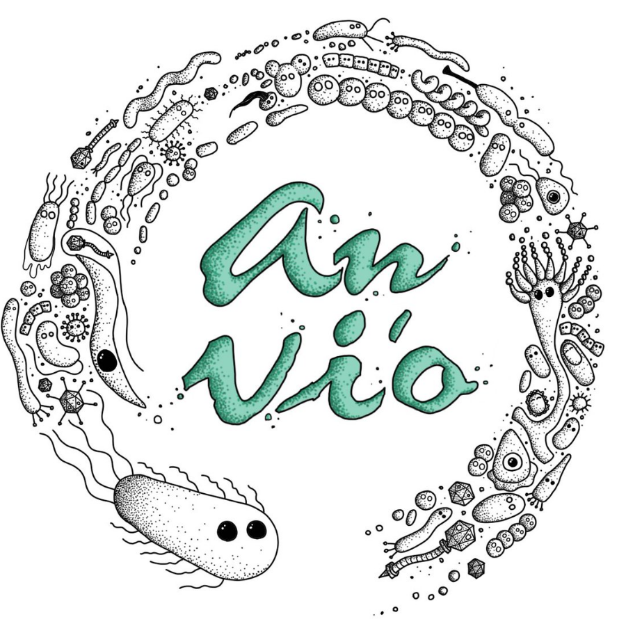

Start an anvi&#x27;o interactive interactive to manually curate or refine a genome, whether it is a metagenome-assembled, single-cell, or an isolate genome.

🔙 **[To the main page](../../)** of anvi'o programs and artifacts.



{{ "network.json" }}
{{ 300 }}


## Authors

<a href="/people/meren" target="_blank">A. Murat Eren (Meren)</a>
<a href="http://merenlab.org" class="person-social" target="_blank"><i class="fa fa-fw fa-home"></i>Web</a><a href="mailto:a.murat.eren@gmail.com" class="person-social" target="_blank"><i class="fa fa-fw fa-envelope-square"></i>Email</a><a href="http://twitter.com/merenbey" class="person-social" target="_blank"><i class="fa fa-fw fa-twitter-square"></i>Twitter</a><a href="http://github.com/meren" class="person-social" target="_blank"><i class="fa fa-fw fa-github"></i>Github</a>

<a href="/people/blankenberg" target="_blank">Daniel Blankenberg</a>
<a href="mailto:blanked2@ccf.org" class="person-social" target="_blank"><i class="fa fa-fw fa-envelope-square"></i>Email</a><a href="http://github.com/blankenberg" class="person-social" target="_blank"><i class="fa fa-fw fa-github"></i>Github</a>

## Requires

[profile-db](../../artifacts/profile-db)  [contigs-db](../../artifacts/contigs-db) 

## Can use

[bin](../../artifacts/bin) 

## Provides

[bin](../../artifacts/bin) 

## Usage

This program **opens the anvi'o interactive interface** to let the user **refine what contigs are contained in a specific [bin](/help/main/artifacts/bin) or manually split one bin into several.**

In the [interactive](/help/main/artifacts/interactive) interface, any bins that you create will overwrite the bin that you originally opened.  If you don't provide any names, the new bins' titles will be prefixed with the name of the original bin, so that bin will continue to live on in spirit.

Essentially, it is like running [anvi-interactive](/help/main/programs/anvi-interactive), but disposing of the original bin when you're done.

### Potential Use Cases

There are several reasons you might want to use anvi-refine:

- Your dataset is just really big.

    This process has its own [dedicated blog post](http://merenlab.org/2015/05/11/anvi-refine/), but, in short, the interactive interface and analysis, like all things, has its limits. Instead of trying to actively analyze all of your data at once, which will be very computationally heavy and might limit the types of analysis you'll even be able to do, it will be helpful to split your data into several smaller bins first. Then you can use anvi-refine on each one to replace those temporary bins with your final bins.

- You want to refine a bin generated by automated binning software.

    After automated binning (which you can do in anvi'o with [anvi-cluster-contigs](/help/main/programs/anvi-cluster-contigs)), you might see an awkward bin or two. These programs often have difficultly separating bins in some scenarios, as well as sorting out prophages, mobile genetic elements, and other things that you might want to have in their own bin. You can take these out of your MAGs and put them in their own bins, split bins with high redundency, or just refine them in any way you please, using anvi-refine.

- You're just not happy with one of your bins.

    Happens to everyone. Maybe the redundency is just a little too high and you want to take a closer look, or maybe you just want to split up two contigs giving you different taxonomy results. Feel free to go in and take specfic contigs out or split one bin into several.

If you just want to look at the contents of partiuclarly glorious bin, you should probably just use [anvi-interactive](/help/main/programs/anvi-interactive) for that, since you don't want to risk overwriting your bin.

{:.notice}
Edit [this file](https://github.com/merenlab/anvio/tree/master/anvio/docs/programs/anvi-refine.md) to update this information.

## Command line interface

The following is the list of parameters and their descriptions in the latest version of `anvi-refine`.

The code that generates this web page ensures that this information is the latest available in **9-dev (eunice)**. Which means, in some cases the information in this section (generated automatically) might be more comprehensive or up-to-date compared to the descriptions above (written by humans).

---

### Command line usage



anvi-refine [-h] -p PROFILE_DB -c CONTIGS_DB [-C COLLECTION_NAME] [-b BIN_NAME] [-B FILE_PATH] [--find-from-split-name SPLIT_NAME] [-t NEWICK] [--skip-hierarchical-clustering] [--load-full-state] [-V ADDITIONAL_VIEW] [-A ADDITIONAL_LAYERS] [-F FUNCTION ANNOTATION SOURCE] [--show-all-layers] [--split-hmm-layers] [--taxonomic-level {t_domain,t_phylum,t_class,t_order,t_family,t_genus,t_species}] [--hide-outlier-SNVs] [--title NAME] [--export-svg FILE_PATH] [--dry-run] [--skip-init-functions] [--skip-news] [--distance DISTANCE_METRIC] [--linkage LINKAGE_METHOD] [--skip-auto-ordering] [-I IP_ADDR] [-P INT] [--browser-path PATH] [--read-only] [--server-only] [--password-protected]



### Parameters and their descriptions



<section class="parameter-group parameter-group-default-inputs">
<header class="parameter-group-header">DEFAULT INPUTS The interavtive interface can be started with and without anvi&#x27;o databases. The default use assumes you have your profile and contigs database, however, it is also possible to start the interface using ad-hoc input files. See &#x27;MANUAL INPUT&#x27; section for other set of parameters that are mutually exclusive with datanases.</header>
<dl class="parameter-list">
<dt class="parameter parameter-required" id="parameter-profile_db"><code class="parameter-flags">-p, --profile-db</code> <code class="parameter-metavar">PROFILE_DB</code> required</dt>
<dd class="parameter-details parameter-required">Anvi&#x27;o profile database</dd>
<dt class="parameter parameter-required" id="parameter-contigs_db"><code class="parameter-flags">-c, --contigs-db</code> <code class="parameter-metavar">CONTIGS_DB</code> required</dt>
<dd class="parameter-details parameter-required">Anvi&#x27;o contigs database generated by &#x27;anvi-gen-contigs-database&#x27;</dd>
</dl>
</section>
<section class="parameter-group parameter-group-refine-specifics">
<header class="parameter-group-header">REFINE-SPECIFICS Parameters that are essential to the refinement process.</header>
<dl class="parameter-list">
<dt class="parameter" id="parameter-collection_name"><code class="parameter-flags">-C, --collection-name</code> <code class="parameter-metavar">COLLECTION_NAME</code></dt>
<dd class="parameter-details">Collection name.</dd>
<dt class="parameter" id="parameter-bin_id"><code class="parameter-flags">-b, --bin-id</code> <code class="parameter-metavar">BIN_NAME</code></dt>
<dd class="parameter-details">Bin name you are interested in.</dd>
<dt class="parameter" id="parameter-bin_ids_file"><code class="parameter-flags">-B, --bin-ids-file</code> <code class="parameter-metavar">FILE_PATH</code></dt>
<dd class="parameter-details">Text file for bins (each line should be a unique bin id).</dd>
<dt class="parameter" id="parameter-find_from_split_name"><code class="parameter-flags">--find-from-split-name</code> <code class="parameter-metavar">SPLIT_NAME</code></dt>
<dd class="parameter-details">If you don&#x27;t know the bin name you want to work with but if you know the split name it contains you can use this parameter to tell anvi&#x27;o the split name, and so it can find the bin for you automatically. This is something extremely difficult for anvi&#x27;o to do, but it does it anyway because you.</dd>
</dl>
</section>
<section class="parameter-group parameter-group-additional-stuff">
<header class="parameter-group-header">ADDITIONAL STUFF Parameters to provide additional layers, views, or layer data.</header>
<dl class="parameter-list">
<dt class="parameter" id="parameter-tree"><code class="parameter-flags">-t, --tree</code> <code class="parameter-metavar">NEWICK</code></dt>
<dd class="parameter-details">NEWICK formatted tree structure</dd>
<dt class="parameter parameter-switch" id="parameter-skip_hierarchical_clustering"><code class="parameter-flags">--skip-hierarchical-clustering</code></dt>
<dd class="parameter-details">Skip hierarchical clustering for the splits in the refined bin, if you skip clustering you need to provide your own newick formatted tree using --tree parameter.</dd>
<dt class="parameter parameter-switch" id="parameter-load_full_state"><code class="parameter-flags">--load-full-state</code></dt>
<dd class="parameter-details">Often the minimum and maximum values defined for the an entire profile database that contains all contigs do not scale well when you wish to work with a single bin in the refine mode. For this reason, the default behavior of anvi-refine is to ignore min/max values set in the default state. This flag is your way of telling anvi&#x27;o to not do that, and load the state stored in the profile database as is. Please note that this variable has no influence on the `detection` view. For the `detection` view, anvi&#x27;o will always load the global detection settings as if you have used this flag.</dd>
<dt class="parameter" id="parameter-additional_view"><code class="parameter-flags">-V, --additional-view</code> <code class="parameter-metavar">ADDITIONAL_VIEW</code></dt>
<dd class="parameter-details">A TAB-delimited file for an additional view to be used in the interface. This file should contain all split names, and values for each of them in all samples. Each column in this file must correspond to a sample name. Content of this file will be called &#x27;user_view&#x27;, which will be available as a new item in the &#x27;views&#x27; combo box in the interface</dd>
<dt class="parameter" id="parameter-additional_layers"><code class="parameter-flags">-A, --additional-layers</code> <code class="parameter-metavar">ADDITIONAL_LAYERS</code></dt>
<dd class="parameter-details">A TAB-delimited file for additional layers for splits. The first column of this file must be split names, and the remaining columns should be unique attributes. The file does not need to contain all split names, or values for each split in every column. Anvi&#x27;o will try to deal with missing data nicely. Each column in this file will be visualized as a new layer in the tree.</dd>
<dt class="parameter" id="parameter-annotation_source_for_per_split_summary"><code class="parameter-flags">-F, --annotation-source-for-per-split-summary</code> <code class="parameter-metavar">FUNCTION ANNOTATION SOURCE</code></dt>
<dd class="parameter-details">Using this parameter with a functional annotation source that (1) is in the contigs database and (2) has a maximum of 10 different function names, will dynamically add a new layer to the intearctive interface where proportions of functions in that source will be shown per split as stacked bar charts.</dd>
</dl>
</section>
<section class="parameter-group parameter-group-visuals-related">
<header class="parameter-group-header">VISUALS RELATED Parameters that give access to various adjustements regarding the interface.</header>
<dl class="parameter-list">
<dt class="parameter parameter-switch" id="parameter-show_all_layers"><code class="parameter-flags">--show-all-layers</code></dt>
<dd class="parameter-details">When declared, this flag tells the interface to show every additional layer even if there are no hits. By default, anvi&#x27;o doesn&#x27;t show layers if there are no hits for any of your items.</dd>
<dt class="parameter parameter-switch" id="parameter-split_hmm_layers"><code class="parameter-flags">--split-hmm-layers</code></dt>
<dd class="parameter-details">When declared, this flag tells the interface to split every gene found in HMM searches that were performed against non-singlecopy gene HMM profiles into their own layer. Please see the documentation for details.</dd>
<dt class="parameter" id="parameter-taxonomic_level"><code class="parameter-flags">--taxonomic-level</code> <code class="parameter-metavar">TAXONOMIC_LEVEL</code></dt>
<dd class="parameter-details">The taxonomic level to use whenever relevant and/or available. The default taxonomic level is t_genus, but if you choose something specific, anvi&#x27;o will focus on that whenever possible. Choices: <code class="parameter-choice">t_domain</code> <code class="parameter-choice">t_phylum</code> <code class="parameter-choice">t_class</code> <code class="parameter-choice">t_order</code> <code class="parameter-choice">t_family</code> <code class="parameter-choice">t_genus</code> <code class="parameter-choice">t_species</code> Default: <code class="parameter-default-value">t_genus</code></dd>
<dt class="parameter parameter-switch" id="parameter-hide_outlier_snvs"><code class="parameter-flags">--hide-outlier-SNVs</code></dt>
<dd class="parameter-details">During profiling, anvi&#x27;o marks positions of single-nucleotide variations (SNVs) that originate from places in contigs where coverage values are a bit &#x27;sketchy&#x27;. If you would like to avoid SNVs in those positions of splits in applicable projects you can use this flag, and the interface would hide SNVs that are marked as &#x27;outlier&#x27; (although it is clearly the best to see everything, no one will judge you if you end up using this flag) (plus, there may or may not be some historical data on this here: https://github.com/meren/anvio/issues/309).</dd>
<dt class="parameter" id="parameter-title"><code class="parameter-flags">--title</code> <code class="parameter-metavar">NAME</code></dt>
<dd class="parameter-details">Title for the interface. If you are working with a RUNINFO dict, the title will be determined based on information stored in that file. Regardless, you can override that value using this parameter.</dd>
<dt class="parameter" id="parameter-export_svg"><code class="parameter-flags">--export-svg</code> <code class="parameter-metavar">FILE_PATH</code></dt>
<dd class="parameter-details">The SVG output file path.</dd>
</dl>
</section>
<section class="parameter-group parameter-group-sweet-params-of-convenience">
<header class="parameter-group-header">SWEET PARAMS OF CONVENIENCE Parameters and flags that are not quite essential (but nice to have).</header>
<dl class="parameter-list">
<dt class="parameter parameter-switch" id="parameter-dry_run"><code class="parameter-flags">--dry-run</code></dt>
<dd class="parameter-details">Don&#x27;t do anything real. Test everything, and stop right before wherever the developer said &#x27;well, this is enough testing&#x27;, and decided to print out results.</dd>
<dt class="parameter parameter-switch" id="parameter-skip_init_functions"><code class="parameter-flags">--skip-init-functions</code></dt>
<dd class="parameter-details">When declared, function calls for genes will not be initialized (therefore will be missing from all relevant interfaces or output files). The use of this flag may reduce the memory fingerprint and processing time for large datasets.</dd>
<dt class="parameter parameter-switch" id="parameter-skip_news"><code class="parameter-flags">--skip-news</code></dt>
<dd class="parameter-details">Don&#x27;t try to read news content from upstream.</dd>
<dt class="parameter" id="parameter-distance"><code class="parameter-flags">--distance</code> <code class="parameter-metavar">DISTANCE_METRIC</code></dt>
<dd class="parameter-details">The distance metric for the hierarchical clustering of splits in the bin. Only relevant if you are not using --skip-hierarchical-clustering. The default is &quot;euclidean&quot;. Default: <code class="parameter-default-value">euclidean</code></dd>
<dt class="parameter" id="parameter-linkage"><code class="parameter-flags">--linkage</code> <code class="parameter-metavar">LINKAGE_METHOD</code></dt>
<dd class="parameter-details">The linkage method for the hierarchical clustering of splits in the bin. Only relevant if you are not using --skip-hierarchical-clustering. The default is &quot;ward&quot;. Default: <code class="parameter-default-value">ward</code></dd>
<dt class="parameter parameter-switch" id="parameter-skip_auto_ordering"><code class="parameter-flags">--skip-auto-ordering</code></dt>
<dd class="parameter-details">When declared, the attempt to include automatically generated orders of items based on additional data is skipped. In case those buggers cause issues with your data, and you still want to see your stuff and deal with the other issue maybe later.</dd>
</dl>
</section>
<section class="parameter-group parameter-group-server-configuration">
<header class="parameter-group-header">SERVER CONFIGURATION For power users.</header>
<dl class="parameter-list">
<dt class="parameter" id="parameter-ip_address"><code class="parameter-flags">-I, --ip-address</code> <code class="parameter-metavar">IP_ADDR</code></dt>
<dd class="parameter-details">IP address for the HTTP server. The default ip address (localhost) should work just fine for most. Default: <code class="parameter-default-value">localhost</code></dd>
<dt class="parameter" id="parameter-port_number"><code class="parameter-flags">-P, --port-number</code> <code class="parameter-metavar">INT</code></dt>
<dd class="parameter-details">Port number to use for anvi&#x27;o services. If nothing is declared, anvi&#x27;o will try to find a suitable port number, starting from the default port number, 8080.</dd>
<dt class="parameter" id="parameter-browser_path"><code class="parameter-flags">--browser-path</code> <code class="parameter-metavar">PATH</code></dt>
<dd class="parameter-details">By default, anvi&#x27;o will use your default browser to launch the interactive interface. If you would like to use something else than your system default, you can provide a full path for an alternative browser using this parameter, and hope for the best. For instance we are using this parameter to call Google&#x27;s experimental browser, Canary, which performs better with demanding visualizations.</dd>
<dt class="parameter parameter-switch" id="parameter-read_only"><code class="parameter-flags">--read-only</code></dt>
<dd class="parameter-details">When the interactive interface is started with this flag, all &#x27;database write&#x27; operations will be disabled.</dd>
<dt class="parameter parameter-switch" id="parameter-server_only"><code class="parameter-flags">--server-only</code></dt>
<dd class="parameter-details">The default behavior is to start the local server, and fire up a browser that connects to the server. If you have other plans, and want to start the server without calling the browser, this is the flag you need.</dd>
<dt class="parameter parameter-switch" id="parameter-password_protected"><code class="parameter-flags">--password-protected</code></dt>
<dd class="parameter-details">If this flag is set, command line tool will ask you to enter a password and interactive interface will be only accessible after entering same password. This option is recommended for shared machines like clusters or shared networks where computers are not isolated.</dd>
</dl>
</section>



## Additional Resources

* [Refining a bin](http://merenlab.org/2015/05/11/anvi-refine/)

* [Notes on genome refinement](http://merenlab.org/2017/05/11/anvi-refine-by-veronika/)

* [A case study: Inspecting the genomic link between Archaea and Eukaryota](http://merenlab.org/2017/01/03/loki-the-link-archaea-eukaryota/)

* [As part of the metagenomic workflow](http://merenlab.org/2016/06/22/anvio-tutorial-v2/#anvi-refine)

* [A demo](https://www.youtube.com/watch?v=vXPKP5vKiBM)

{:.notice}
Are you aware of resources that may help users better understand the utility of this program? Please feel free to edit [this file](https://github.com/merenlab/anvio/blob/master/anvio/cli/refine.py) on GitHub. If you are not sure how to do that, find the `__resources__` tag in [this file](https://github.com/merenlab/anvio/blob/master/anvio/cli/interactive.py) to see an example.
