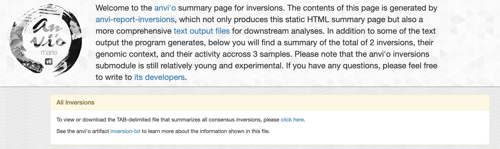
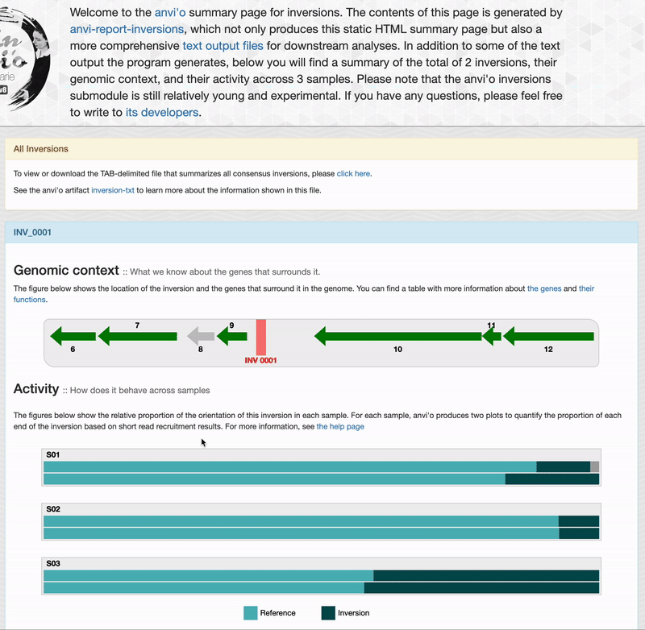
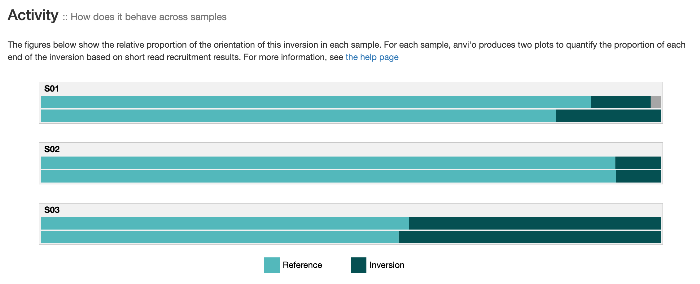
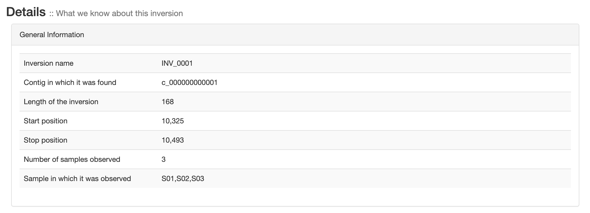
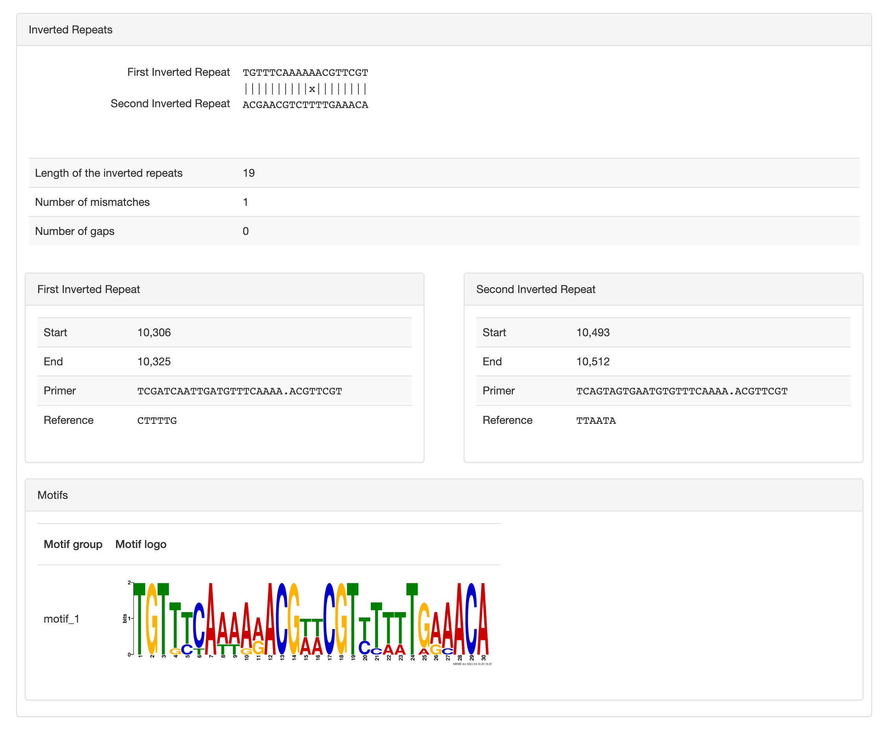

Reports inversions.

🔙 **[To the main page](../../)** of anvi'o programs and artifacts.



<div id="svg" class="subnetwork"></div>
{{ "network.json" }}
{{ 300 }}



## Authors

<div class="anvio-person"><div class="anvio-person-info"><div class="anvio-person-photo"></div><div class="anvio-person-info-box"><a href="/people/floriantrigodet" target="_blank"><span class="anvio-person-name">Florian Trigodet</span></a><div class="anvio-person-social-box"><a href="mailto:trigodet.florian@gmail.com" class="person-social" target="_blank"><i class="fa fa-fw fa-envelope-square"></i>Email</a><a href="http://twitter.com/FlorianTrigodet" class="person-social" target="_blank"><i class="fa fa-fw fa-twitter-square"></i>Twitter</a><a href="http://github.com/floriantrigodet" class="person-social" target="_blank"><i class="fa fa-fw fa-github"></i>Github</a></div></div></div></div>

<div class="anvio-person"><div class="anvio-person-info"><div class="anvio-person-photo"></div><div class="anvio-person-info-box"><a href="/people/meren" target="_blank"><span class="anvio-person-name">A. Murat Eren (Meren)</span></a><div class="anvio-person-social-box"><a href="http://merenlab.org" class="person-social" target="_blank"><i class="fa fa-fw fa-home"></i>Web</a><a href="mailto:a.murat.eren@gmail.com" class="person-social" target="_blank"><i class="fa fa-fw fa-envelope-square"></i>Email</a><a href="http://twitter.com/merenbey" class="person-social" target="_blank"><i class="fa fa-fw fa-twitter-square"></i>Twitter</a><a href="http://github.com/meren" class="person-social" target="_blank"><i class="fa fa-fw fa-github"></i>Github</a></div></div></div></div>

<div class="anvio-person"><div class="anvio-person-info"><div class="anvio-person-photo"></div><div class="anvio-person-info-box"><a href="/people/ekiefl" target="_blank"><span class="anvio-person-name">Evan Kiefl</span></a><div class="anvio-person-social-box"><a href="http://ekiefl.github.io" class="person-social" target="_blank"><i class="fa fa-fw fa-home"></i>Web</a><a href="mailto:kiefl.evan@gmail.com" class="person-social" target="_blank"><i class="fa fa-fw fa-envelope-square"></i>Email</a><a href="http://twitter.com/evankiefl" class="person-social" target="_blank"><i class="fa fa-fw fa-twitter-square"></i>Twitter</a><a href="http://github.com/ekiefl" class="person-social" target="_blank"><i class="fa fa-fw fa-github"></i>Github</a></div></div></div></div>


## Requires


<p style="text-align: left" markdown="1"><span class="artifact-r">[bams-and-profiles-txt](../../artifacts/bams-and-profiles-txt) </span></p>


## Provides


<p style="text-align: left" markdown="1"><span class="artifact-p">[inversions-txt](../../artifacts/inversions-txt) </span></p>


## Usage


This program allows you to find genomic inversions using metagenomic read recruitment results, and their activity patterns across samples.

Specifically, this program search for site-specific inversions which are carried out by site-specific recombinases. This enzyme recognizes a pair of inverted repeats (IRs). The IRs are distant from each other and the site-specific recombinase invert the DNA fragment between the IRs.

In brief, anvi'o leverages paired-read orientation (through the `--fetch-filter` mechanism in <span class="artifact-p">[anvi-profile](/help/main/programs/anvi-profile)</span> explained below) to locate regions of interest in a set of contigs. It screens for IRs within regions that are enriched in read pairs that are enriched in forward/forward or reverse/reverse orientations, and uses short-reads to confirm which IRs correspond to real inversions. Anvi'o can also compute the 'inversion activity', i.e., the relative proportion of each orientation of an inversion in each sample.

### Anvi'o philosophy to find inversions

Much like a T-Rex, the vision of anvi'o relies on movement and it cannot see an inversion if it does not move, or in this case, invert. So let's start with what you cannot do with this command: you cannot find inversions in a set of contigs alone.

To find an inversion, you need to have short-reads from at least one sample. If there is even a small fraction of the members of a microbial population that have an inverted sequence, then <span class="artifact-p">[anvi-report-inversions](/help/main/programs/anvi-report-inversions)</span> will very likely find it for you!

### Before you run this program

Anvi'o is able to locate inversions using the paired-end read orientation. Regular paired-end reads are facing inward with a FWD/REV orientation, but when an inversion happens, some reads will be mapping in the opposite orientation regarding the reference. As a consequence, some paired-end reads will have the same orientation: FWD/FWD or REV/REV.

To leverage that information, anvi'o can profile bam files for FWD/FWD and REV/REV reads only with <span class="artifact-p">[anvi-profile](/help/main/programs/anvi-profile)</span> to make special <span class="artifact-n">[single-profile-db](/help/main/artifacts/single-profile-db)</span>.

<div class="codeblock" markdown="1">
anvi&#45;profile &#45;i <span class="artifact&#45;n">[bam&#45;file](/help/main/artifacts/bam&#45;file)</span> \
             &#45;c <span class="artifact&#45;n">[contigs&#45;db](/help/main/artifacts/contigs&#45;db)</span> \
             &#45;&#45;fetch&#45;filter inversion
</div>

### Other essential inputs to run this program

The main input for <span class="artifact-p">[anvi-report-inversions](/help/main/programs/anvi-report-inversions)</span> is a <span class="artifact-n">[bams-and-profiles-txt](/help/main/artifacts/bams-and-profiles-txt)</span>, which is a TAB-delimited file composed of at least four columns:

* Sample name,
* <span class="artifact-n">[contigs-db](/help/main/artifacts/contigs-db)</span>,
* <span class="artifact-n">[single-profile-db](/help/main/artifacts/single-profile-db)</span> generated with the inversion fetch filter,
* <span class="artifact-n">[bam-file](/help/main/artifacts/bam-file)</span>.

If you are interested in also characterizing inversion activity statistics across samples, you will also need to add two more columns into the <span class="artifact-n">[bams-and-profiles-txt](/help/main/artifacts/bams-and-profiles-txt)</span> file to point out the paths for the R1 and R2 FASTQ files.

Here is a standard run with default parameters:

<div class="codeblock" markdown="1">
anvi&#45;report&#45;inversion &#45;P <span class="artifact&#45;n">[bams&#45;and&#45;profiles&#45;txt](/help/main/artifacts/bams&#45;and&#45;profiles&#45;txt)</span> \
                      &#45;o inversions_output
</div>

### Identifying regions of interest

While anvi'o could directly search for inverted repeats in all the contigs, it would be a waste of time as many IRs are actually not related to inversions. Instead, anvi'o uses the FWD/FWD and REV/REV reads to identify regions of interest and constrain the search for IRs only in these regions.

For this step, you can set the minimum coverage of FWD/FWD and REV/REV reads to define 'stretches' with `--min-coverage-to-define-stretches`. Lower threshold yield more stretches, but also more noise.

The parameter `--min-stretch-length` defines the minimum length for a stretch to be considered.

FWD/FWD reads are found on the leftmost side of an inversion, while the REV/REV reads are found on the right side. When an inversion is quite long, a region of low to no coverage can separate the two groups of reads. With the flag `--min-distance-between-independent-stretches`, anvi'o merges fragmented stretches if they are closer than this value.

When the coverage is quite low, a stretch can be a little bit too short and miss potential IRs, so you use `--num-nts-to-pad-a-stretch` to extend the stretch by x bp upstream and downstream.

Here are the default values for these flags:

<div class="codeblock" markdown="1">
anvi&#45;report&#45;inversions &#45;P <span class="artifact&#45;n">[bams&#45;and&#45;profiles&#45;txt](/help/main/artifacts/bams&#45;and&#45;profiles&#45;txt)</span> \
                       &#45;o inversions_output \
                       &#45;&#45;min&#45;coverage&#45;to&#45;define&#45;stretches 10 \
                       &#45;&#45;min&#45;stretch&#45;length 50 \
                       &#45;&#45;min&#45;distance&#45;between&#45;independent&#45;stretches 2000 \
                       &#45;&#45;num&#45;nts&#45;to&#45;pad&#45;a&#45;stretch 100
</div>

### Finding palindromes

There are a few parameters to constrain the search for palindromic sequences of the IRs, like a minimum length that can be set with `--min-palindrome-length`, and a maximum number of mismatches with `--max-num-mismatches`.

You can set the minimum distance between two palindromic sequences with `--min-distance`. A distance of 0 would correspond to an in-place palindrome, though they don't relate to genomic inversions.

When searching for palindromes with mismatches, the algorithm will extend the palindrome length as much as possible, often including mismatches which are outside of the true palindrome sequences. The flag `--min-mismatch-distance-to-first-base` allows you to trim the palindrome when one or more mismatches are n nucleotides away from a palindrome's start or stop. The default value is 1, meaning that a palindrome `MMMMMM(X)M`, where M denotes matching nucleotides and X a mismatch, will be trimmed to the first 6 matches `MMMMMM`.

There are currently two algorithms to find palindromes in anvi'o: numba and BLAST. Numba is very fast when looking for palindromes in short sequences, and BLAST is more efficient for longer stretches. Anvi'o dynamically set the algorithm according to each stretch length: numba for stretches under 5,000 bp and BLAST for longer stretches. You can use the flag `--palindrome-search-algorithm` to ask anvi'o to use either of these methods explicitly. Note that results between the two methods may differ.

<div class="codeblock" markdown="1">
anvi&#45;report&#45;inversions &#45;P <span class="artifact&#45;n">[bams&#45;and&#45;profiles&#45;txt](/help/main/artifacts/bams&#45;and&#45;profiles&#45;txt)</span> \
                       &#45;o inversions_output \
                       &#45;&#45;min&#45;palindrome&#45;length 10 \
                       &#45;&#45;max&#45;num&#45;mismatches 1 \
                       &#45;&#45;min&#45;distance 50 \
                       &#45;&#45;min&#45;mismatch&#45;distance&#45;to&#45;first&#45;base 1 \
                       &#45;&#45;palindrome&#45;search&#45;algorithm numba
</div>

### Confirming inversions

Multiple palindromes are usually reported for each stretch and to confirm which one actually relates to an inversions, anvi'o searches short-reads in the bam file for unique constructs that can only occur when a genomic region inverted.

By default, anvi'o reports the first confirmed palindrome and moves to the next stretch. This process is very efficient as a stretch usually has only one inversion. But in rare cases, you can have multiple inversions happening in a single stretch. Then, you can use the flag `--check-all-palindromes` and anvi'o will look for inversion evidence in the short-reads for every palindrome in a stretch.

Anvi'o looks for inversion evidence in the FWD/FWD and REV/REV reads first. If no evidence is found, then it searches the rest of the reads mapping to the region of interest. If you want to only search the FWD/FWD and REV/REV reads you can use the flag `--process-only-inverted-reads`

### Computing inversion activity

If you provide the short-reads R1 and R2 in the <span class="artifact-n">[bams-and-profiles-txt](/help/main/artifacts/bams-and-profiles-txt)</span>, anvi'o can compute the proportion of the inversion's orientation in each sample.

This is a very time consuming step, and if you have multiple sample, you can use the parameter `--num-threads` to set the maximum of threads for multithreading when possible.

To compute the inversion's ratios, anvi'o designs in silico primers based on the palindrome sequence and the upstream/downstream genomic context to search short-reads in the raw fastq files. The variable `--oligo-primer-base-length` is used to control how much of the palindrome should be used to design the primers. The longer, the more specific, but if it is too long, fewer reads will match to the primer.

This step is very computationally intense, but you can test it with the parameter `--end-primer-search-after-x-hits`. Once the total number of reads reach this parameter, anvi'o will stop searching further and will continue with the next sample. This flag is only good for testing.

If you want to skip this step, you can use the flag `--skip-compute-inversion-activity`.

An example command with 12 threads:

<div class="codeblock" markdown="1">
anvi&#45;report&#45;inversions &#45;P <span class="artifact&#45;n">[bams&#45;and&#45;profiles&#45;txt](/help/main/artifacts/bams&#45;and&#45;profiles&#45;txt)</span> \
                       &#45;o inversions_output \
                       &#45;&#45;num&#45;threads 12 \
                       &#45;&#45;oligo&#45;primer&#45;base&#45;length 12
</div>

### Computing inversion activity using previously computed inversions

It is possible to instruct anvi'o to use previously reported inversions to characterize their activity across a larger set of samples. This is possible by passing the program <span class="artifact-p">[anvi-report-inversions](/help/main/programs/anvi-report-inversions)</span> the output file for consensus inversions (i.e., 'CONSENSUS-INVERSIONS.txt') or the output file for sample-specific inversions (i.e., 'INVERSIONS-IN-[SAMPLE-NAME].txt') from a previous run using the flag `--pre-computed-inversions`:

<div class="codeblock" markdown="1">
anvi&#45;report&#45;inversions &#45;P <span class="artifact&#45;n">[bams&#45;and&#45;profiles&#45;txt](/help/main/artifacts/bams&#45;and&#45;profiles&#45;txt)</span> \
                       &#45;&#45;pre&#45;computed&#45;inversions inversions_output/INVERSIONS&#45;CONSENSUS.txt
                       &#45;o activity_calculations
</div>

In this mode, <span class="artifact-p">[anvi-report-inversions](/help/main/programs/anvi-report-inversions)</span> will not recalculate inversions, and only report the activity of inversions found in the input file across samples listed in the <span class="artifact-n">[bams-and-profiles-txt](/help/main/artifacts/bams-and-profiles-txt)</span> file.

{:.notice}
If you have additional samples to make sense of the inversions you already know about, you obviously don't need to do any additional mapping and profiling. All you need is the <span class="artifact-n">[contigs-db](/help/main/artifacts/contigs-db)</span> with which you used to generate the inversion report you already have (i.e., not for the new samples you have), and the `r1` and `r2` files for the new samples. This is similar to the structure of <span class="artifact-n">[bams-and-profiles-txt](/help/main/artifacts/bams-and-profiles-txt)</span>, except the `profile_db_path` and `bam_file_path` columns. While the entire purpose of this file is ot have these columns, in this particular instance, when you use the flag `--pre-computed-inversions` with <span class="artifact-p">[anvi-report-inversions](/help/main/programs/anvi-report-inversions)</span>, ANVI'O SANITY CHECKS WILL NOT REQUIRE THE FILE TO INCLUDE PROFILE-DB AND BAM FILE PATHS. Which will make your life much more easier to scale your search. Which means for this particular application, you can create your <span class="artifact-n">[bams-and-profiles-txt](/help/main/artifacts/bams-and-profiles-txt)</span> file only with the columns and you'd still be OK: `name`, `contigs_db_path`, `r1`, `r2`.

### Reporting genomic context around inversions

For every inversion, anvi'o can report the surrounding genes and their function as additional files.

You can use the flag `--num-genes-to-consider-in-context` to choose how many genes to consider upstream/downstream of the inversion. By default, anvi'o report three genes downstream, and three genes upstream.

To select a specific gene caller, you can use `--gene-caller`. The default is pyrodigal-gv.

If you want to skip this step, you can use the flag `--skip-recovering-genomic-context`.

### Searching for conserved motifs in inverted-repeats

The inversions are carried out by site-specific recombinase which recognize a DNA motifs on each end of the invertible DNA fragment. This DNA motif is a relatively conserved palindrome separated by a short sequence called a spacer.

A fascinating aspect of site-specific recombinases is that they can invert multiple site, providing the DNA recognition motif is present. Some genomes can have **one** site-specific recombinase responsible **many** inversions! Some genomes have a few site-specific recombinase regulating different set of inversions.

When you use this command, anvi'o will leverage the program [MEME](https://meme-suite.org/meme/tools/meme) to identify palindrome motifs in the inverted-repeats.
It is done in two steps:
- Per inversion. Anvi'o searches and report three motifs. You can find the output of MEME in each inversion's directory (e.g. `PER_INV/INV_0001/MEME`).
- For all inversions. Anvi'o searches for shared and conserved motifs across all inversions. By default it will search for as many motifs as there are inversions. This can be time consuming if you have a lot of inversions, and you can use the flag `--num-of-motifs` to specify the number of motifs to be reported. The output of MEME can be found here: `PER_INV/ALL_INVERSIONS/MEME`.

In the final outputs, we report the 'motif group' for each inversions. Which means that you can link together groups of inversion putatively associated with the same site-specific recombinase.

If you want to skip this step, you can use the flag `--skip-search-for-motifs`.

### Targeted search

If you are interested in a given contig region you can use the following flags to limit the search:

* `--target-contig`: contig of interest,
* `--target-region-start`: the start position of the region of interest,
* `--target-region-end`: the end position of the region of interest.

### HTML output
The first output of interest is `index.html` which is a static html page with all the information about each inversions.

On the top of this page, you will find general informations such as number of inversions found and link to some tab-delimited files that summarize all inversions:



#### Genomic context



For each inversions you can see the genomic context. This part is interactive and allow you to inspect genes information such as their functions, DNA and amino acid sequences:

#### Activity



If you provided short-reads to the analysis, you can see barplots representing the inversion's activity. As explained in [the activity section](#computing-inversion-activity), anvi'o compute the activity on each end of an inversion, which explains the two barplots per sample. "Reference" correspond to the relative proportion of short-read matching to an inversion's orientation similar to your reference sequence. And "Inversion" correspond to the relative proportion of short-reads matching the reverse orientation.

The two barplots per sample should be relatively similar. It is not the case when (1) the coverage is low (fewer reads = less accurate relative proportions) or (2) there is more than one pair of inverted-repeat in this genomic site. [Here](https://doi.org/10.1093/nar/gkaa824) is a nice example of multiple nested IRs. If you ever see this, you should consider re-running the command for that specific region with [targeted search](#targeted-search), and searching for all possible palindrome with `--check-all-palindromes`. Yes, anvi'o can report nested, multiple IRs inversions when you use these flags :rainbow:.

It is possible to see more colors than the two "Reference" and "Inversion". For instance, if you have a nested multiple IRs inversions (lucky you), you should see another color (a variation of grey) indicating that more than one sequence can end up on this side of an inversions. Another reason is sequencing error. Anvi'o relies on exact matches to report "Reference" and "Inversion", and a single read mismatch can create a third category (and therefore a third color in the barplot). If you see some **red** color, it means more than 4 different DNA sequence can be found at the edge of an inversions, which means that something is probably wrong and requires some manual inspection (or you should collect your Nobel prize).

#### General information



General information about each inversions like contig, position, length and the sample in which it was found.

#### Inverted repeats and motifs



Here you can see the two inverted-repeats, their alignment, length and position.
You can also see the "primer" sequence used to search short-read to report the activity, or relative proportion of an inversion's orientation per sample.

And finally you can see the palindromic motif likely recognized by a site-specific recombinase which carries out such inversion.
The same motif can occur in multiple inversions, which suggest that a unique site-specific recombinase is responsible for a set of inversions.
Typically there is only one motif per inversion, but we don't control biology so it is possible that more than one motif are reported.

### Other outputs

<span class="artifact-p">[anvi-report-inversions](/help/main/programs/anvi-report-inversions)</span> create an output directory with the following structure (if you have not use the `--skip-[..]` flags):

```
INVERSIONS-OUTPUT/
├── ALL-STRETCHES-CONSIDERED.txt
├── INVERSION-ACTIVITY.txt
├── INVERSIONS-CONSENSUS.txt
├── PER_INV
│   ├── ALL_INVERSIONS
│   │   ├── MEME
│   │   │   ├── logo1.eps
│   │   │   ├── [...]
│   │   │   └── meme.xml
│   │   ├── inverted_repeats.fasta
│   │   └── run-MEME.log
│   ├── INV_0001
│   │   ├── MEME
│   │   │   ├── logo1.eps
│   │   │   ├── [...]
│   │   │   └── meme.xml
│   │   ├── SURROUNDING-FUNCTIONS.txt
│   │   ├── SURROUNDING-GENES.txt
│   │   ├── inverted_repeats.fasta
│   │   └── run-MEME.log
│   └── INV_0002
│       ├── MEME
│       │   ├── logo1.eps
│       │   ├── [...]
│       │   └── meme.xml
│       ├── SURROUNDING-FUNCTIONS.txt
│       ├── SURROUNDING-GENES.txt
│       ├── inverted_repeats.fasta
│       └── run-MEME.log
├── PER_SAMPLE
│   ├── INVERSIONS-IN-S01.txt
│   ├── INVERSIONS-IN-S02.txt
│   └── INVERSIONS-IN-S03.txt
└── index.html
```

For more information about each of these txt files, go check <span class="artifact-n">[inversions-txt](/help/main/artifacts/inversions-txt)</span>.


{:.notice}
Edit [this file](https://github.com/merenlab/anvio/tree/master/anvio/docs/programs/anvi-report-inversions.md) to update this information.


## Command line interface

The following is the list of parameters and their descriptions in the latest version of `anvi-report-inversions`.

The code that generates this web page ensures that this information is the latest available in **9-dev (eunice)**. Which means, in some cases the information in this section (generated automatically) might be more comprehensive or up-to-date compared to the descriptions above (written by humans).

---

### Command line usage


<div class="program-parameters-usage">anvi-report-inversions [-h] [-P BAMS-AND-PROFILES-FILE] [--pre-computed-inversions INVERSIONS-FILE] [--min-coverage-to-define-stretches INT] [--min-stretch-length INT] [--min-distance-between-independent-stretches INT] [--num-nts-to-pad-a-stretch INT] [--min-ratio-of-normal-to-special-coverage FLOAT] [--min-detection-to-report-coverage-ratio FLOAT] [-l INT] [-m INT] [-d INT] [--min-mismatch-distance-to-first-base INT] [--palindrome-search-algorithm {BLAST,numba}] [--check-all-palindromes] [--process-only-inverted-reads] [-T NUM_THREADS] [--oligo-primer-base-length INT] [--skip-compute-inversion-activity] [--end-primer-search-after-x-hits END_PRIMER_SEARCH_AFTER_X_HITS] [--min-frequency-to-report MIN_FREQUENCY_TO_REPORT] [--skip-recovering-genomic-context] [--num-genes-to-consider-in-context INT] [--gene-caller GENE-CALLER] [--skip-search-for-motifs] [--num-of-motifs INT] [--verbose] [--target-contig CONTIG_NAME] [--target-region-start NUCLEOTIDE_POSITION] [--target-region-end NUCLEOTIDE_POSITION] [-o DIR_PATH]</div>


### Parameters and their descriptions


<div class="program-parameters">
<section class="parameter-group parameter-group-input-data">
<header class="parameter-group-header"><span class="parameter-group-title">INPUT DATA</span> <span class="parameter-group-description">Essentially a BAMs and profiles file and nothing more.</span></header>
<dl class="parameter-list">
<dt class="parameter" id="parameter-bams_and_profiles"><code class="parameter-flags">-P, --bams-and-profiles</code> <code class="parameter-metavar">BAMS-AND-PROFILES-FILE</code></dt>
<dd class="parameter-details"><span class="parameter-help">A four-column TAB-delimited flat text file. The header line must contain these columns: &#x27;name&#x27;, &#x27;contigs_db_path&#x27;, &#x27;profile_db_path&#x27;, and &#x27;bam_file_path&#x27;. See the profiles-and-bams.txt artifact for the details of the file.</span></dd>
</dl>
</section>
<section class="parameter-group parameter-group-calculate-activity-from-known-inversions">
<header class="parameter-group-header"><span class="parameter-group-title">CALCULATE ACTIVITY FROM KNOWN INVERSIONS?</span> <span class="parameter-group-description">This input option is ONLY relevant to those who have already run the entire workflow and have their consensus inversions (i.e., &#x27;CONSENSUS-INVERSIONS.txt&#x27;) or sample-specific inversions (i.e., &#x27;INVERSIONS-IN-[SAMPLE-NAME].txt&#x27;) calculated. This input option will use the existing inversions reported in the input file and recalculate the inversion activity output. It is a great way to calculate inversions or refine them from a smaller set of genomes / metagenomes, and scale up the characterizations of their activity to thousands of metagenomes quickly (*cough* cheater *cough*). Please note that if you use this flag, most other options EXCEPT those that are listed below &#x27;KEY ALGORITHMIC COMPONENT 04: COMPUTING INVERSION ACTIVITY&#x27; will be irrelevant, so you can skip all and take a look at the parameters there.</span></header>
<dl class="parameter-list">
<dt class="parameter" id="parameter-pre_computed_inversions"><code class="parameter-flags">--pre-computed-inversions</code> <code class="parameter-metavar">INVERSIONS-FILE</code></dt>
<dd class="parameter-details"><span class="parameter-help">A TAB-delimited file that lists sample-specific or consensus inversions identified by the program `anvi-report-inversions`.</span></dd>
</dl>
</section>
<section class="parameter-group parameter-group-key-algorithmic-component-01-identifying-regions-of-interest">
<header class="parameter-group-header"><span class="parameter-group-title">KEY ALGORITHMIC COMPONENT 01: IDENTIFYING REGIONS OF INTEREST</span> <span class="parameter-group-description">How should anvi&#x27;o identify regions of interest based on REV/REV and FWD/FWD paired-end reads? Defaults will be good for most cases.</span></header>
<dl class="parameter-list">
<dt class="parameter" id="parameter-min_coverage_to_define_stretches"><code class="parameter-flags">--min-coverage-to-define-stretches</code> <code class="parameter-metavar">INT</code></dt>
<dd class="parameter-details"><span class="parameter-help">Value to break up contigs into &#x27;stretches&#x27; of high-coverage regions of FWD/FWD and REV/REV reads. The lower the value, the more noise. This acts as a low-pass filter if it helps you imagine how it works.</span> <span class="parameter-default"><span class="parameter-label">Default:</span> <code class="parameter-default-value">10</code></span></dd>
<dt class="parameter" id="parameter-min_stretch_length"><code class="parameter-flags">--min-stretch-length</code> <code class="parameter-metavar">INT</code></dt>
<dd class="parameter-details"><span class="parameter-help">These are not the stretches you are looking for (unless they are longer than this, obv).</span> <span class="parameter-default"><span class="parameter-label">Default:</span> <code class="parameter-default-value">50</code></span></dd>
<dt class="parameter" id="parameter-min_distance_between_independent_stretches"><code class="parameter-flags">--min-distance-between-independent-stretches</code> <code class="parameter-metavar">INT</code></dt>
<dd class="parameter-details"><span class="parameter-help">Our &#x27;low pass&#x27; filter may break a single stretch of reasonable coverage of FWD/FWD and REV/REV reads into multiple pieces. To recover from that, we wish to merge the fragmented ones if they are closer to one another than this value.</span> <span class="parameter-default"><span class="parameter-label">Default:</span> <code class="parameter-default-value">2000</code></span></dd>
<dt class="parameter" id="parameter-num_nts_to_pad_a_stretch"><code class="parameter-flags">--num-nts-to-pad-a-stretch</code> <code class="parameter-metavar">INT</code></dt>
<dd class="parameter-details"><span class="parameter-help">Some leeway towards upstream and downstream context that is essential to not miss key information due to coverage variation that may influence the beginnings and ends of final stretches.</span> <span class="parameter-default"><span class="parameter-label">Default:</span> <code class="parameter-default-value">100</code></span></dd>
<dt class="parameter" id="parameter-min_ratio_of_normal_to_special_coverage"><code class="parameter-flags">--min-ratio-of-normal-to-special-coverage</code> <code class="parameter-metavar">FLOAT</code></dt>
<dd class="parameter-details"><span class="parameter-help">When a contig has significant detection of FWD/FWD or REV/REV reads (see --min-detection-to-report-coverage-ratio), anvi&#x27;o computes the ratio of the coverage of these &#x27;special&#x27; reads to the total coverage from all reads in the BAM file for each stretch. A low ratio with high detection is a hallmark of PCR template-switching artifacts, where chimeric reads uniformly cover entire contigs but represent only a tiny fraction of total sequencing depth. Stretches with a coverage ratio below this cutoff will be skipped. The default of 0.05 means that stretches where special reads account for less than 5% of total coverage will not be considered for inversion calling.</span> <span class="parameter-default"><span class="parameter-label">Default:</span> <code class="parameter-default-value">0.05</code></span></dd>
<dt class="parameter" id="parameter-min_detection_to_report_coverage_ratio"><code class="parameter-flags">--min-detection-to-report-coverage-ratio</code> <code class="parameter-metavar">FLOAT</code></dt>
<dd class="parameter-details"><span class="parameter-help">The minimum detection value (i.e., the fraction of the contig covered by FWD/FWD or REV/REV reads) required before anvi&#x27;o computes the coverage ratio between special reads and all reads in the BAM file. If the detection is below this value, the coverage ratio columns in the stretches report will show &#x27;NA&#x27;. The default of 0.10 means that a contig must have at least 10% of its nucleotide positions covered by special reads before the coverage ratio check kicks in.</span> <span class="parameter-default"><span class="parameter-label">Default:</span> <code class="parameter-default-value">0.1</code></span></dd>
</dl>
</section>
<section class="parameter-group parameter-group-key-algorithmic-component-02-finding-palindromes">
<header class="parameter-group-header"><span class="parameter-group-title">KEY ALGORITHMIC COMPONENT 02: FINDING PALINDROMES</span> <span class="parameter-group-description">Some essential parameters to find palindromes in sequence stretches anvi&#x27;o identified in the previous step</span></header>
<dl class="parameter-list">
<dt class="parameter" id="parameter-min_palindrome_length"><code class="parameter-flags">-l, --min-palindrome-length</code> <code class="parameter-metavar">INT</code></dt>
<dd class="parameter-details"><span class="parameter-help">The minimum palindrome length.</span> <span class="parameter-default"><span class="parameter-label">Default:</span> <code class="parameter-default-value">10</code></span></dd>
<dt class="parameter" id="parameter-max_num_mismatches"><code class="parameter-flags">-m, --max-num-mismatches</code> <code class="parameter-metavar">INT</code></dt>
<dd class="parameter-details"><span class="parameter-help">The maximum number of mismatches allowed.</span> <span class="parameter-default"><span class="parameter-label">Default:</span> <code class="parameter-default-value">0</code></span></dd>
<dt class="parameter" id="parameter-min_distance"><code class="parameter-flags">-d, --min-distance</code> <code class="parameter-metavar">INT</code></dt>
<dd class="parameter-details"><span class="parameter-help">The minimum distance between palindromic sequences (this parameter is essentially asking for the number of `x` in the sequence `ATCGxxxCGAT`). A value of 0 means that the algorithm will find all palindromes whether they are &#x27;in-place&#x27; palindromes or distant palindromes. The default value is 50 ncl.</span> <span class="parameter-default"><span class="parameter-label">Default:</span> <code class="parameter-default-value">50</code></span></dd>
<dt class="parameter" id="parameter-min_mismatch_distance_to_first_base"><code class="parameter-flags">--min-mismatch-distance-to-first-base</code> <code class="parameter-metavar">INT</code></dt>
<dd class="parameter-details"><span class="parameter-help">This parameter allows you to trim the palindrome when one or more mismatches are n nucleotides away from a palindrome&#x27;s start or stop. By default, this flag is set to 1, which means anvi&#x27;o will trim palindromes with a mismatch that are occuring on the second or n-1 position. Here is an example palindrome `MMMMMM(X)M` where `M` are the matching nucleotides and `X` is a mismatch. By default, anvi&#x27;o will only report the first six matches: `MMMMMMM`. The rationale behind this parameter is that when searching for palindromes with mismatches, the algorithm will extend the palindrome length as much as possible, often wrongly including mismatches which are outside of the true palindrome.</span> <span class="parameter-default"><span class="parameter-label">Default:</span> <code class="parameter-default-value">1</code></span></dd>
<dt class="parameter" id="parameter-palindrome_search_algorithm"><code class="parameter-flags">--palindrome-search-algorithm</code> <code class="parameter-metavar">PALINDROME_SEARCH_ALGORITHM</code></dt>
<dd class="parameter-details"><span class="parameter-help">There are two algorithms for calculating palindromes: &#x27;BLAST&#x27; and &#x27;numba&#x27;. By default, anvi&#x27;o will dynamically optimize your search for speed and will use numba when a given sequence is shorter than 5,000 nucleotides or will use BLAST otherwise. However, you can use this parameter to ask anvi&#x27;o to use either of these methods explicitly to search for palindromes. You can choose from the options &#x27;BLAST&#x27; or &#x27;numba&#x27;. Please note that the results from the two approaches may differ.</span> <span class="parameter-choices"><span class="parameter-label">Choices:</span> <code class="parameter-choice">BLAST</code> <code class="parameter-choice">numba</code></span></dd>
</dl>
</section>
<section class="parameter-group parameter-group-key-algorithmic-component-03-confirming-inversions">
<header class="parameter-group-header"><span class="parameter-group-title">KEY ALGORITHMIC COMPONENT 03: CONFIRMING INVERSIONS</span> <span class="parameter-group-description">Which palindromes are inversions? A one million dollar question that is quite difficult to get right (but as anvi&#x27;o does get it right frequently).</span></header>
<dl class="parameter-list">
<dt class="parameter parameter-switch" id="parameter-check_all_palindromes"><code class="parameter-flags">--check-all-palindromes</code></dt>
<dd class="parameter-details"><span class="parameter-help">In a given &#x27;stretch&#x27; anvi&#x27;o has identified as a region of interest due to the coverage of FWD/FWD and REV/REV reads (see KEY ALGORITHMIC COMPONENT 01), there may be multiple palindromic sequences. By default, anvi&#x27;o will stop its search as soon as it finds evidence among short reads in the BAM file that suggests a given palindrome represents an active inversion, WITHOUT testing any of the remaining palindromes in the same region. While this strategy is extremely efficient as it will not go through all reads over and over again for each palindrome, it will miss if there are multiple inversions in a single stretch, which is extremely unlikely. But using this this you can instruct anvi&#x27;o to test ALL palindromes in a stretch. We understand -- we are unreasonable people, too.</span></dd>
<dt class="parameter parameter-switch" id="parameter-process_only_inverted_reads"><code class="parameter-flags">--process-only-inverted-reads</code></dt>
<dd class="parameter-details"><span class="parameter-help">At one point, anvi&#x27;o will have all the regions of interest in contigs that include palindromes that look promising. At that point, it will access to short reads in the BAM file to determine which palindromes in fact represent active inversions by searching for unique constructs that can only occur when a genomic region did funny things. One option is to search for such reads that are evidence of inversion activity among paired-end reads that are in FWD/FWD or REV/REV orientation. Which is defined by the fetch-filter &#x27;inversions&#x27;. However, this may be too limiting as there may be paired-end reads that are too downstream or too upstream to the region of interest, and thus mapping FWD/REV or REV/FWD orientation just like every other non-rebellious paired end read, YET including one of the constructs. Thus, searching all reads may in fact help the identification of more inversions (especially those that are covered less), with only an added disadvantage of compute time, which should be negligible in almost all instances (since anvi&#x27;o at this stage is only focusing on very specific regions of genomes). But this parameter is here in case you insist on only using inverted paired-end reads and assert your authority. You do you and turn on the flag, you rebellious scientist who will likely miss a lot of additional inversions like a boss.</span></dd>
</dl>
</section>
<section class="parameter-group parameter-group-key-algorithmic-component-04-computing-inversion-activity">
<header class="parameter-group-header"><span class="parameter-group-title">KEY ALGORITHMIC COMPONENT 04: COMPUTING INVERSION ACTIVITY</span> <span class="parameter-group-description">What is the proportion of invertible repeat orientation across samples? A two million dollars question that anvi&#x27;o WILL answer for you IF you have `r1` and `r2` columns in your `bams-and-profiles-txt` file that points to raw FASTQ reads you have used to generate your BAM files for each sample. Truly crazy stuff.</span></header>
<dl class="parameter-list">
<dt class="parameter" id="parameter-num_threads"><code class="parameter-flags">-T, --num-threads</code> <code class="parameter-metavar">NUM_THREADS</code></dt>
<dd class="parameter-details"><span class="parameter-help">Maximum number of threads to use for multithreading whenever possible. Very conservatively, the default is 1, unless the environmental variable `ANVIO_THREADS` sets another positive integer. If you use this parameter, it will override `ANVIO_THREADS`. It is a good idea to not exceed the number of CPUs / cores on your system. Plus, please be careful with this option if you are running your commands on a SGE -- if you are clusterizing your runs, and asking for multiple threads to use, you may deplete your resources very fast.</span> <span class="parameter-default"><span class="parameter-label">Default:</span> <code class="parameter-default-value">1</code></span></dd>
<dt class="parameter" id="parameter-oligo_primer_base_length"><code class="parameter-flags">--oligo-primer-base-length</code> <code class="parameter-metavar">INT</code></dt>
<dd class="parameter-details"><span class="parameter-help">Calculating inversion ratios require anvi&#x27;o to &#x27;design&#x27; an in silico primer based on palindromes associated with inversions and the upstream/downstream genomic context to search for short reads in raw sequencing datato find the ratio of inversion activity per sample. This variable is to control how much of the palindrome for a given inversion should be used to build a primer to search for short reads. The longer it is, the more specific the primers will be to survey short reads. But if if it is too long, then there will not be enough reads to &#x27;keep&#x27; depending on the minimum short read length of the sequencing. The default value will probably good for the vast majority of cases.</span> <span class="parameter-default"><span class="parameter-label">Default:</span> <code class="parameter-default-value">12</code></span></dd>
<dt class="parameter parameter-switch" id="parameter-skip_compute_inversion_activity"><code class="parameter-flags">--skip-compute-inversion-activity</code></dt>
<dd class="parameter-details"><span class="parameter-help">This flag will help you skip computing inversion activity, which is an extremely costly step, even if your `bams-and-profiles-txt` contains `r1` and `r2` entries. It may be a good idea to first run the workflow without computing activity, take a look at the CONSENSUS file to make sure everything looks alright, and then run the workflow without this flag.</span></dd>
<dt class="parameter" id="parameter-end_primer_search_after_x_hits"><code class="parameter-flags">--end-primer-search-after-x-hits</code> <code class="parameter-metavar">END_PRIMER_SEARCH_AFTER_X_HITS</code></dt>
<dd class="parameter-details"><span class="parameter-help">For very large datasets, primer search can take a very long time. By setting a small integer here, you can ask anvi&#x27;o to stop searching primers after a few hits. Once the total number of primer hits reach to number for a given sample, anvi&#x27;o will stop searching further and continue with the next sample. This flag is only good for testing, since it will prematurely end the search without testing all primers</span></dd>
<dt class="parameter" id="parameter-min_frequency_to_report"><code class="parameter-flags">--min-frequency-to-report</code> <code class="parameter-metavar">MIN_FREQUENCY_TO_REPORT</code></dt>
<dd class="parameter-details"><span class="parameter-help">By default, anvi&#x27;o will only report primers supported by more than one read from the `r1` and `r2` entry in your `bams-and-profiles-txt`. The reason for this filtering is sequencing errors, which can create very low frequency entries in the activity report. Use this flag to change that minimum threshold.</span> <span class="parameter-default"><span class="parameter-label">Default:</span> <code class="parameter-default-value">1</code></span></dd>
</dl>
</section>
<section class="parameter-group parameter-group-key-algorithmic-component-05-reporting-genomic-context-around-inversions">
<header class="parameter-group-header"><span class="parameter-group-title">KEY ALGORITHMIC COMPONENT 05: REPORTING GENOMIC CONTEXT AROUND INVERSIONS</span> <span class="parameter-group-description">Once the consensus inversions are computed, anvi&#x27;o can go back to contigs on which they are found, and for each inversion site report the surrounding genes and their functions as flat text files in the output directory so you can actually take quick look at them.</span></header>
<dl class="parameter-list">
<dt class="parameter parameter-switch" id="parameter-skip_recovering_genomic_context"><code class="parameter-flags">--skip-recovering-genomic-context</code></dt>
<dd class="parameter-details"><span class="parameter-help">Of course you can skip this step because why should anyone have nice things.</span></dd>
<dt class="parameter" id="parameter-num_genes_to_consider_in_context"><code class="parameter-flags">--num-genes-to-consider-in-context</code> <code class="parameter-metavar">INT</code></dt>
<dd class="parameter-details"><span class="parameter-help">With this parameter you can adjust the number of genes anvi&#x27;o should consider to characterize the genomic context surrounding inversions. If you set nothing here, anvi&#x27;o will go 3 genes upstream from the first palindrome of the inversion and 3 genes downstream from the second. If there are not enough genes in the contig given the position of either of the palindromes, anvio&#x27; will report whatever it can.</span> <span class="parameter-default"><span class="parameter-label">Default:</span> <code class="parameter-default-value">3</code></span></dd>
<dt class="parameter" id="parameter-gene_caller"><code class="parameter-flags">--gene-caller</code> <code class="parameter-metavar">GENE-CALLER</code></dt>
<dd class="parameter-details"><span class="parameter-help">The gene caller to show gene calls from.</span></dd>
</dl>
</section>
<section class="parameter-group parameter-group-key-algorithmic-component-06-finding-motifs-in-inverted-repeats">
<header class="parameter-group-header"><span class="parameter-group-title">KEY ALGORITHMIC COMPONENT 06: FINDING MOTIFS IN INVERTED REPEATS</span> <span class="parameter-group-description">Site-specific inversions are carried out by site-specific recombinases which recognize imperfect palindromic sequences on each end of an inversion. They appear as a single pair of inverted repeats, the one anvi&#x27;o report in the consensus output. We can use DNA motif search to connect inversions that are potentially inverted by the same site-specific recombinase.</span></header>
<dl class="parameter-list">
<dt class="parameter parameter-switch" id="parameter-skip_search_for_motifs"><code class="parameter-flags">--skip-search-for-motifs</code></dt>
<dd class="parameter-details"><span class="parameter-help">Skip the search for conserved motifs in inverted repeats.</span></dd>
<dt class="parameter" id="parameter-num_of_motifs"><code class="parameter-flags">--num-of-motifs</code> <code class="parameter-metavar">INT</code></dt>
<dd class="parameter-details"><span class="parameter-help">By default anvi&#x27;o will search for as many motifs as inversions. It can be time consuming if you have a lot of inversions. You can use that flag to search for less motifs.</span></dd>
</dl>
</section>
<section class="parameter-group parameter-group-targeted-search-processing">
<header class="parameter-group-header"><span class="parameter-group-title">TARGETED SEARCH &amp; PROCESSING</span> <span class="parameter-group-description">By default anvi&#x27;o process every region of every contig it is given. Using the following three parameters, you can limit your search to a particular contig, start position, or end position. You can use ANY COMBINATION of these three. For instance, if you focus on a particular contig only, all regions identified in it by FWD/FWD or REV/REV reads. You can limit the search space on that contig using target region start and end parameters.</span></header>
<dl class="parameter-list">
<dt class="parameter parameter-switch" id="parameter-verbose"><code class="parameter-flags">--verbose</code></dt>
<dd class="parameter-details"><span class="parameter-help">Be verbose, print more messages whenever possible. You may regret this.</span></dd>
<dt class="parameter" id="parameter-target_contig"><code class="parameter-flags">--target-contig</code> <code class="parameter-metavar">CONTIG_NAME</code></dt>
<dd class="parameter-details"><span class="parameter-help">Contig name of interest.</span></dd>
<dt class="parameter" id="parameter-target_region_start"><code class="parameter-flags">--target-region-start</code> <code class="parameter-metavar">NUCLEOTIDE_POSITION</code></dt>
<dd class="parameter-details"><span class="parameter-help">The start position of the region of interest.</span></dd>
<dt class="parameter" id="parameter-target_region_end"><code class="parameter-flags">--target-region-end</code> <code class="parameter-metavar">NUCLEOTIDE_POSITION</code></dt>
<dd class="parameter-details"><span class="parameter-help">The end position of the region of interest.</span></dd>
</dl>
</section>
<section class="parameter-group parameter-group-output-directory">
<header class="parameter-group-header"><span class="parameter-group-title">OUTPUT DIRECTORY</span> <span class="parameter-group-description">Where to put all the output files.</span></header>
<dl class="parameter-list">
<dt class="parameter" id="parameter-output_dir"><code class="parameter-flags">-o, --output-dir</code> <code class="parameter-metavar">DIR_PATH</code></dt>
<dd class="parameter-details"><span class="parameter-help">Directory path for output files</span></dd>
</dl>
</section>
</div>



## Additional Resources


{:.notice}
Are you aware of resources that may help users better understand the utility of this program? Please feel free to edit [this file](https://github.com/merenlab/anvio/blob/master/anvio/cli/report_inversions.py) on GitHub. If you are not sure how to do that, find the `__resources__` tag in [this file](https://github.com/merenlab/anvio/blob/master/anvio/cli/interactive.py) to see an example.
