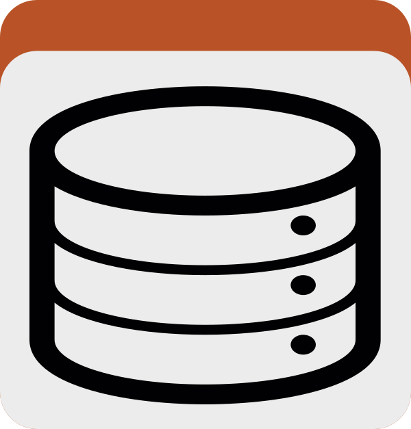
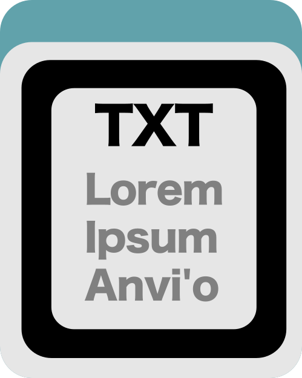
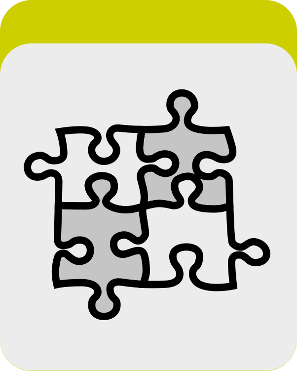

Run antiSMASH on one or many anvi&#x27;o contigs databases and import biosynthetic gene cluster (BGC) annotations into the gene functions table.

🔙 **[To the main page](../../)** of anvi'o programs and artifacts.



{{ "network.json" }}
{{ 300 }}


## Authors

<a href="/people/jessika-fuessel" target="_blank">Jessika Fuessel</a>
<a href="mailto:ju.fuessel@gmail.com" class="person-social" target="_blank"><i class="fa fa-fw fa-envelope-square"></i>Email</a><a href="http://twitter.com/FuesselJessika" class="person-social" target="_blank"><i class="fa fa-fw fa-twitter-square"></i>Twitter</a><a href="http://github.com/jessika-fuessel" class="person-social" target="_blank"><i class="fa fa-fw fa-github"></i>Github</a>

## Requires

[contigs-db](../../artifacts/contigs-db) 

## Can use

[external-genomes](../../artifacts/external-genomes) 

## Provides

[functions](../../artifacts/functions) 

## Usage

This program runs [antiSMASH](https://antismash.secondarymetabolites.org/) on a [contigs-db](/help/main/artifacts/contigs-db) to identify **biosynthetic gene clusters** (BGCs) that, for example, produce secondary metabolites such as antibiotics, siderophores, pigments, and quorum-sensing signals. The program stores antiSMASH's annotations in the database as [functions](/help/main/artifacts/functions).

{:.notice}
Just to avoid any misunderstandings and/or confusions down the line: what a gene cluster describes in this context is very different than what it describes in the context of pangenomics.

For downstream analysis, you can export the annotations with [anvi-export-functions](/help/main/programs/anvi-export-functions), search them with [anvi-search-functions](/help/main/programs/anvi-search-functions), view them in [anvi-interactive](/help/main/programs/anvi-interactive), include them in [anvi-summarize](/help/main/programs/anvi-summarize), and compare BGCs across different contigs databases with [anvi-script-gen-antismash-matrix](/help/main/programs/anvi-script-gen-antismash-matrix).

antiSMASH describes several different facets of each gene in a cluster (what it does, its role, the biosynthetic domains it carries, and which cluster it belongs to). The anvi'o functions table stores a single accession and function per row, so each of these facets becomes its own annotation source:

|**source**|**what it holds**|
|:--|:--|
|`antiSMASH`|the clearest functional name for each gene: antiSMASH's smCOG description where available (e.g. `crotonyl-CoA reductase / alcohol dehydrogenase`, with the smCOG id as the accession and its E-value), otherwise the biosynthetic domain name. A gene with several names gets several rows.|
|`antiSMASH_ROLE`|the gene's role in the cluster: `biosynthetic`, `biosynthetic-additional`, `regulatory`, `transport`, or `other`.|
|`antiSMASH_DOMAIN`|all the biosynthetic domains an individual gene in the BGC carries, each with its E-value.|
|`antiSMASH_REGION`|which BGC region the gene belongs to (the accession is a compact, assembly-unique region id; the function is the region's product/type, e.g. `terpene` or `NRPS`). Genes that sit on a region boundary count as part of that region.|

All four sources are always registered in the database after a run, even if antiSMASH found nothing for some (or all) of them, so you can always tell a database that was searched from one that was never processed.

## How does it work?

**Export the sequences and gene calls**
antiSMASH uses both sequence information and gene locations, so this program exports a FASTA file and a GFF3 file of the gene calls already stored in your [contigs-db](/help/main/artifacts/contigs-db). At this point, very short contigs are filtered out before the BGC search (by default, anything shorter than 3,000 bp), because antiSMASH cannot meaningfully call clusters on short fragments.

**Gene and BGC annotation**
antiSMASH scans the sequences for the signature enzymes and domains of known biosynthetic pathways and groups them into **regions** (the clusters). The primary annotation source is **smCOGs** (secondary-metabolism Clusters of Orthologous Groups), a curated library of the protein families that recur in biosynthetic gene clusters. In contrast to COGs, smCOGs cover only the enzymes, transporters, and regulators found in and around BGCs. Each one (for example `SMCOG1006`, acyl-CoA dehydrogenase) carries a readable functional name and a hint about the gene's likely role in the cluster, and `anvi-run-antismash` uses the smCOG description as a gene's clearest name whenever one exists. Additionally, antiSMASH draws on the **TIGRFAM** and **Pfam** protein-family databases, uses **RRE-Finder** to identify RiPP-recognition elements (the signatures of RiPPs, ribosomally synthesized and post-translationally modified peptides), and runs an **Active Site Finder**. The per-gene results are imported into your [contigs-db](/help/main/artifacts/contigs-db) as the four sources above: the TIGRFAM, Pfam, and RRE domains are stored in the `antiSMASH_DOMAIN` source, while the active-site predictions are only visible in the browsable HTML report.

## Setting up antiSMASH

antiSMASH has to be installed in a **separate** conda environment, because its strict dependency versions conflict with anvi'o's. This is a one-time setup:

conda create &#45;y &#45;n antismash python=3.10
conda activate antismash
conda install &#45;y &#45;c conda&#45;forge &#45;c bioconda antismash=7.1.0 "bcbio&#45;gff<0.7"
download&#45;antismash&#45;databases
conda deactivate

{:.notice}
The `download-antismash-databases` step fetches several gigabytes of reference data, so it can take a while and needs disk space. You only ever have to do it once.

{:.notice}
The `bcbio-gff<0.7` pin is a workaround for a current incompatibility: newer `bcbio-gff` (0.7+) needs a `biopython` version that antiSMASH 7.1.0 does not allow, and without the pin antiSMASH fails to parse the gene calls (with a `could not parse records from GFF3 file` error). You can drop it once a future antiSMASH release resolves this.

## Standard usage

To annotate a single [contigs-db](/help/main/artifacts/contigs-db) with BGCs, run:

anvi&#45;run&#45;antismash &#45;c [contigs&#45;db](/help/main/artifacts/contigs&#45;db)

To annotate **many databases in one command**, list them in an [external-genomes](/help/main/artifacts/external-genomes) file and pass it with `-e` instead of `-c` (just like [anvi-estimate-metabolism](/help/main/programs/anvi-estimate-metabolism)):

anvi&#45;run&#45;antismash &#45;e [external&#45;genomes](/help/main/artifacts/external&#45;genomes) \
                   &#45;&#45;num&#45;threads 8

Each database in the file is annotated in place and gets its own report directory (`<db>-ANTISMASH`) next to it. Databases that already carry antiSMASH annotations are skipped, so you can safely re-run to pick up where a batch left off (add `--just-do-it` to re-annotate them anyway). The single-database output options (`--output-dir`, `--regions-output`, `--work-dir`) apply to `-c` runs only.

You normally do **not** need to tell anvi'o where antiSMASH is. Because antiSMASH lives in its own conda environment, anvi'o first looks for an `antismash` executable on your `PATH`, and failing that automatically searches your other conda environments for it.

## Telling anvi'o where antiSMASH is

If anvi'o cannot find antiSMASH on its own, or if you have several antiSMASH installations and want to use a specific one, point it at the antiSMASH installation directory (i.e. its conda environment) with `--antismash-dir`:

anvi&#45;run&#45;antismash &#45;c [contigs&#45;db](/help/main/artifacts/contigs&#45;db) \
                   &#45;&#45;antismash&#45;dir ~/miniforge3/envs/antismash

## Extended output option

`anvi-run-antismash` annotates the [contigs-db](/help/main/artifacts/contigs-db) as described above and saves a browsable antiSMASH HTML report together with the two summary files. By default it keeps the view-only HTML report and the summary files, but does not generate the per-region GenBank files, the raw JSON, or the ClusterBlast/smCOG comparison data.

Adding `--include-detailed-output` runs antiSMASH's cluster-comparison analyses and keeps their output, together with the per-region GenBank (`.gbk`) files (a useful input to downstream tools such as [BiG-SCAPE](https://bigscape-corason.secondarymetabolites.org/)) and the raw JSON:

anvi&#45;run&#45;antismash &#45;c [contigs&#45;db](/help/main/artifacts/contigs&#45;db) \
                   &#45;&#45;include&#45;detailed&#45;output

The comparison analyses this enables are:

* **`--cb-general`** (ClusterBlast): compares each cluster against a large database of antiSMASH-predicted clusters from other genomes.
* **`--cb-knownclusters`** (KnownClusterBlast): compares against experimentally characterized clusters in [MIBiG](https://mibig.secondarymetabolites.org/) (i.e. clusters with a known product).
* **`--cb-subclusters`** (SubClusterBlast): compares against known sub-clusters that make specific precursor building blocks.
* **`--cc-mibig`**: a cluster-level comparison against the MIBiG reference set.
* **`--smcog-trees`**: builds phylogenetic trees for the smCOG gene families in each cluster.

The database annotations are unaffected by these additional outputs.

{:.notice}
The detailed output is much larger and slower to produce: on one test genome the default run produced about 2.4 MB in roughly 50 seconds, versus about 91 MB in roughly 4 minutes with `--include-detailed-output`.

## Optional flags

**1. Change the output directory.** By default the report is saved next to the [contigs-db](/help/main/artifacts/contigs-db) as `<contigs-db basename>-ANTISMASH`. Use `-o` / `--output-dir` to put it somewhere else:

anvi&#45;run&#45;antismash &#45;c [contigs&#45;db](/help/main/artifacts/contigs&#45;db) \
                   &#45;&#45;output&#45;dir MY_BGC_REPORT/

**2. Use multiple threads.** antiSMASH can take a while, so if you have the cores to spare, give it more threads:

anvi&#45;run&#45;antismash &#45;c [contigs&#45;db](/help/main/artifacts/contigs&#45;db) &#45;T 4

**3. Switch the taxon to fungi.** By default anvi'o tells antiSMASH to expect a bacterial genome. If your [contigs-db](/help/main/artifacts/contigs-db) describes a fungal genome, switch the taxon:

anvi&#45;run&#45;antismash &#45;c [contigs&#45;db](/help/main/artifacts/contigs&#45;db) \
                   &#45;&#45;taxon fungi

**4. Change the minimum contig length.** Contigs shorter than 3,000 bp are dropped before the run. To change that cutoff, for instance to be stricter, set `--min-contig-length`:

anvi&#45;run&#45;antismash &#45;c [contigs&#45;db](/help/main/artifacts/contigs&#45;db) \
                   &#45;&#45;min&#45;contig&#45;length 5000

## Additional options

antiSMASH provides a series of additional annotation tools that you can also include in an `anvi-run-antismash` run:

* **`--fullhmmer`**: whole-genome Pfam annotation (essentially what [anvi-run-pfams](/help/main/programs/anvi-run-pfams) does).
* **`--clusterhmmer`**: Pfam annotation limited to genes inside clusters.
* **`--tigrfam`**: TIGRFAM family annotation of cluster genes (antiSMASH's core detection already contributes the relevant ones).
* **`--pfam2go`**: maps Pfam domains to Gene Ontology terms (report only).
* **`--tfbs`**: TFBS finder that looks for transcription-factor binding sites in clusters (regulatory context).
* **`--cassis`**: an alternative, motif-based method for predicting cluster boundaries.

To include any of them, pass them through the `--antismash-add-on` flag. Please use the `=` form shown below, otherwise the command line parser may mistake the antiSMASH flags for flags of `anvi-run-antismash` itself:

anvi&#45;run&#45;antismash &#45;c [contigs&#45;db](/help/main/artifacts/contigs&#45;db) \
                   &#45;&#45;antismash&#45;add&#45;on="&#45;&#45;fullhmmer &#45;&#45;tfbs"

Flags anvi'o already sets for antiSMASH on its own (such as `--cpus`, `--taxon`, `--databases`, `--output-dir`, or the ones `--include-detailed-output` turns on) are not accepted here; please use the corresponding `anvi-run-antismash` flags for those instead.

## Re-annotating a database

If the [contigs-db](/help/main/artifacts/contigs-db) already contains antiSMASH annotations from a previous run, the program refuses to overwrite them, so you don't clobber earlier results by accident. To re-annotate, either remove the old annotations first:

anvi&#45;delete&#45;functions &#45;c [contigs&#45;db](/help/main/artifacts/contigs&#45;db) \
                      &#45;&#45;annotation&#45;sources antiSMASH,antiSMASH_ROLE,antiSMASH_DOMAIN,antiSMASH_REGION
anvi&#45;run&#45;antismash &#45;c [contigs&#45;db](/help/main/artifacts/contigs&#45;db)

or pass `--just-do-it` to overwrite them in a single step:

anvi&#45;run&#45;antismash &#45;c [contigs&#45;db](/help/main/artifacts/contigs&#45;db) &#45;&#45;just&#45;do&#45;it

With `--just-do-it`, anvi'o first removes all four antiSMASH sources from the previous run, so nothing stale survives even if the new run finds fewer (or no) clusters.

{:.notice}
Like other anvi'o programs, `anvi-run-antismash` will not write into an output directory that already exists. So if the report directory from the previous run (the default `<contigs-db basename>-ANTISMASH`, or the one you gave with `--output-dir`) is still around, either use `--output-dir` to put the new report elsewhere, or add `--force-overwrite` to have anvi'o remove the existing directory first (please use that flag with care, since it removes the directory with everything in it). The same applies to a directory you give with `--work-dir`.

anvi&#45;run&#45;antismash &#45;c [contigs&#45;db](/help/main/artifacts/contigs&#45;db) &#45;&#45;just&#45;do&#45;it &#45;&#45;force&#45;overwrite

## What you get

**Four annotation sources in the database.** These are the four sources described at the top of this page. You can confirm they were added with [anvi-db-info](/help/main/programs/anvi-db-info).

**A browsable HTML report,** saved by default as `<contigs-db basename>-ANTISMASH`. Open its `index.html` in a web browser to explore each region interactively, exactly as you would on the antiSMASH website. Please note that contigs in the HTML report are named `anvio_c000000`, `anvio_c000001`, and so on, rather than with your contig names (see below for why, and for how to translate them back).

**A contig name mapping file,** `contig-name-mapping.txt`, inside the report directory. It translates the contig names you see in antiSMASH's own output back to the contig names in your [contigs-db](/help/main/artifacts/contigs-db):

|**antismash_record_id**|**contig**|
|:--|:--|
|anvio_c000000|c_000000000001|
|anvio_c000001|c_000000000002|

Why is this necessary? antiSMASH renames any sequence whose name is longer than 16 characters (e.g., `NODE_1_length_10000_cov_5.2` becomes something like `c00001_NODE_1_..`), and once that happens anvi'o could no longer tell which of your contigs a given BGC came from. To make sure every result can be linked back to the right contig regardless of how long your contig names are (or how future versions of antiSMASH decide to handle them), anvi'o gives every contig a short, predictable name before handing it to antiSMASH, and translates these names back when it imports the results. So, the annotations in your database and the two summary files below always use your own contig names, and the only places the `anvio_c` names show up are the files antiSMASH itself generates: the HTML report and, with `--include-detailed-output`, the GenBank (`.gbk`) and JSON files (keep this in mind if you use the `.gbk` files with other tools such as BiG-SCAPE). Whenever you need to know which contig an `anvio_c` name refers to, `contig-name-mapping.txt` is where to look.

**Two self-contained TAB-delimited (`.txt`) summary files inside the report directory.** These lay everything out for direct inspection, so you never have to go back to the database to read the results.

`antismash_genes.txt` has one row per antiSMASH-annotated gene, with the function name, biosynthetic domains, smCOG, role, region, and E-value as separate columns:

|**gene_callers_id**|**contig**|**region_id**|**role**|**function**|**smcog**|**domains**|**e_value**|
|:--|:--|:--|:--|:--|:--|:--|:--|
|698|c_000000000001|e5c0ecfbd09e_region_001|biosynthetic-additional|crotonyl-CoA reductase / alcohol dehydrogenase|SMCOG1028|ADH_N;ADH_zinc_N|7.4e-85|
|700|c_000000000001|e5c0ecfbd09e_region_001|regulatory|autoinducer-binding transcriptional regulator|SMCOG1197||2.3e-30|
|701|c_000000000001|e5c0ecfbd09e_region_001|biosynthetic|Autoind_synth||Autoind_synth|1.8e-14|

`antismash_regions.txt` has one row per BGC region, fully describing it (its compact id, contig, product/type, coordinates, and the genes it contains):

|**region_id**|**contig**|**product**|**start**|**end**|**length**|**num_genes**|**gene_callers_ids**|**contig_edge**|
|:--|:--|:--|:--|:--|:--|:--|:--|:--|
|e5c0ecfbd09e_region_001|c_000000000001|hserlactone|690123|711456|21333|22|689;690;691;...;710|False|

## Inspecting and using the results

Confirm the sources were added, export them, or search them:

anvi&#45;db&#45;info [contigs&#45;db](/help/main/artifacts/contigs&#45;db) | grep antiSMASH
anvi&#45;export&#45;functions &#45;c [contigs&#45;db](/help/main/artifacts/contigs&#45;db) &#45;&#45;annotation&#45;sources antiSMASH &#45;o bgc.txt
anvi&#45;search&#45;functions &#45;c [contigs&#45;db](/help/main/artifacts/contigs&#45;db) &#45;&#45;search&#45;terms NRPS,PKS,siderophore

## Comparing BGCs across genomes

To compare biosynthetic potential across many genomes, first annotate them all (a single `anvi-run-antismash -e [external-genomes](/help/main/artifacts/external-genomes)` does the whole set, as shown above), then summarize them with [anvi-script-gen-antismash-matrix](/help/main/programs/anvi-script-gen-antismash-matrix). The matrix tool reads the four antiSMASH sources straight from each database, so there is nothing extra to run per database beyond the annotation itself.

Point it at the same [external-genomes](/help/main/artifacts/external-genomes) file and pick one of two views. A per-cluster matrix (`--regions`), where the rows are BGC product types such as `terpene` or `NRPS` and each cell counts how many clusters of that type a genome has:

anvi&#45;script&#45;gen&#45;antismash&#45;matrix &#45;e [external&#45;genomes](/help/main/artifacts/external&#45;genomes) \
                                 &#45;&#45;regions \
                                 &#45;O BGC_TYPES

or a per-gene matrix (`--genes`), where the rows are gene signatures described by their function, role, smCOG, and domains:

anvi&#45;script&#45;gen&#45;antismash&#45;matrix &#45;e [external&#45;genomes](/help/main/artifacts/external&#45;genomes) \
                                 &#45;&#45;genes \
                                 &#45;O BGC_GENES

Either way you get a frequency matrix and a presence/absence matrix across all of your genomes. See [anvi-script-gen-antismash-matrix](/help/main/programs/anvi-script-gen-antismash-matrix) for the full description, including the companion per-gene file that links each matrix cell back to the individual genes behind it.

{:.notice}
Edit [this file](https://github.com/merenlab/anvio/tree/master/anvio/docs/programs/anvi-run-antismash.md) to update this information.

## Additional Resources

{:.notice}
Are you aware of resources that may help users better understand the utility of this program? Please feel free to edit [this file](https://github.com/merenlab/anvio/blob/master/anvio/cli/run_antismash.py) on GitHub. If you are not sure how to do that, find the `__resources__` tag in [this file](https://github.com/merenlab/anvio/blob/master/anvio/cli/interactive.py) to see an example.
