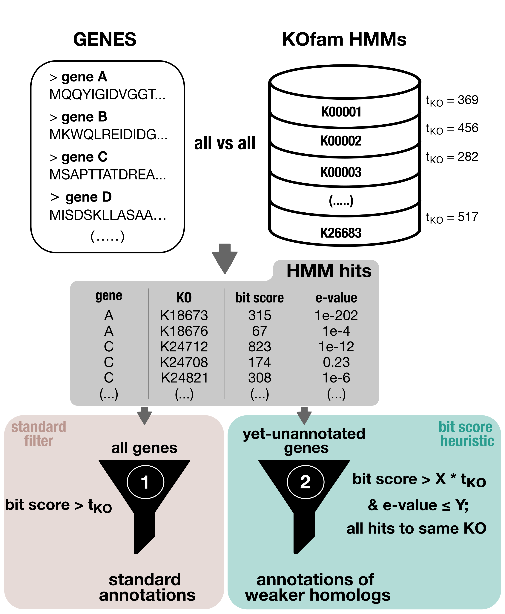

Run KOfam HMMs on an anvi&#x27;o contigs database.

🔙 **[To the main page](../../)** of anvi'o programs and artifacts.



{{ "network.json" }}
{{ 300 }}


## Authors

<a href="/people/ivagljiva" target="_blank">Iva Veseli</a>
<a href="mailto:iva.veseli@gmail.com" class="person-social" target="_blank"><i class="fa fa-fw fa-envelope-square"></i>Email</a><a href="http://twitter.com/ivaglj1va" class="person-social" target="_blank"><i class="fa fa-fw fa-twitter-square"></i>Twitter</a><a href="http://github.com/ivagljiva" class="person-social" target="_blank"><i class="fa fa-fw fa-github"></i>Github</a>

<a href="/people/semiller10" target="_blank">Samuel Miller</a>
<a href="https://semiller10.github.io" class="person-social" target="_blank"><i class="fa fa-fw fa-home"></i>Web</a><a href="mailto:samuelmiller10@gmail.com" class="person-social" target="_blank"><i class="fa fa-fw fa-envelope-square"></i>Email</a><a href="http://twitter.com/smiller_science" class="person-social" target="_blank"><i class="fa fa-fw fa-twitter-square"></i>Twitter</a><a href="http://github.com/semiller10" class="person-social" target="_blank"><i class="fa fa-fw fa-github"></i>Github</a>

## Requires

[contigs-db](../../artifacts/contigs-db)  [kegg-data](../../artifacts/kegg-data) 

## Provides

[kegg-functions](../../artifacts/kegg-functions)  [functions](../../artifacts/functions) 

## Usage

Essentially, this program uses the KEGG database to annotate functions and metabolic pathways in a [contigs-db](/help/main/artifacts/contigs-db). More specifically, [anvi-run-kegg-kofams](/help/main/programs/anvi-run-kegg-kofams) annotates a [contigs-db](/help/main/artifacts/contigs-db) with HMM hits from KOfam, a database of KEGG Orthologs (KOs). You must set up these HMMs on your computer using [anvi-setup-kegg-data](/help/main/programs/anvi-setup-kegg-data) before you can use this program. If a [modules-db](/help/main/artifacts/modules-db) is available, membership of KOfam functions in KEGG metabolic MODULES and BRITE hierarchies is also stored in the [contigs-db](/help/main/artifacts/contigs-db).

Running this program is a pre-requisite for metabolism estimation with [anvi-estimate-metabolism](/help/main/programs/anvi-estimate-metabolism). Note that if you are planning to run metabolism estimation, it must be run with the same [kegg-data](/help/main/artifacts/kegg-data) that is used in this program to annotate KOfam hits.

## How does it work?
**1) Run an HMM search against KOfam**
Briefly, what this program does is extract all the gene calls from the [contigs-db](/help/main/artifacts/contigs-db) and checks each one for hits to the KOfam HMM profiles in your [kegg-data](/help/main/artifacts/kegg-data). This can be time-consuming given that the number of HMM profiles is quite large, even more so if the number of genes in the [contigs-db](/help/main/artifacts/contigs-db) is also large. Multi-threading is a good idea if you have the computational capability to do so.

**2) Eliminate weak hits based on bitscore**
Many HMM hits will be found, most of them weak. The weak hits will by default be eliminated according to the bitscore thresholds provided by KEGG; that is, hits with bitscores below the threshold for a given KO profile will be discarded, and those with bitscores above the threshold will be annotated in the [contigs-db](/help/main/artifacts/contigs-db). It is perfectly normal to notice that the number of raw hits found is many, many times larger than the number of annotated KO hits in your database.

**3) Add back valid hits that were missed**
There is one issue with this practice of removing _all_ KOfam hits below the KEGG bitscore threshold for a given profile. We (and others) have noticed that the KEGG thresholds can sometimes be too stringent, eliminating hits that are actually valid annotations. To solve this problem, we
have implemented the following heuristic for relaxing the bitscore thresholds and annotating genes that would otherwise go without a valid KO annotation:

For every gene without a KOfam annotation, we examine all the hits with an e-value below `X` and a bitscore above `Y` percent of the threshold. If those hits are all to a unique KOfam profile, then we annotate the gene call with that KO.

`X` and `Y` are parameters that can be modified (see below), but by default the e-value threshold (`X`) is 1e-05 and the bitscore fraction (`Y`) is 0.75.

Please note that this strategy is just a heuristic. We have tried to pick default parameters that seemed reasonable but by no means have we comprehensively tested and optimized them. This is why X and Y are mutable so that you can explore different values and see how they work for your data. It is always a good idea to double-check your annotations to make sure they are reasonable and as stringent as you'd like them to be. In addition, if you do not feel comfortable using this heuristic at all, you can always turn this behavior off and rely solely on KEGG's bitscore thresholds. :)

**3) Put annotations in the database**
In the [contigs-db](/help/main/artifacts/contigs-db) functions table, annotated KO hits ([kegg-functions](/help/main/artifacts/kegg-functions)) will have the source `KOfam`. If a [modules-db](/help/main/artifacts/modules-db) is available, metabolic modules and BRITE functional classifications containing these functions also have entries in the table, with sources labeled `KEGG_Module` and `KEGG_BRITE`. BRITE classification will not occur if [anvi-setup-kegg-data](/help/main/programs/anvi-setup-kegg-data) was not set up with BRITE data (see the artifact for that program to see how to include BRITE).

## Standard usage

anvi&#45;run&#45;kegg&#45;kofams &#45;c [contigs&#45;db](/help/main/artifacts/contigs&#45;db)

## Use a specific non-default KEGG data directory
If you have previously setup your KEGG data directory using `--kegg-data-dir` (see [anvi-setup-kegg-data](/help/main/programs/anvi-setup-kegg-data)), or have moved the KEGG data directory that you wish to use to a non-default location (maybe you like keeping the older versions around when you update, we don't know how you roll), then you may need to specify where to find the KEGG data so that this program can use the right one. In that case, this is how you do it:

anvi&#45;run&#45;kegg&#45;kofams &#45;c [contigs&#45;db](/help/main/artifacts/contigs&#45;db) \
                     &#45;&#45;kegg&#45;data&#45;dir /path/to/directory/KEGG

## Run with multiple threads

anvi&#45;run&#45;kegg&#45;kofams &#45;c [contigs&#45;db](/help/main/artifacts/contigs&#45;db) &#45;T 4

## Use a different HMMER program
By default, [anvi-run-kegg-kofams](/help/main/programs/anvi-run-kegg-kofams) uses `hmmsearch` to find KO hits. If for some reason you would rather use a different program (`hmmscan` is also currently supported), you can do so.

anvi&#45;run&#45;kegg&#45;kofams &#45;c [contigs&#45;db](/help/main/artifacts/contigs&#45;db) \
                     &#45;&#45;hmmer&#45;program hmmscan

## Prevent HMMER from pre-filtering hits with default e-value reporting thresholds
The default e-value reporting thresholds that HMMER uses are quite high, but e-values are dependent on the size of the databases used. So, if you have a very large dataset, it is possible that we miss some annotations from hits with bit scores that would be good enough to pass the bit score thresholds, but never get reported by HMMER in the first place because their e-values are too high. To avoid this, use the following flag:

anvi&#45;run&#45;kegg&#45;kofams &#45;c [contigs&#45;db](/help/main/artifacts/contigs&#45;db) \
                     &#45;&#45;no&#45;hmmer&#45;prefiltering

In this case, we will set HMMER's reporting thresholds to be extremely low and bit score-based (`-T -20 and --domT -20`) so that we don't lose any hits with high bitscore yet high e-value. In most cases, this won't lead to many new annotations because the bitscore filtering we apply later will weed out most raw hits. But please exercise caution. Using this flag with `--keep-all-hits` is not recommended.

## Keep all HMM hits
Usually, this program parses out weak HMM hits and keeps only those that are above the score threshold for a given KO. If you would like to turn off this behavior and keep all hits (there will be _a lot_ of weak ones), you can follow the example below:

anvi&#45;run&#45;kegg&#45;kofams &#45;c [contigs&#45;db](/help/main/artifacts/contigs&#45;db) \
                     &#45;&#45;keep&#45;all&#45;hits

## Save the bitscores of HMM hits

If you want to see the bitscores of all KOfam hits that were added to your contigs database, you can use the `--log-bitscores` option to save these values into a tab-delimited file:

anvi&#45;run&#45;kegg&#45;kofams &#45;c [contigs&#45;db](/help/main/artifacts/contigs&#45;db) \
                     &#45;&#45;log&#45;bitscores

Here is an example of what the resulting bitscore file would look like:

|**entry_id**|**bit_score**|**domain_bit_score**|**e_value**|**entry_id**|**gene_callers_id**|**gene_hmm_id**|**gene_name**|
|:--|:--|:--|:--|:--|:--|:--|:--|
|1|177.4|85.1|8e-54|0|1371|-|K10681|
|2|34.1|33.7|9.1e-11|1|1141|-|K01954|
|3|22.4|22.4|3.1e-07|2|1402|-|K01954|
|4|12.8|11.8|0.00024|3|1099|-|K01954|
|5|17.1|16.7|4.4e-05|4|1267|-|K20024|

Combining this flag with the `--keep-all-hits` option is one way to get the bitscores of all matches to the KOfam profiles, even the ones that would usually not pass the bitscore threshold provided by KEGG.

## Modify the bitscore relaxation heuristic
As described above, this program does its best to avoid missing valid annotations by relaxing the bitscore threshold for genes without any annotations. For such a gene, hits with e-value <= X and bitscore > (Y * KEGG threshold) that are all hits to the same KOfam profile are used to annotate the gene with that KO.

### Skip this heuristic entirely
If you don't want any previously-eliminated hits to be used for annotation, you can skip this heuristic by using the flag `--skip-bitscore-heuristic`. Then, _only_ hits with bitscores above the KEGG-provided threshold for a given KO will be used for annotation.

anvi&#45;run&#45;kegg&#45;kofams &#45;c [contigs&#45;db](/help/main/artifacts/contigs&#45;db) \
                     &#45;&#45;skip&#45;bitscore&#45;heuristic

### Modify the heuristic parameters
If our default values are too stringent or not stringent enough for your tastes, you can change them! The e-value threshold (X, default: 1e-05) can be set using `-E` or `--heuristic-e-value` and the bitscore fraction (Y, default: 0.50) can be set using `-H` or `--heuristic-bitscore-fraction`. Like so:

anvi&#45;run&#45;kegg&#45;kofams &#45;c [contigs&#45;db](/help/main/artifacts/contigs&#45;db) \
                     &#45;E 1e&#45;15 \
                     &#45;H 0.90

## Skip BRITE annotations
If for some strange reason you do not want KEGG BRITE annotations to be added to your contigs database, you can skip them by providing the `--skip-brite-hierarchies` flag:

anvi&#45;run&#45;kegg&#45;kofams &#45;c [contigs&#45;db](/help/main/artifacts/contigs&#45;db) \
                     &#45;&#45;skip&#45;brite&#45;hierarchies

## Annotate 'No-threshold KOs'

In every release of KOfam, there are some KO profiles that don't come with predefined bit score thresholds. Normally, we skip annotating these. But if you want to annotate them, first read [this documentation on our strategy for estimating bit score thresholds for nt-KOs](https://anvio.org/help/main/programs/anvi-setup-kegg-data/#what-are-nt-kos-and-what-happens-when-i-include-them) so that you understand what is going on, and then run this program with the `--include-nt-KOs` flag:

anvi&#45;run&#45;kegg&#45;kofams &#45;c [contigs&#45;db](/help/main/artifacts/contigs&#45;db) \
                     &#45;&#45;include&#45;nt&#45;KOs

{:.notice}
Edit [this file](https://github.com/merenlab/anvio/tree/master/anvio/docs/programs/anvi-run-kegg-kofams.md) to update this information.

## Command line interface

The following is the list of parameters and their descriptions in the latest version of `anvi-run-kegg-kofams`.

The code that generates this web page ensures that this information is the latest available in **9-dev (eunice)**. Which means, in some cases the information in this section (generated automatically) might be more comprehensive or up-to-date compared to the descriptions above (written by humans).

---

### Command line usage



anvi-run-kegg-kofams [-h] -c CONTIGS_DB [--kegg-data-dir DIR_PATH] [-T NUM_THREADS] [--hmmer-program HMMER_PROGRAM] [--include-nt-KOs] [--keep-all-hits] [--log-bitscores] [--skip-brite-hierarchies] [--no-hmmer-prefiltering] [--just-do-it] [--skip-bitscore-heuristic] [-E FLOAT] [-H FLOAT]



### Parameters and their descriptions



<section class="parameter-group parameter-group-required-input">
<header class="parameter-group-header">REQUIRED INPUT The stuff you need for this to work.</header>
<dl class="parameter-list">
<dt class="parameter parameter-required" id="parameter-contigs_db"><code class="parameter-flags">-c, --contigs-db</code> <code class="parameter-metavar">CONTIGS_DB</code> required</dt>
<dd class="parameter-details parameter-required">Anvi&#x27;o contigs database generated by &#x27;anvi-gen-contigs-database&#x27;</dd>
</dl>
</section>
<section class="parameter-group parameter-group-optional-input">
<header class="parameter-group-header">OPTIONAL INPUT Optional params for a custom experience.</header>
<dl class="parameter-list">
<dt class="parameter" id="parameter-kegg_data_dir"><code class="parameter-flags">--kegg-data-dir</code> <code class="parameter-metavar">DIR_PATH</code></dt>
<dd class="parameter-details">The directory path for your KEGG setup, which will include things like KOfam profiles, KEGG MODULE data, and KEGG BRITE data. Anvi&#x27;o will try to use the default path if you do not specify anything.</dd>
<dt class="parameter" id="parameter-num_threads"><code class="parameter-flags">-T, --num-threads</code> <code class="parameter-metavar">NUM_THREADS</code></dt>
<dd class="parameter-details">Maximum number of threads to use for multithreading whenever possible. Very conservatively, the default is 1, unless the environmental variable `ANVIO_THREADS` sets another positive integer. If you use this parameter, it will override `ANVIO_THREADS`. It is a good idea to not exceed the number of CPUs / cores on your system. Plus, please be careful with this option if you are running your commands on a SGE -- if you are clusterizing your runs, and asking for multiple threads to use, you may deplete your resources very fast. Default: <code class="parameter-default-value">1</code></dd>
<dt class="parameter" id="parameter-hmmer_program"><code class="parameter-flags">--hmmer-program</code> <code class="parameter-metavar">HMMER_PROGRAM</code></dt>
<dd class="parameter-details">Which of the HMMER programs to use to run HMMs (hmmscan or hmmsearch). By default anvi&#x27;o will use hmmscan for typical HMM operations like those in anvi-run-hmms (as these tend to scan a very large number of genes against a relatively small number of HMMs), but if you are using this program to scan a very large number of HMMs, hmmsearch might be a better choice for performance. For this reason, hmmsearch is the default in operations like anvi-run-pfams and anvi-run-kegg-kofams. See this article for a discussion on the performance of these two programs: http://cryptogenomicon.org/hmmscan-vs-hmmsearch-speed-the-numerology.html</dd>
<dt class="parameter parameter-switch" id="parameter-include_nt_kos"><code class="parameter-flags">--include-nt-KOs</code></dt>
<dd class="parameter-details">&#x27;No-threshold KOs&#x27;, or &#x27;nt-KOs&#x27; are what we call KEGG Orthlogs that KEGG does not provide a bit score threshold for. If you want to include these protein families in your annotations and downstream analyses, then you can use this flag. Anvi&#x27;o does something very basic to estimate a bit score threshold for annotating these KOs, which is (1) to download the KEGG GENES sequences associated with each family, (2) to build a new HMM from these GENES (since KEGG GENES updates with new sequences faster than KOfam updates its models), (3) to run HMMER of each new model against the KO&#x27;s associated sequences, and (4) to take the minimum bit score of those hits as the bit score threshold for the KO. Downstream, we use the anvi&#x27;o-generated models to annotate these KO families with their estimated bit score thresholds.</dd>
<dt class="parameter parameter-switch" id="parameter-keep_all_hits"><code class="parameter-flags">--keep-all-hits</code></dt>
<dd class="parameter-details">If you use this flag, anvi&#x27;o will not get rid of any raw HMM hits, even those that are below the score threshold.</dd>
<dt class="parameter parameter-switch" id="parameter-log_bitscores"><code class="parameter-flags">--log-bitscores</code></dt>
<dd class="parameter-details">Use this flag to generate a tab-delimited text file containing the bit scores of every KOfam hit that is put in the contigs database.</dd>
<dt class="parameter parameter-switch" id="parameter-skip_brite_hierarchies"><code class="parameter-flags">--skip-brite-hierarchies</code></dt>
<dd class="parameter-details">Use this flag to skip using BRITE hierarchies, which we don&#x27;t recommend but let you do anyways.</dd>
<dt class="parameter parameter-switch" id="parameter-no_hmmer_prefiltering"><code class="parameter-flags">--no-hmmer-prefiltering</code></dt>
<dd class="parameter-details">By default, the initial set of hits we get back from HMMER are subject to its default e-value threshold of 10. However, if you are working with a very large dataset, this pre-filtering based on e-value might be too stringent and lead to missing some legitimate hits. If this is your case, you can use this flag to turn off the HMMER pre-filtering based on e-value (instead we will use `-T -20` and `-domT -20`). All hits we get from HMMER will still be subject to later bitscore-based filtering and the annotation heuristic to ensure we don&#x27;t let in any garbage annotations (unless you use the `--keep-all-hits` or the `--skip-bitscore-heuristic` flags, respectively). See https://github.com/merenlab/anvio/issues/2446 for more details.</dd>
<dt class="parameter parameter-switch" id="parameter-just_do_it"><code class="parameter-flags">--just-do-it</code></dt>
<dd class="parameter-details">Don&#x27;t bother me with questions or warnings, just do it.</dd>
</dl>
</section>
<section class="parameter-group parameter-group-bitscore-relaxation-heuristic">
<header class="parameter-group-header">BITSCORE RELAXATION HEURISTIC Sometimes, KEGG-provided bitscore thresholds are too stringent, causing us to miss valid annotations. We apply the following heuristic to relax those thresholds and annotate genes that would otherwise miss a valid annotations: for every gene call that is not annotated, examine hits to that gene with an evalue &lt;= X and a bitscore &gt; Y * KEGG&#x27;s threshold (where Y is a float from 0 to 1). If those hits are all to a unique KO profile, annotate the gene with that KO. Long story over, you can set X and Y using the parameters below.</header>
<dl class="parameter-list">
<dt class="parameter parameter-switch" id="parameter-skip_bitscore_heuristic"><code class="parameter-flags">--skip-bitscore-heuristic</code></dt>
<dd class="parameter-details">If you just want annotations from KOfam hits that are above the KEGG bitscore threshold, use this flag to skip the mumbo-jumbo we do here to relax those thresholds.</dd>
<dt class="parameter" id="parameter-heuristic_e_value"><code class="parameter-flags">-E, --heuristic-e-value</code> <code class="parameter-metavar">FLOAT</code></dt>
<dd class="parameter-details">When considering hits that didn&#x27;t quite make the bitscore cut-off for a gene, we will only look at hits with e-values &lt;= this number. (This is X.) Default: <code class="parameter-default-value">0.00001</code></dd>
<dt class="parameter" id="parameter-heuristic_bitscore_fraction"><code class="parameter-flags">-H, --heuristic-bitscore-fraction</code> <code class="parameter-metavar">FLOAT</code></dt>
<dd class="parameter-details">When considering hits that didn&#x27;t quite make the bitscore cut-off for a gene, we will only look at hits with bitscores &gt; the KEGG threshold * this number. (This is Y.) It should be a fraction between 0 and 1 (inclusive). Default: <code class="parameter-default-value">0.75</code></dd>
</dl>
</section>



## Additional Resources

{:.notice}
Are you aware of resources that may help users better understand the utility of this program? Please feel free to edit [this file](https://github.com/merenlab/anvio/blob/master/anvio/cli/run_kegg_kofams.py) on GitHub. If you are not sure how to do that, find the `__resources__` tag in [this file](https://github.com/merenlab/anvio/blob/master/anvio/cli/interactive.py) to see an example.
