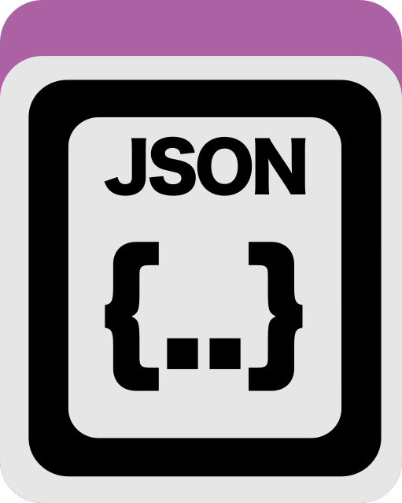
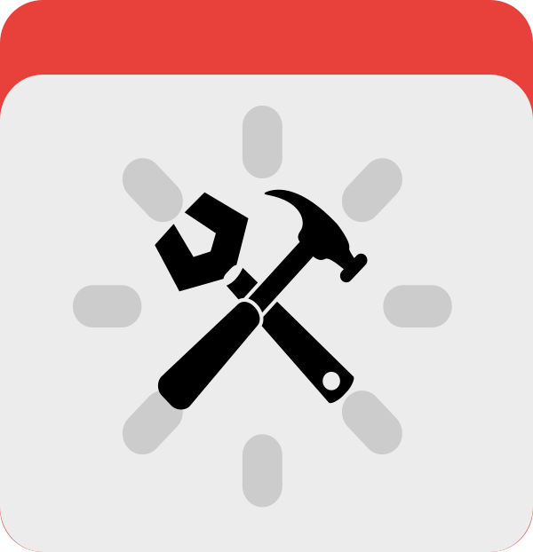

Execute, manage, parallelize, and troubleshoot entire &#x27;omics workflows and chain together anvi&#x27;o and third party programs.

🔙 **[To the main page](../../)** of anvi'o programs and artifacts.



{{ "network.json" }}
{{ 300 }}


## Authors

<a href="/people/shaiberalon" target="_blank">Alon Shaiber</a>
<a href="mailto:alon.shaiber@gmail.com" class="person-social" target="_blank"><i class="fa fa-fw fa-envelope-square"></i>Email</a><a href="http://twitter.com/alon_shaiber" class="person-social" target="_blank"><i class="fa fa-fw fa-twitter-square"></i>Twitter</a><a href="http://github.com/shaiberalon" class="person-social" target="_blank"><i class="fa fa-fw fa-github"></i>Github</a>

<a href="/people/semiller10" target="_blank">Samuel Miller</a>
<a href="https://semiller10.github.io" class="person-social" target="_blank"><i class="fa fa-fw fa-home"></i>Web</a><a href="mailto:samuelmiller10@gmail.com" class="person-social" target="_blank"><i class="fa fa-fw fa-envelope-square"></i>Email</a><a href="http://twitter.com/smiller_science" class="person-social" target="_blank"><i class="fa fa-fw fa-twitter-square"></i>Twitter</a><a href="http://github.com/semiller10" class="person-social" target="_blank"><i class="fa fa-fw fa-github"></i>Github</a>

<a href="/people/mschecht" target="_blank">Matthew Schechter</a>
<a href="mailto:mschechter@uchicago.edu" class="person-social" target="_blank"><i class="fa fa-fw fa-envelope-square"></i>Email</a><a href="http://twitter.com/mschecht_bio" class="person-social" target="_blank"><i class="fa fa-fw fa-twitter-square"></i>Twitter</a><a href="http://github.com/mschecht" class="person-social" target="_blank"><i class="fa fa-fw fa-github"></i>Github</a>

## Requires

[workflow-config](../../artifacts/workflow-config) 

## Provides

[workflow](../../artifacts/workflow) 

## Usage

This program allows you to run a [workflow](/help/main/artifacts/workflow) implemented by anvi'o developers for various commonly used set of steps to typically process your raw data (i.e., short reads or contigs from genomes, transcriptomes, metagenomes, metatranscriptomes, etc). Some aspects of this program is described in [this tutorial](https://merenlab.org/2018/07/09/anvio-snakemake-workflows/).

For a list of currently available anvi'o workflows, please see the [workflow](/help/main/artifacts/workflow) artifact.

### Before running the workflow

Each workflow requires a [workflow-config](/help/main/artifacts/workflow-config): the file that details all of the parameters for the workflow. To get the [workflow-config](/help/main/artifacts/workflow-config) with the default parameters, just run

anvi&#45;run&#45;workflow &#45;w [workflow](/help/main/artifacts/workflow) \
                  &#45;&#45;get&#45;default&#45;config CONFIG.json

Before running a workflow, it is also a good idea to check the required dependencies by running

anvi&#45;run&#45;workflow &#45;w [workflow](/help/main/artifacts/workflow) \
                  &#45;&#45;list&#45;dependencies

### The main run

The main run of the workflow should look like this:

anvi&#45;run&#45;workflow &#45;w [workflow](/help/main/artifacts/workflow) \
                  &#45;c CONFIG.json
                  &#45;&#45;save&#45;workflow&#45;graph

The flag `--save-workflow-graph` creates a visual representation of the anvio programs that the workflow you're running used.

You can also use the `-A` flag at the end of the parameter list to change other [Snakemake](https://snakemake.readthedocs.io/en/stable/) parameters.

### Logs and the workflow manifest

Every workflow run writes rule logs under `00_LOGS`, within a subdirectory for the workflow or named run. Logs are then organized by rule name:

00_LOGS/<workflow&#45;or&#45;run&#45;name>/<rule&#45;name>/<job&#45;specific&#45;name>.log

For instance, a metagenomics profiling job may write to `00_LOGS/metagenomics/anvi_profile/G01-S01.log`, while an SRA download checksum job may write to `00_LOGS/sra_download/check_md5sum/SRR5965623.log`.

Each workflow run also creates a tab-delimited manifest in the same workflow-specific log directory:

00_LOGS/<workflow&#45;or&#45;run&#45;name>/<workflow&#45;name>&#45;workflow&#45;manifest.tsv

This file lists the status of each Snakemake job, the rule name, the `group` and `read` wildcards when they exist, the rule log path, and the Snakemake log path when Snakemake reports one. If a workflow stops because a rule failed, this manifest is often the quickest way to find the relevant rule log.

{:.notice}
Edit [this file](https://github.com/merenlab/anvio/tree/master/anvio/docs/programs/anvi-run-workflow.md) to update this information.

## Command line interface

The following is the list of parameters and their descriptions in the latest version of `anvi-run-workflow`.

The code that generates this web page ensures that this information is the latest available in **9-dev (eunice)**. Which means, in some cases the information in this section (generated automatically) might be more comprehensive or up-to-date compared to the descriptions above (written by humans).

---

### Command line usage



anvi-run-workflow [-h] [-w WORKFLOW] [--get-default-config OUTPUT_FILENAME] [--list-workflows] [--list-dependencies] [-c CONFIG_FILE] [--dry-run] [--skip-dry-run] [--save-workflow-graph] [-A ...]



### Parameters and their descriptions



<section class="parameter-group parameter-group-essential-inputs">
<header class="parameter-group-header">ESSENTIAL INPUTS Things you must provide or this won&#x27;t work</header>
<dl class="parameter-list">
<dt class="parameter" id="parameter-workflow"><code class="parameter-flags">-w, --workflow</code> <code class="parameter-metavar">WORKFLOW</code></dt>
<dd class="parameter-details">You must specify a workflow name. To see a list of available workflows run --list-workflows.</dd>
</dl>
</section>
<section class="parameter-group parameter-group-additional-stuff">
<header class="parameter-group-header">ADDITIONAL STUFF additional stuff</header>
<dl class="parameter-list">
<dt class="parameter" id="parameter-get_default_config"><code class="parameter-flags">--get-default-config</code> <code class="parameter-metavar">OUTPUT_FILENAME</code></dt>
<dd class="parameter-details">Store a json formatted config file with all the default settings of the workflow. This is a good draft you could use in order to write your own config file. This config file contains all parameters that could be configured for this workflow. NOTICE: the config file is provided with default values only for parameters that are set by us in the workflow. The values for the rest of the parameters are determined by the relevant program.</dd>
<dt class="parameter parameter-switch" id="parameter-list_workflows"><code class="parameter-flags">--list-workflows</code></dt>
<dd class="parameter-details">Print a list of available snakemake workflows</dd>
<dt class="parameter parameter-switch" id="parameter-list_dependencies"><code class="parameter-flags">--list-dependencies</code></dt>
<dd class="parameter-details">Print a list of the dependencies of this workflow. You must provide a workflow name and a config file. snakemake will figure out which rules need to be run according to your config file, and according to the files available on your disk. According to the rules that need to be run, we will let you know which programs are going to be used, so that you can make sure you have all of them installed and loaded.</dd>
<dt class="parameter" id="parameter-config_file"><code class="parameter-flags">-c, --config-file</code> <code class="parameter-metavar">CONFIG_FILE</code></dt>
<dd class="parameter-details">A JSON-formatted configuration file.</dd>
<dt class="parameter parameter-switch" id="parameter-dry_run"><code class="parameter-flags">--dry-run</code></dt>
<dd class="parameter-details">Don&#x27;t do anything real. Test everything, and stop right before wherever the developer said &#x27;well, this is enough testing&#x27;, and decided to print out results.</dd>
<dt class="parameter parameter-switch" id="parameter-skip_dry_run"><code class="parameter-flags">--skip-dry-run</code></dt>
<dd class="parameter-details">Don&#x27;t do a dry run. Just start the workflow! Useful when your job is so big it takes hours to do a dry run.</dd>
<dt class="parameter parameter-switch" id="parameter-save_workflow_graph"><code class="parameter-flags">--save-workflow-graph</code></dt>
<dd class="parameter-details">Save a graph representation of the workflow. If you are using this flag and if your system is unable to generate such graph outputs, you will hear anvi&#x27;o complaining (still, totally worth trying).</dd>
<dt class="parameter" id="parameter-additional_params"><code class="parameter-flags">-A, --additional-params</code> <code class="parameter-metavar">ADDITIONAL_PARAMS</code></dt>
<dd class="parameter-details">Additional snakemake parameters to add when running snakemake. NOTICE: --additional-params HAS TO BE THE LAST ARGUMENT THAT IS PASSED TO anvi-run-workflow, ANYTHING THAT FOLLOWS WILL BE CONSIDERED AS PART OF THE ADDITIONAL PARAMETERS THAT ARE PASSED TO SNAKEMAKE. Any parameter that is accepted by snakemake should be fair game here, but it is your responsibility to make sure that whatever you added makes sense. To see what parameters are available please refer to the snakemake documentation. For example, you could use this to set up cluster submission using --additional-params --cluster &#x27;YOUR-CLUSTER-SUBMISSION-CMD&#x27;.</dd>
</dl>
</section>



## Additional Resources

* [Tutorial](http://merenlab.org/2018/07/09/anvio-snakemake-workflows/)

{:.notice}
Are you aware of resources that may help users better understand the utility of this program? Please feel free to edit [this file](https://github.com/merenlab/anvio/blob/master/anvio/cli/run_workflow.py) on GitHub. If you are not sure how to do that, find the `__resources__` tag in [this file](https://github.com/merenlab/anvio/blob/master/anvio/cli/interactive.py) to see an example.
