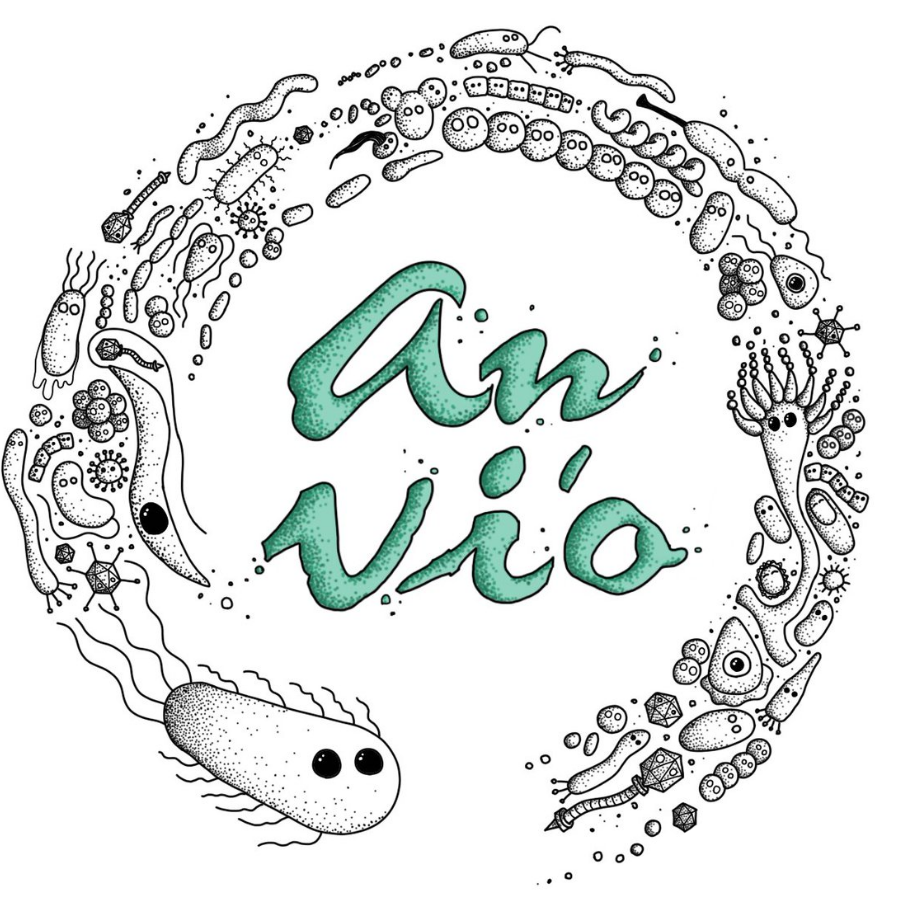

Runs mOTUpan on your gene clusters to estimate whether they are core or accessory.

🔙 **[To the main page](../../)** of anvi'o programs and artifacts.



{{ "network.json" }}
{{ 300 }}


## Authors

<a href="/people/moritzbuck" target="_blank">Moritz Buck</a>
<a href="mailto:moritz.buck@slu.se" class="person-social" target="_blank"><i class="fa fa-fw fa-envelope-square"></i>Email</a><a href="http://twitter.com/MetaMoritz" class="person-social" target="_blank"><i class="fa fa-fw fa-twitter-square"></i>Twitter</a><a href="http://github.com/moritzbuck" class="person-social" target="_blank"><i class="fa fa-fw fa-github"></i>Github</a>

## Requires

[pan-db](../../artifacts/pan-db)  [genomes-storage-db](../../artifacts/genomes-storage-db) 

## Provides

[bin](../../artifacts/bin) 

## Usage

{:.notice}
**No one has described the usage of this program** :/ If you would like to contribute, please see previous examples [here](https://github.com/merenlab/anvio/tree/master/anvio/docs/programs), and feel free to add a Markdown formatted file in that directory named "anvi-script-compute-bayesian-pan-core.md". For a template, you can use the markdown file for `anvi-gen-contigs-database`. THANK YOU!

## Command line interface

The following is the list of parameters and their descriptions in the latest version of `anvi-script-compute-bayesian-pan-core`.

The code that generates this web page ensures that this information is the latest available in **9-dev (eunice)**. Which means, in some cases the information in this section (generated automatically) might be more comprehensive or up-to-date compared to the descriptions above (written by humans).

---

### Command line usage



anvi-script-compute-bayesian-pan-core [-h] -p PAN_DB [-g GENOMES_STORAGE] [-o FILE_PATH] [--store-in-db] [-T NUM_THREADS] [--just-do-it] [-B NUM_BOOTSTRAPS]



### Parameters and their descriptions



<section class="parameter-group parameter-group-input-files">
<header class="parameter-group-header">INPUT FILES Input files from the pangenome analysis.</header>
<dl class="parameter-list">
<dt class="parameter parameter-required" id="parameter-pan_db"><code class="parameter-flags">-p, --pan-db</code> <code class="parameter-metavar">PAN_DB</code> required</dt>
<dd class="parameter-details parameter-required">Anvi&#x27;o pan database</dd>
<dt class="parameter" id="parameter-genomes_storage"><code class="parameter-flags">-g, --genomes-storage</code> <code class="parameter-metavar">GENOMES_STORAGE</code></dt>
<dd class="parameter-details">Anvi&#x27;o genomes storage file</dd>
</dl>
</section>
<section class="parameter-group parameter-group-reporting">
<header class="parameter-group-header">REPORTING How do you want results to be reported? Anvi&#x27;o can produce a TAB-delimited output file for you (for which you would have to provide an output file name). Or the results can be stored in the pan database directly, for which you would have to explicitly ask for it. You can get both as well in case you are a fan of redundancy and poor data analysis practices. Anvi&#x27;o does not judge.</header>
<dl class="parameter-list">
<dt class="parameter" id="parameter-output_file"><code class="parameter-flags">-o, --output-file</code> <code class="parameter-metavar">FILE_PATH</code></dt>
<dd class="parameter-details">File path to store results.</dd>
<dt class="parameter parameter-switch" id="parameter-store_in_db"><code class="parameter-flags">--store-in-db</code></dt>
<dd class="parameter-details">Store analysis results into the database directly.</dd>
</dl>
</section>
<section class="parameter-group parameter-group-optional">
<header class="parameter-group-header">OPTIONAL Optional stuff available for you to use</header>
<dl class="parameter-list">
<dt class="parameter" id="parameter-num_threads"><code class="parameter-flags">-T, --num-threads</code> <code class="parameter-metavar">NUM_THREADS</code></dt>
<dd class="parameter-details">Maximum number of threads to use for multithreading whenever possible. Very conservatively, the default is 1, unless the environmental variable `ANVIO_THREADS` sets another positive integer. If you use this parameter, it will override `ANVIO_THREADS`. It is a good idea to not exceed the number of CPUs / cores on your system. Plus, please be careful with this option if you are running your commands on a SGE -- if you are clusterizing your runs, and asking for multiple threads to use, you may deplete your resources very fast. Default: <code class="parameter-default-value">1</code></dd>
<dt class="parameter parameter-switch" id="parameter-just_do_it"><code class="parameter-flags">--just-do-it</code></dt>
<dd class="parameter-details">Don&#x27;t bother me with questions or warnings, just do it.</dd>
<dt class="parameter" id="parameter-num_bootstraps"><code class="parameter-flags">-B, --num-bootstraps</code> <code class="parameter-metavar">NUM_BOOTSTRAPS</code></dt>
<dd class="parameter-details">number of boostraps run on the partitioning to evaluate it&#x27;s quality Default: <code class="parameter-default-value">0</code></dd>
</dl>
</section>



## Additional Resources

* [GitHub repository for the mOTUPan](https://github.com/moritzbuck/mOTUlizer/)

{:.notice}
Are you aware of resources that may help users better understand the utility of this program? Please feel free to edit [this file](https://github.com/merenlab/anvio/blob/master/anvio/cli/compute_bayesian_pan_core.py) on GitHub. If you are not sure how to do that, find the `__resources__` tag in [this file](https://github.com/merenlab/anvio/blob/master/anvio/cli/interactive.py) to see an example.
