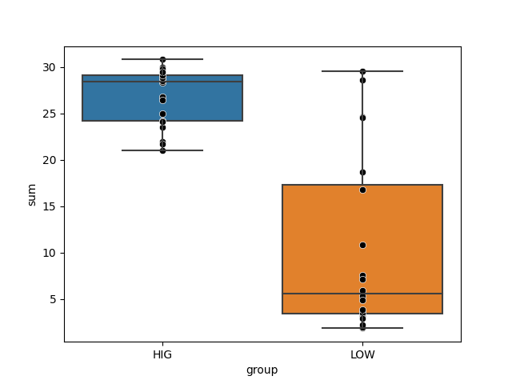

Takes a genome as a contigs-db, and tells you whether it can be considered as an organism of high metabolic independence, or not.

🔙 **[To the main page](../../)** of anvi'o programs and artifacts.



<div id="svg" class="subnetwork"></div>
{{ "network.json" }}
{{ 300 }}



## Authors

<div class="anvio-person"><div class="anvio-person-info"><div class="anvio-person-photo"></div><div class="anvio-person-info-box"><a href="/people/ivagljiva" target="_blank"><span class="anvio-person-name">Iva Veseli</span></a><div class="anvio-person-social-box"><a href="mailto:iva.veseli@gmail.com" class="person-social" target="_blank"><i class="fa fa-fw fa-envelope-square"></i>Email</a><a href="http://twitter.com/ivaglj1va" class="person-social" target="_blank"><i class="fa fa-fw fa-twitter-square"></i>Twitter</a><a href="http://github.com/ivagljiva" class="person-social" target="_blank"><i class="fa fa-fw fa-github"></i>Github</a></div></div></div></div>

<div class="anvio-person"><div class="anvio-person-info"><div class="anvio-person-photo"></div><div class="anvio-person-info-box"><a href="/people/meren" target="_blank"><span class="anvio-person-name">A. Murat Eren (Meren)</span></a><div class="anvio-person-social-box"><a href="http://merenlab.org" class="person-social" target="_blank"><i class="fa fa-fw fa-home"></i>Web</a><a href="mailto:a.murat.eren@gmail.com" class="person-social" target="_blank"><i class="fa fa-fw fa-envelope-square"></i>Email</a><a href="http://twitter.com/merenbey" class="person-social" target="_blank"><i class="fa fa-fw fa-twitter-square"></i>Twitter</a><a href="http://github.com/meren" class="person-social" target="_blank"><i class="fa fa-fw fa-github"></i>Github</a></div></div></div></div>


## Requires


<p style="text-align: left" markdown="1"><span class="artifact-r">[contigs-db](../../artifacts/contigs-db) </span></p>


## Provides


<p style="text-align: left" markdown="1"><span class="artifact-p">[metabolic-independence-score](../../artifacts/metabolic-independence-score) </span></p>


## Usage


The goal of this script is to give access to some [recent findings](https://doi.org/10.1101/2021.03.02.433653) between the metabolic make-up of a given organism and its ability to survive stressful conditions in the human gut, and classify whether a given genome can be considered as an organism with high metabolic independence (HMI) or not.

The idea implemented in this script should work for human gut microbes, however, we have not yet tested the concept of HMI/LMI beyond that.

## The concept of 'High Metabolic Independence'

Briefly, a microbial organism will have high metabolic independence (HMI) when its genome encodes, with high completeness, a set of key metabolic pathways for the biosynthesis of key molecules such as amino acids, cofactors, nucleotides, lipids, etc, through which the organism will be fairly robust to environmental stress, changing environmental conditions, and/or factors that can disrupt microbial communities. In contrast, low metabolic independence (LMI) is characterized by the complete absence and/or low level of completion of the same set of pathways, which renders organisms with LMI unable to produce critical metabolites that are often necessary for survival.

Even if this hypothesis has merit, there are open questions that needs to be addressed, such as (1) which specific metabolic pathways would be necessary to calculate the extent of metabolic independence, (2) how complete the set of pathways should be in a given genome, or (3) to what extent these insights are environment-dependent (i.e., will the set of pathways and completion for human gut microbes also work for marine microbes, etc). Despite the lack of clear answers to these questions, this script offers a framework to investigate the extent of metabolic independence of gut microbes based on our recent study. In this study, we were able to define two groups of microbial genomes following an FMT experiment: the first group was composed of populations that were able to colonize many FMT recipients and were prevalent in the global gut metageomes (the good colonizers). The second group, in contrast, was composed of populations that largely failed to colonize FMT recipients, and were also missing in global gut metagenomes (the poor colonizers). Using the programs <span class="artifact-p">[anvi-estimate-metabolism](/help/main/programs/anvi-estimate-metabolism)</span> and <span class="artifact-p">[anvi-compute-metabolic-enrichment](/help/main/programs/anvi-compute-metabolic-enrichment)</span>, we asked the question which metabolic pathways were differentially enriched between these two groups of genomes (more specifically, we only kept the modules that were 'associated' with good colonizers with a q-value of 0.05 and were at least 75% complete in at least 50% of the genomes in the good colonizers group). This analysis revealed the following set of 33 [KEGG modules](https://www.genome.jp/kegg/module.html):

|**module**|**name**|
|:--|:--|
|M00049|Adenine ribonucleotide biosynthesis, IMP => ADP,ATP|
|M00050|Guanine ribonucleotide biosynthesis, IMP => GDP,GTP|
|M00007|Pentose phosphate pathway, non-oxidative phase, fructose 6P => ribose 5P|
|M00140|C1-unit interconversion, prokaryotes|
|M00005|PRPP biosynthesis, ribose 5P => PRPP|
|M00083|Fatty acid biosynthesis, elongation|
|M00120|Coenzyme A biosynthesis, pantothenate => CoA|
|M00854|Glycogen biosynthesis, glucose-1P => glycogen/starch|
|M00527|Lysine biosynthesis, DAP aminotransferase pathway, aspartate => lysine|
|M00096|C5 isoprenoid biosynthesis, non-mevalonate pathway|
|M00048|Inosine monophosphate biosynthesis, PRPP + glutamine => IMP|
|M00855|Glycogen degradation, glycogen => glucose-6P|
|M00022|Shikimate pathway, phosphoenolpyruvate + erythrose-4P => chorismate|
|M00844|Arginine biosynthesis, ornithine => arginine|
|M00051|Uridine monophosphate biosynthesis, glutamine (+ PRPP) => UMP|
|M00082|Fatty acid biosynthesis, initiation|
|M00157|F-type ATPase, prokaryotes and chloroplasts|
|M00026|Histidine biosynthesis, PRPP => histidine|
|M00526|Lysine biosynthesis, DAP dehydrogenase pathway, aspartate => lysine|
|M00015|Proline biosynthesis, glutamate => proline|
|M00019|Valine/isoleucine biosynthesis, pyruvate => valine / 2-oxobutanoate => isoleucine|
|M00432|Leucine biosynthesis, 2-oxoisovalerate => 2-oxoisocaproate|
|M00018|Threonine biosynthesis, aspartate => homoserine => threonine|
|M00570|Isoleucine biosynthesis, threonine => 2-oxobutanoate => isoleucine|
|M00126|Tetrahydrofolate biosynthesis, GTP => THF|
|M00115|NAD biosynthesis, aspartate => quinolinate => NAD|
|M00028|Ornithine biosynthesis, glutamate => ornithine|
|M00924|Cobalamin biosynthesis, anaerobic, uroporphyrinogen III => sirohydrochlorin => cobyrinate a,c-diamide|
|M00122|Cobalamin biosynthesis, cobyrinate a,c-diamide => cobalamin|
|M00125|Riboflavin biosynthesis, plants and bacteria, GTP => riboflavin/FMN/FAD|
|M00023|Tryptophan biosynthesis, chorismate => tryptophan|
|M00631|D-Galacturonate degradation (bacteria), D-galacturonate => pyruvate + D-glyceraldehyde 3P|
|M00061|D-Glucuronate degradation, D-glucuronate => pyruvate + D-glyceraldehyde 3P|

## Estimating the level of metabolic independence

This script will use by default the list of modules that we determined to be associated with high metabolic independence, and calculate the completion scores of these modules in a given <span class="artifact-n">[contigs-db](/help/main/artifacts/contigs-db)</span> to classify it as an HMI or an LMI organism. Here is an example run:

<div class="codeblock" markdown="1">
anvi&#45;script&#45;estimate&#45;metabolic&#45;independence &#45;c <span class="artifact&#45;n">[contigs&#45;db](/help/main/artifacts/contigs&#45;db)</span>
</div>

Running this on a _Ruminococcus gnavus_ genome will print something like this:

```
CLASSIFICATION RESULT
===============================================
Metabolic independence .......................: High
Threshold for classification .................: 20
Genome score .................................: 31.06
```

The script calls upon the same classes that are invoked via <span class="artifact-p">[anvi-estimate-metabolism](/help/main/programs/anvi-estimate-metabolism)</span> to estimate the completeness of each metabolic pathway of interest. This estimation step returns a fractional completeness score for each pathway, which will have a value between 0 and 1 (inclusive). Note that this step also depends on the provided KEGG database, and that we currently use the pathwise completeness score for this step (you can find [an explanation of pathwise completeness here](https://anvio.org/help/main/programs/anvi-estimate-metabolism/#technical-details)). In its current iteration, the script will add up all the completeness scores to get one sum (which is reported as the 'genome score', and if it is higher than the threshold, it will label the organism as one that has high metabolic independence.

## Determining a new set of modules and a threshold

You can provide this script with a different set of metabolic modules, a different threshold, and/or a different KEGG data directory to utilize:

<div class="codeblock" markdown="1">
anvi&#45;script&#45;estimate&#45;metabolic&#45;independence &#45;c <span class="artifact&#45;n">[contigs&#45;db](/help/main/artifacts/contigs&#45;db)</span> \
                                            &#45;&#45;module&#45;list modules.txt \
                                            &#45;&#45;threshold 20 \
                                            &#45;&#45;kegg&#45;data&#45;dir <span class="artifact&#45;n">[kegg&#45;data](/help/main/artifacts/kegg&#45;data)</span> \
</div>

If you wish to update the list of modules based on your own empirical data, you can follow this simple recipe:

1. Define two groups of genomes, one that is of what you consider 'high metabolic independence', and one that is of 'low metabolic independence'.
2. Estimate the completeness of all metabolic pathways of potential interest in these genomes.
3. Determine metabolic modules that are enriched in the HMI group. This is the list of modules you would provide to the script for classifying additional genomes as HMI or LMI.

The exact methods of estimating metabolism and computing enrichment are up to you, but note that this strategy only works if you already have genomes that you have manually identified as HMI or LMI.

This may require adjusting the threshold for classification. Which can be done in a similar fashion, where you determine a cutoff that best separates your genomes in either groups. The plot below shows our two groups of genomes, good and poor colonizers. With the assumption that most of the good colonizers had HMI, and most of the poor colonizers had LMI, we plotted the overall completion of metabolic modules of interest, and selected a number that separates them:



{:.notice}
Since individual completeness scores have a maximum of 1 (for 100% complete), the maximum value of the sum will be _n_, where _n_ is the number of metabolic pathways in your list. So you should be selecting a threshold between 0 and _n_, but most likely on the higher end of that range, since high metabolic independence is generally defined as _high_ completeness scores across the set of pathways). It will depend on your data, of course.

## Other parameter options

### Using stepwise completeness instead

By default, this script relies on the pathwise completeness scores for each module in the input list. If you want to use stepwise completeness instead, simply add the `--use-stepwise-completeness` flag (you may also want to adjust the threshold value):

<div class="codeblock" markdown="1">
anvi&#45;script&#45;estimate&#45;metabolic&#45;independence &#45;c <span class="artifact&#45;n">[contigs&#45;db](/help/main/artifacts/contigs&#45;db)</span> \
                                            &#45;&#45;module&#45;list modules.txt \
                                            &#45;&#45;threshold 20 \
                                            &#45;&#45;use&#45;stepwise&#45;completeness
</div>

Not sure what we're talking about here? You can learn about the differences between pathwise and stepwise metrics [on this page](https://anvio.org/help/main/programs/anvi-estimate-metabolism/#two-estimation-strategies---pathwise-and-stepwise).


{:.notice}
Edit [this file](https://github.com/merenlab/anvio/tree/master/anvio/docs/programs/anvi-script-estimate-metabolic-independence.md) to update this information.


## Command line interface

The following is the list of parameters and their descriptions in the latest version of `anvi-script-estimate-metabolic-independence`.

The code that generates this web page ensures that this information is the latest available in **9-dev (eunice)**. Which means, in some cases the information in this section (generated automatically) might be more comprehensive or up-to-date compared to the descriptions above (written by humans).

---

### Command line usage


<div class="program-parameters-usage">anvi-script-estimate-metabolic-independence [-h] -c CONTIGS_DB [--module-list FILE] [--kegg-data-dir DIR_PATH] [--threshold NUM] [--use-stepwise-completeness] [-T NUM_THREADS]</div>


### Parameters and their descriptions


<div class="program-parameters">
<section class="parameter-group parameter-group-the-genome">
<header class="parameter-group-header"><span class="parameter-group-title">THE GENOME</span> <span class="parameter-group-description">Your genome as a contigs-db.</span></header>
<dl class="parameter-list">
<dt class="parameter parameter-required" id="parameter-contigs_db"><code class="parameter-flags">-c, --contigs-db</code> <code class="parameter-metavar">CONTIGS_DB</code> <span class="parameter-required-label">required</span></dt>
<dd class="parameter-details parameter-required"><span class="parameter-help">Anvi&#x27;o contigs database generated by &#x27;anvi-gen-contigs-database&#x27;</span></dd>
</dl>
</section>
<section class="parameter-group parameter-group-optional-inputs">
<header class="parameter-group-header"><span class="parameter-group-title">OPTIONAL INPUTS</span> <span class="parameter-group-description">To go beyond what is default.</span></header>
<dl class="parameter-list">
<dt class="parameter" id="parameter-module_list"><code class="parameter-flags">--module-list</code> <code class="parameter-metavar">FILE</code></dt>
<dd class="parameter-details"><span class="parameter-help">By default, this script will try to determine whether your genome represents an HMI or LMI organism based on the sum of the completeness scores of each metabolic module we have previously identified as predictors of metabolic independence status. You can find the list of such modules in the documentation of the tool (please see the link at the end of the help menu). But using this parameter, you can provide a list of KEGG module accession numbers (one accession per line) to be used instead.</span></dd>
<dt class="parameter" id="parameter-kegg_data_dir"><code class="parameter-flags">--kegg-data-dir</code> <code class="parameter-metavar">DIR_PATH</code></dt>
<dd class="parameter-details"><span class="parameter-help">By default, anvi&#x27;o will try to use the default KEGG data on your computer (if you have it setup already). Alternatively, you can use this parameter to point the path that contains a MODULES.db that holds the HMI module data.</span></dd>
<dt class="parameter" id="parameter-threshold"><code class="parameter-flags">--threshold</code> <code class="parameter-metavar">NUM</code></dt>
<dd class="parameter-details"><span class="parameter-help">Genomes with a score over this threshold will be classified as HMI. Must be a positive number. The default value reflects our findings based on known HMI/LMI genomes. Please see the docs for more information on this.</span> <span class="parameter-default"><span class="parameter-label">Default:</span> <code class="parameter-default-value">20</code></span></dd>
<dt class="parameter parameter-switch" id="parameter-use_stepwise_completeness"><code class="parameter-flags">--use-stepwise-completeness</code></dt>
<dd class="parameter-details"><span class="parameter-help">Pass this flag if you want stepwise completeness scores to be used for the calculation rather than pathwise completeness. Confused about what these are? Please see the help page for anvi-estimate-metabolism: https://anvio.org/help/main/programs/anvi-estimate-metabolism</span></dd>
</dl>
</section>
<section class="parameter-group parameter-group-optional-thingies">
<header class="parameter-group-header"><span class="parameter-group-title">OPTIONAL THINGIES</span> <span class="parameter-group-description">We are not sure if increasing the number of threads will help at this time. But you can try.</span></header>
<dl class="parameter-list">
<dt class="parameter" id="parameter-num_threads"><code class="parameter-flags">-T, --num-threads</code> <code class="parameter-metavar">NUM_THREADS</code></dt>
<dd class="parameter-details"><span class="parameter-help">Maximum number of threads to use for multithreading whenever possible. Very conservatively, the default is 1, unless the environmental variable `ANVIO_THREADS` sets another positive integer. If you use this parameter, it will override `ANVIO_THREADS`. It is a good idea to not exceed the number of CPUs / cores on your system. Plus, please be careful with this option if you are running your commands on a SGE -- if you are clusterizing your runs, and asking for multiple threads to use, you may deplete your resources very fast.</span> <span class="parameter-default"><span class="parameter-label">Default:</span> <code class="parameter-default-value">1</code></span></dd>
</dl>
</section>
</div>



## Additional Resources


{:.notice}
Are you aware of resources that may help users better understand the utility of this program? Please feel free to edit [this file](https://github.com/merenlab/anvio/blob/master/anvio/cli/estimate_metabolic_independence.py) on GitHub. If you are not sure how to do that, find the `__resources__` tag in [this file](https://github.com/merenlab/anvio/blob/master/anvio/cli/interactive.py) to see an example.
