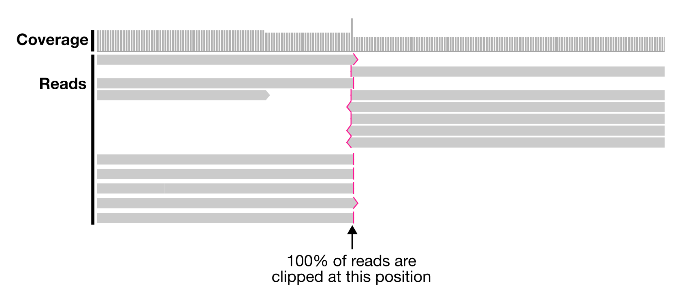

This script report errors in long read assembly using read-recruitment information. The input file should be a BAM file of long reads mapped to an assembly made from these reads..

🔙 **[To the main page](../../)** of anvi'o programs and artifacts.



{{ "network.json" }}
{{ 300 }}


## Authors

<a href="/people/floriantrigodet" target="_blank">Florian Trigodet</a>
<a href="mailto:trigodet.florian@gmail.com" class="person-social" target="_blank"><i class="fa fa-fw fa-envelope-square"></i>Email</a><a href="http://twitter.com/FlorianTrigodet" class="person-social" target="_blank"><i class="fa fa-fw fa-twitter-square"></i>Twitter</a><a href="http://github.com/floriantrigodet" class="person-social" target="_blank"><i class="fa fa-fw fa-github"></i>Github</a>

## Requires

[bam-file](../../artifacts/bam-file) 

## Provides

This program does not seem to provide any artifacts. Such programs usually print out some information for you to see or alter some anvi'o artifacts without producing any immediate outputs.

## Usage

The aim of this script is to find potential assembly errors from long read assemblers. For a comprehensive assembly error analysis, which include the use of this script, you can check [the reproducible workflow](https://merenlab.org/data/benchmarking-long-read-assemblers/) for [Assemblies of long-read metagenomes suffer from diverse forms of errors”](https://doi.org/10.1101/2025.04.22.649783) by Trigodet et al.

### Principle

This script searches for potential assembly errors in a [bam-file](/help/main/artifacts/bam-file) generated from the mapping of long reads onto an assembly made using the same reads. The basic principle is that (1) every single nucleotide, and (2) consecutive pairs/triplets of nucleotides in an assembly should be covered by at least one of the long reads that was used to generate the assembly.

To find out if every nucleotide is covered by at least one read, one simply needs to find regions with 0x coverage, and that is one output of this script.

To find where two/three consecutive nucleotides are not covered by at least one read, we can leverage the clipping information reported by long read mapping software like [minimap2](https://github.com/lh3/minimap2). Clipping happens when the left- or right-most part of a read does not align to the reference. If 100% of reads clip at the same nucleotide position, then it means that not a single read is covering at least two consecutive nucleotides. AND THAT'S NOT GOOD.

Here is an example visualized in [IGV](https://igv.org/). All reads are clipped at the same position. There is no support in the long reads that the left and right sides of the contig should be joined, suggesting that there is a misassembly here.

### Basic usage

The only input file to this script is a simple [bam-file](/help/main/artifacts/bam-file). But not any BAM file. It has to made by mapping long reads onto an assembly generated using the same reads. You also need to provide an output prefix.

anvi&#45;script&#45;find&#45;misassemblies &#45;b sample01.bam &#45;o result

### Outputs

The first output is a table reporting regions in your assemblies with zero coverage. This output includes the contig in which the region occurs, the contig's length, the region's start and stop positions, and the length of the region with no coverage.

|**contig**|**length**|**range**|**range_size**|
|:--|:--|:--|:--|
|contig_001|1665603|0-498|498|
|contig_001|1665603|100500-101000|500|
|contig_001|1665603|1665106-1665603|497|

The second output is a table reporting the positions with high relative abundance of clipped reads. It includes the contig in which the position occurs, the contig's length, the position in the contig with high levels of clipping, its relative position in the contig, the total coverage at that position, the coverage of reads clipping at that position, and the ratio between these two coverage values. The 'relative position' is the position divided by the contig's length (a value from 0 to 1), which tells you whether the position is close to the contig ends or somewhere in the middle.

|**contig**|**length**|**pos**|**relative_pos**|**cov**|**clipping**|**clipping_ratio**|
|:--|:--|:--|:--|:--|:--|:--|
|contig_001|1665603|498|0.0002989908159387321|48|48|1.0|
|contig_001|1665603|500999|0.30079136504917436|120|120|1.0|
|contig_001|1665603|501000|0.30079196543233894|79|79|1.0|
|contig_001|1665603|1665105|0.9997010091840612|45|45|1.0|

### Additional parameters

By default, the script will report clipping positions if the ratio of clipping reads to the total number of reads is over 80%. You can change that threshold with the flag `--clipping-ratio`:

anvi&#45;script&#45;find&#45;misassemblies &#45;b sample01.bam &#45;o result &#45;&#45;clipping&#45;ratio 0.6

Another default behavior of the script is to skip the first and last 100bp of a contig (only valid for the table reporting positions of high clipping). This is because contig ends often have high proportions of clipping which have nothing to do with misassemblies. You can change that parameter with the flag `--min-dist-to-end`:

anvi&#45;script&#45;find&#45;misassemblies &#45;b sample01.bam &#45;o result &#45;&#45;min&#45;dist&#45;to&#45;end 0

You can also speed up the process by using multiple threads with the flag `-T`:

anvi&#45;script&#45;find&#45;misassemblies &#45;b sample01.bam &#45;o result &#45;T 8

{:.notice}
Edit [this file](https://github.com/merenlab/anvio/tree/master/anvio/docs/programs/anvi-script-find-misassemblies.md) to update this information.

## Command line interface

The following is the list of parameters and their descriptions in the latest version of `anvi-script-find-misassemblies`.

The code that generates this web page ensures that this information is the latest available in **9-dev (eunice)**. Which means, in some cases the information in this section (generated automatically) might be more comprehensive or up-to-date compared to the descriptions above (written by humans).

---

### Command line usage



anvi-script-find-misassemblies [-h] -b BAM_FILE -o OUTPUT_PREFIX [-m MIN_DIST_TO_END] [-r CLIPPING_RATIO] [-T NUM_THREADS] [--just-do-it]



### Parameters and their descriptions



<section class="parameter-group parameter-group-required">
<header class="parameter-group-header">REQUIRED Declare your BAM file here</header>
<dl class="parameter-list">
<dt class="parameter parameter-required" id="parameter-bam_file"><code class="parameter-flags">-b, --bam-file</code> <code class="parameter-metavar">BAM_FILE</code> required</dt>
<dd class="parameter-details parameter-required">Sorted and indexed BAM file to analyze.</dd>
</dl>
</section>
<section class="parameter-group parameter-group-output-prefix">
<header class="parameter-group-header">OUTPUT-PREFIX Choose a prefix for the two output files</header>
<dl class="parameter-list">
<dt class="parameter parameter-required" id="parameter-output_prefix"><code class="parameter-flags">-o, --output-prefix</code> <code class="parameter-metavar">OUTPUT_PREFIX</code> required</dt>
<dd class="parameter-details parameter-required">Output prefix for the two tab-delimited files. Will overwrite existing files.</dd>
</dl>
</section>
<section class="parameter-group parameter-group-other-parameters">
<header class="parameter-group-header">OTHER PARAMETERS Various paramaters that you can change</header>
<dl class="parameter-list">
<dt class="parameter" id="parameter-min_dist_to_end"><code class="parameter-flags">-m, --min-dist-to-end</code> <code class="parameter-metavar">MIN_DIST_TO_END</code></dt>
<dd class="parameter-details">Sequence length on each side of a contigs that will be ignored in the clipping outut. This is to prevent aftifactual results that typically occurs at the ends of contigs. Default: <code class="parameter-default-value">100</code></dd>
<dt class="parameter" id="parameter-clipping_ratio"><code class="parameter-flags">-r, --clipping-ratio</code> <code class="parameter-metavar">CLIPPING_RATIO</code></dt>
<dd class="parameter-details">Minimum ratio of &#x27;coverage-of-clipped-reads / total-coverage&#x27; that will be reported in the output file. Default is 0.8 Default: <code class="parameter-default-value">0.8</code></dd>
<dt class="parameter" id="parameter-num_threads"><code class="parameter-flags">-T, --num-threads</code> <code class="parameter-metavar">NUM_THREADS</code></dt>
<dd class="parameter-details">Maximum number of threads to use for multithreading whenever possible. Very conservatively, the default is 1, unless the environmental variable `ANVIO_THREADS` sets another positive integer. If you use this parameter, it will override `ANVIO_THREADS`. It is a good idea to not exceed the number of CPUs / cores on your system. Plus, please be careful with this option if you are running your commands on a SGE -- if you are clusterizing your runs, and asking for multiple threads to use, you may deplete your resources very fast. Default: <code class="parameter-default-value">1</code></dd>
<dt class="parameter parameter-switch" id="parameter-just_do_it"><code class="parameter-flags">--just-do-it</code></dt>
<dd class="parameter-details">Don&#x27;t bother me with questions or warnings, just do it.</dd>
</dl>
</section>



## Additional Resources

{:.notice}
Are you aware of resources that may help users better understand the utility of this program? Please feel free to edit [this file](https://github.com/merenlab/anvio/blob/master/anvio/cli/find_misassemblies.py) on GitHub. If you are not sure how to do that, find the `__resources__` tag in [this file](https://github.com/merenlab/anvio/blob/master/anvio/cli/interactive.py) to see an example.
