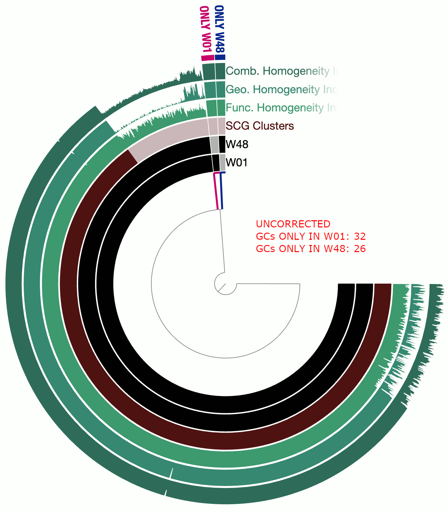

Corrects homopolymer-region associated INDELs in a given genome based on a reference genome. The most effective use of this script is when the input genome is a genome reconstructed by minION long reads, and the reference genome is one that is of high-quality. Essentially, this script will BLAST the genome you wish to correct against the reference genome you provide, identify INDELs in the BLAST results that are exclusively associated with homopolymer regions, and will take the reference genome as a guide to correct the input sequences, and report a new FASTA file. You can use the output FASTA file that is fixed as the input FASTA file over and over again to see if you can eliminate all homopolymer-associated INDELs.

🔙 **[To the main page](../../)** of anvi'o programs and artifacts.



<div id="svg" class="subnetwork"></div>
{{ "network.json" }}
{{ 300 }}



## Authors

<div class="anvio-person"><div class="anvio-person-info"><div class="anvio-person-photo"></div><div class="anvio-person-info-box"><a href="/people/meren" target="_blank"><span class="anvio-person-name">A. Murat Eren (Meren)</span></a><div class="anvio-person-social-box"><a href="http://merenlab.org" class="person-social" target="_blank"><i class="fa fa-fw fa-home"></i>Web</a><a href="mailto:a.murat.eren@gmail.com" class="person-social" target="_blank"><i class="fa fa-fw fa-envelope-square"></i>Email</a><a href="http://twitter.com/merenbey" class="person-social" target="_blank"><i class="fa fa-fw fa-twitter-square"></i>Twitter</a><a href="http://github.com/meren" class="person-social" target="_blank"><i class="fa fa-fw fa-github"></i>Github</a></div></div></div></div>


## Requires


<p style="text-align: left" markdown="1"><span class="artifact-r">[fasta](../../artifacts/fasta) </span></p>


## Provides


<p style="text-align: left" markdown="1"><span class="artifact-p">[fasta](../../artifacts/fasta) </span></p>


## Usage


This program takes an input <span class="artifact-n">[fasta](/help/main/artifacts/fasta)</span> file with one or more sequences, then **corrects INDELs associated with homopolymer regions given a reference <span class="artifact-n">[fasta](/help/main/artifacts/fasta)</span> file**, and reports edited sequences as a new <span class="artifact-n">[fasta](/help/main/artifacts/fasta)</span> file.

{:.warning}
You must be extremely careful with this program since it reports edited sequences.

## Better alternatives

If you need a comprehensive solution to correct your long-read sequencing data for serious applications, you should not use this script, but resort to better alternatives designed to correct frameshift errors.

For instance, [Arumugam et al's solution](https://microbiomejournal.biomedcentral.com/articles/10.1186/s40168-019-0665-y) leverages NCBI's nr protein database to correct frameshift errors through modified-DIAMOND alignments. Another solution, [homopolish](https://github.com/ythuang0522/homopolish) by Yao-Ting Huang et al, uses mash sketches to correct minION sequences. You may also want to check [proovframe](https://github.com/thackl/proovframe) by Thomas Hackl, which aims to correct frame-shift errors in long-read sequencing data.

## Motivation

We developed this tool largely to test the impact of INDEL errors associated with homopolymers Oxford Nanopore Technology yields. When there is a high-quality reference genome, this program can align a set of input sequences to the reference, and when it sees something like this in the alignment:

```
Input sequence ......: ... CGAAAAACG ...
Reference sequence ..: ... CGAAA--CG ...
```

It can correct the input sequence to look like this, since this would indicate that the additional `A` nucleotides after `AAA` were likely due to errors from the long-read sequencing:

```
Input sequence ......: ... CGAAACG ...
```

Similarly, if the program sees a case like this:

```
Input sequence ......: ... CGAAA--CG ...
Reference sequence ..: ... CGAAAAACG ...
```

The program would correct the input sequence this way, assuming that the lacking `A` nucleotides were likely due to errors from long-read sequencing:


```
Input sequence ......: ... CGAAAAACG ...
```

{:.warning}
Please note that INDEL errors associated with homopolymers are only a subset of errors that will casue frameshifts and impact amino acid sequences.

## Homopolymer length

The parameter `--min-homopolymer-length` helps the program to determine what to call a homopolymer region. Please read the help menu for this parameter carefully since it is not exactly intuitive.

The value `3` would be a stringent setting. But you may want to lower it to `2` if you promise to evaluate your output carefully.

The script includes some pre-aligned test sequences for you to see how `--min-homopolymer-length` influences things. For instance, here is the output for `--min-homopolymer-length 2`:

```
anvi-script-fix-homopolymer-indels --test-run \
                                   --min-homopolymer-length 2

* >>>>>>>>>>>>>>>>>>>>>>>>>>>>>>>>>>>>>>>>>>>>>>>>>

Query sequence ...............................: ATCGATCGATCGAAAATCGATCGATCG
Reference sequence ...........................: ATCGATCGATCG-AAATCGATCGATCG

GAPS BEFORE REPEATS OF "A"
===============================================
Query ........................................: AAA
Reference ....................................: -AA
Resolution ...................................: {'action': 'DEL', 'positions': [12], 'nt': 'A'}

Edited query sequence ........................: ATCGATCGATCGAAATCGATCGATCG
Query sequence edited correctly? .............: Yes

* >>>>>>>>>>>>>>>>>>>>>>>>>>>>>>>>>>>>>>>>>>>>>>>>>

Query sequence ...............................: ATCGATCGATCGAAAATCGATCGATCG
Reference sequence ...........................: ATCGATCGATCGAA-TCGATCGATCG

GAPS AFTER REPEATS OF "A"
===============================================
Query ........................................: AAA
Reference ....................................: AA-
Resolution ...................................: {'action': 'DEL', 'positions': [14], 'nt': 'A'}

Edited query sequence ........................: ATCGATCGATCGAAATCGATCGATCG
Query sequence edited correctly? .............: Yes

* >>>>>>>>>>>>>>>>>>>>>>>>>>>>>>>>>>>>>>>>>>>>>>>>>

Query sequence ...............................: ATCGATCGATCGAAA-TCGATCGATCG
Reference sequence ...........................: ATCGATCGATCGAAAATCGATCGATCG

GAPS AFTER REPEATS OF "A"
===============================================
Query ........................................: AA-
Reference ....................................: AAA
Resolution ...................................: {'action': 'INS', 'positions': [15], 'nt': 'A'}

Edited query sequence ........................: ATCGATCGATCGAAAATCGATCGATCG
Query sequence edited correctly? .............: Yes

* >>>>>>>>>>>>>>>>>>>>>>>>>>>>>>>>>>>>>>>>>>>>>>>>>

Query sequence ...............................: A-C-AT-GATCG-AAATCGATCGATCG
Reference sequence ...........................: ATCGATCGATCGAAAATCGATCGATCG

GAPS BEFORE REPEATS OF "A"
===============================================
Query ........................................: -AA
Reference ....................................: AAA
Resolution ...................................: {'action': 'INS', 'positions': [9], 'nt': 'A'}

Edited query sequence ........................: ACATGATCGAAAATCGATCGATCG
Query sequence edited correctly? .............: Yes

* >>>>>>>>>>>>>>>>>>>>>>>>>>>>>>>>>>>>>>>>>>>>>>>>>

Query sequence ...............................: ATCGATCGATCGAAATCGATCGATCG
Reference sequence ...........................: ATCGATCGATCGAA-TCGATCGATCG

GAPS AFTER REPEATS OF "A"
===============================================
Query ........................................: AAA
Reference ....................................: AA-
Resolution ...................................: {'action': 'DEL', 'positions': [14], 'nt': 'A'}

Edited query sequence ........................: ATCGATCGATCGAATCGATCGATCG
Query sequence edited correctly? .............: Yes
```

The output for the same input sequences with `--min-homopolymer-length 3`:


```
anvi-script-fix-homopolymer-indels --test-run \
                                   --min-homopolymer-length 3


* >>>>>>>>>>>>>>>>>>>>>>>>>>>>>>>>>>>>>>>>>>>>>>>>>

Query sequence ...............................: ATCGATCGATCGAAAATCGATCGATCG
Reference sequence ...........................: ATCGATCGATCG-AAATCGATCGATCG

GAPS BEFORE REPEATS OF "A"
===============================================
Query ........................................: AAAA
Reference ....................................: -AAA
Resolution ...................................: {'action': 'DEL', 'positions': [12], 'nt': 'A'}

Edited query sequence ........................: ATCGATCGATCGAAATCGATCGATCG
Query sequence edited correctly? .............: Yes

* >>>>>>>>>>>>>>>>>>>>>>>>>>>>>>>>>>>>>>>>>>>>>>>>>

Query sequence ...............................: ATCGATCGATCGAAAATCGATCGATCG
Reference sequence ...........................: ATCGATCGATCGAA-TCGATCGATCG
Edited query sequence ........................: ATCGATCGATCGAAAATCGATCGATCG
Query sequence edited correctly? .............: No

* >>>>>>>>>>>>>>>>>>>>>>>>>>>>>>>>>>>>>>>>>>>>>>>>>

Query sequence ...............................: ATCGATCGATCGAAA-TCGATCGATCG
Reference sequence ...........................: ATCGATCGATCGAAAATCGATCGATCG

GAPS AFTER REPEATS OF "A"
===============================================
Query ........................................: AAA-
Reference ....................................: AAAA
Resolution ...................................: {'action': 'INS', 'positions': [15], 'nt': 'A'}

Edited query sequence ........................: ATCGATCGATCGAAAATCGATCGATCG
Query sequence edited correctly? .............: Yes

* >>>>>>>>>>>>>>>>>>>>>>>>>>>>>>>>>>>>>>>>>>>>>>>>>

Query sequence ...............................: A-C-AT-GATCG-AAATCGATCGATCG
Reference sequence ...........................: ATCGATCGATCGAAAATCGATCGATCG

GAPS BEFORE REPEATS OF "A"
===============================================
Query ........................................: -AAA
Reference ....................................: AAAA
Resolution ...................................: {'action': 'INS', 'positions': [9], 'nt': 'A'}

Edited query sequence ........................: ACATGATCGAAAATCGATCGATCG
Query sequence edited correctly? .............: Yes

* >>>>>>>>>>>>>>>>>>>>>>>>>>>>>>>>>>>>>>>>>>>>>>>>>

Query sequence ...............................: ATCGATCGATCGAAATCGATCGATCG
Reference sequence ...........................: ATCGATCGATCGAA-TCGATCGATCG
Edited query sequence ........................: ATCGATCGATCGAAATCGATCGATCG
Query sequence edited correctly? .............: No
```

The output for the same input sequences with `--min-homopolymer-length 4`:

```
anvi-script-fix-homopolymer-indels --test-run \
                                   --min-homopolymer-length 4

* >>>>>>>>>>>>>>>>>>>>>>>>>>>>>>>>>>>>>>>>>>>>>>>>>

Query sequence ...............................: ATCGATCGATCGAAAATCGATCGATCG
Reference sequence ...........................: ATCGATCGATCG-AAATCGATCGATCG
Edited query sequence ........................: ATCGATCGATCGAAAATCGATCGATCG
Query sequence edited correctly? .............: No

* >>>>>>>>>>>>>>>>>>>>>>>>>>>>>>>>>>>>>>>>>>>>>>>>>

Query sequence ...............................: ATCGATCGATCGAAAATCGATCGATCG
Reference sequence ...........................: ATCGATCGATCGAA-TCGATCGATCG
Edited query sequence ........................: ATCGATCGATCGAAAATCGATCGATCG
Query sequence edited correctly? .............: No

* >>>>>>>>>>>>>>>>>>>>>>>>>>>>>>>>>>>>>>>>>>>>>>>>>

Query sequence ...............................: ATCGATCGATCGAAA-TCGATCGATCG
Reference sequence ...........................: ATCGATCGATCGAAAATCGATCGATCG
Edited query sequence ........................: ATCGATCGATCGAAATCGATCGATCG
Query sequence edited correctly? .............: No

* >>>>>>>>>>>>>>>>>>>>>>>>>>>>>>>>>>>>>>>>>>>>>>>>>

Query sequence ...............................: A-C-AT-GATCG-AAATCGATCGATCG
Reference sequence ...........................: ATCGATCGATCGAAAATCGATCGATCG
Edited query sequence ........................: ACATGATCGAAATCGATCGATCG
Query sequence edited correctly? .............: No

* >>>>>>>>>>>>>>>>>>>>>>>>>>>>>>>>>>>>>>>>>>>>>>>>>

Query sequence ...............................: ATCGATCGATCGAAATCGATCGATCG
Reference sequence ...........................: ATCGATCGATCGAA-TCGATCGATCG
Edited query sequence ........................: ATCGATCGATCGAAATCGATCGATCG
Query sequence edited correctly? .............: No
```

## Tips and Warnings

As you correct your input sequences one round, the BLAST may produce new homopolymers. So you may want to re-run the tool by turning the output sequence into an input sequence. For instance, we had a genome reconstructed using long-read sequencing that matched to a gold-standard genome on NCBI.

Running the script the first time this way,

``` bash
anvi-script-fix-homopolymer-indels --input Genome_minION.fasta \
                                   --reference Genome_NCBI_REF.fasta \
                                   --output Genome_minION_CORRECTED.fasta
```

Produced the following output:

```
OVERALL & PER-SEQUENCE STATS
===============================================
Num input sequences ..........................: 1
Num homopolymers associated with INDELs ......: 529
Num actions ..................................: 597
Num insertions ...............................: 292
Num deletions ................................: 305

* contig_332_pilon
    - Homopolymers: 529
    - Insertions: 292
    - Deletions: 305

Corrected output FASTA .......................: Genome_minION_CORRECTED.fasta
```

Then copying the output file as the input file,

```
cp Genome_minION_CORRECTED.fasta Genome_minION.fasta
```

And re-running the script the same way multiple times gave the following outputs:

``` bash

# (first round)

* contig_332_pilon
    - Homopolymers associated with INDELs: 29
    - Insertions: 21
    - Deletions: 10

# (second round)

* contig_332_pilon
    - Homopolymers associated with INDELs: 17
    - Insertions: 9
    - Deletions: 13

# (third round)

* contig_332_pilon
    - Homopolymers associated with INDELs: 4
    - Insertions: 4
    - Deletions: 0

# (fourth round)

* contig_332_pilon
    - Homopolymers associated with INDELs: 0
    - Insertions: 0
    - Deletions: 0
```

At the end, there were no more homopolymers associated with INDELs.

**Please consider the following points**:

* If the input and reference genomes are not closely related enough (i.e., expected ANI if there were no sequencing errors > 98%-99%), this process may yield very incorrect outcomes. But it should work great for genomes reconstructed from the same culture.

* The iterative improvement of a given input genome may reach to a 'back-and-forth' situation where there is no overall improvement, but the homopolymers associated with INDELs do not reach to 0. This happens when there are repeats in the reference genome that are identical to each other expect the number of nucleotides in homopolymers.

* You can always add `--verbose` to your command to see every single case that is considered, and resolution anvi'o reached.

* The script cleans after itself. But if you add the flag `--debug` to your call, you will find the raw blast output in XML form, which is the primary file this script uses to identify and correct INDELS associated with homopolymers.

* Under all circumstances, it is important to double check your results, and make sure you keep in mind that anything you see outstanding in your downstream analyses may be due to this step.

## A real-world example

This example involves two circular bacterial genomes, `W01` and `W48`, both of which were reconstructed using minION long-reads that were assembled by [Flye](https://github.com/fenderglass/Flye) and polished by [Pilon](https://github.com/broadinstitute/pilon/wiki).

Although `W01` and `W48` were supposed to be near-identical genomes based on our understanding of the system, the pangenome contained a lot of gene clusters that were either found only in `W01` or only in `W48`, which was quite unexpected. We thought that the spurious gene clusters were in-part due to frame-shifts caused by INDELs associated with random and erroneous homopolymers that influenced both genomes.

The following GIF shows three pangenomes for (1) the uncorrected genomes, (2) `W01` corrected by `W02` using `--min-homopolymer-lenth 3` and (3) `W01` corrected by `W02` using `--min-homopolymer-lenth 2`. Please note that the sequence for `W48` is unchanged throughout these steps, but it is only `W01` that is modified:

{:.center-img}

As this preliminary analysis shows, not only there is a reasonable reduction in spurious gene clusters, but also the homogeneity indices for core gene clusters display remarkable improvement. `--min-homopolymer-lenth 2` seems to be doing slightly better than `--min-homopolymer-lenth 3`. Overall, the script seems to be doing its job.

{:.warning}
Since in this example the 'reference genome', `W48` is also a genome with substantial homopolymer errors, the corrected sequences in `W01` do not necessarily yield amino acid sequences that are globally correct. But they are as incorrect as the ones in `W48` and not more. When a very closely related reference genome is used, the corrections will not only remove spurious gene clusters from pangenomes, but also yield more accurate amino acid sequences.

For posterity, the following shell script shows how each pangenome shown in the GIF above is generated and displayed:


``` bash
###########################################################################################
# NO CORRECTION
###########################################################################################
anvi-gen-contigs-database -f W01.fa -o W01.db
anvi-gen-contigs-database -f W48.fa -o W48.db

anvi-gen-genomes-storage -e external-genomes-01.txt \
                         -o UNCORRECTED-GENOMES.db

anvi-pan-genome -g UNCORRECTED-GENOMES.db \
                -n UNCORRECTED \
                --num-threads 4

anvi-display-pan -g UNCORRECTED-GENOMES.db \
                 -p UNCORRECTED/UNCORRECTED-PAN.db \
                 --title "UNCORRECTED"

###########################################################################################
# W1 CORRECTED BY W48 --min-homopolymer-length 3
###########################################################################################

anvi-script-fix-homopolymer-indels -i W01.fa \
                                   -r W48.fa \
                                   --min-homopolymer-length 3 \
                                   -o W01_CBW48_MHL3.fa

anvi-gen-contigs-database -f W01_CBW48_MHL3.fa \
                          -o W01_CBW48_MHL3.db

anvi-gen-genomes-storage -e external-genomes-02.txt \
                         -o CORRECTED-BY-W48-MHL3-GENOMES.db

anvi-pan-genome -g CORRECTED-BY-W48-MHL3-GENOMES.db \
                -n CORRECTED-BY-W48-MHL3 \
                --num-threads 4

anvi-display-pan -g CORRECTED-BY-W48-MHL3-GENOMES.db \
                 -p CORRECTED-BY-W48-MHL3/CORRECTED-BY-W48-MHL3-PAN.db \
                 --title "W01 CORRECTED BY W48 w/MHL3"

###########################################################################################
# W1 CORRECTED BY W48 --min-homopolymer-length 2
###########################################################################################

anvi-script-fix-homopolymer-indels -i W01.fa \
                                   -r W48.fa \
                                   --min-homopolymer-length 2 \
                                   -o W01_CBW48_MHL2.fa

anvi-gen-contigs-database -f W01_CBW48_MHL2.fa \
                          -o W01_CBW48_MHL2.db

anvi-gen-genomes-storage -e external-genomes-03.txt \
                         -o CORRECTED-BY-W48-MHL2-GENOMES.db

anvi-pan-genome -g CORRECTED-BY-W48-MHL2-GENOMES.db \
                -n CORRECTED-BY-W48-MHL2 \
                --num-threads 4

anvi-display-pan -g CORRECTED-BY-W48-MHL2-GENOMES.db \
                 -p CORRECTED-BY-W48-MHL2/CORRECTED-BY-W48-MHL2-PAN.db \
                 --title "W01 CORRECTED BY W48 w/MHL2"
```


{:.notice}
Edit [this file](https://github.com/merenlab/anvio/tree/master/anvio/docs/programs/anvi-script-fix-homopolymer-indels.md) to update this information.


## Command line interface

The following is the list of parameters and their descriptions in the latest version of `anvi-script-fix-homopolymer-indels`.

The code that generates this web page ensures that this information is the latest available in **9-dev (eunice)**. Which means, in some cases the information in this section (generated automatically) might be more comprehensive or up-to-date compared to the descriptions above (written by humans).

---

### Command line usage


<div class="program-parameters-usage">anvi-script-fix-homopolymer-indels [-h] [-i FASTA] [-r FASTA] [-o FASTA] [--min-homopolymer-length INT] [--verbose] [-T NUM_THREADS] [--test-run]</div>


### Parameters and their descriptions


<div class="program-parameters">
<section class="parameter-group parameter-group-files-that-matter">
<header class="parameter-group-header"><span class="parameter-group-title">FILES THAT MATTER</span> <span class="parameter-group-description">Here you provide file paths for input sequence(s) to be corrected, reference sequence(s) to be used for correction, and the edited input sequences to be stored. UNLESS you just want to do a test run. In which case you don&#x27;t need any of these but the parameter `--test-run`</span></header>
<dl class="parameter-list">
<dt class="parameter" id="parameter-input_fasta"><code class="parameter-flags">-i, --input-fasta</code> <code class="parameter-metavar">FASTA</code></dt>
<dd class="parameter-details"><span class="parameter-help">A FASTA file of sequences you wish to fix</span></dd>
<dt class="parameter" id="parameter-reference_fasta"><code class="parameter-flags">-r, --reference-fasta</code> <code class="parameter-metavar">FASTA</code></dt>
<dd class="parameter-details"><span class="parameter-help">A FASTA file for reference sequences</span></dd>
<dt class="parameter" id="parameter-output_fasta"><code class="parameter-flags">-o, --output-fasta</code> <code class="parameter-metavar">FASTA</code></dt>
<dd class="parameter-details"><span class="parameter-help">Corrected FASTA file</span></dd>
</dl>
</section>
<section class="parameter-group parameter-group-stuff-under-the-hood">
<header class="parameter-group-header"><span class="parameter-group-title">STUFF UNDER THE HOOD</span> <span class="parameter-group-description">Like how should we define homopolymers or how much information should we share with you as we go.</span></header>
<dl class="parameter-list">
<dt class="parameter" id="parameter-min_homopolymer_length"><code class="parameter-flags">--min-homopolymer-length</code> <code class="parameter-metavar">INT</code></dt>
<dd class="parameter-details"><span class="parameter-help">Minimum number of identical nucleotides next to each other PLUS THE GAP CHARACTER to be considered a homopolymer when these nucleotides are aligned to a region in the other sequnce that is all composed of the same nucleotides. Confused? Read on. The default is 3. So when this value is 2, the program would consider the following to match the definition of minimum homopolymer length to be considered for fixing: (R)eference: &#x27;AA-&#x27; and (Q)uery: &#x27;AAA&#x27;. The same would be true for R: &#x27;AA---&#x27; / Q: &#x27;AAAAA&#x27; but not R: &#x27;A-&#x27; / Q: &#x27;AA&#x27; In contrast, when this value is 3, then the minimum that would work would be this: R: &#x27;AAA-&#x27;, Q: &#x27;AAAA&#x27;. Obviously, you shouldn&#x27;t go any lower than 2, but then why should you listen to a computer?</span> <span class="parameter-default"><span class="parameter-label">Default:</span> <code class="parameter-default-value">3</code></span></dd>
<dt class="parameter parameter-switch" id="parameter-verbose"><code class="parameter-flags">--verbose</code></dt>
<dd class="parameter-details"><span class="parameter-help">Be verbose, print more messages whenever possible. You may regret this.</span></dd>
</dl>
</section>
<section class="parameter-group parameter-group-performance">
<header class="parameter-group-header"><span class="parameter-group-title">PERFORMANCE</span> <span class="parameter-group-description">For the BLAST search</span></header>
<dl class="parameter-list">
<dt class="parameter" id="parameter-num_threads"><code class="parameter-flags">-T, --num-threads</code> <code class="parameter-metavar">NUM_THREADS</code></dt>
<dd class="parameter-details"><span class="parameter-help">Maximum number of threads to use for multithreading whenever possible. Very conservatively, the default is 1, unless the environmental variable `ANVIO_THREADS` sets another positive integer. If you use this parameter, it will override `ANVIO_THREADS`. It is a good idea to not exceed the number of CPUs / cores on your system. Plus, please be careful with this option if you are running your commands on a SGE -- if you are clusterizing your runs, and asking for multiple threads to use, you may deplete your resources very fast.</span> <span class="parameter-default"><span class="parameter-label">Default:</span> <code class="parameter-default-value">1</code></span></dd>
</dl>
</section>
<section class="parameter-group parameter-group-test-run">
<header class="parameter-group-header"><span class="parameter-group-title">TEST RUN</span> <span class="parameter-group-description">To have an idea about what is corrected and what is not</span></header>
<dl class="parameter-list">
<dt class="parameter parameter-switch" id="parameter-test_run"><code class="parameter-flags">--test-run</code></dt>
<dd class="parameter-details"><span class="parameter-help">Just do a test run and nothing more.</span></dd>
</dl>
</section>
</div>



## Additional Resources


{:.notice}
Are you aware of resources that may help users better understand the utility of this program? Please feel free to edit [this file](https://github.com/merenlab/anvio/blob/master/anvio/cli/fix_homopolymer_indels.py) on GitHub. If you are not sure how to do that, find the `__resources__` tag in [this file](https://github.com/merenlab/anvio/blob/master/anvio/cli/interactive.py) to see an example.
