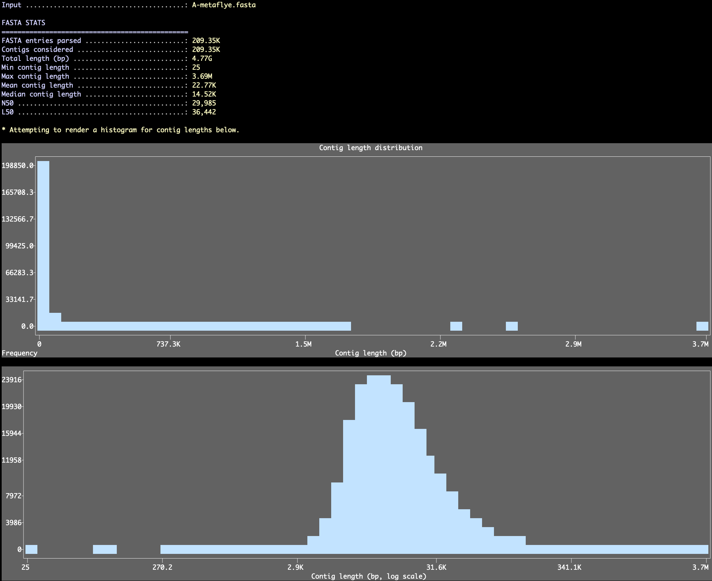

Reformat FASTA file (remove contigs based on length, or based on a given list of deflines, and/or generate an output with simpler names).

🔙 **[To the main page](../../)** of anvi'o programs and artifacts.



<div id="svg" class="subnetwork"></div>
{{ "network.json" }}
{{ 300 }}



## Authors

<div class="anvio-person"><div class="anvio-person-info"><div class="anvio-person-photo"></div><div class="anvio-person-info-box"><a href="/people/meren" target="_blank"><span class="anvio-person-name">A. Murat Eren (Meren)</span></a><div class="anvio-person-social-box"><a href="http://merenlab.org" class="person-social" target="_blank"><i class="fa fa-fw fa-home"></i>Web</a><a href="mailto:a.murat.eren@gmail.com" class="person-social" target="_blank"><i class="fa fa-fw fa-envelope-square"></i>Email</a><a href="http://twitter.com/merenbey" class="person-social" target="_blank"><i class="fa fa-fw fa-twitter-square"></i>Twitter</a><a href="http://github.com/meren" class="person-social" target="_blank"><i class="fa fa-fw fa-github"></i>Github</a></div></div></div></div>

<div class="anvio-person"><div class="anvio-person-info"><div class="anvio-person-photo"></div><div class="anvio-person-info-box"><a href="/people/ekiefl" target="_blank"><span class="anvio-person-name">Evan Kiefl</span></a><div class="anvio-person-social-box"><a href="http://ekiefl.github.io" class="person-social" target="_blank"><i class="fa fa-fw fa-home"></i>Web</a><a href="mailto:kiefl.evan@gmail.com" class="person-social" target="_blank"><i class="fa fa-fw fa-envelope-square"></i>Email</a><a href="http://twitter.com/evankiefl" class="person-social" target="_blank"><i class="fa fa-fw fa-twitter-square"></i>Twitter</a><a href="http://github.com/ekiefl" class="person-social" target="_blank"><i class="fa fa-fw fa-github"></i>Github</a></div></div></div></div>

<div class="anvio-person"><div class="anvio-person-info"><div class="anvio-person-photo"></div><div class="anvio-person-info-box"><a href="/people/vinisalazar" target="_blank"><span class="anvio-person-name">Vini Salazar</span></a><div class="anvio-person-social-box"><a href="https://scholar.google.com/citations?user=P6xo0BsAAAAJ" class="person-social" target="_blank"><i class="fa fa-fw fa-home"></i>Web</a><a href="mailto:vinicius.salazar@unimelb.edu.au" class="person-social" target="_blank"><i class="fa fa-fw fa-envelope-square"></i>Email</a><a href="http://twitter.com/vinisalazar_" class="person-social" target="_blank"><i class="fa fa-fw fa-twitter-square"></i>Twitter</a><a href="http://github.com/vinisalazar" class="person-social" target="_blank"><i class="fa fa-fw fa-github"></i>Github</a></div></div></div></div>


## Requires


<p style="text-align: left" markdown="1"><span class="artifact-r">[fasta](../../artifacts/fasta) </span></p>


## Provides


<p style="text-align: left" markdown="1"><span class="artifact-p">[contigs-fasta](../../artifacts/contigs-fasta) </span> <span class="artifact-p">[contig-rename-report-txt](../../artifacts/contig-rename-report-txt) </span></p>


## Usage


A simpe program to perform a combination of simple operations on a FASTA file including,

* Renaming sequences so they have simplified deflines (more on this in the next section),
* Adding a prefix to sequence names in a FASTA file (useful when you wish to concatenate multiple FASTA files and want to make sure each sequence name is unique and tracable back to its original source),
* Removing sequences that are shorter or longer than specific thresholds, or only keeping those that match to a specific length,
* Removing sequences if they contain more than a number of gap characters or exceed the precentage of gap characters you permit (some simple quality checks prior to phylogenetic / phylogenomic analyses),
* Excluding sequences that match to a list of sequence IDs, or only keep those that match to a list of sequence IDs,
* Enforcing a sequence type and to replace any character with `N` for nucleotide sequences that are not A, C, T, or G, or to replace any character with `X` for amino acid sequences if the character does not match any of the single-letter amino acid characters (useuful to make sure the input file conforms the expectations of that input file type (i.e., all DNA sequences, or all AA sequences, etc)).

{:.notice}
This program can work with compressed input FASTA files (i.e., the file name ends with a `.gz` extention) and will report a compressed output FASTA file (i.e., if the output file name ends with a `.gz` extension). It will just take awfully long time to run as it will have to decompress and recompress the file on the fly. But hey, you will have all the storage place you need to protect protected, right?

### Stats-only mode

If you only want to take a quick look at FASTA-level summary statistics without writing a new file, you can ask the program to skip all reformatting steps and don't change anything in the FASTA file with the `--stats-only` flag:

<div class="codeblock" markdown="1">
anvi&#45;script&#45;reformat&#45;fasta <span class="artifact&#45;n">[fasta](/help/main/artifacts/fasta)</span> \
                           &#45;&#45;stats&#45;only
</div>

Which will report entry counts, length totals, min/max/mean/median lengths, and N50/L50, and render length histograms in the terminal (anvi'o will pick a bin count for these histograms, but you can also set a specific number using the `--length-histogram-bins` parameter and control the plot height with `--length-histogram-height`).

[{:.center-img}](../../images/anvi-script-reformat-fasta-stats.png)

### Renaming / simplifying sequence deflines

One of the most useful tasks this program performs is to simplify the deflines in your <span class="artifact-n">[fasta](/help/main/artifacts/fasta)</span> file so they meet the conditions required of a <span class="artifact-n">[contigs-fasta](/help/main/artifacts/contigs-fasta)</span> that is required by other anvi'o programs. You can simplify deflines in a <span class="artifact-n">[fasta](/help/main/artifacts/fasta)</span> file the following way:

<div class="codeblock" markdown="1">
anvi&#45;script&#45;reformat&#45;fasta <span class="artifact&#45;n">[fasta](/help/main/artifacts/fasta)</span> \
                           &#45;o <span class="artifact&#45;n">[contigs&#45;fasta](/help/main/artifacts/contigs&#45;fasta)</span> \
                           &#45;&#45;simplify&#45;names \
                           &#45;&#45;report&#45;file <span class="artifact&#45;n">[contig&#45;rename&#45;report&#45;txt](/help/main/artifacts/contig&#45;rename&#45;report&#45;txt)</span>
</div>

The `--report-file` flag is quite important to use here as it will generate a TAB-delimited file, <span class="artifact-n">[contig-rename-report-txt](/help/main/artifacts/contig-rename-report-txt)</span>, to keep track of which defline in the new file corresponds to which defline in the original file.

### Removing the short reads

If your <span class="artifact-n">[fasta](/help/main/artifacts/fasta)</span> file includes a lot of very short contigs, removing them may dramatically improve the performance of the generation and processing of your <span class="artifact-n">[contigs-db](/help/main/artifacts/contigs-db)</span>. The example below runs the same command while also removing sequences that are shorter than 1,000 nts:

<div class="codeblock" markdown="1">
anvi&#45;script&#45;reformat&#45;fasta <span class="artifact&#45;n">[fasta](/help/main/artifacts/fasta)</span> \
                           &#45;o <span class="artifact&#45;n">[contigs&#45;fasta](/help/main/artifacts/contigs&#45;fasta)</span> \
                           &#45;l 1000 \
                           &#45;&#45;simplify&#45;names \
                           &#45;&#45;report&#45;file <span class="artifact&#45;n">[contig&#45;rename&#45;report&#45;txt](/help/main/artifacts/contig&#45;rename&#45;report&#45;txt)</span>
</div>

You can also discard unusually long sequences with the `--max-len` parameter if you want to enforce an upper bound on sequence size. You may ask yourself why would I discard my long contigs, but actually this can be quite useful when screening FASTA files for phylogenomic analyses, where you do not want to include sequences that are much longer than the expected siize of the model hits. To do it right, you can take a look at the histogram output, and determine what is your meaningful limits for length.

### Example output

```
anvi-script-reformat-fasta contigs.fa \
                           --simplify-names \
                           --prefix YYY \
                           --min-len 1000 \
                           --seq-type NT \
                           --overwrite-input
```

```
Input ........................................: contigs.fa
Output .......................................: (anvi'o will overwrite your input file)

WHAT WAS THERE
===============================================
Total num contigs ............................: 4,189
Total num nucleotides ........................: 35,766,167

WHAT WAS ASKED
===============================================
Simplify deflines? ...........................: Yes
Add prefix to sequence names? ................: Yes, add 'YYY'
Minimum length of contigs to keep ............: 1,000
Maximum length of contigs to keep ............: No limit
Max % gaps allowed ...........................: 100.00%
Max num gaps allowed .........................: 1,000,000
Exclude specific sequences? ..................: No
Keep specific sequences? .....................: No
Enforce sequence type? .......................: Yes, enforce 'NT'

WHAT HAPPENED
===============================================
Contigs removed ..............................: 3,156 (75.34% of all)
Nucleotides removed ..........................: 6,121,239 (17.11% of all)
Nucleotides modified .........................: 161 (0.00045% of all)
Deflines simplified ..........................: True


* The contents of your input file have changed because you used the flag
`--overwrite-input`.

```

{:.warning}
Please use the flag `--overwrite-input` with extreme caution.


{:.notice}
Edit [this file](https://github.com/merenlab/anvio/tree/master/anvio/docs/programs/anvi-script-reformat-fasta.md) to update this information.


## Command line interface

The following is the list of parameters and their descriptions in the latest version of `anvi-script-reformat-fasta`.

The code that generates this web page ensures that this information is the latest available in **9-dev (eunice)**. Which means, in some cases the information in this section (generated automatically) might be more comprehensive or up-to-date compared to the descriptions above (written by humans).

---

### Command line usage


<div class="program-parameters-usage">anvi-script-reformat-fasta [-h] [-o FASTA FILE PATH] [--overwrite-input] [-r TXT FILE PATH] [--simplify-names] [--prefix PREFIX] [-l INT] [-L INT] [--exact-length INT] [--max-percentage-gaps PERCENTAGE] [-M MAX_GAPS] [-i TXT FILE] [--export-gap-counts-table TSV FILE] [-I TXT FILE] [--seq-type SEQ TYPE] [--ignore-empty-sequences] [--stats-only] [--length-histogram-bins [INT]] [--length-histogram-height [INT]] FASTA FILE</div>


### Parameters and their descriptions


<div class="program-parameters">
<section class="parameter-group parameter-group-input">
<header class="parameter-group-header"><span class="parameter-group-title">INPUT</span> <span class="parameter-group-description">The input file you wish to work with.</span></header>
<dl class="parameter-list">
<dt class="parameter parameter-required parameter-positional" id="parameter-contigs_fasta"><code class="parameter-flags">FASTA FILE</code> <span class="parameter-required-label">required</span></dt>
<dd class="parameter-details parameter-required"><span class="parameter-help"></span></dd>
</dl>
</section>
<section class="parameter-group parameter-group-output">
<header class="parameter-group-header"><span class="parameter-group-title">OUTPUT</span> <span class="parameter-group-description">Dealing with the output.</span></header>
<dl class="parameter-list">
<dt class="parameter" id="parameter-output_file"><code class="parameter-flags">-o, --output-file</code> <code class="parameter-metavar">FASTA FILE PATH</code></dt>
<dd class="parameter-details"><span class="parameter-help">Output file path for a NEW FASTA file. If you want all changes to be stored in the same file, see the `--overwrite` flag.</span></dd>
<dt class="parameter parameter-switch" id="parameter-overwrite_input"><code class="parameter-flags">--overwrite-input</code></dt>
<dd class="parameter-details"><span class="parameter-help">Instead of reporting a new file, overwrite the input file. For those of us who loves to live life at the very edge of it. A case of we can&#x27;t go back, Kate.</span></dd>
<dt class="parameter" id="parameter-report_file"><code class="parameter-flags">-r, --report-file</code> <code class="parameter-metavar">TXT FILE PATH</code></dt>
<dd class="parameter-details"><span class="parameter-help">When you run this program with `--simplify-names` flag, all changes to deflines will be reported in this file in case you need to go back to this information later. It is not mandatory to declare one, but it is a very good idea to have it.</span></dd>
</dl>
</section>
<section class="parameter-group parameter-group-operations-rename-your-deflines">
<header class="parameter-group-header"><span class="parameter-group-title">OPERATIONS: RENAME YOUR DEFLINES</span></header>
<dl class="parameter-list">
<dt class="parameter parameter-switch" id="parameter-simplify_names"><code class="parameter-flags">--simplify-names</code></dt>
<dd class="parameter-details"><span class="parameter-help">Edit deflines to make sure they contigs have simple names.</span></dd>
<dt class="parameter" id="parameter-prefix"><code class="parameter-flags">--prefix</code> <code class="parameter-metavar">PREFIX</code></dt>
<dd class="parameter-details"><span class="parameter-help">Use this parameter if you would like to add a prefix to your contig names while simplifying them. The prefix must be a single word (you can use underscor character, but nothing more!).</span></dd>
</dl>
</section>
<section class="parameter-group parameter-group-operations-tame-your-sequences">
<header class="parameter-group-header"><span class="parameter-group-title">OPERATIONS: TAME YOUR SEQUENCES</span></header>
<dl class="parameter-list">
<dt class="parameter" id="parameter-min_len"><code class="parameter-flags">-l, --min-len</code> <code class="parameter-metavar">INT</code></dt>
<dd class="parameter-details"><span class="parameter-help">Minimum length of contigs to keep (contigs shorter than this value will not be included in the output file). The default is 0, so nothing will be removed if you do not declare a minimum size.</span> <span class="parameter-default"><span class="parameter-label">Default:</span> <code class="parameter-default-value">0</code></span></dd>
<dt class="parameter" id="parameter-max_len"><code class="parameter-flags">-L, --max-len</code> <code class="parameter-metavar">INT</code></dt>
<dd class="parameter-details"><span class="parameter-help">Maximum length of contigs to keep (contigs longer than this value will not be included in the output file). If omitted, no upper bound is enforced.</span></dd>
<dt class="parameter" id="parameter-exact_length"><code class="parameter-flags">--exact-length</code> <code class="parameter-metavar">INT</code></dt>
<dd class="parameter-details"><span class="parameter-help">Exact lenght of the sequences you wish to keep from a FASTA fille. Why would anyone need that? Anvi&#x27;o does not know. But there you have it. This parameter is indeed incompatible with a lot of others, such as `--min-len` or `--max-len`.</span></dd>
<dt class="parameter" id="parameter-max_percentage_gaps"><code class="parameter-flags">--max-percentage-gaps</code> <code class="parameter-metavar">PERCENTAGE</code></dt>
<dd class="parameter-details"><span class="parameter-help">Maximum fraction of gaps in a sequence (any sequence with more gaps will be removed from the output FASTA file). The default is 100.000000.</span> <span class="parameter-default"><span class="parameter-label">Default:</span> <code class="parameter-default-value">100</code></span></dd>
<dt class="parameter" id="parameter-max_gaps"><code class="parameter-flags">-M, --max-gaps</code> <code class="parameter-metavar">MAX_GAPS</code></dt>
<dd class="parameter-details"><span class="parameter-help">Maximum amount of gaps allowed per sequence in the alignment. Don&#x27;t know which threshold to pick? Use --export-gap-counts-table to explore the gap counts per sequence distribution!</span> <span class="parameter-default"><span class="parameter-label">Default:</span> <code class="parameter-default-value">1000000</code></span></dd>
<dt class="parameter" id="parameter-exclude_ids"><code class="parameter-flags">-i, --exclude-ids</code> <code class="parameter-metavar">TXT FILE</code></dt>
<dd class="parameter-details"><span class="parameter-help">IDs to remove from the FASTA file. You cannot provide both --keep-ids and --exclude-ids.</span></dd>
<dt class="parameter" id="parameter-export_gap_counts_table"><code class="parameter-flags">--export-gap-counts-table</code> <code class="parameter-metavar">TSV FILE</code></dt>
<dd class="parameter-details"><span class="parameter-help">Export a table with the number of gaps per sequence. Please provide a prefix to name the file.</span></dd>
<dt class="parameter" id="parameter-keep_ids"><code class="parameter-flags">-I, --keep-ids</code> <code class="parameter-metavar">TXT FILE</code></dt>
<dd class="parameter-details"><span class="parameter-help">If provided, all IDs not in this file will be excluded from the reformatted FASTA file. Any additional filters (such as --min-len) will still be applied to the IDs in this file. You cannot provide both --exclude-ids and --keep-ids.</span></dd>
<dt class="parameter" id="parameter-seq_type"><code class="parameter-flags">--seq-type</code> <code class="parameter-metavar">SEQ TYPE</code></dt>
<dd class="parameter-details"><span class="parameter-help">Supply either &#x27;NT&#x27; or &#x27;AA&#x27; (if you want). If &#x27;NT&#x27;, any characters besides {A,C,T,G} will by replaced with &#x27;N&#x27;. If &#x27;AA&#x27;, any characters that are not 1-letter amino acid characters will be replaced with &#x27;X&#x27;. If you don&#x27;t supply anything, no charaters will be modified.</span> <span class="parameter-choices"><span class="parameter-label">Choices:</span> <code class="parameter-choice">AA</code> <code class="parameter-choice">NT</code></span></dd>
<dt class="parameter parameter-switch" id="parameter-ignore_empty_sequences"><code class="parameter-flags">--ignore-empty-sequences</code></dt>
<dd class="parameter-details"><span class="parameter-help">If your FASTA file contains entries with no sequences, you will either have to ask anvi&#x27;o to ignore them, or go back to your file and figure out why it is the case (because you will certainly get an error somewhere during the process).</span></dd>
</dl>
</section>
<section class="parameter-group parameter-group-utility-fasta-stats">
<header class="parameter-group-header"><span class="parameter-group-title">UTILITY: FASTA STATS</span></header>
<dl class="parameter-list">
<dt class="parameter parameter-switch" id="parameter-stats_only"><code class="parameter-flags">--stats-only</code></dt>
<dd class="parameter-details"><span class="parameter-help">Skip all reformatting operations and instead report basic statistics about the input FASTA file (total sequences, min/max/mean lengths, N50, GC content, etc.) without writing a new file.</span></dd>
<dt class="parameter" id="parameter-length_histogram_bins"><code class="parameter-flags">--length-histogram-bins</code> <code class="parameter-metavar">INT</code></dt>
<dd class="parameter-details"><span class="parameter-help">Number of bins for the length histogram shown with --stats-only. If you omit a value, anvi&#x27;o chooses a reasonable one based on the number of sequences.</span></dd>
<dt class="parameter" id="parameter-length_histogram_height"><code class="parameter-flags">--length-histogram-height</code> <code class="parameter-metavar">INT</code></dt>
<dd class="parameter-details"><span class="parameter-help">Height (rows) for the length histograms shown with --stats-only. Defaults to 24 rows if not provided.</span></dd>
</dl>
</section>
</div>



## Additional Resources


{:.notice}
Are you aware of resources that may help users better understand the utility of this program? Please feel free to edit [this file](https://github.com/merenlab/anvio/blob/master/anvio/cli/reformat_fasta.py) on GitHub. If you are not sure how to do that, find the `__resources__` tag in [this file](https://github.com/merenlab/anvio/blob/master/anvio/cli/interactive.py) to see an example.
