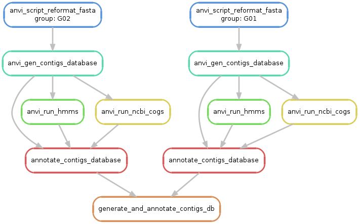

<i>From FASTA files to annotated anvi&#x27;o contigs databases</i>

This workflow is useful for converting a bunch of genomes into an anvi&#x27;o-compatible format. It generates contigs databases from each input FASTA file, and subsequently runs a variety of annotation programs of your choice to populate these databases with some useful information for your downstream work (i.e. functions, single-copy-core genes, taxonomy, etc).

🔙 **[To the main page](../../)** of anvi'o programs and artifacts.

## Authors

<div class="anvio-person"><div class="anvio-person-info"><div class="anvio-person-photo"></div><div class="anvio-person-info-box"><a href="/people/shaiberalon" target="_blank"><span class="anvio-person-name">Alon Shaiber</span></a><div class="anvio-person-social-box"><a href="mailto:alon.shaiber@gmail.com" class="person-social" target="_blank"><i class="fa fa-fw fa-envelope-square"></i>Email</a><a href="http://twitter.com/alon_shaiber" class="person-social" target="_blank"><i class="fa fa-fw fa-twitter-square"></i>Twitter</a><a href="http://github.com/shaiberalon" class="person-social" target="_blank"><i class="fa fa-fw fa-github"></i>Github</a></div></div></div></div>

<div class="anvio-person"><div class="anvio-person-info"><div class="anvio-person-photo"></div><div class="anvio-person-info-box"><a href="/people/ivagljiva" target="_blank"><span class="anvio-person-name">Iva Veseli</span></a><div class="anvio-person-social-box"><a href="mailto:iva.veseli@gmail.com" class="person-social" target="_blank"><i class="fa fa-fw fa-envelope-square"></i>Email</a><a href="http://twitter.com/ivaglj1va" class="person-social" target="_blank"><i class="fa fa-fw fa-twitter-square"></i>Twitter</a><a href="http://github.com/ivagljiva" class="person-social" target="_blank"><i class="fa fa-fw fa-github"></i>Github</a></div></div></div></div>

<div class="anvio-person"><div class="anvio-person-info"><div class="anvio-person-photo"></div><div class="anvio-person-info-box"><a href="/people/meren" target="_blank"><span class="anvio-person-name">A. Murat Eren (Meren)</span></a><div class="anvio-person-social-box"><a href="http://merenlab.org" class="person-social" target="_blank"><i class="fa fa-fw fa-home"></i>Web</a><a href="mailto:a.murat.eren@gmail.com" class="person-social" target="_blank"><i class="fa fa-fw fa-envelope-square"></i>Email</a><a href="http://twitter.com/merenbey" class="person-social" target="_blank"><i class="fa fa-fw fa-twitter-square"></i>Twitter</a><a href="http://github.com/meren" class="person-social" target="_blank"><i class="fa fa-fw fa-github"></i>Github</a></div></div></div></div>

<div class="anvio-person"><div class="anvio-person-info"><div class="anvio-person-photo"></div><div class="anvio-person-info-box"><a href="/people/mschecht" target="_blank"><span class="anvio-person-name">Matthew Schechter</span></a><div class="anvio-person-social-box"><a href="mailto:mschechter@uchicago.edu" class="person-social" target="_blank"><i class="fa fa-fw fa-envelope-square"></i>Email</a><a href="http://twitter.com/mschecht_bio" class="person-social" target="_blank"><i class="fa fa-fw fa-twitter-square"></i>Twitter</a><a href="http://github.com/mschecht" class="person-social" target="_blank"><i class="fa fa-fw fa-github"></i>Github</a></div></div></div></div>


## Artifacts accepted

The contigs can typically be initiated with the following artifacts:

<p style="text-align: left" markdown="1"><span class="artifact-p">[workflow-config](../../artifacts/workflow-config) </span> <span class="artifact-p">[fasta-txt](../../artifacts/fasta-txt) </span></p>

## Artifacts produced

The contigs typically produce the following anvi'o artifacts:

<p style="text-align: left" markdown="1"><span class="artifact-p">[contigs-db](../../artifacts/contigs-db) </span></p>

## Third party programs

This is a list of programs that may be used by the contigs workflow depending on the user settings in the <span class="artifact-p">[workflow-config](../../artifacts/workflow-config/) </span>:

<ul>
<li><a href="https://github.com/althonos/pyrodigal-gv" target="_blank">pyrodigal-gv</a> (Gene calling)</li><li><a href="http://hmmer.org/" target="_blank">HMMER</a> (HMM search)</li><li><a href="https://github.com/fbreitwieser/krakenuniq" target="_blank">krakenuniq</a> (Gene taxonomy)</li><li><a href="https://github.com/DaehwanKimLab/centrifuge" target="_blank">centrifuge</a> (Gene taxonomy)</li><li><a href="https://uni-tuebingen.de/fakultaeten/mathematisch-naturwissenschaftliche-fakultaet/fachbereiche/informatik/lehrstuehle/algorithms-in-bioinformatics/software/diamond/" target="_blank">DIAMOND</a> (Sequence search against various databases)</li>
</ul>

An anvi'o installation that follows the recommendations on the <a href="https://anvio.org/install/" target="_blank">installation page</a> will include all these programs. But please consider your settings, and cite these additional tools from your methods sections.

## Workflow description and usage


This workflow is extremely useful if you have one or more <span class="artifact-n">[fasta](/help/main/artifacts/fasta)</span> files that describe one or more contig sequences for your genomes or assembled metagenomes, and all you want to turn them into <span class="artifact-n">[contigs-db](/help/main/artifacts/contigs-db)</span> files.

{:.warning}
If you have not yet run anvi'o programs <span class="artifact-p">[anvi-setup-ncbi-cogs](/help/main/programs/anvi-setup-ncbi-cogs)</span> and <span class="artifact-p">[anvi-setup-scg-taxonomy](/help/main/programs/anvi-setup-scg-taxonomy)</span> on your system yet, you will get a cryptic error from this workflow if you run it with the default <span class="artifact-n">[workflow-config](/help/main/artifacts/workflow-config)</span>. You can avoid this by first running these two anvi'o programs to setup the necessary databases (which is done only once for every anvi'o installation), **or** set the rules for COG functions and/or SCG taxonomy to `run=false` explicitly.

To start things going with this workflow, first ask anvi'o to give you a default <span class="artifact-n">[workflow-config](/help/main/artifacts/workflow-config)</span> file for the contigs workflow:

```bash
anvi-run-workflow -w contigs \
                  --get-default-config config-contigs-default.json
```

This will generate a file in your work directory called `config-contigs-default.json`. You should investigate its contents, and familiarize youself with it. It should look something like this, but much longer:
and you could examine its content to find out all possible options to tweak. We included a much simpler config file, `config-contigs.json`, in the mock data package for the sake of demonstrating how the contigs workflow works:

```json
{
    "workflow_name": "contigs",
    "config_version": "2",
    "fasta_txt": "fasta.txt",
    "output_dirs": {
        "FASTA_DIR": "01_FASTA",
        "CONTIGS_DIR": "02_CONTIGS",
        "LOGS_DIR": "00_LOGS"
    }
}
```

The only mandatory thing you need to do is to (1) manually create a <span class="artifact-n">[fasta-txt](/help/main/artifacts/fasta-txt)</span> file to describe the name and location of each FASTA file you wish to work with, and (2) make sure the `fasta_txt` variable in your <span class="artifact-n">[workflow-config](/help/main/artifacts/workflow-config)</span> point to the location of your <span class="artifact-n">[fasta-txt](/help/main/artifacts/fasta-txt)</span>.

To see if everything looks alright, you can simply run the following command, which should generate a 'workflow graph' for you, given your config file parameters and input files:

```bash
anvi-run-workflow -w contigs \
                  -c config-contigs.json \
                  --save-workflow-graph
```

For the example config file shown above, this command will generate something similar to this:

[]( ../../images/workflows/contigs/DAG-contigs.png){:.center-img .width-50}

{:.notice}
Please note that the generation of this workflow graph requires the usage of a program called [dot](https://en.wikipedia.org/wiki/DOT_(graph_description_language)). If you are using MAC OSX, you can use [dot](https://en.wikipedia.org/wiki/DOT_(graph_description_language)) by installing [graphviz](http://www.graphviz.org/) through `brew` or `conda`.

If everything looks alright, you can run this workflow the following way:

```bash
anvi-run-workflow -w contigs \
                  -c config-contigs.json
```

If everything goes smoothly, you should see happy messages flowing on your screen, and at the end of it all you should see your contigs databases are generated and annotated properly. At the end of this process, you will have all your <span class="artifact-n">[contigs-db](/help/main/artifacts/contigs-db)</span> files in the `02_CONTIGS` directory (as per the instructions in the config file, which you can change). You can use the program <span class="artifact-p">[anvi-display-contigs-stats](/help/main/programs/anvi-display-contigs-stats)</span> on one of them to see if everything makes sense.

Workflow logs will be under `00_LOGS/contigs` by default. Rule logs are organized by rule name, and the contigs workflow writes a tab-delimited manifest at `00_LOGS/contigs/contigs-workflow-manifest.tsv` that points to each job's log and records whether it succeeded or failed.

## Predicting protein structures

The contigs workflow can also predict the structures of the genes in each <span class="artifact-n">[contigs-db](/help/main/artifacts/contigs-db)</span>, and store them in a <span class="artifact-n">[structure-db](/help/main/artifacts/structure-db)</span> using <span class="artifact-p">[anvi-gen-structure-database](/help/main/programs/anvi-gen-structure-database)</span>. This step is off by default. To turn it on, set `run` to `true` for the rule `anvi_gen_structure_database` in your <span class="artifact-n">[workflow-config](/help/main/artifacts/workflow-config)</span>. Every parameter of the prediction (including the `--engine`, which can be `modeller` or `colabfold`) lives under this rule:

```json
"anvi_gen_structure_database": {
    "run": true,
    "threads": 4,
    "--engine": "colabfold",
    "--colabfold-conda-env": "colabfold",
    "--colabfold-db": "/path/to/colabfold_db"
}
```

The workflow writes one <span class="artifact-n">[structure-db](/help/main/artifacts/structure-db)</span> per FASTA file into `03_STRUCTURE`, e.g., `03_STRUCTURE/SAMPLE_01-STRUCTURE.db`. The prediction does not hold up the rest of the workflow: it only needs the <span class="artifact-n">[contigs-db](/help/main/artifacts/contigs-db)</span>, and annotating the <span class="artifact-n">[contigs-db](/help/main/artifacts/contigs-db)</span> afterwards will not trigger a new prediction.

Once a <span class="artifact-n">[structure-db](/help/main/artifacts/structure-db)</span> exists, the workflow never touches it again, even if you change the structure parameters in your <span class="artifact-n">[workflow-config](/help/main/artifacts/workflow-config)</span> or the genes of interest of that <span class="artifact-n">[contigs-db](/help/main/artifacts/contigs-db)</span>: predicting structures can take days, and the workflow will not delete them. Anvi'o lists these <span class="artifact-n">[structure-db](/help/main/artifacts/structure-db)</span> files every time you run the workflow. To predict the structures of a <span class="artifact-n">[contigs-db](/help/main/artifacts/contigs-db)</span> again, move or remove its <span class="artifact-n">[structure-db](/help/main/artifacts/structure-db)</span> first. To only add genes to it, you can use <span class="artifact-p">[anvi-update-structure-database](/help/main/programs/anvi-update-structure-database)</span>. The workflow writes each <span class="artifact-n">[structure-db](/help/main/artifacts/structure-db)</span> under a temporary name (e.g., `03_STRUCTURE/SAMPLE_01-STRUCTURE-INCOMPLETE.db`) and only renames it once it is complete, so a job that failed or was killed (for instance, by your cluster's time limit) does not leave behind an unfinished <span class="artifact-n">[structure-db](/help/main/artifacts/structure-db)</span> under its final name. If you stop the workflow yourself with Ctrl-C, please check `03_STRUCTURE` before running it again.

The workflow also makes sure each existing <span class="artifact-n">[structure-db](/help/main/artifacts/structure-db)</span> was made from the <span class="artifact-n">[contigs-db](/help/main/artifacts/contigs-db)</span> it belongs to, and stops if it was not (for instance, if you made a <span class="artifact-n">[contigs-db](/help/main/artifacts/contigs-db)</span> again), so you can move or remove the old <span class="artifact-n">[structure-db](/help/main/artifacts/structure-db)</span>.

With MODELLER, a <span class="artifact-n">[structure-db](/help/main/artifacts/structure-db)</span> may contain no structures at all, when MODELLER does not find a good enough template for any of the genes of interest. This is not an error: the <span class="artifact-n">[structure-db](/help/main/artifacts/structure-db)</span> still records the genes anvi'o tried.

### Choosing genes

By default, anvi'o predicts a structure for every gene of every <span class="artifact-n">[contigs-db](/help/main/artifacts/contigs-db)</span>, and warns you when it is about to do so. A single genome has thousands of genes, so this can take a very long time. To limit the prediction to some genes, add a `structure_genes_of_interest` column to your <span class="artifact-n">[fasta-txt](/help/main/artifacts/fasta-txt)</span> that points to a <span class="artifact-n">[genes-of-interest-txt](/help/main/artifacts/genes-of-interest-txt)</span> for each FASTA file:

|name|path|structure_genes_of_interest|
|:--|:--|:--|
|SAMPLE_01|path/to/sample_01.fa|genes_01.txt|
|SAMPLE_02|path/to/sample_02.fa||

Here, anvi'o predicts structures for the genes listed in `genes_01.txt` for `SAMPLE_01`, and for every gene of `SAMPLE_02`.

Since gene caller ids only exist once a <span class="artifact-n">[contigs-db](/help/main/artifacts/contigs-db)</span> is built, you can first run the workflow without structure prediction, pick your genes, add the column to your <span class="artifact-n">[fasta-txt](/help/main/artifacts/fasta-txt)</span>, turn on `anvi_gen_structure_database`, and then run the workflow again: anvi'o will only run the missing structure steps.

### Splitting ColabFold into CPU and GPU steps

ColabFold generates multiple sequence alignments (MSA) on the CPU, then predicts structures on the GPU. With a local ColabFold database (`--colabfold-db`), you can set `split_msa_and_predict` to `true` for `anvi_gen_structure_database` to run these as two separate jobs: `colabfold_msa` (with `--only-msa`) and `colabfold_predict` (with `--only-predict`). This way, a cluster can run each one on the appropriate node. Each of these two rules has its own `threads`, and takes every other parameter from `anvi_gen_structure_database`. The MSAs go into a temporary `03_STRUCTURE/SAMPLE_01-COLABFOLD-MSA` directory that the workflow removes once the <span class="artifact-n">[structure-db](/help/main/artifacts/structure-db)</span> is built.

### GPU resources

The rules that predict structures with ColabFold (`colabfold_predict`, and `anvi_gen_structure_database` when `--engine` is `colabfold`) declare a GPU through the snakemake resource `gpu=1`. MODELLER and `colabfold_msa` declare `gpu=0`. You can change this number with the `gpu` parameter of `anvi_gen_structure_database` and `colabfold_predict`.

It is up to you to map this resource onto your scheduler. On a single machine with one GPU, you can make sure that only one prediction runs at a time with `--additional-params --resources gpu=1 nodes=N`, where `N` is the total number of threads for your workflow (anvi'o sets `nodes` itself only when you do not pass your own `--resources`).

On a cluster, you can pass the number of GPUs of each job to your submission command with `{resources.gpu}` in the snakemake `--cluster` string. Since only the structure rules declare a `gpu` resource, you also need to give every other rule a default value with `--default-resources gpu=0`. Otherwise snakemake cannot fill in `{resources.gpu}` for them and stops before submitting any job. Your submission command must then treat `0` as "no GPU".

If your cluster has a dedicated partition for GPU jobs, you can use the same mechanism with a custom `partition` resource: a default for every rule with `--default-resources`, and a different value for the rules that need a GPU with `--set-resources`. Here is an example with SLURM's `sbatch`, where `cpu_part` and `gpu_part` are the names of your partitions:

```bash
anvi-run-workflow -w contigs \
                  -c config-contigs.json \
                  --additional-params \
                      --cluster "sbatch --cpus-per-task={threads} --gres=gpu:{resources.gpu} --partition={resources.partition}" \
                      --default-resources gpu=0 partition=cpu_part \
                      --set-resources colabfold_predict:partition=gpu_part \
                      --jobs 20 \
                      --resources nodes=64 \
                      --latency-wait 100
```

Only list the rules that actually use a GPU under `--set-resources`: `colabfold_predict` when `split_msa_and_predict` is `true`, or `anvi_gen_structure_database` when it runs ColabFold in a single step. With MODELLER, `anvi_gen_structure_database` belongs on the CPU partition. You can also add `gpu=N` to `--resources` to limit the number of GPU jobs submitted at the same time.


{:.notice}
Edit [this file](https://github.com/merenlab/anvio/tree/master/anvio/docs/workflows/contigs.md) to update this information.

